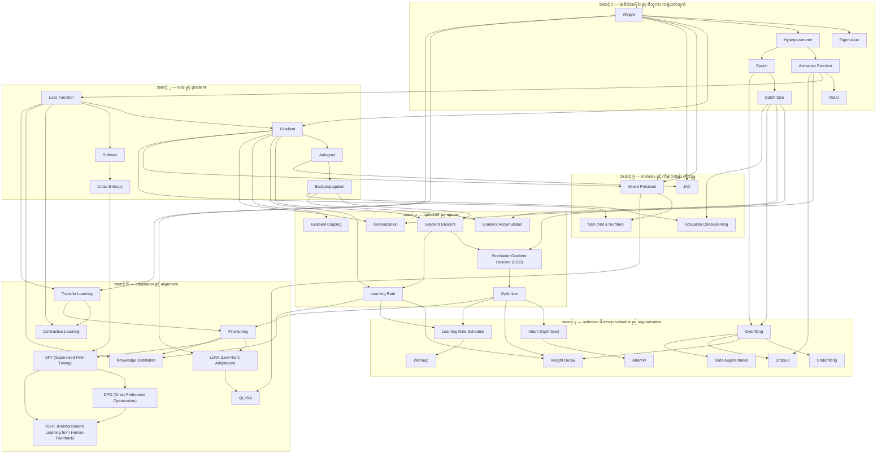

# Area 01 — Math & Training: လေ့လာသည့် အစဉ် (Learning Sequence)

ဤနယ်ပယ်၏ term ၄၂ ခုသည် ခေါင်းစဉ် တစ်ခုတည်း အောက်တွင် စုထားသည့် term များ မဟုတ်ပါ။ ၎င်းတို့သည်
**တစ်ခုတည်းသော လုပ်ငန်းစဉ်** — weight နှင့် activation မှ စ၍ loss၊ gradient၊ update၊ schedule၊
regularization၊ memory နှင့် adaptation အထိ — ၏ အစိတ်အပိုင်း များ ဖြစ်သည်။

**ဖတ်သည့် အစဉ်ကို လိုက်ခြင်း၏ အကျိုးသက်ရောက်မှု** — နောက် term တိုင်းသည် အရင် term များကို အသုံးပြု၍
ရှင်းလင်းသည်။ ဥပမာ `Gradient` သည် `Loss Function` နှင့် `Weight` ကို မသိဘဲ အဓိပ္ပာယ် မရှိသလို၊ `AdamW`
သည် `Adam (Optimizer)` နှင့် `Weight Decay` ကို မသိဘဲ ရှင်းလင်းနိုင်မည် မဟုတ်ပါ။

## အဆင့် ၆ ဆင့်၏ ခြုံငုံမှု

| အဆင့် | အမည် | Term | ဤအဆင့် ပြီးပါက ဖြေနိုင်ရမည့် မေးခွန်း |
|---|---|---|---|
| ၁ | အစိတ်အပိုင်းနှင့် ဗိသုကာ ကန့်သတ်ချက် | Weight, Eigenvalue, Hyperparameter, Activation Function, ReLU, Epoch, Batch Size | model တွင် သင်ယူသည့် တန်ဖိုး မည်သည့်အရာ ဖြစ်သည်၊ ဗိသုကာနှင့် configuration က ဘာကို ကန့်သတ်သည် |
| ၂ | loss နှင့် gradient | Loss Function, Softmax, Cross-Entropy, Gradient, Autograd, Backpropagation | training က မည်သည့် အမှားကို အရင့်အရောက် ခံစေသည်၊ ထို အမှားကို parameter အပေါ် မည်သို့ ဖြန့်သည် |
| ၃ | optimizer နှင့် update | Gradient Descent, Stochastic Gradient Descent (SGD), Optimizer, Learning Rate, Gradient Clipping, Gradient Accumulation, Normalization | gradient တစ်ခုမှ parameter တန်ဖိုးအသစ် မည်သို့ ဖြစ်လာသည်၊ update အရွယ်အစားကို ဘာ ကန့်သတ်သည် |
| ၄ | optimizer မိသားစု၊ schedule နှင့် regularization | Adam (Optimizer), AdamW, Weight Decay, Learning Rate Schedule, Warmup, Dropout, Overfitting, Underfitting, Data Augmentation | update ကို adaptive ဖြစ်စေသည့် အခါ ဘာကွာခြားသည်၊ generalization ကို မည်သို့ ထိန်းသည် |
| ၅ | training dynamics — memory နှင့် ကိန်းဂဏန်း တိကျမှု | Mixed Precision, NaN (Not a Number), Activation Checkpointing, JAX | weight၊ gradient နှင့် activation များကို မည်သည့် dtype နှင့် မည်သည့် အရွယ်အစားဖြင့် ထားမည်၊ run ပြိုလဲသည့် အခါ အဘယ်တွင် စစ်မည် |
| ၆ | adaptation နှင့် alignment | Transfer Learning, Fine-tuning, LoRA (Low-Rank Adaptation), QLoRA, SFT (Supervised Fine-Tuning), DPO (Direct Preference Optimization), RLHF (Reinforcement Learning from Human Feedback), Contrastive Learning, Knowledge Distillation | ရှိပြီးသား parameter မှ စ၍ အပြုအမူ အသစ်ကို မည်သည့် အစိတ်အပိုင်းကို update လုပ်၍ သင်မည် |

## အဆင့်များအကြား မှီခိုမှု (Prerequisite Graph)

## အဆင့် ၁ — အစိတ်အပိုင်းနှင့် ဗိသုကာ ကန့်သတ်ချက် (၇ term)

**အစဉ်** — `Weight` → `Eigenvalue` → `Hyperparameter` → `Activation Function` → `ReLU` → `Epoch` → `Batch Size`

**ဘာကြောင့် ဤနေရာတွင် ရှိသည်** — ဤအဆင့်သည် သင်ယူခြင်း ခံရသည့် အရာ (`Weight`)၊ ဗိသုကာ ရွေးချယ်မှုက
မည်သည့် ဦးတည်ချက်ကို ဖမ်းယူသည့် အခြေခံ အချက် (`Eigenvalue` — variance များသည့် ဦးတည်ချက်)၊
သင်ယူခြင်း မခံရသည့် ရွေးချယ်မှု (`Hyperparameter`) နှင့် nonlinearity (`Activation Function`၊ `ReLU`) ကို
သတ်မှတ်သည်။ `Epoch` နှင့် `Batch Size` သည် training တစ်ကြိမ်၏ အတိုင်းအတာ နှစ်ခု ဖြစ်သည် — မည်မျှ
ဖြတ်သွားမည်၊ တစ်ကြိမ်လျှင် နမူနာ မည်မျှ ပါမည်။ ဤအဆင့် မပြီးဘဲ stage ၂ ကို ဖတ်ပါက "မည်သည့်အရာ
အပေါ် gradient တွက်သည်" ဟူသည့် အချက်ကို ဆုံးဖြတ်နိုင်မည် မဟုတ်ပါ။

**မှတ်သားရန်** — `Weight` သည် `Parameter` တစ်မျိုးသာ ဖြစ်သည်၊ သို့သော် parameter တိုင်း weight မဟုတ်ပါ
(bias၊ embedding၊ normalization scale တို့လည်း parameter များ ဖြစ်သည်)။ `Hyperparameter` တွင်
learning rate၊ batch size၊ layer အရေအတွက်၊ decoding setting တို့ ပါဝင်သည်။

**စစ်ဆေးသည့် မေးခွန်း** — `Activation Function` မပါဘဲ affine layer များကို ထပ်ပါက ဘာဖြစ်သနည်း၊
`ReLU` သည် negative input တွင် မည်သည့် လက္ခဏာ ထုတ်သနည်း။

## အဆင့် ၂ — loss နှင့် gradient (၆ term)

**အစဉ်** — `Loss Function` → `Softmax` → `Cross-Entropy` → `Gradient` → `Autograd` → `Backpropagation`

**ဘာကြောင့် ဤနေရာတွင် ရှိသည်** — training ၏ ရည်မှန်းချက်ကို `Loss Function` က သတ်မှတ်သည်။
classification နှင့် next-token training တွင် ထို objective ကို `Softmax` ဖြင့် distribution ဖြစ်စေပြီး
`Cross-Entropy` ဖြင့် တိုင်းတာသည်။ ထို loss မှ parameter တိုင်းအထိ ပြန်၍ derivative ဖြန့်သည့် လုပ်ငန်းစဉ်သည်
`Gradient`၊ `Autograd` နှင့် `Backpropagation` ဖြစ်သည်။ ဤအဆင့်သည် stage ၃ ၏ optimizer အတွက်
အဝင်အချက် (input) ကို ထုတ်ပေးသည်။

**မှတ်သားရန်** — `Backpropagation` သည် gradient ကို **တွက်ချက်** သည်။ update rule နှင့် learning rate ကို
ရွေးချယ်သည်မှာ optimizer ဖြစ်သည်။ ဤ တာဝန် နှစ်ခုကို ရောနှောပါက stage ၃ တွင် အမှား အလွယ်တကူ ဖြစ်သည်။

**စစ်ဆေးသည့် မေးခွန်း** — logits မှ softmax ပြီးနောက် cross-entropy ၏ logit အပေါ် gradient သည် မည်သည့်
ပုံစံ ရှိသနည်း၊ ၎င်း၏ ပေါင်းလဒ်သည် မည်မျှ ဖြစ်သနည်း။

## အဆင့် ၃ — optimizer နှင့် update (၇ term)

**အစဉ်** — `Gradient Descent` → `Stochastic Gradient Descent (SGD)` → `Optimizer` → `Learning Rate` →
`Gradient Clipping` → `Gradient Accumulation` → `Normalization`

**ဘာကြောင့် ဤနေရာတွင် ရှိသည်** — `Gradient Descent` သည် negative gradient ဦးတည်ချက်သို့ ရွှေ့သည့်
အခြေခံ update ဖြစ်သည်၊ `Stochastic Gradient Descent (SGD)` သည် ထို update ကို dataset အစား
minibatch မှ ခန့်မှန်းထားသည့် gradient ဖြင့် လုပ်သည်၊ ထို့ကြောင့် `Batch Size` နှင့် ဆက်စပ်သည်။ `Optimizer`
သည် ထို gradient ကို update အဖြစ် အသွင်ပြောင်းသည့် algorithm ဖြစ်ပြီး၊ `Learning Rate` သည် update
အရွယ်အစားကို သတ်မှတ်သည်။ `Gradient Clipping` နှင့် `Gradient Accumulation` သည် update အရွယ်အစားနှင့်
gradient အရည်အသွေးကို ထိန်းသည့် နည်းလမ်း နှစ်ခု ဖြစ်သည်။ `Normalization` သည် activation ၏ scale ကို
ထိန်း၍ optimization တည်ငြိမ်မှုကို ကူညီသည်။

**မှတ်သားရန်** — `Gradient Accumulation` သည် step တစ်ကြိမ်စာ activation memory ကို လျှော့ပေးသည်၊
သို့သော် batch အပြည့်ကို တစ်ပြိုင်နက် စီမံခြင်း၏ အရည်အချင်း အားလုံးကို ပြန်လည် ဖော်ပြပေးသည်မဟုတ်ပါ။

**စစ်ဆေးသည့် မေးခွန်း** — curvature 2 ရှိသည့် objective တွင် ရိုးရှင်းသည့် gradient descent သည် မည်သည့်
learning rate အထက် ပြိုလဲသနည်း၊ ထို အခြေအနေတွင် `Gradient Clipping` က update ကို မည်သို့ ကန့်သတ်သနည်း။

## အဆင့် ၄ — optimizer မိသားစု၊ schedule နှင့် regularization (၉ term)

**အစဉ်** — `Adam (Optimizer)` → `AdamW` → `Weight Decay` → `Learning Rate Schedule` → `Warmup` →
`Dropout` → `Overfitting` → `Underfitting` → `Data Augmentation`

**ဘာကြောင့် ဤနေရာတွင် ရှိသည်** — `Adam (Optimizer)` သည် gradient ၏ exponential average နှင့် squared
gradient ၏ exponential average ကို ပေါင်းစပ်၍ parameter တိုင်းအတွက် update scale ကို ချိန်ညှိသည်၊
ထို့ကြောင့် stage ၃ ၏ `Learning Rate` နှင့် `Optimizer` အပေါ် တိုက်ရိုက် မှီခိုသည်။ `AdamW` သည်
weight decay ကို gradient update မှ ခွဲထုတ်ထားသည့် မျိုးကွဲ ဖြစ်သဖင့် `Weight Decay` ကို ဤနေရာတွင်
အတူ ဖတ်ရမည်။ `Learning Rate Schedule` နှင့် `Warmup` သည် learning rate ကို အချိန်နှင့်အမျှ ပြောင်းသည်။
ထို့နောက် အဆင့်တစ်ဝက် သည် ရလဒ်၏ အရည်အသွေး — `Overfitting`၊ `Underfitting` နှင့် ထို နှစ်ခုကို
တိုက်ဖျက်သည့် `Dropout`၊ `Weight Decay`၊ `Data Augmentation` — ကို ဖုံးလွှမ်းသည်။

**မှတ်သားရန်** — `Weight Decay` သည် ရိုးရှင်းသည့် optimizer အချို့တွင် L2 loss penalty နှင့် တူညီသည်၊
သို့သော် `Adam (Optimizer)` ကဲ့သို့ adaptive optimizer အတွက် ယေဘုယျအားဖြင့် တူညီသည်မဟုတ်ပါ။ ဤ
ကွာခြားမှုကို [`04_exercises.md`](04_exercises.md) တွင် ကိန်းဂဏန်းဖြင့် တွက်ပြထားသည်။

**စစ်ဆေးသည့် မေးခွန်း** — `Warmup` က step ၂၀၀ ဖြင့် စပါက step ၂၀ တွင် rate မည်မျှ ရှိသနည်း၊
`Overfitting` ၏ လက္ခဏာကို မည်သည့် metric နှစ်ခု နှိုင်းယှဉ်၍ ဆုံးဖြတ်သနည်း။

## အဆင့် ၅ — memory နှင့် ကိန်းဂဏန်း တိကျမှု (၄ term)

**အစဉ်** — `Mixed Precision` → `NaN (Not a Number)` → `Activation Checkpointing` → `JAX`

**ဘာကြောင့် ဤနေရာတွင် ရှိသည်** — အဆင့် ၁ မှ ၄ အထိ သတ်မှတ်ထားသည့် training ကို တကယ် run လုပ်သည့်အခါ
ကန့်သတ်ချက် နှစ်ခု ပေါ်လာသည် — memory နှင့် dtype ဖြစ်သည်။ `Mixed Precision` သည် operation အမျိုးမျိုးအတွက်
data type အမျိုးမျိုးကို သုံးသဖြင့် memory နှင့် throughput ကို သက်ရောက်သည်၊ သို့သော် range နည်းသည့်
dtype သည် `NaN (Not a Number)` ကို အလွယ်တကူ ဖြစ်စေသည်။ `Activation Checkpointing` သည် forward
activation အချို့ကို သိမ်းဆည်းခြင်း အစား ပြန်လည် တွက်ချက်ခြင်းဖြင့် memory ကို လျှော့သည်။ `JAX` သည်
ဤ transformation များ (autodiff၊ compilation၊ vectorization) ကို function အဆင့်တွင် ပေးသည့် အလွှာ ဖြစ်သည်။
ဤအဆင့်သည် အဆင့် ၆ တွင် ပါဝင်သည့် parameter-efficient နည်းလမ်းများ၏ အခြေခံ ဖြစ်သည် — memory ကို
မထိန်းနိုင်ပါက `QLoRA` ကဲ့သို့ နည်းလမ်း လိုအပ်သည့် အကြောင်းရင်း ဤနေရာတွင် ရှိသည်။

**မှတ်သားရန်** — `Activation Checkpointing` သည် memory ကို computation နှင့် လဲလှယ်သည်။ ထို့ကြောင့်
memory အကျိုးအမြတ်နှင့် ထပ်တိုးသည့် step အချိန် နှစ်ခုလုံးကို တိုင်းတာရမည်။

**စစ်ဆေးသည့် မေးခွန်း** — fp16 တွင် ကြီးလွန်းသည့် တန်ဖိုး မည်သည့်အဆင့်တွင် non-finite ဖြစ်သနည်း၊
loss scaling သည် ထို ပြဿနာကို မည်သို့ ကူညီသနည်း။

## အဆင့် ၆ — adaptation နှင့် alignment (၉ term)

**အစဉ်** — `Transfer Learning` → `Fine-tuning` → `LoRA (Low-Rank Adaptation)` → `QLoRA` →
`SFT (Supervised Fine-Tuning)` → `DPO (Direct Preference Optimization)` →
`RLHF (Reinforcement Learning from Human Feedback)` → `Contrastive Learning` → `Knowledge Distillation`

**ဘာကြောင့် ဤနေရာတွင် ရှိသည်** — ဤအဆင့်သည် အဆင့် ၁ မှ ၅ အထိ တည်ဆောက်ထားသည့် training loop ကို
ရှိပြီးသား parameter အပေါ် ဆက်လက် အသုံးချသည့် အဆင့် ဖြစ်သည်။ `Transfer Learning` သည်
distribution တစ်ခုမှ သင်ယူထားသည့် representation မှ စတင်သည်၊ `Fine-tuning` သည် ထို မှတ်တမ်းမှ
ဆက်လက် train လုပ်သည်။ `LoRA (Low-Rank Adaptation)` နှင့် `QLoRA` သည် update လုပ်ရမည့် parameter
အရေအတွက်နှင့် memory ကို လျှော့သည် (ထို့ကြောင့် အဆင့် ၅ အပေါ် မှီခိုသည်)။ `SFT (Supervised Fine-Tuning)`
သည် ပြသထားသည့် အပြုအမူကို သင်သည်၊ `DPO (Direct Preference Optimization)` နှင့်
`RLHF (Reinforcement Learning from Human Feedback)` သည် preference signal ကို အသုံးချသည်။
`Contrastive Learning` နှင့် `Knowledge Distillation` သည် loss နှင့် training အစီအစဉ်ကို အခြား ပုံစံဖြင့်
သုံးသည့် နည်းလမ်း နှစ်ခု ဖြစ်သည်။

**မှတ်သားရန်** — `Fine-tuning` သည် အပြုအမူ၊ style သို့မဟုတ် format ကို ပြုပြင်နိုင်သည်၊ သို့သော်
အချက်အလက်များ လက်ရှိ ဖြစ်နေရန် လိုအပ်သည့်အခါ retrieval ကို ယုံကြည်စိတ်ချစွာ အစားထိုးနိုင်သည့်
နည်းလမ်း မဟုတ်ပါ။

**စစ်ဆေးသည့် မေးခွန်း** — `LoRA (Low-Rank Adaptation)` သည် base weight များကို မည်သို့ ထားသနည်း၊
`QLoRA` သည် ထို အပေါ် မည်သည့် အချက်ကို ထပ်တိုးသနည်း။

## Term ၄၂ ခု၏ အစဉ် ဇယား

| # | Term | အဆင့် | ကြိုတင် သိရမည့် term | ဖွင့်ပေးသည့် အချက် |
|---|---|---|---|---|
| 1 | Weight | ၁ | — | model အရွယ်အစားနှင့် memory တွက်ချက်မှု |
| 2 | Eigenvalue | ၁ | Weight | variance များသည့် ဦးတည်ချက်နှင့် dimensionality reduction |
| 3 | Hyperparameter | ၁ | Weight | training အပြုအမူကို ကန့်သတ်သည့် configuration |
| 4 | Activation Function | ၁ | Hyperparameter | nonlinearity နှင့် gradient စီးဆင်းမှု |
| 5 | ReLU | ၁ | Activation Function | gradient သုည ဖြစ်သည့် inactive unit ပြဿနာ |
| 6 | Epoch | ၁ | Hyperparameter | training အရှည် တိုင်းတာသည့် ယူနစ် |
| 7 | Batch Size | ၁ | Epoch | gradient noise၊ memory နှင့် learning rate ရွေးချယ်မှု |
| 8 | Loss Function | ၂ | Activation Function, Hyperparameter | training က မည်သည့် အမှားကို အရင့်အရောက် ခံစေသည် |
| 9 | Softmax | ၂ | Loss Function | logits မှ categorical distribution သို့ |
| 10 | Cross-Entropy | ၂ | Softmax, Loss Function | next-token training ၏ loss တန်ဖိုး |
| 11 | Gradient | ၂ | Weight, Loss Function | update ၏ ဦးတည်ချက်နှင့် အရွယ်အစား |
| 12 | Autograd | ၂ | Gradient | gradient ကို အလိုအလျောက် ရရှိမှု |
| 13 | Backpropagation | ၂ | Autograd | computation graph အတွင်း chain rule ဖြန့်ခြင်း |
| 14 | Gradient Descent | ၃ | Gradient, Backpropagation | parameter ရွှေ့သည့် အခြေခံ update အုပ်စု |
| 15 | Stochastic Gradient Descent (SGD) | ၃ | Gradient Descent, Batch Size | minibatch update နှင့် gradient noise |
| 16 | Optimizer | ၃ | Stochastic Gradient Descent (SGD) | gradient မှ parameter update သို့ အသွင်ပြောင်းမှု |
| 17 | Learning Rate | ၃ | Gradient Descent | update တစ်ကြိမ်၏ အရွယ်အစား |
| 18 | Gradient Clipping | ၃ | Gradient, Learning Rate | ကြီးလွန်းသည့် gradient ကို ကန့်သတ်ခြင်း |
| 19 | Gradient Accumulation | ၃ | Batch Size, Backpropagation | ပိုကြီးသည့် effective batch ကို အနီးစပ်ဆုံး ရရှိမှု |
| 20 | Normalization | ၃ | Activation Function, Gradient | optimization တည်ငြိမ်မှု |
| 21 | Adam (Optimizer) | ၄ | Optimizer, Learning Rate | parameter တိုင်းအတွက် adaptive update scale |
| 22 | AdamW | ၄ | Adam (Optimizer), Weight Decay | decoupled weight decay ဖြင့် ကျုံ့ဝင်မှု ထိန်းချုပ်ခြင်း |
| 23 | Weight Decay | ၄ | AdamW, Overfitting | parameter magnitude ကျုံ့ခြင်း |
| 24 | Learning Rate Schedule | ၄ | Learning Rate, Optimizer | step အလိုက် rate ပြောင်းလဲမှု |
| 25 | Warmup | ၄ | Learning Rate Schedule | အစောပိုင်း မတည်ငြိမ်မှုကို ရှောင်ခြင်း |
| 26 | Dropout | ၄ | Activation Function, Overfitting | activation လမ်းကြောင်း မှီခိုမှု လျှော့ခြင်း |
| 27 | Overfitting | ၄ | Epoch, Batch Size | generalization gap ကို တိုင်းတာခြင်း |
| 28 | Underfitting | ၄ | Overfitting, Loss Function | capacity သို့မဟုတ် optimization မလုံလောက်မှု |
| 29 | Data Augmentation | ၄ | Overfitting, Epoch | training diversity နှင့် ခံနိုင်ရည် |
| 30 | Mixed Precision | ၅ | Weight, Gradient | dtype ရွေးချယ်မှုနှင့် memory အကျိုးအမြတ် |
| 31 | NaN (Not a Number) | ၅ | Mixed Precision, Gradient | non-finite တန်ဖိုး ဖြစ်ပေါ်မှုကို ရှာဖွေခြင်း |
| 32 | Activation Checkpointing | ၅ | Backpropagation, Batch Size | activation memory ကို computation နှင့် လဲလှယ်ခြင်း |
| 33 | JAX | ၅ | Autograd, Weight | function transformation အလွှာ |
| 34 | Transfer Learning | ၆ | Weight, Loss Function | representation ပြန်လည် အသုံးချမှု |
| 35 | Fine-tuning | ၆ | Transfer Learning, Optimizer | ဆက်လက် training လုပ်သည့် အစီအစဉ် |
| 36 | LoRA (Low-Rank Adaptation) | ၆ | Fine-tuning, Weight | update လုပ်ရမည့် parameter အရေအတွက် လျှော့ခြင်း |
| 37 | QLoRA | ၆ | LoRA (Low-Rank Adaptation), Mixed Precision | quantized base ပေါ်တွင် adapter training |
| 38 | SFT (Supervised Fine-Tuning) | ၆ | Fine-tuning, Cross-Entropy | ပြသထားသည့် အပြုအမူကို သင်ယူမှု |
| 39 | DPO (Direct Preference Optimization) | ၆ | SFT (Supervised Fine-Tuning), Loss Function | preference pair မှ တိုက်ရိုက် policy training |
| 40 | RLHF (Reinforcement Learning from Human Feedback) | ၆ | DPO (Direct Preference Optimization), SFT (Supervised Fine-Tuning) | reward သို့မဟုတ် preference signal အပေါ် policy optimization |
| 41 | Contrastive Learning | ၆ | Loss Function, Transfer Learning | ဆင်တူမှု ဖွဲ့စည်းပုံကို သင်ယူမှု |
| 42 | Knowledge Distillation | ၆ | Loss Function, Fine-tuning, Learning Rate | teacher ၏ output distribution ကို student သို့ လွှဲပြောင်းမှု |

## လက်တွေ့ လုပ်သည့် အစဉ် (၆ ကြိမ် ထိုင်ရန်)

| ကြိမ် | ဖတ်ရမည့် အဆင့် | လက်တွေ့ လုပ်ရမည့် လက်တွေ့စမ်းသပ်မှု |
|---|---|---|
| ၁ | အဆင့် ၁ + ၂ | `labs/lab_memory.py --params-b 1.3 --batch 8 --seq 2048` |
| ၂ | အဆင့် ၂ + ၃ | ဤဖိုင်ရှိ prerequisite graph ကို စာရွက်ပေါ် ပြန်ဆွဲခြင်း၊ `labs/lab_gradient_step.py --lr 0.2 --steps 12` |
| ၃ | အဆင့် ၃ + ၄ | `labs/lab_gradient_step.py --sweep` |
| ၄ | အဆင့် ၄ | `labs/lab_schedule.py --sweep` |
| ၅ | အဆင့် ၅ + ၆ | `labs/lab_memory.py --batch 64 --activation-checkpointing on` |
| ၆ | စစ်ဆေးခြင်း | [`04_exercises.md`](04_exercises.md) ရှိ တွက်ချက်ရသည့် လေ့ကျင့်ခန်း ၆ ခု |

**သတိပြုရန် —** lab ဖိုင်များသည် `labs/` အတွင်း ရှိသည်၊ run သည့်အခါ ထို folder အတွင်းမှ
run ရမည် (သို့မဟုတ် `guides/01_math_and_training/labs/<file>` ဟု ဖိုင်လမ်းကြောင်း အပြည့်အစုံ ပေးရမည်)။
Lab အားလုံးကို တစ်ကြိမ်တည်း စစ်ရန် `python3 labs/run_labs.py` ကို အသုံးပြုပါ။
[`04_exercises.md`](04_exercises.md) ရှိ `python3 - <<'PY'` block များသည် lab များအပေါ် မှီခိုမှု
မရှိဘဲ ထို ကိန်းဂဏန်းများကို ကိုယ်တိုင် ပြန်ထုတ်နိုင်သည်။

## နောက်တစ်ဆင့်

- ပုံရှင်းလင်းချက်များ — [`02_visual_explanations.md`](02_visual_explanations.md)
- လေ့ကျင့်ခန်းများ — [`04_exercises.md`](04_exercises.md)
- ကုန်ကျစရိတ်နှင့် production အပေါ် သက်ရောက်မှု — [`03_theory_to_infrastructure.md`](03_theory_to_infrastructure.md)
- Term တိုင်း၏ အပြည့်အစုံ အဓိပ္ပာယ် — [`../../terms/01_math_and_training.md`](../../terms/01_math_and_training.md)
