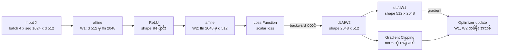
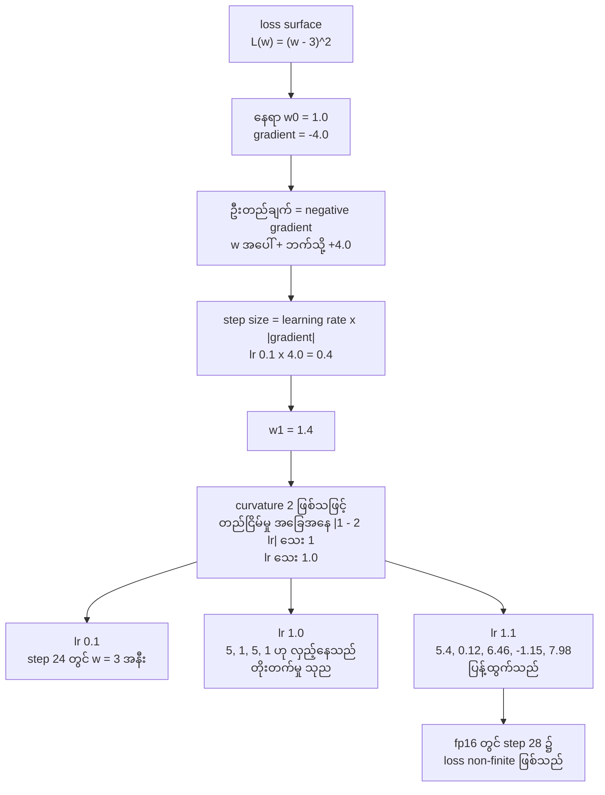
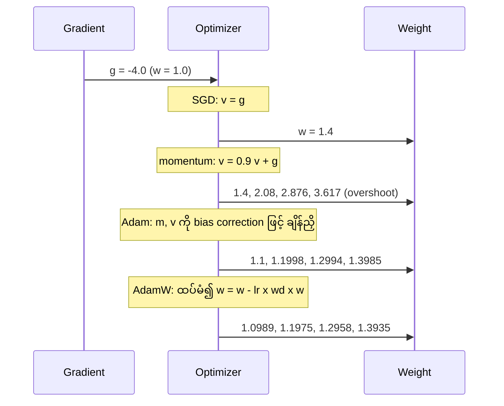
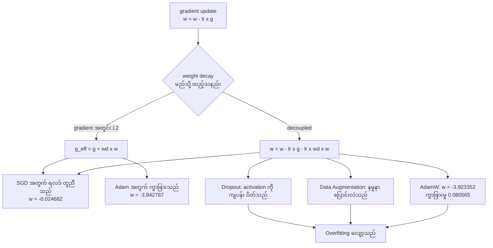
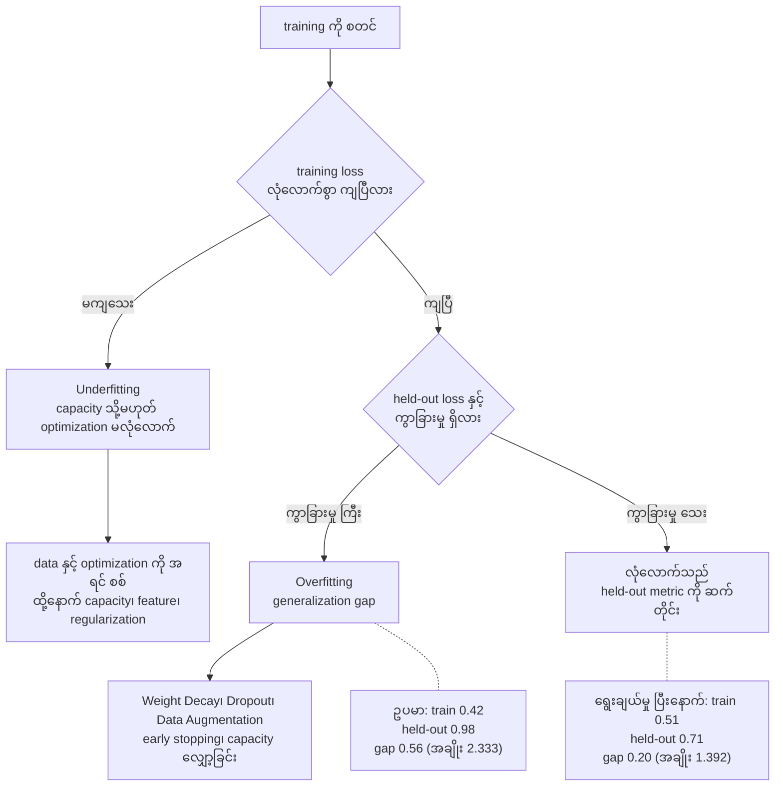
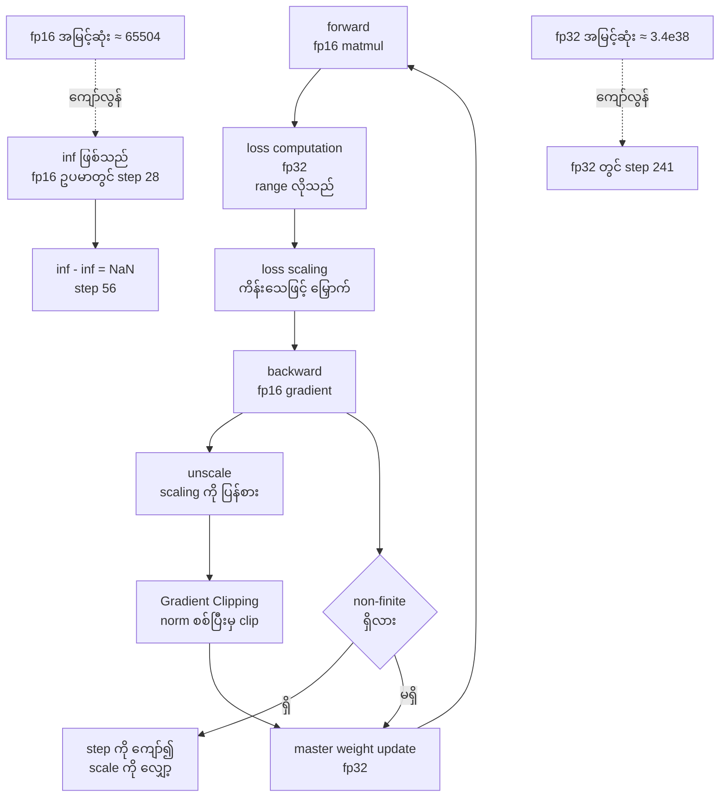
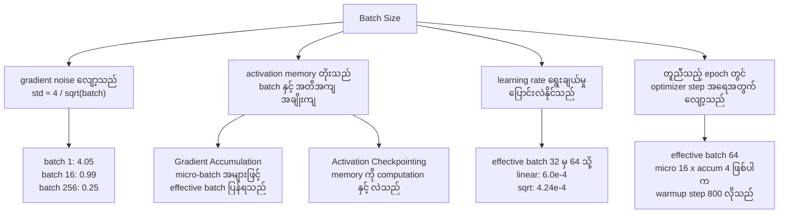

# Area 01 — ပုံရှင်းလင်းချက်များ (Visual Explanations)

Term တစ်ခုကို စာဖြင့်သာ ဖတ်ပါက "မည်သည့် အစိတ်အပိုင်းမှ မည်သည့် အစိတ်အပိုင်းသို့ စီးသည်" ဟူသည့်
လမ်းကြောင်း မမြင်ရပါ။ ဤဖိုင်သည် training loop ၏ လမ်းကြောင်းများကို ပုံဖြင့် ပြသည် — forward နှင့် backward
pass ၏ shape များ၊ loss landscape နှင့် gradient step၊ optimizer update trace၊ learning rate schedule
၏ ပုံသဏ္ဍာန်၊ regularization၊ overfitting နှင့် underfitting၊ mixed precision နှင့် batch-size
အကျိုးသက်ရောက်မှု အထိ။

**ပုံများ ကြည့်နည်း** — ဤဖိုင်ကို GitHub တွင် ဖတ်ပါက Mermaid ပုံများ အလိုအလျောက် render ဖြစ်သည်။
ဒေသအတွင်း ဖတ်လိုပါက VS Code ၏ Mermaid extension သို့မဟုတ် mermaid.live တွင် ```mermaid``` block ကို
ကူးထည့်ပါ။ ပုံတိုင်းတွင် ပါဝင်သည့် ကိန်းဂဏန်းများသည် [`04_exercises.md`](04_exercises.md) ရှိ run
များမှ ဖြစ်သည်။

## ၁။ Forward pass နှင့် backward pass — shape များနှင့် အစီအစဉ်



**ဘာကို ကြည့်ရမည်**

- မြှား တိုင်း၏ အမည်တွင် shape ပါသည် — forward တွင် shape များ ပြောင်းလဲသည်၊ backward တွင်
  **gradient ၏ shape သည် သက်ဆိုင်သည့် weight ၏ shape နှင့် ထပ်တူ** ဖြစ်ရမည်။
- `ReLU` သည် shape ကို မပြောင်းလဲပါ၊ negative input တွင် gradient ကို သုည ဖြစ်စေသည် — ထို့ကြောင့်
  `G1` တွင် တန်ဖိုးများ ပျောက်နိုင်သည်။
- `Gradient Clipping` သည် optimizer update မတိုင်မီ အဆင့် ဖြစ်သည်၊ ထို့ကြောင့် ကြီးလွန်းသည့် gradient
  တစ်ခုသည် update ကို မတည်ငြိမ်စေခြင်းကို တားသည်။

**သက်ဆိုင်သည့် term** — Weight, Activation Function, ReLU, Loss Function, Gradient, Backpropagation,
Autograd, Gradient Clipping, Optimizer

## ၂။ Loss landscape နှင့် gradient step တစ်ကြိမ်



**ဘာကို ကြည့်ရမည်**

- step တစ်ကြိမ်၏ အရွယ်အစားသည် `learning rate` နှင့် `gradient ၏ ပမာဏ` နှစ်ခုလုံးအပေါ် မှီခိုသည် —
  gradient ကြီးသည့် နေရာတွင် အလိုအလျောက် ကြီးလာသည်။
- တည်ငြိမ်မှု အခြေအနေသည် **curvature** အပေါ် မှီခိုသည်။ ဤ objective တွင် curvature 2 ဖြစ်သဖြင့်
  lr သေး 1.0 သာ တည်ငြိမ်သည်။ lr 0.1 ဖြင့် step 24 တွင် ရောက်သည်၊ lr 0.5 ဖြင့် step တစ်ကြိမ်တည်းဖြင့်
  ရောက်သည်၊ lr 1.0 ဖြင့် 5 နှင့် 1 အကြား လှည့်နေသည်။
- `NaN (Not a Number)` သည် ဤပုံတွင် **နောက်ဆုံးအဆင့်** ဖြစ်သည်၊ အကြောင်းရင်း မဟုတ်ပါ။ မေးရမည့်
  မေးခွန်းမှာ "မည်သည့် step တွင် မည်သည့် tensor သည် ပထမဆုံး non-finite ဖြစ်သည်" ဖြစ်သည်။

**သက်ဆိုင်သည့် term** — Loss Function, Gradient, Gradient Descent, Learning Rate,
Stochastic Gradient Descent (SGD), NaN (Not a Number), Mixed Precision

## ၃။ Optimizer update trace — SGD၊ momentum၊ Adam၊ AdamW



**ဘာကို ကြည့်ရမည်**

- optimizer လေးခုလုံးသည် gradient **တူညီသည့် တန်ဖိုး** (-4.0) ကို ရရှိသည်၊ သို့သော် update အရွယ်အစား
  ကွာခြားသည်။ ထို့ကြောင့် "gradient မှန်ပြီး loss မကျ" ဖြစ်သည့်အခါ optimizer နှင့် learning rate ကို
  စစ်ရမည်။
- `momentum` သည် ဦးတည်ချက် တူသည့် gradient များကို စုဆောင်းသဖြင့် **overshoot** ဖြစ်သည် (step 4 တွင်
  3.617 ရောက်ပြီး အနိမ့်ဆုံးအမှတ် 3 ကို ကျော်လွန်သည်)။
- `Adam (Optimizer)` သည် update ကို parameter တိုင်းအတွက် ချိန်ညှိသဖြင့် ဤဥပမာတွင် အသေးဆုံး step များ
  ရရှိသည်။ `AdamW` သည် ထို update အပေါ် ကျုံ့ဝင်မှုကို **ခွဲထုတ်၍** ထပ်ထည့်သဖြင့် တန်ဖိုးများ
  အနည်းငယ် ပိုကျသည်။

**သက်ဆိုင်သည့် term** — Gradient, Stochastic Gradient Descent (SGD), Optimizer, Learning Rate,
Adam (Optimizer), AdamW, Weight Decay

## ၄။ Learning rate schedule ၏ ပုံသဏ္ဍာန်

```mermaid
flowchart LR
    H["Warmup ရှိလျှင်<br/>step 0 မှ step 200 အထိ"]
    H --> P["peak = 3e-4<br/>step 200"]
    P --> DC["Cosine decay<br/>step 200 မှ step 2000 အထိ"]
    DC --> F["floor = 3e-5<br/>peak ၏ 10 %"]
    P --- M["step 500: 2.8191e-4<br/>step 1000: 1.8844e-4<br/>step 1100: 1.6500e-4")
    F --- N["ပျမ်းမျှ rate 0-2000<br/>1.6349e-4<br/>peak ၏ 54.5 %"]
```

| အစီအစဉ် | ပုံသဏ္ဍာန် | ရည်ရွယ်ချက် |
|---|---|---|
| constant | တန်ဖိုး တစ်ခုတည်း | အစောပိုင်း မတည်ငြိမ်နိုင်၊ နောက်ပိုင်း အလဟသ |
| warmup + cosine | တက်ပြီး ဖြည်းညင်းစွာ ဆင်း | အစောပိုင်း ရှောင်၍ နောက်ပိုင်း ကျဉ်းစေ |
| step decay | အဆင့်လိုက် ဆင်း | ရိုးရှင်းပြီး ခန့်မှန်းလွယ် |

**ဘာကို ကြည့်ရမည်**

- `Warmup` သည် rate ကို သုညမှ စတင်၍ မြှင့်သည် — ဤအစီအစဉ်တွင် step 20 တွင် 3.0e-5 (peak ၏ 10 %)
  ဖြစ်ပြီး step 200 တွင် 3.0e-4 ဖြစ်သည်။ ထို့ကြောင့် အစောပိုင်း ၂၀၀ step တွင် update သည်
  ပြည့်အားဖြင့် မလုပ်ပါ။
- ပျမ်းမျှ rate သည် peak ၏ 54.5 % သာ ဖြစ်သည် — schedule ကို ဖော်ပြခြင်း မရှိဘဲ "peak learning rate"
  ကို သာ နှိုင်းယှဉ်ပါက အမှား ဖြစ်စေသည်။
- step 1999 နှင့် step 2000 တွင် rate သည် 3.0e-5 တွင် ရပ်သည် (floor) — ထို့ကြောင့် နောက်ဆုံး step များ
  တွင် တိုးတက်မှု အလွန်နည်းသည်။

**သက်ဆိုင်သည့် term** — Learning Rate, Learning Rate Schedule, Warmup, Optimizer, Epoch

## ၅။ Weight decay နှင့် regularization



**ဘာကို ကြည့်ရမည်**

- ဤပုံတွင် အရေးအကြီးဆုံး မြှားနှစ်ခုမှာ `S` မှ ထွက်သည့် လမ်းကြောင်း နှစ်ခု ဖြစ်သည်။ `w` တူညီသည့်
  gradient နှင့် wd ဖြင့် step ၅၀ လုပ်ပါက SGD တွင် လမ်းကြောင်း နှစ်ခု၏ ရလဒ်သည် **တိတိကျကျ တူညီ** သည်
  (ကွာခြားမှု 0.0)၊ သို့သော် Adam တွင် မတူညီပါ (ကွာခြားမှု 0.080565)။
- အကြောင်းရင်းမှာ Adam သည် gradient ကို squared gradient ၏ average ဖြင့် စားသဖြင့်၊ gradient အတွင်း
  ထည့်သည့် L2 penalty သည်လည်း ထို scaling ခံရသည်။ Decoupled ဖြစ်ပါက ထို scaling မခံပါ။
- Regularization နည်းလမ်း သုံးခု (`Weight Decay`၊ `Dropout`၊ `Data Augmentation`) သည် လမ်းကြောင်း
  မတူသော်လည်း ပန်းတိုင် တူညီသည် — training data အပေါ် မှီခိုမှုကို လျှော့ခြင်း ဖြစ်သည်။

**သက်ဆိုင်သည့် term** — Weight Decay, AdamW, Adam (Optimizer), Stochastic Gradient Descent (SGD),
Dropout, Data Augmentation, Overfitting, Hyperparameter

## ၆။ Overfitting နှင့် Underfitting



**ဘာကို ကြည့်ရမည်**

- ဆုံးဖြတ်ချက်သည် **training metric တစ်ခုတည်း** အပေါ် မမှီခိုပါ — မေးခွန်း နှစ်ခု ရှိသည်။
  training loss ကျပြီလား၊ ကျပြီး ဆိုပါက held-out loss နှင့် ကွာခြားမှု ရှိလား။
- `Underfitting` တွင် ပထမဦးစွာ data နှင့် optimization ကို စစ်ရမည်၊ `Overfitting` တွင် regularization
  နှင့် early stopping ကို စဉ်းစားရမည်။ ဤ အစဉ်သည် ရောနှောလျှင် regularization ကို အလွန်အကျွံ
  တိုးမိခြင်း ဖြစ်စေသည်။
- ဤပုံ၏ ကိန်းဂဏန်းများသည် [`04_exercises.md`](04_exercises.md) ရှိ ဆုံးဖြတ်ချက် ၂ ၏ ယူဆချက် ဖြစ်သည် —
  gap သည် 64.29 % ကျဉ်းလာသည်၊ training loss သည် 21.43 % တက်သည်။

**သက်ဆိုင်သည့် term** — Overfitting, Underfitting, Weight Decay, Dropout, Data Augmentation,
Loss Function, Epoch, Hyperparameter

## ၇။ Mixed precision — dtype များ၏ အခန်းကဏ္ဍ



**ဘာကို ကြည့်ရမည်**

- မြှောက်ခြင်း အားလုံး (matmul) ကို တိကျမှု နည်းသည့် dtype ဖြင့် လုပ်သည်၊ **တန်ဖိုး အတိအကျနှင့် range လိုသည့်
  နေရာ** (loss၊ accumulation၊ master weight) ကို fp32 ဖြင့် ထားသည်။ ဤ ခွဲထားမှုသည် memory နှင့်
  throughput ကို သက်သာစေသည်။
- Range နည်းသည့် dtype သည် ကြီးလွန်းသည့် တန်ဖိုးတွင် `inf` ဖြစ်သည်၊ ထို့နောက် `inf - inf` မှ
  `NaN (Not a Number)` ဖြစ်သည်။ ဤဥပမာ (lr 1.1) တွင် fp16 loss သည် step 28 ၌ non-finite ဖြစ်ပြီး
  step 56 ၌ weight သည် NaN ဖြစ်သည်၊ တူညီသည့် အစီအစဉ်ကို fp32 ဖြင့် လုပ်ပါက step 241 တွင်မှ
  non-finite ဖြစ်သည်။
- `loss scaling` ၏ တာဝန်သည် gradient ကို ဖော်ပြနိုင်သည့် range ထဲ ပြန်ထည့်ခြင်း ဖြစ်သည်၊ သို့သော်
  ထို scaling ကို **clip မတိုင်မီ unscale** လုပ်ရမည်။ မလုပ်ပါက clipping threshold ၏ အဓိပ္ပာယ်
  ပျောက်သည်။

**သက်ဆိုင်သည့် term** — Mixed Precision, NaN (Not a Number), Gradient Clipping, Weight,
Gradient, Learning Rate, Activation Checkpointing

## ၈။ Batch size ၏ အကျိုးသက်ရောက်မှု — noise၊ memory နှင့် step အရေအတွက်



**ဘာကို ကြည့်ရမည်**

- batch size ကြီးလာပါက gradient ခန့်မှန်းချက်၏ noise သည် `1/sqrt(batch)` အချိုးဖြင့် လျော့သည် —
  ဤဥပမာတွင် batch 16 တွင် std 0.988 ဖြစ်ပြီး batch 256 တွင် 0.2495 ဖြစ်သည်။ ထို့ကြောင့် 4 ဆ
  တိုးလျှင် std သည် ထက်ဝက်သာ လျော့သည်၊ အချိုးတူ မလျော့ပါ။
- တူညီသည့် epoch အတွင်း batch ကြီးခြင်းသည် optimizer **step အရေအတွက်** ကို လျှော့စေသည်၊ ထို့ကြောင့်
  learning rate သို့မဟုတ် schedule ကို ပြန်ချိန်ရနိုင်သည်။ effective batch 64 ကို micro 16 × accum 4
  ဖြင့် ရပါက warmup "step 200" သည် micro-step 800 ဖြစ်သည် - ရေတွက်သည့် ယူနစ်ကို အမြဲ
  သတ်မှတ်ထားရမည်။
- memory သည် batch နှင့် **အတိအကျ အချိုးကျ** တိုးသည်၊ သို့သော် gradient noise သည် အချိုးကျ မလျော့ပါ။
  ထို့ကြောင့် batch size သည် "memory နှင့် step အရေအတွက်" ကို လဲလှယ်သည့်နေရာ ဖြစ်သည်။

**သက်ဆိုင်သည့် term** — Batch Size, Gradient, Learning Rate, Learning Rate Schedule, Warmup,
Gradient Accumulation, Activation Checkpointing, Epoch, Stochastic Gradient Descent (SGD)

## ပုံတိုင်းနှင့် term ချိတ်ဆက်မှု

| ပုံ | ပြသည့် အကြောင်းအရာ | သက်ဆိုင်သည့် term |
|---|---|---|
| ၁ | forward/backward shape နှင့် အစီအစဉ် | Weight, Activation Function, ReLU, Loss Function, Gradient, Backpropagation, Autograd, Gradient Clipping, Optimizer |
| ၂ | loss landscape နှင့် gradient step | Loss Function, Gradient, Gradient Descent, Learning Rate, Stochastic Gradient Descent (SGD), NaN (Not a Number), Mixed Precision |
| ၃ | optimizer update trace | Gradient, Stochastic Gradient Descent (SGD), Optimizer, Learning Rate, Adam (Optimizer), AdamW, Weight Decay |
| ၄ | learning rate schedule ၏ ပုံသဏ္ဍာန် | Learning Rate, Learning Rate Schedule, Warmup, Optimizer, Epoch |
| ၅ | weight decay နှင့် regularization | Weight Decay, AdamW, Adam (Optimizer), Stochastic Gradient Descent (SGD), Dropout, Data Augmentation, Overfitting, Hyperparameter |
| ၆ | overfitting နှင့် underfitting | Overfitting, Underfitting, Weight Decay, Dropout, Data Augmentation, Loss Function, Epoch, Hyperparameter |
| ၇ | mixed precision နှင့် non-finite တန်ဖိုး | Mixed Precision, NaN (Not a Number), Gradient Clipping, Weight, Gradient, Learning Rate, Activation Checkpointing |
| ၈ | batch-size အကျိုးသက်ရောက်မှု | Batch Size, Gradient, Learning Rate, Learning Rate Schedule, Warmup, Gradient Accumulation, Activation Checkpointing, Epoch, Stochastic Gradient Descent (SGD) |

ပုံ ၁ မှ ၈ အထိတွင် term အားလုံး မပါဝင်ပါ — `Eigenvalue`၊ `JAX`၊ `Normalization`၊ `Transfer Learning`၊
`Fine-tuning`၊ `LoRA (Low-Rank Adaptation)`၊ `QLoRA`၊ `SFT (Supervised Fine-Tuning)`၊
`DPO (Direct Preference Optimization)`၊ `RLHF (Reinforcement Learning from Human Feedback)`၊
`Contrastive Learning`၊ `Knowledge Distillation` တို့သည် **ပုံဖြင့် မဟုတ်ဘဲ** လုပ်ငန်းစဉ်နှင့် ဒေတာ
ပုံစံဖြင့် ရှင်းလင်းရသည့် term များ ဖြစ်သဖြင့် [`01_learning_sequence.md`](01_learning_sequence.md)
နှင့် [`04_exercises.md`](04_exercises.md) တွင် ဖုံးလွှမ်းထားသည်။

## နောက်တစ်ဆင့်

- ကိန်းဂဏန်း လေ့ကျင့်ခန်းများ — [`04_exercises.md`](04_exercises.md)
- term များ၏ အစဉ်နှင့် မှီခိုမှု — [`01_learning_sequence.md`](01_learning_sequence.md)
- ဤဖိုင်၏ ကိန်းဂဏန်းများ ထွက်လာသည့် lab များ — [`labs/`](labs/)
