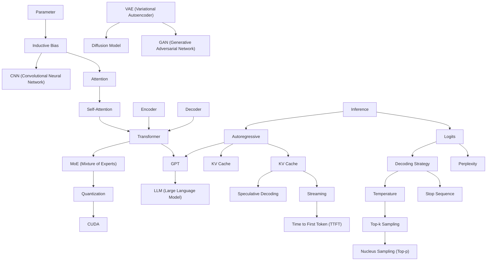

# Area 02 — Models & inference: လေ့လာသည့် အစဉ် (Learning Sequence)

ဤနယ်ပယ်၏ term ၂၉ ခုသည် ရောနှောနေသည့် ခေါင်းစဉ်များ မဟုတ်ပါ။ ၎င်းတို့သည် **လေးဆင့် အစဉ်တစ်ခု** —
တည်ဆောက်ပုံ (structure) → အလုပ်လုပ်ပုံ (behaviour) → ကုန်ကျစရိတ် (cost) → တိုင်းတာမှု (measurement) —
အဖြစ် တည်ဆောက်ထားသည်။ ဤဖိုင်သည် term များကို မည်သည့် အစဉ်အတိုင်း ဖတ်ရမည်၊ မည်သည့် term က
မည်သည့် term အပေါ် အခြေခံသည်ကို သတ်မှတ်ပေးသည်။

**ဖတ်သည့် အစဉ်ကို လိုက်ခြင်း၏ အကျိုးသက်ရောက်မှု** — နောက် term တိုင်းသည် အရင် term များကို
အသုံးပြု၍ ရှင်းလင်းသည်။ ဥပမာ `KV Cache` သည် `Autoregressive` နှင့် `Attention` ကို မသိဘဲ
နားလည်နိုင်မည် မဟုတ်သလို၊ `Time to First Token (TTFT)` သည် `Streaming` နှင့် `Decoding Strategy` ကို
မသိဘဲ တိုင်းတာနိုင်မည် မဟုတ်ပါ။

## အဆင့် ၆ ဆင့်၏ ခြုံငုံမှု

| အဆင့် | အမည် | Term | ဤအဆင့် ပြီးပါက ဖြေနိုင်ရမည့် မေးခွန်း |
|---|---|---|---|
| ၁ | အခြေခံ အစိတ်အပိုင်း | Parameter, Inductive Bias, CNN | မော်ဒယ် တစ်ခုကို ဘာနှင့် တည်ဆောက်သည်၊ ဗိသုကာ ရွေးချယ်မှုက ဘာကို ကန့်သတ်သည် |
| ၂ | Transformer ဗိသုကာ | Encoder, Decoder, Attention, Self-Attention, Transformer, MoE | token တစ်ခု သည် logits အထိ မည်သည့် လမ်းကြောင်းဖြင့် သွားသည် |
| ၃ | Generative မော်ဒယ် မိသားစု | GPT, LLM, Autoregressive, VAE, GAN, Diffusion Model | ထုတ်လုပ်မှု ပုံစံ ဆယ်ခုအနက် မည်သည့်အရာက မည်သည့်အလုပ်အတွက် ဖြစ်သည် |
| ၄ | logits မှ token သို့ | Inference, Logits, Decoding Strategy, Temperature, Top-k Sampling, Nucleus Sampling (Top-p), Stop Sequence | မော်ဒယ် ထုတ်ပေးသည့် ကိန်းဂဏန်းများမှ token တစ်ခု မည်သို့ ဖြစ်လာသည် |
| ၅ | ကုန်ကျစရိတ် လျှော့ချခြင်း | KV Cache, Quantization, Speculative Decoding, CUDA | တူညီသည့် ရလဒ်ကို memory၊ latency နှင့် ကုန်ကျစရိတ် လျှော့၍ မည်သို့ ထုတ်မည် |
| ၆ | တိုင်းတာမှုနှင့် ပေးပို့မှု | Streaming, Time to First Token (TTFT), Perplexity | deployment တစ်ခု ကောင်း/ဆိုးကို မည်သည့် ကိန်းဂဏန်းဖြင့် ဆုံးဖြတ်မည် |

## အဆင့်များအကြား မှီခိုမှု (Prerequisite Graph)

## အဆင့် ၁ — အခြေခံ အစိတ်အပိုင်း (၃ term)

**အစဉ်** — `Parameter` → `Inductive Bias` → `CNN (Convolutional Neural Network)`

**ဘာကြောင့် ဤနေရာတွင် ရှိသည်** — ဤ term သုံးခုသည် မော်ဒယ် တစ်ခု "ဘာနှင့် တည်ဆောက်ထားသည်" ကို
သတ်မှတ်သည်။ `Parameter` သည် သင်ယူခြင်း ခံရသည့် တန်ဖိုး ဖြစ်သည်။ `Inductive Bias` သည် ဗိသုကာ တစ်ခုက
မည်သည့် အဖြေကို ဦးစားပေးသည် ကို ရှင်းပြသည်။ `CNN` သည် ထို bias ကို လက်တွေ့ ပြသည့်
အရင် မျိုးဆက် ဗိသုကာ ဖြစ်သည် — locality ကို ဦးစားပေးသည်။ ဤအဆင့် မပြီးဘဲ Transformer ကို
ဖတ်ပါက "ဘာကြောင့် attention က ကောင်းသည်" ဟူသည့် အချက်ကို ဆုံးဖြတ်နိုင်မည် မဟုတ်ပါ။

**စစ်ဆေးသည့် မေးခွန်း** — parameter အရေအတွက်က စွမ်းရည် ကို တိုက်ရိုက် ဆုံးဖြတ်သလား။
CNN ၏ inductive bias နှင့် Transformer ၏ bias သည် မည်သို့ ကွာခြားသနည်း။

## အဆင့် ၂ — Transformer ဗိသုကာ (၆ term)

**အစဉ်** — `Encoder` → `Decoder` → `Attention` → `Self-Attention` → `Transformer` → `MoE (Mixture of Experts)`

**ဘာကြောင့် ဤနေရာတွင် ရှိသည်** — `Attention` သည် ဤနယ်ပယ်၏ အခရာ ဖြစ်သည်၊ သို့သော် `Encoder`
နှင့် `Decoder` ဟူသည့် အကြောင်းအရာ (context) မရှိဘဲ ဖတ်ပါက query၊ key၊ value မည်သည့်နေရာမှ
လာသည်ကို မသိနိုင်ပါ။ `Self-Attention` သည် Attention ၏ အထူးအခြေအနေ (Q၊ K၊ V အားလုံး
တူညီသည့် sequence မှ လာသည်) ဖြစ်သည်။ `Transformer` သည် ထို အပိုင်းများကို residual connection၊
normalization နှင့် feed-forward ဖြင့် စုစည်းသည်။ `MoE` သည် ထို ဗိသုကာကို parameter များစွာ
ထည့်လျက် compute ကို ထိန်းထားသည့် scaling နည်းလမ်း ဖြစ်သဖြင့် အဆုံးတွင် ရှိသည်။

**မှတ်သားရန်** — Attention က "မည်သည့် နေရာကို ကြည့်မည်"၊ feed-forward က "ထို အချက်အလက်ဖြင့် ဘာလုပ်မည်"
ဟု ခွဲခြားမှတ်ပါ။ ဤ အခန်းကဏ္ဍ နှစ်ခု ကွဲပါက latency နှင့် memory ဆွေးနွေးချက် (အဆင့် ၅) အဆင်ပြေစွာ ဖတ်နိုင်သည်။

**စစ်ဆေးသည့် မေးခွန်း** — self-attention တွင် mask တစ်ခု ထည့်ပါက ဘာပြောင်းလဲသနည်း။
MoE တွင် parameter အားလုံး မည်သည့် request တွင်မျှ တစ်ချိန်တည်း အလုပ်မလုပ်သည့် အကြောင်းရင်းက ဘာလဲ။

## အဆင့် ၃ — Generative မော်ဒယ် မိသားစု (၆ term)

**အစဉ်** — `Autoregressive` → `GPT` → `LLM (Large Language Model)` → `VAE (Variational Autoencoder)` → `GAN (Generative Adversarial Network)` → `Diffusion Model`

**ဘာကြောင့် ဤနေရာတွင် ရှိသည်** — ဤအဆင့်သည် "ထုတ်လုပ်ခြင်း" ဟူသည့် အတွေးအခေါ် ကို
မိသားစု နှစ်ခုအဖြစ် ခွဲပြသည်။ ပထမ မိသားစု (`Autoregressive`, `GPT`, `LLM`) သည် token တစ်ခုချင်း
အစဉ်လိုက် ထုတ်သည်။ ဒုတိယ မိသားစု (`VAE`, `GAN`, `Diffusion Model`) သည် latent space နှင့်
ဆူညံသံမှ ပြန်ထုတ်သည့် လုပ်ငန်းစဉ်ဖြင့် ထုတ်သည်။ နောက်ဆုံး အဆင့် ၄ နှင့် ၅ သည် ပထမ
မိသားစု အတွက်သာ အကျုံးဝင်သဖြင့် ဤ ခွဲခြားမှုကို ဦးစွာ လုပ်ရသည်။

**စစ်ဆေးသည့် မေးခွန်း** — diffusion sampling သည် autoregressive decoding ထက် ဘာကြောင့်
step အရေအတွက် ကွာခြားသနည်း။ VAE မပါဘဲ latent diffusion ကို ရှင်းပြနိုင်သလား။

## အဆင့် ၄ — logits မှ token သို့ (၇ term)

**အစဉ်** — `Inference` → `Logits` → `Decoding Strategy` → `Temperature` → `Top-k Sampling` → `Nucleus Sampling (Top-p)` → `Stop Sequence`

**ဘာကြောင့် ဤနေရာတွင် ရှိသည်** — ဤအဆင့်သည် မော်ဒယ် ထုတ်ပေးသည့် ကိန်းဂဏန်း (`Logits`) မှ
အသုံးပြုသူ မြင်သည့် token အထိ လမ်းကြောင်း ဖြစ်သည်။ `Temperature` သည် distribution ကို
ပြောင်းသည်၊ `Top-k` နှင့် `Nucleus Sampling (Top-p)` သည် ဖြတ်တောက်သည်၊ `Stop Sequence` သည်
ရပ်တန့်စေသည်။ ဤ term များကို အစဉ်လိုက် ဖတ်ပါက sampling pipeline တစ်ခုလုံးကို
တစ်ကြောင်းတည်း ဖတ်ပြီး ဖြစ်သည် (ပုံရှင်းလင်းချက် ဖိုင်၏ sampling diagram ကို ကြည့်ပါ)။

**စစ်ဆေးသည့် မေးခွန်း** — `temperature=0` သည် ဘာကြောင့် "အမြဲ မှန်သည့် အဖြေ" မဟုတ်သနည်း။
top-k နှင့် top-p ကို တစ်ချိန်တည်း သုံးပါက မည်သည့်အရာက အရင် ဖြတ်သနည်း။

## အဆင့် ၅ — ကုန်ကျစရိတ် လျှော့ချခြင်း (၄ term)

**အစဉ်** — `KV Cache` → `Quantization` → `Speculative Decoding` → `CUDA`

**ဘာကြောင့် ဤနေရာတွင် ရှိသည်** — `KV Cache` သည် autoregressive လုပ်ငန်းစဉ်ကို
တတ်နိုင်သည့် အရာ ဖြစ်စေသည်။ ထို့နောက် cache ကိုယ်တိုင် memory ကြီးလာသဖြင့် `Quantization`
လိုအပ်သည်။ `Speculative Decoding` သည် တူညီသည့် ရလဒ်ကို draft မော်ဒယ် ဖြင့် step လျှော့သည်။
`CUDA` သည် ဤ အလုပ်များ တကယ် run သည့် အလွှာ ဖြစ်သည်။ ဤအဆင့် သည် area 09
(Infrastructure & serving) နှင့် တိုက်ရိုက် ဆက်စပ်သည် — ပိုမိုနက်ရှိုင်းသည့် ဆွေးနွေးချက်ကို
[`03_theory_to_infrastructure.md`](03_theory_to_infrastructure.md) တွင် ဖတ်ပါ။

**စစ်ဆေးသည့် မေးခွန်း** — cache မပါဘဲ context 32K တွင် ထုတ်လုပ်ခြင်းသည် ဘာကြောင့်
မဖြစ်နိုင်သလောက် ဖြစ်သနည်း။ 4-bit quantization သည် latency ကို အမြဲ လျှော့သလား။

## အဆင့် ၆ — တိုင်းတာမှုနှင့် ပေးပို့မှု (၃ term)

**အစဉ်** — `Streaming` → `Time to First Token (TTFT)` → `Perplexity`

**ဘာကြောင့် ဤနေရာတွင် ရှိသည်** — ဤအဆင့်သည် ရလဒ်နှင့် ကုန်ကျစရိတ် ကို **တိုင်းတာသည့်**
အဆင့် ဖြစ်သည်။ `Streaming` သည် အသုံးပြုသူ ခံစားသည့် latency ကို ပြောင်းသည်၊
`Time to First Token (TTFT)` သည် ထို ခံစားမှုကို ကိန်းဂဏန်း ဖြစ်စေသည်၊ `Perplexity` သည်
မော်ဒယ်၏ token ခန့်မှန်းမှု ကောင်း/ဆိုး ကို အတိုင်းအတာ ဖြစ်စေသည်။ ဤအဆင့်တွင် ရှေ့
အဆင့် ၅ ခုလုံး၏ ရလဒ်ကို တိုင်းတာနိုင်သည် — ထို့ကြောင့် အဆုံးတွင် ရှိသည်။

**စစ်ဆေးသည့် မေးခွန်း** — TTFT ကောင်းသော်လည်း ခံစားမှု နှေးသည့် အခြေအနေကို မည်သို့ ရှင်းပြမည်။
perplexity နည်းသည့် မော်ဒယ်သည် deployment တွင် အမြဲ ပိုကောင်းသလား။

## Term ၂၉ ခု၏ အစဉ် ဇယား

| # | Term | အဆင့် | ကြိုတင် သိရမည့် term | ဖွင့်ပေးသည့် အချက် |
|---|---|---|---|---|
| 1 | Parameter | ၁ | — | မော်ဒယ် အရွယ်အစား၊ memory တွက်ချက်မှု |
| 2 | Inductive Bias | ၁ | Parameter | ဗိသုကာ ရွေးချယ်မှု၏ အကျိုးဆက် |
| 3 | CNN (Convolutional Neural Network) | ၁ | Inductive Bias | locality bias ကို လက်တွေ့ မြင်ခြင်း |
| 4 | Encoder | ၂ | Parameter | ကိုယ်စားပြုပုံ ဖန်တီးခြင်း |
| 5 | Decoder | ၂ | Encoder | ကိုယ်စားပြုပုံမှ output ထုတ်ခြင်း |
| 6 | Attention | ၂ | Encoder, Decoder | context ကို ရွေးချယ်ခြင်း |
| 7 | Self-Attention | ၂ | Attention | sequence တစ်ခုတည်းအတွင်း ဆက်စပ်မှု |
| 8 | Transformer | ၂ | Encoder, Decoder, Self-Attention | ခေတ်သစ် LLM ဗိသုကာ |
| 9 | MoE (Mixture of Experts) | ၂ | Transformer, Parameter | parameter များစွာ + compute နည်း |
| 10 | Autoregressive | ၃ | Transformer | token တစ်ခုချင်း ထုတ်သည့် ပုံစံ |
| 11 | GPT | ၃ | Transformer, Autoregressive | generative transformer မိသားစု |
| 12 | LLM (Large Language Model) | ၃ | GPT | ယေဘုယျ အလုပ်များအတွက် မော်ဒယ် |
| 13 | VAE (Variational Autoencoder) | ၃ | Encoder, Decoder | latent space နှင့် reconstruction |
| 14 | GAN (Generative Adversarial Network) | ၃ | VAE, Loss Function (area 01) | ပြိုင်ဘက် သင်ယူမှု |
| 15 | Diffusion Model | ၃ | VAE | ဆူညံသံမှ ပြန်ထုတ်သည့် sampling |
| 16 | Inference | ၄ | Autoregressive | parameter update မပါသည့် run |
| 17 | Logits | ၄ | Inference | ကိန်းဂဏန်း အဆင့်၏ output |
| 18 | Decoding Strategy | ၄ | Logits | ကိန်းဂဏန်းမှ token သို့ စည်းမျဉ်း |
| 19 | Temperature | ၄ | Logits, Decoding Strategy | distribution ကျဉ်း/ကျယ် |
| 20 | Top-k Sampling | ၄ | Temperature | ကိုယ်စားလောင်း k ခု ဖြတ်ခြင်း |
| 21 | Nucleus Sampling (Top-p) | ၄ | Top-k Sampling | ဖြစ်နိုင်ခြေ စုစုပေါင်း အလိုက် ဖြတ်ခြင်း |
| 22 | Stop Sequence | ၄ | Decoding Strategy | ရပ်တန့်သည့် အခြေအနေ |
| 23 | KV Cache | ၅ | Self-Attention, Autoregressive | decode step တစ်ခု၏ ကုန်ကျစရိတ် |
| 24 | Quantization | ၅ | Parameter, KV Cache | memory နှင့် bandwidth လျှော့ခြင်း |
| 25 | Speculative Decoding | ၅ | KV Cache, Decoding Strategy | token/duration တိုးခြင်း |
| 26 | CUDA | ၅ | Quantization | တကယ် run သည့် အလွှာ |
| 27 | Streaming | ၆ | Autoregressive | ခံစားသည့် latency |
| 28 | Time to First Token (TTFT) | ၆ | Streaming | တိုင်းတာသည့် ကိန်းဂဏန်း |
| 29 | Perplexity | ၆ | Logits | မော်ဒယ်၏ ခန့်မှန်းမှု အတိုင်းအတာ |

## လက်တွေ့ လုပ်သည့် အစဉ် (၆ ကြိမ် ထိုင်ရန်)

| ကြိမ် | ဖတ်ရမည့် အဆင့် | လက်တွေ့ လုပ်ရမည့် လက်တွေ့စမ်းသပ်မှု |
|---|---|---|
| ၁ | အဆင့် ၁ + ၂ | `python3 guides/02_models_and_inference/labs/lab_attention_cost.py --context 8192` |
| ၂ | အဆင့် ၃ | ဤဖိုင်ရှိ prerequisite graph ကို စာရွက်ပေါ် ပြန်ဆွဲခြင်း |
| ၃ | အဆင့် ၄ | `python3 .../lab_sampling.py --temperature 0.2 --top-p 0.9` နှင့် `--sweep` |
| ၄ | အဆင့် ၅ | `python3 .../lab_kv_cache.py --context 32768` နှင့် `lab_quantization.py --sweep` |
| ၅ | အဆင့် ၅ + ၆ | `python3 .../lab_batching.py --sweep` နှင့် `lab_context_budget.py` |
| ၆ | စစ်ဆေးခြင်း | [`04_exercises.md`](04_exercises.md) ရှိ တွက်ချက်ရသည့် လေ့ကျင့်ခန်း ၈ ခု |

## နောက်တစ်ဆင့်

- ပုံရှင်းလင်းချက်များ — [`02_visual_explanations.md`](02_visual_explanations.md) (attention၊ KV cache၊ decoding လမ်းကြောင်း)
- လက်တွေ့စမ်းသပ်မှုများ — [`labs/`](labs/) (`--self-test` အောင်မြင်သော lab ၆ ခု)
- အောက်ခံစနစ်နှင့် ချိတ်ဆက်မှု — [`03_theory_to_infrastructure.md`](03_theory_to_infrastructure.md)
- လေ့ကျင့်ခန်းများ — [`04_exercises.md`](04_exercises.md)
- Term တိုင်း၏ အပြည့်အစုံ အဓိပ္ပာယ် — [`../../terms/02_models_and_inference.md`](../../terms/02_models_and_inference.md)
