# Area 02 — ပုံရှင်းလင်းချက်များ (Visual Explanations)

Term တစ်ခုကို စာဖြင့်သာ ဖတ်ပါက "ဘယ်ကနေ ဘယ်ကို သွားသည်" ဟူသည့် လမ်းကြောင်း မမြင်ရပါ။
ဤဖိုင်သည် ထို လမ်းကြောင်းများကို ပုံဖြင့် ပြသည် — attention ၏ တွက်ချက်မှု၊ Transformer
block အတွင်း အချက်အလက် စီးဆင်းမှု၊ KV cache ၏ ကြီးထွားမှု၊ decoding loop နှင့်
စုစည်းခြင်း (batching) အထိ။

**ပုံများ ကြည့်နည်း** — ဤဖိုင်ကို GitHub တွင် ဖတ်ပါက Mermaid ပုံများ အလိုအလျောက် render ဖြစ်သည်။
ဒေသအတွင်း တွင်ဖတ်လိုပါက VS Code ၏ Mermaid extension သို့မဟုတ် mermaid.live တွင်
```mermaid``` block ကို ကူးထည့်ပါ။

## ၁။ တောင်းဆိုမှု တစ်ခုလုံး၏ လမ်းကြောင်း (End-to-end)

```mermaid
flowchart LR
    A["အသုံးပြုသူ prompt"] --> B["Tokenizer<br/>token id များ"]
    B --> C["Embedding<br/>vector များ"]
    C --> D["Transformer block x N"]
    D --> E["Logits<br/>vocabulary တစ်ခုလုံး အတွက် ရမှတ်"]
    E --> F["Decoding Strategy<br/>temperature, top-k, top-p"]
    F --> G["token ရွေးချယ်ခြင်း"]
    G --> H["Streaming<br/>token ကို ချက်ချင်း ပို့ခြင်း"]
    H --> I{"Stop Sequence<br/>ရောက်ပြီလား"}
    I -->|"မရောက်သေး"| C
    I -->|"ရောက်ပြီ"| J["ပြီးစီးသည့် အဖြေ"]
```

**ဘာကို ကြည့်ရမည်** — `C` မှ `G` အထိ လမ်းကြောင်းသည် **တစ် ကြိမ်** ဖတ်သည့် အပိုင်း (prefill) ဖြစ်ပြီး၊
`I → C` ဟူသည့် ပြန်လှည့်သည့် မြှား သည် **token တစ်ခုချင်း** (decode) ဖြစ်သည်။ ဤ နှစ်ပိုင်း
ကွာခြားမှုကို နားလည်ပါက TTFT နှင့် inter-token latency ကို ရှင်းနိုင်သည်။
**သက်ဆိုင်သည့် term** — Inference, Logits, Decoding Strategy, Streaming, Stop Sequence, Autoregressive

## ၂။ Transformer block အတွင်း စီးဆင်းမှု

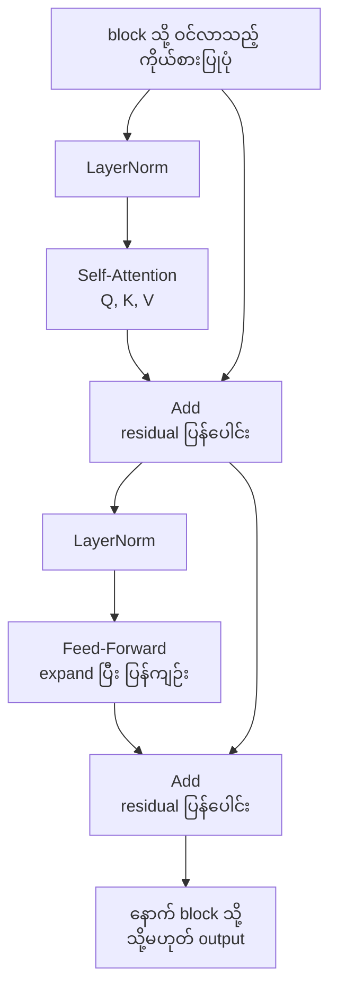

**ဘာကို ကြည့်ရမည်** — block တစ်ခုတွင် အခန်းကဏ္ဍ နှစ်ခု ရှိသည်။ **Self-Attention** က
"မည်သည့် နေရာများကို ကြည့်မည်" ကို ဆုံးဖြတ်သည်၊ **Feed-Forward** က "ထို အချက်အလက်ဖြင့် ဘာလုပ်မည်"
ကို လုပ်သည်။ `Add` (residual) သည် gradient စီးဆင်းမှုကို ထိန်းပြီး၊ `LayerNorm` သည်
တန်ဖိုးများ ကြီးလွန်းခြင်းကို တားသည်။ MoE ဗိသုကာတွင် `Feed-Forward` ကို expert များစွာ
ဖြင့် အစားထိုးပြီး router က တစ်ကြိမ်လျှင် အနည်းငယ်သာ ရွေးသည်။
**သက်ဆိုင်သည့် term** — Transformer, Self-Attention, MoE, Parameter

## ၃။ Attention ၏ တွက်ချက်မှု ၅ ဆင့်

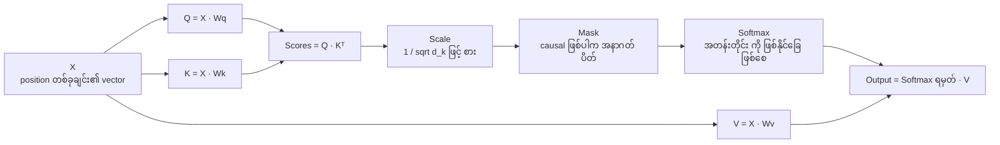

**ဘာကို ကြည့်ရမည်** — `Scores` သည် **n × n မက်ထရစ်** ဖြစ်သည်။ ထို့ကြောင့် context length ၂ ဆ
တိုးပါက ဤမက်ထရစ် ၄ ဆ ကြီးလာသည် — ဤ နေရာတွင် quadratic ကုန်ကျစရိတ် စတင်သည်
(`lab_attention_cost.py` ဖြင့် တိုင်းပါ)။ `Mask` သည် encoder (အားလုံး မြင်သည်) နှင့်
decoder/LLM (အနာဂတ် မမြင်) ကို ခွဲသည့် တစ်ခုတည်းသော နေရာ ဖြစ်သည်။
**သက်ဆိုင်သည့် term** — Attention, Self-Attention, Encoder, Decoder, Transformer

## ၄။ Prefill နှင့် Decode — KV Cache က ဘာကို ပြောင်းသည်

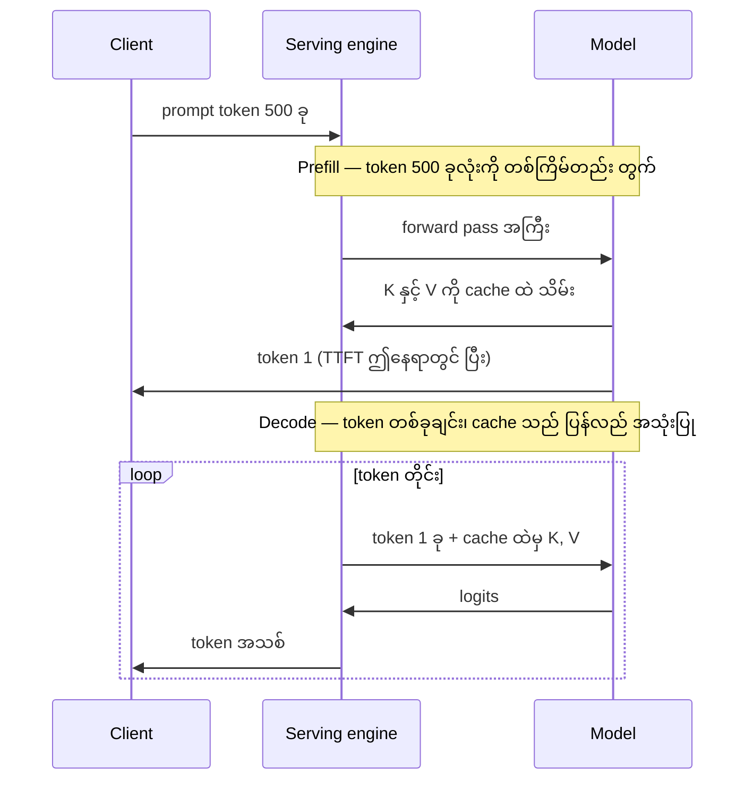

**ဘာကို ကြည့်ရမည်** — ပထမ အကွက်တွင် prompt တစ်ခုလုံးကို တွက်သည် (compute-bound)။
နောက် token တိုင်းတွင် **၁ ခုသာ** တွက်သည်၊ သို့သော် cache ထဲမှ K၊ V အားလုံးကို ဖတ်ရသည်
(memory-bandwidth-bound)။ ထို့ကြောင့် decode အဆင့်တွင် တွက်နိုင်စွမ်း မဟုတ်ဘဲ memory bandwidth
သည် ကန့်သတ်ချက် ဖြစ်လာသည် — batching က အကျိုးရှိသည့် အကြောင်းရင်း ဤနေရာတွင် ရှိသည်။
**သက်ဆိုင်သည့် term** — KV Cache, Autoregressive, Inference, Time to First Token (TTFT), Streaming

## ၅။ KV Cache ၏ အရွယ်အစား ဘယ်ကနေ လာသည်

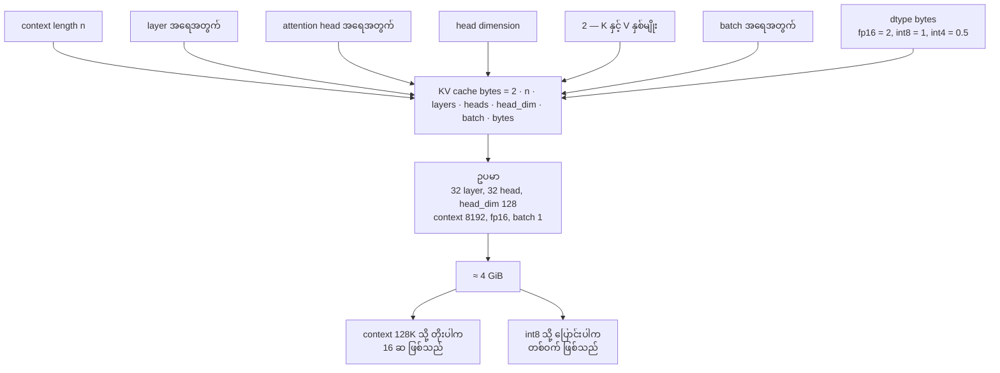

**ဘာကို ကြည့်ရမည်** — ဤ ကိန်းဂဏန်း အားလုံးသည် **တိုက်ရိုက် မြှောက်ခြင်း** သာဖြစ်သည်။
context ၂ ဆ → KV ၂ ဆ။ dtype ကို fp16 မှ int8 → KV တစ်ဝက်။ အလားတူ အချက်ဖြင့်
weights မှတ်ဉာဏ် နှင့် နှိုင်းယှဉ်ပါက context ရှည်သည့် session တွင် cache က
weights ကို ကျော်လွန်နိုင်သည်။ `lab_kv_cache.py --context 131072` ဖြင့် မိမိ စက်၏
အခြေအနေအတွက် တွက်ပါ။
**သက်ဆိုင်သည့် term** — KV Cache, Attention, Quantization

## ၆။ Sampling pipeline — logits မှ token ၁ ခုသို့

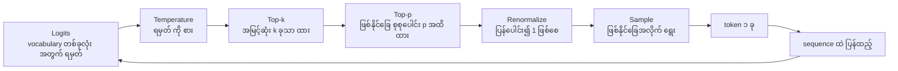

**ဘာကို ကြည့်ရမည်** — pipeline ၏ အစဉ်သည် အရေးပါသည်။ `Temperature` သည်
distribution ၏ **ပုံသဏ္ဍာန်** ကို ပြောင်းသည် (ကျဉ်းစေ/ကျယ်စေ)။ `Top-k` နှင့် `Top-p`
သည် **ဖြတ်တောက်သည်** (ဖြတ်တောက်ပြီးမှ ပြန်ပေါင်းသည်)။ `temperature=0` ဖြစ်ပါက
T အဆင့်တွင် အမြင့်ဆုံး ရမှတ်သာ ကျန်သဖြင့် နောက်အဆင့်များ၏ သက်ရောက်မှု မရှိတော့ပါ။
**သက်ဆိုင်သည့် term** — Logits, Temperature, Top-k Sampling, Nucleus Sampling (Top-p), Decoding Strategy

## ၇။ Quantization — တိကျမှုနှင့် မှတ်ဉာဏ် လဲလှယ်ခြင်း

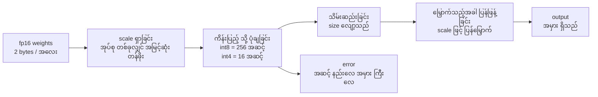

**ဘာကို ကြည့်ရမည်** — အဆင့် နည်းလာသည့် အခါ တစ်ခုချင်း အလေး၏ တိကျမှု လျော့သည်၊
သို့သော် မှတ်ဉာဏ်နှင့် bandwidth သည် တိုက်ရိုက် အချိုးကျ လျော့သည်။ decode အဆင့်သည်
memory-bandwidth-bound ဖြစ်သဖြင့် ထို လျော့မှုသည် latency အဖြစ် တိုက်ရိုက် ပြောင်းနိုင်သည်။
သို့သော် quantization အမှားသည် အရည်အသွေး အပေါ် သက်ရောက်သည့် အချက်ကို
`lab_quantization.py --sweep` ဖြင့် တိုင်းပါ။
**သက်ဆိုင်သည့် term** — Quantization, Parameter, CUDA

## ၈။ Autoregressive နှင့် Diffusion — ထုတ်လုပ်သည့် လမ်းကြောင်း နှစ်မျိုး

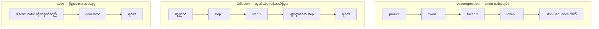

**ဘာကို ကြည့်ရမည်** — Autoregressive လမ်းကြောင်းတွင် step တိုင်းသည် **မတူညီသည့် အလုပ်**
(token တစ်ခု ပေါင်းထည့်) ဖြစ်ပြီး၊ diffusion လမ်းကြောင်းတွင် step တိုင်းသည်
**တူညီသည့် အလုပ်** (ဆူညံသံ လျှော့ခြင်း) ကို ထပ်လုပ်သည်။ ဤ ကွာခြားမှုက
TTFT၊ TTST (time to second token) နှင့် cost ကို ကွာခြားစေသည်။ LLM serving
တွင် ပြဿနာအများစုသည် autoregressive loop ပတ်လည်တွင် ရှိသည်။
**သက်ဆိုင်သည့် term** — Autoregressive, GPT, LLM, VAE, GAN, Diffusion Model

## ၉။ MoE routing

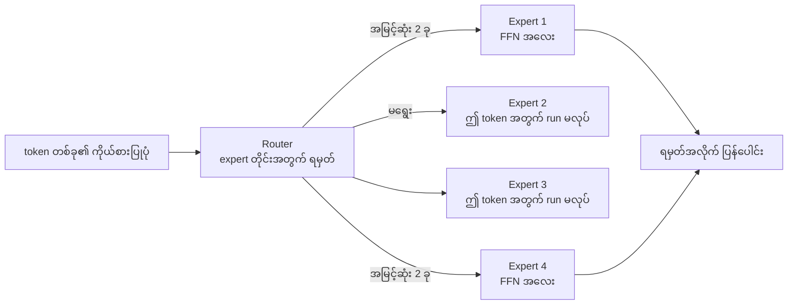

**ဘာကို ကြည့်ရမည်** — parameter များစွာ ရှိသော်လည်း token တိုင်းတွင် **အနည်းငယ်သာ** run
ဖြစ်သည်။ ထို့ကြောင့် မှတ်ဉာဏ်သည် parameter အားလုံးကို ထားရန် လိုသည် (weights အားလုံး
VRAM တွင် ရှိရမည်)၊ သို့သော် compute သည် ရွေးထားသည့် expert များအတွက်သာ ကုန်သည်။
ဤ ကွာခြားမှုသည် serving ရှိ memory နှင့် compute တွက်ချက်မှုကို ကွဲပြားစေသည်။
**သက်ဆိုင်သည့် term** — MoE, Transformer, Parameter, CUDA

## ၁၀။ Speculative Decoding

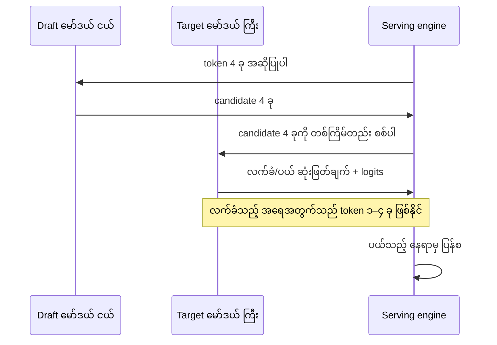

**ဘာကို ကြည့်ရမည်** — ရလဒ်သည် မော်ဒယ် ကြီး တစ်ခုတည်း ထုတ်သည့် ရလဒ်နှင့် **တူညီ** ရမည်
(ပယ်သည့် candidate များကို ပြန်လုပ်သည်)။ အကျိုးအမြတ်သည် လက်ခံနှုန်း (acceptance rate) အပေါ်
မူတည်သည် — draft မော်ဒယ်နှင့် target မော်ဒယ်၏ ဖြန့်ကျက်မှု နီးပါက အကျိုးအမြတ် ကြီးသည်။
memory ပိုကုန်သည် (မော်ဒယာ နှစ်ခု)၊ ထို့ကြောင့် latency နှင့် cost ကို ချိန်ညှိရသည်။
**သက်ဆိုင်သည့် term** — Speculative Decoding, KV Cache, Decoding Strategy, Time to First Token (TTFT)

## ၁၁။ Latency ကို ဘယ်နေရာမှာ ကုန်သလဲ — TTFT နှင့် ITL

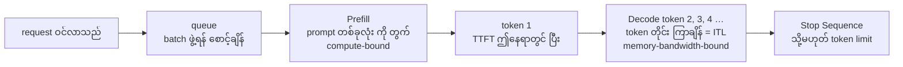

**ဘာကို ကြည့်ရမည်** — TTFT သည် `Q + P` အပေါ် မူတည်သည်၊ ITL သည် `D` အပေါ် မူတည်သည်။
TTFT ကောင်းသော်လည်း D အလွန်နှေးပါက ခံစားမှု ဆိုးသည် (streaming ဖြင့် အဆင့်ဆင့် ပို့သော်လည်း
စာလုံး တစ်ခုချင်း ကြာလွန်းပါက ဖတ်ရ ခက်သည်)။ ပြောင်းပြန်လည်း ဖြစ်သည်။
**သက်ဆိုင်သည့် term** — Time to First Token (TTFT), Streaming, Inference, Decoding Strategy

## ၁၂။ Static batching နှင့် Continuous batching

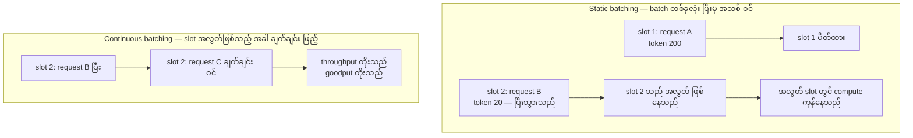

**ဘာကို ကြည့်ရမည်** — decode အဆင့်တွင် GPU ၏ compute သည် token အနည်းငယ်အတွက်သာ ကုန်သဖြင့်
slot အလွတ်သည် **အလွင့် ဖြစ်နေသည်**။ continuous batching သည် ထို အလွတ်ကို ဖြည့်သည်။
ထို့ကြောင့် throughput နှင့် goodput တိုးသည်၊ သို့သော် batch ကြီးလာပါက တစ်ခုချင်း request ၏
ITL သည် နှေးနိုင်သည် — `lab_batching.py --sweep` ဖြင့် ထို ချိန်ညှိမှုကို ကြည့်ပါ။
**သက်ဆိုင်သည့် term** — Inference, Time to First Token (TTFT), Streaming, KV Cache

## ပုံတိုင်းနှင့် term ချိတ်ဆက်မှု

| ပုံ | ပြသည့် အကြောင်းအရာ | သက်ဆိုင်သည့် term |
|---|---|---|
| ၁ | တောင်းဆိုမှု တစ်ခုလုံး၏ လမ်းကြောင်း | Inference, Logits, Decoding Strategy, Streaming, Stop Sequence |
| ၂ | Transformer block အတွင်း စီးဆင်းမှု | Transformer, Self-Attention, MoE, Parameter |
| ၃ | Attention ၏ တွက်ချက်မှု ၅ ဆင့် | Attention, Self-Attention, Encoder, Decoder |
| ၄ | Prefill နှင့် decode | KV Cache, Autoregressive, TTFT |
| ၅ | KV cache အရွယ်အစား | KV Cache, Attention, Quantization |
| ၆ | Sampling pipeline | Logits, Temperature, Top-k, Top-p, Decoding Strategy |
| ၇ | Quantization | Quantization, Parameter, CUDA |
| ၈ | Autoregressive နှင့် diffusion | Autoregressive, GPT, LLM, VAE, GAN, Diffusion Model |
| ၉ | MoE routing | MoE, Transformer, Parameter |
| ၁၀ | Speculative decoding | Speculative Decoding, KV Cache |
| ၁၁ | Latency အစိတ်အပိုင်း | TTFT, Streaming, Inference |
| ၁၂ | Batching မူဝါဒ | Inference, TTFT, KV Cache |

## နောက်တစ်ဆင့်

- ကိန်းဂဏန်း အဖြစ် မြင်လိုပါက — [`labs/`](labs/) ရှိ `lab_kv_cache.py`၊ `lab_attention_cost.py`၊ `lab_batching.py`
- deployment အပေါ် သက်ရောက်မှု — [`03_theory_to_infrastructure.md`](03_theory_to_infrastructure.md)
- လေ့ကျင့်ခန်းများ — [`04_exercises.md`](04_exercises.md)
