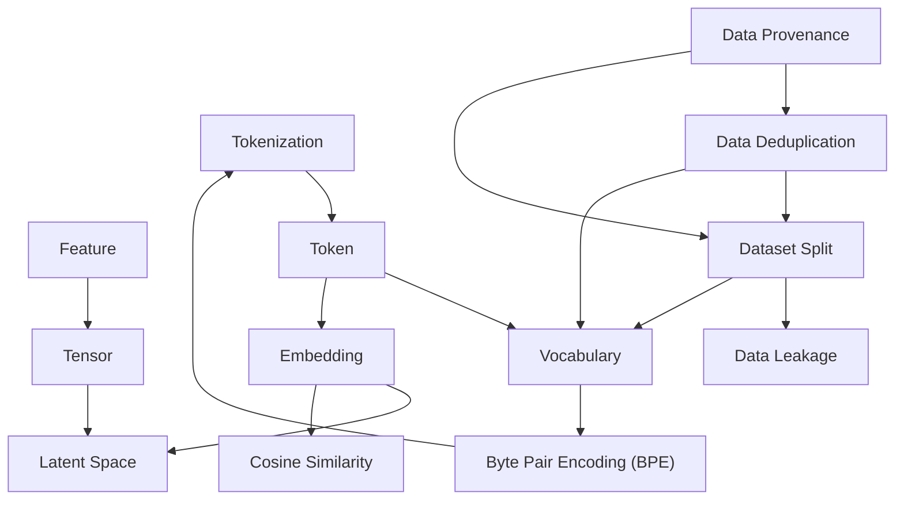

# Area 03 — Data & representations: လေ့လာသည့် အစဉ် (Learning Sequence)

ဤနယ်ပယ်၏ term ၁၃ ခုသည် ရောနှောနေသည့် ခေါင်းစဉ်များ မဟုတ်ပါ။ ၎င်းတို့သည် **အဆင့် ငါးဆင့်
အစဉ်တစ်ခု** — အချက်အလက်၏ အရင်း ကိုယ်စားပြုမှု → tokenization → vector ကိုယ်စားပြုမှု →
split နှင့် leakage → အရည်အသွေးနှင့် ခြေရာခံမှု — အဖြစ် တည်ဆောက်ထားသည်။ ဤဖိုင်သည်
term များကို မည်သည့် အစဉ်အတိုင်း ဖတ်ရမည်၊ မည်သည့် term က မည်သည့် term အပေါ် အခြေခံသည်ကို
သတ်မှတ်ပေးသည်။

**ဖတ်သည့် အစဉ်ကို လိုက်ခြင်း၏ အကျိုးသက်ရောက်မှု** — နောက် term တိုင်းသည် အရင် term များကို
အသုံးပြု၍ ရှင်းလင်းသည်။ ဥပမာ `Byte Pair Encoding (BPE)` သည် `Vocabulary` နှင့် `Token` ကို
မသိဘဲ အဓိပ္ပာယ် မရှိသလို၊ `Data Leakage` သည် `Dataset Split` ကို မသိဘဲ ဖြစ်ပေါ်သည့်
အန္တရာယ် အဖြစ် မမြင်နိုင်ပါ။ `Embedding` သည် `Token` အဆင့်ကို မရသေးဘဲ မည်သည့် အရာကို
vector ပြောင်းသည်ကို မသိနိုင်ပါ။ ထို့ကြောင့် တစ်ဆင့်ချင်း တက်ရမည်။

## အဆင့် ငါးဆင့်၏ ခြုံငုံမှု

| အဆင့် | အမည် | Term | ဤအဆင့် ပြီးပါက ဖြေနိုင်ရမည့် မေးခွန်း |
|---|---|---|---|
| ၁ | အချက်အလက်၏ အရင်း ကိုယ်စားပြုမှု | Feature, Tensor, Latent Space | အချက်အလက် တစ်ခုကို ကိန်းဂဏန်း အဖြစ် မည်သို့ ဖော်ပြသည်၊ အလွှာ မည်မျှ ရှိသည် |
| ၂ | Tokenization နှင့် vocabulary | Tokenization, Token, Vocabulary, Byte Pair Encoding (BPE) | စာသားမှ model လက်ခံသည့် ကိန်း လက္ခဏာ အထိ မည်သို့ ရောက်သည် |
| ၃ | Vector ကိုယ်စားပြုမှု | Embedding, Cosine Similarity | token တစ်ခုက ဘယ်လို vector ဖြစ်လာသည်၊ ဆင်တူမှုကို မည်သို့ တိုင်းသည် |
| ၄ | Dataset Split နှင့် Leakage | Dataset Split, Data Leakage | evaluation သည် အဘယ်ကြောင့် ယုံကြည်ရသည်၊ ဘယ်အခါ ယုံကြည်မရ |
| ၅ | အရည်အသွေး၊ Versioning နှင့် Lineage | Data Deduplication, Data Provenance | dataset တစ်ခုကို မည်သို့ သန့်စင်သည်၊ မည်သို့ ပြန်လည် ဖန်တီးနိုင်အောင် သိမ်းသည် |

## အဆင့်များအကြား မှီခိုမှု (Prerequisite Graph)

**ဂရပ် ဖတ်နည်း** — မြှား သည် "ဤ term ကို နားလည်ရန် အရင် term ကို သိရမည်" ဟု ဆိုသည်။
`Feature → Tensor → Latent Space` သည် အဆင့် ၁ ဖြစ်သည်။ `Tokenization → Token → Vocabulary →
Byte Pair Encoding (BPE)` သည် အဆင့် ၂ ၏ ကိုယ်ထည် ဖြစ်ပြီး၊ BPE မှ Tokenization သို့ ပြန်လှည့်
သည့် မြှား သည် "BPE ကို သိပါက tokenization ကို ပိုမို တိကျစွာ မြင်သည်" ဟု ဆိုသည်။
`Data Provenance → Data Deduplication → Dataset Split` သည် အဆင့် ၄ နှင့် ၅ ကို
ဆက်ပေးသည် — ခြေရာခံမှု မရှိပါက မည်သည့် နမူနာကို ဖယ်ရှားခဲ့သည်ကို ပြန်မသိနိုင်ပါ။
`Dataset Split` နှင့် `Data Deduplication` မှ `Vocabulary` သို့ မြှား သည် tokenizer ကို
ခွင့်ပြုထားသည့် split များအပေါ်တွင်သာ train လုပ်ရမည် ဆိုသည့် စည်းမျဉ်းကို ပြသည်။

## အဆင့် ၁ — အချက်အလက်၏ အရင်း ကိုယ်စားပြုမှု (၃ term)

**အစဉ်** — `Feature` → `Tensor` → `Latent Space`

**ဘာကြောင့် ဤနေရာတွင် ရှိသည်** — ဤ term သုံးခုသည် "အချက်အလက် ဆိုသည်မှာ ဘာလဲ၊ မည်သည့်
ပုံစံဖြင့် စက်ထဲ ဝင်လာသည်" ကို သတ်မှတ်သည်။ `Feature` သည် အချက်အလက်၏ တိုင်းတာနိုင်သည့်
ပိုင်ဆိုင်မှု ဖြစ်သည်။ `Tensor` သည် ထို တန်ဖိုးများကို shape၊ data type နှင့် device placement
ဖြင့် ထည့်သိမ်းသည့် typed array ဖြစ်သည်။ `Latent Space` သည် model က သင်ယူထားသည့်
ဖုံးကွယ်ထားသည့် representation space ဖြစ်သည်။ ဤအဆင့် မပြီးဘဲ အဆင့် ၃ ကို ဖတ်ပါက
embedding သည် မည်သည့် space ထဲ ရောက်သည်ကို နားလည်နိုင်မည် မဟုတ်ပါ။

**မှတ်သားရန်** — `Feature` ကို classical ML တွင် လက်ဖြင့် တည်ဆောက်ရပြီး deep learning တွင်
network က raw data မှ အလိုအလျောက် သင်ယူသည်။ `Latent Space` သည် input ထက် dimension
နည်းနိုင်သော်လည်း compression သည် latent representation တိုင်းအတွက် မဖြစ်မနေ မလိုအပ်ပါ။

**စစ်ဆေးသည့် မေးခွန်း** — သိမ်းဆည်းထားသည့် column တစ်ခုနှင့် feature တစ်ခုသည် အမြဲ တူညီသလား။
latent space အတွင်း အနီးအနား ရှိသည့် point နှစ်ခုသည် အဘယ်ကြောင့် model နှင့်
training objective မပါဘဲ "ဆင်တူသည်" ဟု မဆိုနိုင်သနည်း။

## အဆင့် ၂ — Tokenization နှင့် vocabulary (၄ term)

**အစဉ်** — `Tokenization` → `Token` → `Vocabulary` → `Byte Pair Encoding (BPE)`

**ဘာကြောင့် ဤနေရာတွင် ရှိသည်** — ဤအဆင့်သည် စာသား၊ code သို့မဟုတ် အခြား input
representation တစ်ခုမှ model လက်ခံသည့် အစဉ်လိုက် ကိန်း လက္ခဏာ အထိ လမ်းကြောင်း
တစ်ခုလုံး ဖြစ်သည်။ `Tokenization` သည် ထို ပြောင်းလဲသည့် လုပ်ငန်းစဉ် ဖြစ်သည်။ `Token` သည်
ထို လုပ်ငန်းစဉ် ထုတ်ပေးသည့် integer identifier တစ်ခု ဖြစ်သည်။ `Vocabulary` သည် ထို
identifier များနှင့် tokenizer ထုတ်နိုင်သည့် ယူနစ်များအကြား အကန့်အသတ် ရှိသည့် mapping
ဖြစ်သည်။ `Byte Pair Encoding (BPE)` သည် ထို vocabulary ကို မည်သို့ တည်ဆောက်သည်ကို
ပြသည့် subword-tokenization နည်းလမ်း ဖြစ်သည်။ အစဉ်သည် အရေးပါသည် — vocabulary
အရွယ်အစားကို မသိဘဲ token အရေအတွက်နှင့် ကုန်ကျစရိတ်ကို တွက်နိုင်မည် မဟုတ်ပါ။

**မှတ်သားရန်** — `Token` တစ်ခုသည် စကားလုံး တစ်လုံးလုံး၊ စကားလုံး၏ အစိတ်အပိုင်း၊
punctuation၊ whitespace၊ byte sequence သို့မဟုတ် special control symbol တစ်ခု ဖြစ်နိုင်သည်။
`Vocabulary` သည် လူသုံး အဘိဓာန် မဟုတ်ပါ။ BPE သည် tokenizer မိသားစု တစ်ခုသာ ဖြစ်သည်။

**စစ်ဆေးသည့် မေးခွန်း** — token အရေအတွက်ကို ခန့်မှန်းရာတွင် character-to-token ratio ကို
ဘာသာစကား တစ်ခုတည်းအတွက် ကိန်းသေ တန်ဖိုး အဖြစ် သုံးနိုင်သလား။
vocabulary ကြီးလာသည့်အခါ ဘယ်အရာ တိုးလာပြီး ဘယ်အရာ လျော့လာသနည်း။

## အဆင့် ၃ — Vector ကိုယ်စားပြုမှု (၂ term)

**အစဉ်** — `Embedding` → `Cosine Similarity`

**ဘာကြောင့် ဤနေရာတွင် ရှိသည်** — အဆင့် ၂ ၏ အဆုံးတွင် ရရှိသည်မှာ integer id များ ဖြစ်သည်။
`Embedding` သည် ထို သီးခြား အရာဝတ္ထုများကို continuous space အတွင်းရှိ dense vector များသို့
သင်ယူထားသည့် mapping ဖြစ်သည်။ `Cosine Similarity` သည် ထို vector များ၏ ဆင်တူမှုကို
တိုင်းသည့် ကိရိယာ ဖြစ်သည်။ အစဉ်သည် အရေးပါသည် — မည်သည့် space ထဲ ရောက်သည်ကို
မသိဘဲ ဆင်တူမှု တန်ဖိုးကို အဓိပ္ပာယ် ဖော်နိုင်မည် မဟုတ်ပါ။

**မှတ်သားရန်** — ဆင်တူမှုသည် သက်ဆိုင်သည့် model၊ training objective နှင့် metric အတွင်း၌သာ
အဓိပ္ပာယ် ရှိသည်။ embedding space တစ်ခုအတွင်း အကွာအဝေးကို အခြား space တစ်ခုသို့
ကူးယူ အသုံးပြု၍ မရပါ။ cosine similarity မြင့်မားခြင်းသည် အချက်အလက်အရ တူညီမှုကို
သက်သေ မပြပါ။

**စစ်ဆေးသည့် မေးခွန်း** — embedding matrix တွင် row အရေအတွက်ကို ဘယ်အရာက ဆုံးဖြတ်သနည်း။
`Cosine Similarity` သည် vector များ၏ ပမာဏ (magnitude) အပေါ် အဘယ်ကြောင့် မူတည်မှု မရှိသနည်း။

## အဆင့် ၄ — Dataset Split နှင့် Leakage (၂ term)

**အစဉ်** — `Dataset Split` → `Data Leakage`

**ဘာကြောင့် ဤနေရာတွင် ရှိသည်** — ဤအဆင့်သည် "ရလဒ် ဆိုသည်မှာ ယုံကြည်နိုင်သလား" ဆိုသည့်
မေးခွန်းကို ဖြေသည်။ `Dataset Split` သည် နမူနာများကို fitting၊ development ဆုံးဖြတ်ချက်များနှင့်
နောက်ဆုံး evaluation အတွက် သီးခြား subset များအဖြစ် မှတ်တမ်းတင် ခွဲခြားခြင်း ဖြစ်သည်။
`Data Leakage` သည် ထို နယ်နိမိတ်ကို မရည်ရွယ်ဘဲ ဖြတ်ကျော်သည့် အခါ ဖြစ်ပေါ်သည့်
ပြဿနာ ဖြစ်သည်။ split ကို အရင် သိရမည်၊ ထို့နောက် leakage ကို ရှာရမည်။

**မှတ်သားရန်** — `Data Leakage` သည် ထပ်တူကျသည့် row များတွင်သာ ကန့်သတ်မထားပါ။
Global normalization statistic များ၊ timestamp များ၊ target မှ ဆင်းသက်သည့် feature များနှင့်
test ကို အခြေခံ၍ ထပ်ခါတလဲလဲ ပြုပြင်သည့် prompt များ အားလုံး ယိုစိမ့်မှု ဖြစ်စေနိုင်သည်။
ကျပန်း split သည် အလိုအလျောက် လွတ်လပ်မှု ရှိသည်မဟုတ်ပါ။

**စစ်ဆေးသည့် မေးခွန်း** — user တစ်ဦးလျှင် record အများအပြား ရှိသည့် dataset တွင် row ကို
ကျပန်း ခွဲခြားပါက test set ထဲ ရောက်သည့် row မည်မျှသည် train set ထဲ model မြင်ဖူးပြီး
ဖြစ်နိုင်သနည်း။ ထို အခြေအနေကို ပြုပြင်ရန် မည်သည့် ယူနစ်အလိုက် ခွဲခြားရမည်နည်း။

## အဆင့် ၅ — အရည်အသွေး၊ Versioning နှင့် Lineage (၂ term)

**အစဉ်** — `Data Deduplication` → `Data Provenance`

**ဘာကြောင့် ဤနေရာတွင် ရှိသည်** — ဤအဆင့်သည် dataset ကို သန့်စင်ခြင်းနှင့် ပြန်လည်
ဖန်တီးနိုင်အောင် သိမ်းဆည်းခြင်း ဖြစ်သည်။ `Data Deduplication` သည် တိကျတူညီသည့်
(exact) နှင့် အနီးစပ်ဆုံး တူညီသည့် (near-duplicate) နမူနာများကို ရှာဖွေပြီး ဖယ်ရှားသည် —
အဆင့် ၄ ၏ evaluation ယုံကြည်စိတ်ချရမှုကို ဤနေရာမှ ထပ်မံ ကာကွယ်သည်။ `Data Provenance`
သည် အချက်အလက်သည် မည်သည့်နေရာမှ မူလ ဖြစ်ပေါ်ခဲ့သည်၊ မည်သူ သို့မဟုတ် မည်သည့်
အရာက ၎င်းကို အသွင်ပြောင်းခဲ့သည်၊ မည်သည့် version များကို အသုံးပြုခဲ့သည်ကို
ခြေရာခံသည်။ Deduplication က "ဖယ်ရှားသည်" ကို ကိုင်တွယ်သည်၊ Provenance က
"ဖယ်ရှားခဲ့သည်ကို မှတ်တမ်းတင်သည်" ကို ကိုင်တွယ်သည် — ထို့ကြောင့် ဤအစဉ် ဖြစ်သည်။

**မှတ်သားရန်** — Deduplication သည် သာမန် data cleaning မဟုတ်ပါ။ Paraphrase နှစ်ခုသည်
တူညီသည့် ယိုစိမ့်သည့် အချက်အလက်ကို ဆက်လက် သယ်ဆောင်ထားနိုင်သည်။ Source URL သည်
provenance ၏ အစိတ်အပိုင်း တစ်ခုသာ ဖြစ်သည်။

**စစ်ဆေးသည့် မေးခွန်း** — dataset တွင် ထပ်တလဲလဲ ဖြစ်နေခြင်း ၁၂ % ရှိပါက တူညီသည့်
training budget အတွင်း epoch အရေအတွက် မည်သို့ ပြောင်းလဲသနည်း။
source ပြောင်းလဲသည့်အခါ ထိခိုက်သည့် နမူနာများကို ဖယ်ရှားနိုင်ရန် ဘာကို လိုအပ်သနည်း။

## Term ၁၃ ခု၏ အစဉ် ဇယား

| # | Term | အဆင့် | ကြိုတင် သိရမည့် term | ဖွင့်ပေးသည့် အချက် |
|---|---|---|---|---|
| 1 | Feature | ၁ | — | အချက်အလက်၏ တိုင်းတာနိုင်သည့် ပိုင်ဆိုင်မှု |
| 2 | Tensor | ၁ | Feature | shape၊ data type၊ device placement ဖြင့် သိမ်းဆည်းခြင်း |
| 3 | Latent Space | ၁ | Tensor | model သင်ယူထားသည့် representation space |
| 4 | Tokenization | ၂ | Tensor | input ၏ အရှည်နှင့် ကုန်ကျစရိတ် ဆုံးဖြတ်ခြင်း |
| 5 | Token | ၂ | Tokenization | ကိန်း လက္ခဏာ တစ်ခုချင်း အဆင့် |
| 6 | Vocabulary | ၂ | Token | identifier များနှင့် ယူနစ်များအကြား mapping |
| 7 | Byte Pair Encoding (BPE) | ၂ | Vocabulary | vocabulary တည်ဆောက်သည့် နည်းလမ်း |
| 8 | Embedding | ၃ | Token, Vocabulary | discrete id မှ dense vector သို့ |
| 9 | Cosine Similarity | ၃ | Embedding | vector ဆင်တူမှု တိုင်းတာခြင်း |
| 10 | Dataset Split | ၄ | Tokenization, Vocabulary | evaluation ၏ လွတ်လပ်မှု |
| 11 | Data Leakage | ၄ | Dataset Split | ယုံကြည်မရသည့် metric ကို ရှာဖွေခြင်း |
| 12 | Data Deduplication | ၅ | Dataset Split, Data Leakage | training distribution နှင့် evaluation သန့်ရှင်းမှု |
| 13 | Data Provenance | ၅ | Data Deduplication | ပြန်လည် ဖန်တီးနိုင်မှုနှင့် ခြေရာခံမှု |

**ဇယား ဖတ်နည်း** — "ကြိုတင် သိရမည့် term" ကော်လံသည် prerequisite graph ၏ မြှားများနှင့်
တူညီသည်။ `Embedding` သည် `Token` နှင့် `Vocabulary` ကို ကြိုတင် သိရမည် — အကြောင်းမှာ
embedding matrix ၏ row အရေအတွက်သည် vocabulary အရွယ်အစားနှင့် တူညီသည်။
`Data Provenance` သည် အဆုံးတွင် ရှိသည် — အကြောင်းမှာ ၎င်းသည် အရင် အဆင့် လေးဆင့်လုံး၏
ရလဒ်ကို ခြေရာခံသည်။

## လက်တွေ့ လုပ်သည့် အစဉ် (၅ ကြိမ် ထိုင်ရန်)

| ကြိမ် | ဖတ်ရမည့် အဆင့် | လက်တွေ့ လုပ်ရမည့် လက်တွေ့စမ်းသပ်မှု |
|---|---|---|
| ၁ | အဆင့် ၁ + ၂ | `python3 guides/03_data_and_representations/labs/lab_tokenizer.py` — merge အရေအတွက် ပြောင်း၍ token ခွဲမှု ကြည့်ခြင်း |
| ၂ | အဆင့် ၃ | ဤဖိုင်ရှိ prerequisite graph ကို စာရွက်ပေါ် ပြန်ဆွဲခြင်း၊ `python3 guides/03_data_and_representations/scripts/ex_b_vocab_memory.py` |
| ၃ | အဆင့် ၂ + ၃ | `labs/lab_pipeline_budget.py` — token id သိမ်းဆည်းမှုနှင့် GiB တွက်ချက်မှု |
| ၄ | အဆင့် ၄ | `labs/lab_split_leak.py` — ကျပန်း split နှင့် entity split ကို နှိုင်းယှဉ်ခြင်း |
| ၅ | အဆင့် ၅ | `scripts/ex_c_dedup_epochs.py`၊ [`04_exercises.md`](04_exercises.md) ၏ တွက်ချက်ရသည့် လေ့ကျင့်ခန်း ၆ ခု |

**အချိန် ခန့်မှန်းချက်** — ကြိမ် တစ်ကြိမ်လျှင် ဖတ်ခြင်း နှင့် lab ကို ပေါင်းလျှင် တစ်နာရီ မှ
နှစ်နာရီ အထိ ဖြစ်သည်။ အဆင့် ၄ နှင့် ၅ (leakage၊ deduplication၊ provenance) သည်
စာဖတ်ရုံဖြင့် မပြီးဘဲ မိမိ dataset တွင် တိုင်းတာကြည့်ရမည့် အဆင့်များ ဖြစ်သည့်အတွက်
အချိန် ပိုလိုသည်။

## နောက်တစ်ဆင့်

- ပုံရှင်းလင်းချက်များ — [`02_visual_explanations.md`](02_visual_explanations.md) (စာသားမှ token သို့၊ embedding lookup၊ split နှင့် leakage)
- လေ့ကျင့်ခန်းများ — [`04_exercises.md`](04_exercises.md)
- Lab များ — [`labs/`](labs/) (`lab_tokenizer.py`၊ `lab_split_leak.py`၊ `lab_pipeline_budget.py`)
- Term တိုင်း၏ အပြည့်အစုံ အဓိပ္ပာယ် — [`../../terms/03_data_and_representations.md`](../../terms/03_data_and_representations.md)
