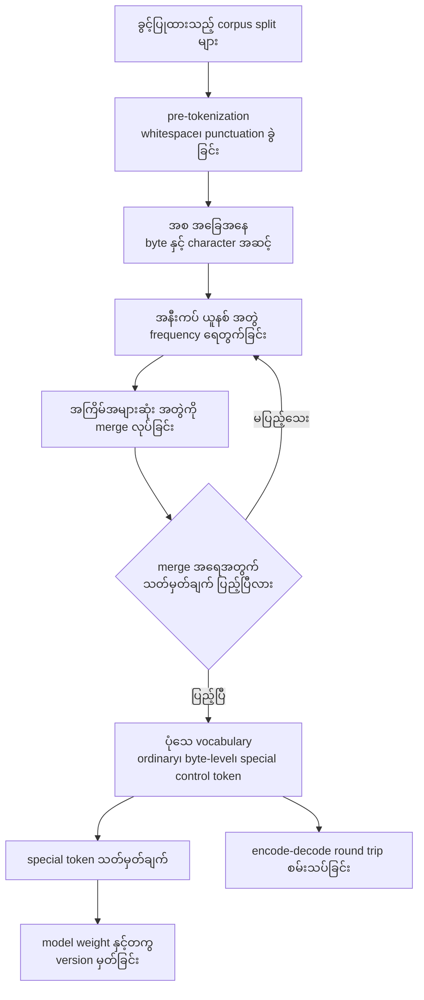
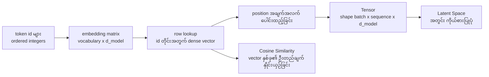
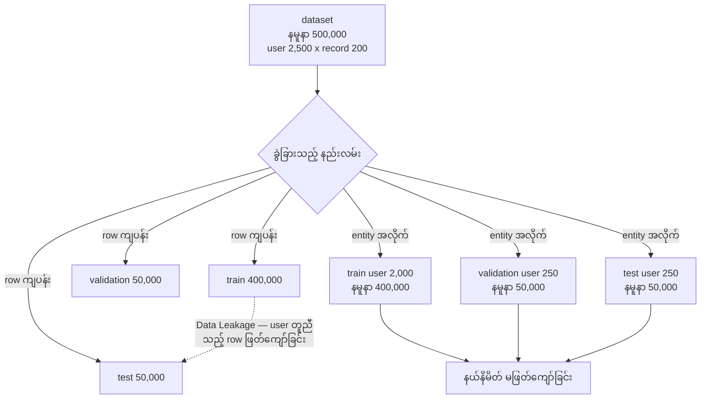
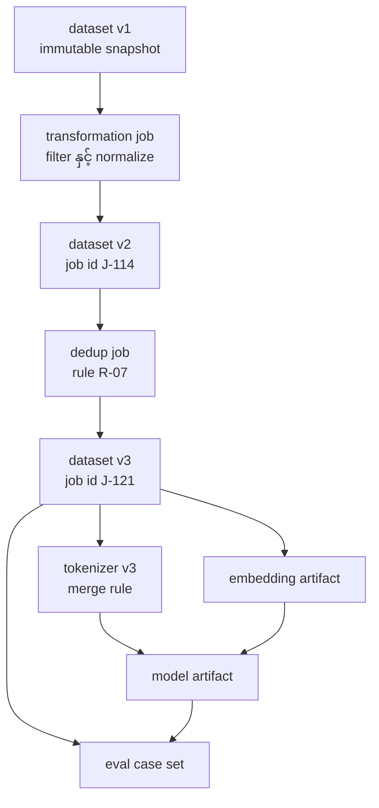
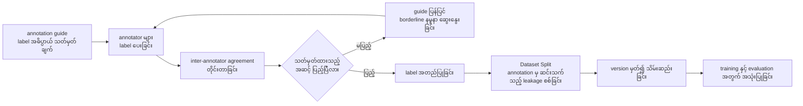
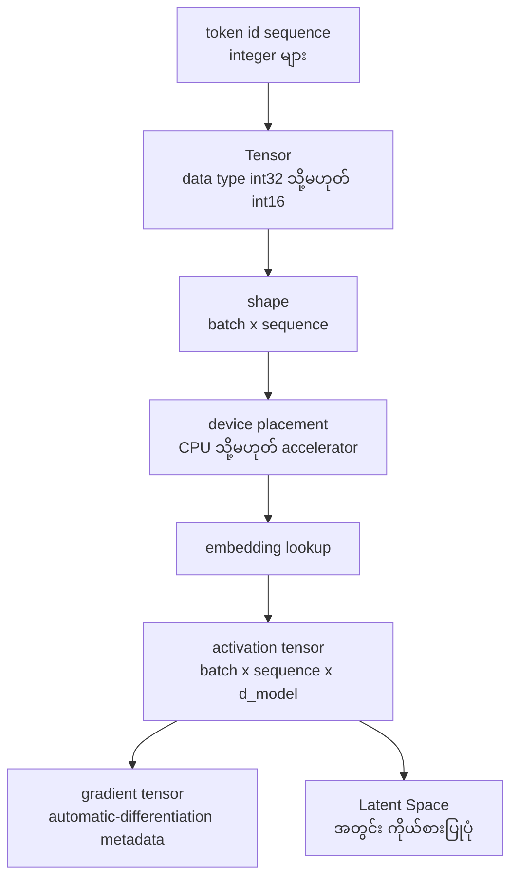

# Area 03 — ပုံရှင်းလင်းချက်များ (Visual Explanations)

Term တစ်ခုကို စာဖြင့်သာ ဖတ်ပါက "ဘယ်ကနေ ဘယ်ကို သွားသည်" ဟူသည့် လမ်းကြောင်း မမြင်ရပါ။
ဤဖိုင်သည် ထို လမ်းကြောင်းများကို ပုံဖြင့် ပြသည် — စာသားမှ token သို့၊ token မှ vector သို့,
vector မှ tensor သို့၊ dataset မှ training batch သို့၊ အချက်အလက် တစ်ခု၏ version နှင့်
lineage အထိ။

**ပုံများ ကြည့်နည်း** — ဤဖိုင်ကို GitHub တွင် ဖတ်ပါက Mermaid ပုံများ အလိုအလျောက် render
ဖြစ်သည်။ ဒေသအတွင်း တွင်ဖတ်လိုပါက VS Code ၏ Mermaid extension သို့မဟုတ် mermaid.live တွင်
```mermaid``` block ကို ကူးထည့်ပါ။

## ၁။ စာသားမှ token သို့ — BPE merge အစဉ်

```mermaid
flowchart LR
    A["corpus<br/>low x5, lowest x1<br/>newer x2, newest x3<br/>wider x1"] --> B["character အဆင့်<br/>token 66 ခု"]
    B --> C["merge w + e<br/>frequency 6 → token 60"]
    C --> D["merge l + o<br/>frequency 6 → token 54"]
    D --> E["merge w + end-marker<br/>frequency 5 → token 49"]
    E --> F["merge n + e<br/>frequency 5 → token 44"]
    F --> G["merge ne + we<br/>frequency 5 → token 39"]
    G --> H["merge lo + low-end<br/>frequency 5 → token 34"]
    H --> I["vocabulary symbol 12 ခု<br/>compress ratio 66/34"]
```

**ဘာကို ကြည့်ရမည်** —

- ပထမ အကွက်တွင် token အရေအတွက်သည် **character အရေအတွက်** ဖြစ်သည်၊ စကားလုံး အရေအတွက်
  မဟုတ်ပါ။ စာလုံး တစ်လုံးချင်း နှင့် စကားလုံး အဆုံး သတ်မှတ်သည့် marker ကို ရေတွက်သည်။
- merge တိုင်းသည် **အကြိမ်အများဆုံး အနီးကပ် ယူနစ် အတွဲ** ကို ရွေးသည်။ frequency တူညီပါက
  စာလုံး အစဉ်အလိုက် ရွေးသည် — ထို့ကြောင့် ရလဒ်သည် deterministic ဖြစ်သည်။
- token အရေအတွက်သည် 66 မှ 34 သို့ ကျဆင်းသည်၊ သို့သော် **ဘယ်တော့မှ 0 မဖြစ်** ပါ။
  မမြင်ဖူးသေးသည့် စကားလုံး သည် အစိတ်အပိုင်း သေးငယ်များ အဖြစ် ကျန်သည် — ဤအချက်သည်
  `Byte Pair Encoding (BPE)` ၏ အဓိက အကျိုးအမြတ် ဖြစ်သည်။
- merge rule အစဉ်သည် **tokenizer ၏ အစိတ်အပိုင်း** ဖြစ်သည်။ rule ပြောင်းပါက token အရေအတွက်
  ပြောင်းသည်၊ token အရေအတွက် ပြောင်းပါက ကုန်ကျစရိတ် ပြောင်းသည်။

**သက်ဆိုင်သည့် term** — Byte Pair Encoding (BPE), Tokenization, Token, Vocabulary, Feature

## ၂။ Vocabulary တည်ဆောက်ခြင်း



**ဘာကို ကြည့်ရမည်** —

- `D → E → F → D` ဟူသည့် ပြန်လှည့်သည့် ကွင်းသည် **တူညီသည့် အလုပ်ကို ထပ်လုပ်သည်** —
  merge တစ်ကြိမ် လုပ်ပြီးတိုင်း frequency ဇယားကို အသစ် ပြန်ရေတွက်သည်။
- ထွက်လာသည့် `G` သည် **အကန့်အသတ် ရှိသည့် mapping** ဖြစ်သည်။ ၎င်းသည် လူသုံး အဘိဓာန်
  မဟုတ်ပါ — entry အများအပြားသည် အစိတ်အပိုင်း အက်ကွဲများ၊ byte များ၊ whitespace ပုံစံများ
  သို့မဟုတ် control symbol များ ဖြစ်သည်။
- tokenizer ကို **ခွင့်ပြုထားသည့် corpus split များအပေါ်တွင်သာ** train လုပ်ရမည်။ ထို
  စည်းမျဉ်း မလိုက်ပါက evaluation set ၏ စာသားသည် vocabulary တည်ဆောက်မှုထဲ ဝင်လာပြီး
  `Data Leakage` ဖြစ်စေသည်။
- vocabulary အရွယ်အစား သည် sequence အရှည်၊ multilingual coverage၊ code ကိုယ်စားပြုမှုနှင့်
  embedding အရွယ်အစားကို တိုက်ရိုက် သက်ရောက်သည်။

**သက်ဆိုင်သည့် term** — Vocabulary, Byte Pair Encoding (BPE), Tokenization, Token, Dataset Split, Data Leakage

## ၃။ Embedding lookup အဆင့်



**ဘာကို ကြည့်ရမည်** —

- `B` သည် **parameter တစ်ခု** ဖြစ်သည်။ row အရေအတွက်သည် vocabulary အရွယ်အစားနှင့် တူညီသည်၊
  ကော်လံ အရေအတွက်သည် `d_model` ဖြစ်သည်။ ထို့ကြောင့် vocabulary နှစ်ဆ ဖြစ်ပါက
  ဤ matrix ၏ memory လည်း နှစ်ဆ ဖြစ်သည်။
- `C` သည် **ရွေးထုတ်ခြင်း** သာဖြစ်သည်၊ တွက်ချက်ခြင်း မဟုတ်ပါ။ token id တစ်ခုလျှင်
  matrix row တစ်ခုကို ယူသည်။ ထို့ကြောင့် **မြင်ဖူးသည့်** id အားလုံးတွင် vector ရှိပြီးသား ဖြစ်သည်။
- `E` သည် `Tensor` ဖြစ်သည် — ထို့ကြောင့် shape၊ data type နှင့် device placement ပါသည်။
  `F` သည် model သင်ယူထားသည့် space ဖြစ်သည်၊ `G` သည် ထို space အတွင်း တိုင်းတာသည့်
  metric ဖြစ်သည် — metric နှင့် space ကို ခွဲထား၍ ကြည့်ရမည်။

**သက်ဆိုင်သည့် term** — Embedding, Token, Vocabulary, Tensor, Latent Space, Cosine Similarity

## ၄။ Train/validation/test ခွဲခြားခြင်းနှင့် leakage မြှား



**ဘာကို ကြည့်ရမည်** —

- အပေါ် လမ်းကြောင်း (`A1`၊ `A2`၊ `A3`) နှင့် အောက် လမ်းကြောင်း (`B1`၊ `B2`၊ `B3`) ၏
  **အရေအတွက် သည် လုံးဝ တူညီသည်** — 400,000 / 50,000 / 50,000။ ကွာခြားသည်မှာ
  **မည်သည့် ယူနစ်အလိုက် ခွဲခြားသည်** ဆိုသည့် အချက် ဖြစ်သည်။
- မှေးမှိန်သည့် မြှား (`A1` မှ `A3`) သည် `Data Leakage` ဖြစ်သည်။ user တစ်ဦးလျှင် record 200 ခု
  ရှိသည့်အတွက် row ကို ကျပန်း ခွဲခြားပါက test row တိုင်း၏ user သည် train set ထဲ ပါဝင်နိုင်သည့်
  ဖြစ်နိုင်ခြေ ~1 ဖြစ်သည်။ ထို့ကြောင့် test set သည် **သီးခြား သက်သေ** မဟုတ်တော့ပါ။
- `B` လမ်းကြောင်းတွင် entity (user) က နယ်နိမိတ်ကို မဖြတ်ကျော်ပါ — ဤအချက်သည်
  `Dataset Split` ၏ ရည်ရွယ်ချက် ဖြစ်သည့် "ရွေးချယ်ရန် အသုံးပြုသည့် အထောက်အထားက
  generalization သက်သေ အဖြစ် ထပ်မံ မထမ်းဆောင်နိုင်ရန် တားဆီးခြင်း" ကို ပြည့်မီစေသည်။
- row တူညီမှု မရှိသော်လည်း **အနီးစပ်ဆုံး တူညီသည့် (near-duplicate)** နမူနာများနှင့်
  **အချိန် အလိုက် ဆက်စပ်သည့်** နမူနာများသည် နယ်နိမိတ်ကို ဖြတ်ကျော်နိုင်သည်။

**သက်ဆိုင်သည့် term** — Dataset Split, Data Leakage, Data Deduplication, Data Provenance, Feature

## ၅။ Data pipeline — source မှ training batch သို့

```mermaid
flowchart LR
    S["source<br/>URL၊ log၊ scan၊ archive"] --> P["Data Provenance<br/>source id၊ လိုင်စင်၊ စုဆောင်းသည့် အချိန်"]
    P --> N["normalize<br/>encoding၊ whitespace၊ format"]
    N --> DE["Data Deduplication<br/>exact hash၊ similarity rule"]
    DE --> SP["Dataset Split<br/>train၊ validation၊ test"]
    SP --> TK["Tokenization<br/>BPE merge rule"]
    TK --> PK["packing နှင့် padding<br/>sequence အရှည် သတ်မှတ်ခြင်း"]
    PK --> B["training batch<br/>Tensor shape batch x sequence"]
    B --> EM["Embedding lookup"]
```



**ဘာကို ကြည့်ရမည်** —

- လမ်းကြောင်း၏ **အစဉ် သည် စည်းမျဉ်း ဖြစ်သည်**။ `SP` (split) သည် `DE` (deduplication)
  ပြီးမှ ဖြစ်သည် — အကြောင်းမှာ duplicate များကို မဖယ်မီ ခွဲခြားပါက တူညီသည့် နမူနာ တစ်စုံ
  သည် split နှစ်ခုထဲ ရောက်နိုင်သည်။
- `TK` (Tokenization) သည် `SP` ပြီးမှ ဖြစ်သည် — tokenizer ကို training split အပေါ်တွင်သာ
  train လုပ်ရမည် ဆိုသည့် စည်းမျဉ်းနှင့် ကိုက်ညီသည်။
- `P` (Provenance) သည် အစတွင် ရှိသည်၊ သို့သော် ရလဒ်သည် အဆုံးထိ လိုက်ပါသည် — lineage
  metadata ကို embedding၊ eval case နှင့် model artifact များထဲသို့ သယ်ဆောင်ရမည်။
- `PK` တွင် **padding** လုပ်ပါက token အလွင့် ရှိသည်၊ **packing** လုပ်ပါက အလွင့် မရှိဘဲ
  နမူနာ နယ်နိမိတ် ရောထွေးသည်။ ဤ ရွေးချယ်မှုသည် ကုန်ကျစရိတ်နှင့် အရည်အသွေး နှစ်ခုလုံးကို
  သက်ရောက်သည် ([`04_exercises.md`](04_exercises.md) ဥပမာ ၃ ကို ကြည့်ပါ)။

**သက်ဆိုင်သည့် term** — Data Provenance, Data Deduplication, Dataset Split, Tokenization, Tensor, Embedding, Data Leakage

## ၆။ Dataset versioning နှင့် lineage



**ဘာကို ကြည့်ရမည်** —

- version တိုင်း (`V1`၊ `V2`၊ `V3`) သည် **ပြောင်းလဲ၍ မရသည့် snapshot** ဖြစ်သည်။
  ပြင်ဆင်လိုပါက နောက် version တစ်ခု အသစ် ဖန်တီးသည်၊ လက်ရှိ version ကို မဖျက်ပါ —
  ထို့ကြောင့် ရလဒ်များကို ပြန်လည် ဖန်တီးနိုင်သည်။
- edge တိုင်းတွင် **job id** သို့မဟုတ် **rule id** ရှိသည်၊ ၎င်းသည် "မည်သည့် အရာက
  အသွင်ပြောင်းခဲ့သည်" ဆိုသည့် provenance ကို ဖြေသည်။ `Data Deduplication` ၏
  "မည်သည့် rule က မည်သည့် နမူနာကို ဖယ်ရှားခဲ့သည်" ဟူသည့် လိုအပ်ချက်သည် `J2/R-07`
  နေရာတွင် မှတ်တမ်းတင်ခြင်း ဖြစ်သည်။
- `V3` မှ မြှား သုံးခု (tokenizer၊ embedding၊ eval case) သည် **derived artifact** များ ဖြစ်သည်။
  source (`V1`) ပြောင်းလဲပါက ထို artifact များ အားလုံးကို ရှာဖွေ၍ ပြန်လည် ဖန်တီးရမည် —
  lineage မရှိပါက မည်သည့် ရလဒ် ထိခိုက်သည်ကို မသိနိုင်ပါ။

**သက်ဆိုင်သည့် term** — Data Provenance, Data Deduplication, Dataset Split, Tokenization, Embedding

## ၇။ Annotation နှင့် label-quality flow



**ဘာကို ကြည့်ရမည်** —

- `C` နှင့် `D` သည် **တိုင်းတာမှု အဆင့်** ဖြစ်သည်။ label ၏ အရည်အသွေးကို ခံစားချက်ဖြင့်
  မဆုံးဖြတ်ဘဲ ကိန်းဂဏန်းဖြင့် ဆုံးဖြတ်သည်။ သတ်မှတ်ချက် မပြည့်ပါက `E` ဖြင့် guide ကို
  ပြန်ပြင်ပြီး ထပ်လုပ်သည် — ဤ ပြန်လှည့်သည့် ကွင်းသည် annotation အလုပ်တွင် အဓိက ဖြစ်သည်။
- `G` သည် အဆင့် ၄ နှင့် ဆက်သည်။ annotation process က label အားလုံးကို မြင်ဖူးပါက
  evaluation label များသည် ထို လုပ်ငန်းစဉ်မှ တစ်ဆင့် ယိုစိမ့်နိုင်သည်။
- `H` သည် label သတ်မှတ်ချက်နှင့် guide version ကို အတူ တွဲ၍ သိမ်းသည်။ Label ၏
  အဓိပ္ပာယ် ပြောင်းလဲပါက ထို ပြောင်းလဲမှုကို ပြန်လည် ရှာဖွေနိုင်ရမည်။
- label သည် လူက ပေးသည့် အချက်အလက် ဖြစ်သည့်အတွက် ၎င်းသည် `Feature` တစ်ခု ဖြစ်လာသည် —
  သို့သော် target မှ ဆင်းသက်သည့် feature ဖြစ်ပါက ထို feature သည် `Data Leakage` ဖြစ်စေသည်။

**သက်ဆိုင်သည့် term** — Feature, Dataset Split, Data Leakage, Data Provenance, Data Deduplication

## ၈။ Token id မှ tensor သို့ — သိမ်းဆည်းမှုနှင့် အလွှာများ



**ဘာကို ကြည့်ရမည်** —

- `B` တွင် data type ရွေးချယ်မှုသည် **တိုက်ရိုက် memory** ဖြစ်သည်။ vocabulary သည်
  65,536 အောက် ဖြစ်ပါက int16 ဖြင့် သိမ်းနိုင်သည်၊ မဟုတ်ပါက int32 လိုအပ်သည် — ထို့ကြောင့်
  storage နှစ်ဆ ကွာသည် ([`04_exercises.md`](04_exercises.md) အဖြေ ၆ ကို ကြည့်ပါ)။
- `C` နှင့် `D` သည် **shape နှင့် device** ဖြစ်သည်။ ဤ နှစ်ခုသည် `Tensor` ၏ ပင်ကို
  ဂုဏ်သတ္တိ ဖြစ်သည်၊ ထို့ကြောင့် computation ကို နားလည်ရန် အခြေခံ ဖြစ်သည်။
- `G` ၏ automatic-differentiation metadata သည် **framework နှင့် operation အပေါ် မူတည်သည်**၊
  tensor တိုင်း၏ ပင်ကို ဂုဏ်သတ္တိ မဟုတ်ပါ။ ဤ အချက်သည် `Tensor` ကို နားလည်ရာတွင်
  အလွယ်တကူ မှားတတ်သည့် အချက် ဖြစ်သည်။
- `H` သည် နောက်ဆုံး အဓိပ္ပာယ် အလွှာ ဖြစ်သည်။ ထို space အတွင်း ဆင်တူမှုကို
  `Cosine Similarity` ဖြင့် တိုင်းသည် — သို့သော် ထို တန်ဖိုးသည် model နှင့် training
  objective ကို အခြေခံ၍သာ အဓိပ္ပာယ် ရှိသည်။

**သက်ဆိုင်သည့် term** — Tensor, Token, Embedding, Latent Space, Cosine Similarity, Feature

## ပုံတိုင်းနှင့် term ချိတ်ဆက်မှု

| ပုံ | ပြသည့် အကြောင်းအရာ | သက်ဆိုင်သည့် term |
|---|---|---|
| ၁ | စာသားမှ token သို့ BPE merge အစဉ် | Byte Pair Encoding (BPE), Tokenization, Token, Vocabulary |
| ၂ | Vocabulary တည်ဆောက်ခြင်း | Vocabulary, Byte Pair Encoding (BPE), Token, Dataset Split, Data Leakage |
| ၃ | Embedding lookup အဆင့် | Embedding, Token, Vocabulary, Tensor, Latent Space, Cosine Similarity |
| ၄ | Train/validation/test ခွဲခြားခြင်းနှင့် leakage | Dataset Split, Data Leakage, Data Deduplication, Data Provenance |
| ၅ | Data pipeline — source မှ training batch သို့ | Data Provenance, Data Deduplication, Dataset Split, Tokenization, Tensor |
| ၆ | Dataset versioning နှင့် lineage | Data Provenance, Data Deduplication, Dataset Split, Tokenization |
| ၇ | Annotation နှင့် label-quality flow | Feature, Dataset Split, Data Leakage, Data Provenance, Data Deduplication |
| ၈ | Token id မှ tensor သို့ | Tensor, Token, Embedding, Latent Space, Cosine Similarity, Feature |

**စစ်ဆေးချက်** — term ၁၃ ခုအနက် တစ်ခုချင်းစီသည် အနည်းဆုံး ပုံ တစ်ခုတွင် ပါဝင်သည်။
`Byte Pair Encoding (BPE)`၊ `Cosine Similarity`၊ `Latent Space`၊ `Tensor`၊ `Feature` တို့ကို
စာဖြင့် ဖတ်ရုံဖြင့် မမြင်နိုင်သည့် အချက်များကို ဤပုံများက ဖော်ပြသည်။

## နောက်တစ်ဆင့်

- ကိန်းဂဏန်း အဖြစ် မြင်လိုပါက — [`04_exercises.md`](04_exercises.md)
- အစဉ်နှင့် prerequisite — [`01_learning_sequence.md`](01_learning_sequence.md)
- Term တိုင်း၏ အပြည့်အစုံ အဓိပ္ပာယ် — [`../../terms/03_data_and_representations.md`](../../terms/03_data_and_representations.md)
