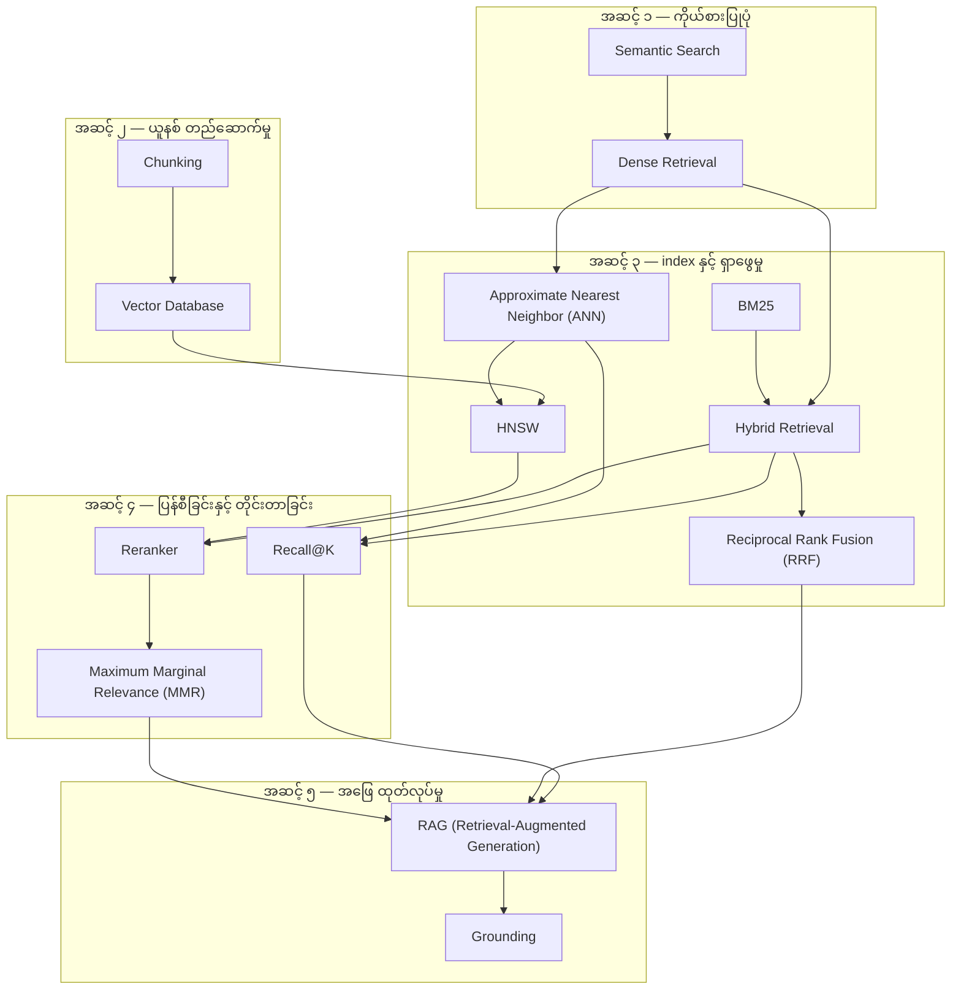
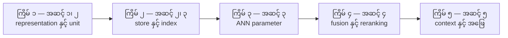

# Area 04 — Retrieval & generation: လေ့လာသည့် အစဉ် (Learning Sequence)

ဤနယ်ပယ်၏ term ၁၄ ခုသည် ခေါင်းစဉ် ရောနှောနေသည့် စာရင်း မဟုတ်ပါ။ ၎င်းတို့သည် **အဆင့် ၅ ဆင့်** —
ကိုယ်စားပြုပုံ (representation) → ယူနစ် တည်ဆောက်မှု (unit) → index နှင့် ရှာဖွေမှု (search) →
ပေါင်းစပ်မှုနှင့် တိုင်းတာမှု (fusion and measurement) → အဖြေ ထုတ်လုပ်မှု (generation) —
အဖြစ် တည်ဆောက်ထားသည်။ ဤဖိုင်သည် term များကို မည်သည့် အစဉ်အတိုင်း ဖတ်ရမည်၊ မည်သည့် term က
မည်သည့် term အပေါ် အခြေခံသည်ကို သတ်မှတ်ပေးသည်။

**ဖတ်သည့် အစဉ်ကို လိုက်ခြင်း၏ အကျိုးသက်ရောက်မှု** — နောက် term တိုင်းသည် အရင် term များကို
အသုံးပြု၍ ရှင်းလင်းသည်။ ဥပမာ `HNSW` သည် `Approximate Nearest Neighbor (ANN)` နှင့် ကိုယ်စားပြုပုံ
(vector) ကို မသိဘဲ နားလည်နိုင်မည် မဟုတ်သလို၊ `Reranker` သည် first-stage retrieval ကို မသိဘဲ
အဓိပ္ပာယ် မရှိပါ။ `Hybrid Retrieval` သည် `BM25` နှင့် `Dense Retrieval` နှစ်ခုလုံးကို မသိဘဲ ဖတ်ပါက
"ဘာကို ပေါင်းစပ်သည်" ကို ဆုံးဖြတ်နိုင်မည် မဟုတ်ပါ။

## အဆင့် ၅ ဆင့်၏ ခြုံငုံမှု

| အဆင့် | အမည် | Term | ဤအဆင့် ပြီးပါက ဖြေနိုင်ရမည့် မေးခွန်း |
|---|---|---|---|
| ၁ | အဓိပ္ပာယ်ကို vector အဖြစ် ကိုယ်စားပြုခြင်း | Semantic Search, Dense Retrieval | query နှင့် candidate ကို မည်သို့ နှိုင်းယှဉ်သည်၊ စကားလုံး မတူဘဲ အဓိပ္ပာယ် တူသည့် အထောက်အထားကို မည်သို့ ရှာသည် |
| ၂ | Document များကို ရှာဖွေနိုင်သည့် ယူနစ်အဖြစ် ခွဲခြားခြင်း | Chunking, Vector Database | မည်သည့် အရွယ်အစားဖြင့် ခွဲမည်၊ ယူနစ်များကို ဘယ်နေရာတွင် သိမ်း၍ မည်သို့ ရှာမည် |
| ၃ | Index တည်ဆောက်၍ ရှာဖွေခြင်း | BM25, Approximate Nearest Neighbor (ANN), HNSW, Hybrid Retrieval, Reciprocal Rank Fusion (RRF) | ရှာဖွေမှု အရည်အသွေး၊ memory နှင့် latency ကို မည်သို့ လဲလှယ်သည်၊ signal နှစ်မျိုးကို မည်သို့ ပေါင်းသည် |
| ၄ | ရလဒ် ပြန်စီခြင်းနှင့် အရည်အသွေး တိုင်းတာခြင်း | Reranker, Maximum Marginal Relevance (MMR), Recall@K | မည်သည့် အထောက်အထား context window ထဲ ရောက်မည်၊ retrieval ကောင်း/ဆိုးကို မည်သည့် ကိန်းဂဏန်းဖြင့် ဆုံးဖြတ်မည် |
| ၅ | အထောက်အထားမှ အဖြေ ထုတ်လုပ်ခြင်း | RAG (Retrieval-Augmented Generation), Grounding | ရလဒ်များကို အဖြေ တစ်ခုအဖြစ် မည်သို့ စုစည်းသည်၊ အဖြေက အထောက်အထားကို မှီမှီ ဖြစ်သည်ကို မည်သို့ စစ်သည် |

## အဆင့်များအကြား မှီခိုမှု (Prerequisite Graph)

## အဆင့် ၁ — အဓိပ္ပာယ်ကို vector အဖြစ် ကိုယ်စားပြုခြင်း (၂ term)

**အစဉ်** — `Semantic Search` → `Dense Retrieval`

**ဘာကြောင့် ဤနေရာတွင် ရှိသည်** — ဤအဆင့်သည် ဤနယ်ပယ် တစ်ခုလုံး၏ အခြေခံ ဖြစ်သည်။
`Semantic Search` သည် query နှင့် candidate ကို embedding space တစ်ခုအတွင်း ကိုယ်စားပြုပြီး
vector-similarity function ဖြင့် အစဉ်သတ်မှတ်သည့် ရှာဖွေမှု ဖြစ်သည်။ `Dense Retrieval` သည် ထို ရှာဖွေမှုကို
**first-stage** အဖြစ် တိကျစွာ သတ်မှတ်သည် — collection တစ်ခုလုံးကို ရှာဖွေ၍ candidate များ ပေးအပ်သည်။
ဤ ခွဲခြားမှုကို ဦးစွာ လုပ်ရခြင်းမှာ အဆင့် ၄ ရှိ `Reranker` သည် collection တစ်ခုလုံးကို ရှာဖွေသည့်
အရာ မဟုတ်ဘဲ candidate set သေးငယ် တစ်ခုကို ပြန်စီသည့် အရာ ဖြစ်ကြောင်း နားလည်ရန် ဖြစ်သည်။

**မှတ်သားရန်** — `Semantic Search` သည် "အဓိပ္ပာယ်ဖြင့် ရှာဖွေခြင်း" ဟူသည့် ရှာဖွေမှု အမျိုးအစား ဖြစ်ပြီး၊
`Dense Retrieval` သည် ထို ရှာဖွေမှု ကို ပထမအဆင့် အဖြစ် အကောင်အထည်ဖော်သည့် နည်းလမ်း ဖြစ်သည်။
နှစ်ခုလုံးတွင် exact identifier နှင့် ရှားပါးသည့် string အတွက် lexical search လိုအပ်ဆဲ ဖြစ်နိုင်သည် —
ဤ အချက်သည် အဆင့် ၃ ရှိ `BM25` ကို ဖွင့်ပေးသည်။

**စစ်ဆေးသည့် မေးခွန်း** — query နှင့် candidate သည် စကားလုံး တစ်လုံးမှ မတူဘဲ အဓိပ္ပာယ် တူပါက
vector-similarity function က မည်သို့ ရှာဖွေနိုင်သနည်း။ `Dense Retrieval` သည် reranking ကို
အစားထိုးနိုင်သလား။

## အဆင့် ၂ — Document များကို ရှာဖွေနိုင်သည့် ယူနစ်အဖြစ် ခွဲခြားခြင်း (၂ term)

**အစဉ်** — `Chunking` → `Vector Database`

**ဘာကြောင့် ဤနေရာတွင် ရှိသည်** — index မပြုမီ source material ကို ရှာဖွေနိုင်သည့် ယူနစ်များအဖြစ်
ခွဲရမည်။ `Chunking` သည် chunk နယ်နိမိတ်၊ overlap၊ metadata နှင့် document တည်ဆောက်ပုံ — လေးခုလုံးက
retrieval အရည်အသွေးကို ဆုံးဖြတ်သည် ဟု သတ်မှတ်ပေးသည်။ `Vector Database` သည် ထို ယူနစ်များ၏
vector များကို သိမ်းဆည်း၍ nearest-neighbor query များကို ပံ့ပိုးသည့် အလွှာ ဖြစ်သည်။
`Chunking` ကို ရှေ့တွင် ထားခြင်း၏ အကြောင်းရင်းမှာ chunk အရေအတွက်၊ အရွယ်အစားနှင့် metadata သည်
store လုပ်ရမည့် ပမာဏကို တိုက်ရိုက် သတ်မှတ်သောကြောင့် ဖြစ်သည်။

**မှတ်သားရန်** — `Vector Database` သည် vector များကို သိမ်းဆည်းပြီး ရှာဖွေသည်၊ သို့သော်
အရည်အသွေးမြင့် embedding များကို ဖန်တီးပေးခြင်း သို့မဟုတ် သက်ဆိုင်သည့် retrieval ကို အာမခံခြင်း
မပြုပါ။ အားလုံးအတွက် သက်ဆိုင်သည့် token အရွယ်အစား သို့မဟုတ် overlap ရာခိုင်နှုန်း မရှိပါ။

**စစ်ဆေးသည့် မေးခွန်း** — chunk အရွယ်အစားကို သေးငယ်စေပါက recall နှင့် context အရည်အသွေး အပေါ်
မည်သို့ သက်ရောက်သနည်း။ chunk အရေအတွက်နှင့် vector store ပမာဏ အကြား ဆက်စပ်မှုက ဘာလဲ။

## အဆင့် ၃ — Index တည်ဆောက်၍ ရှာဖွေခြင်း (၅ term)

**အစဉ်** — `BM25` → `Approximate Nearest Neighbor (ANN)` → `HNSW` → `Hybrid Retrieval` → `Reciprocal Rank Fusion (RRF)`

**ဘာကြောင့် ဤနေရာတွင် ရှိသည်** — `BM25` ကို ဦးစွာ ထားခြင်းမှာ ၎င်းသည် signal တစ်မျိုးတည်း၊
အကောင်အထည်ဖော်ရ လွယ်ကူသည့် ခိုင်မာသည့် exact-term baseline ဖြစ်သောကြောင့် ဖြစ်သည်။
`Approximate Nearest Neighbor (ANN)` သည် ထို baseline နှင့် ဆန့်ကျင်ဘက် ဘက်မှ လာသည် —
vector တိုင်းနှင့် အပြည့်အစုံ နှိုင်းယှဉ်ခြင်း မပြုဘဲ ရှာဖွေခြင်း ဖြစ်ပြီး၊ speed၊ memory နှင့်
retrieval recall အကြား တိုင်းတာနိုင်သည့် လဲလှယ်မှုကို ဖော်ပြသည်။ `HNSW` သည် ထို ရည်မှန်းချက်ကို
အလွှာလိုက် proximity graph ဖြင့် အကောင်အထည်ဖော်သည့် index algorithm ဖြစ်သည် — ထို့ကြောင့်
`HNSW` သည် `ANN` ၏ နောက်တွင် ရှိသည်။ `Hybrid Retrieval` သည် ဤ signal နှစ်မျိုး
(lexical နှင့် dense) ကို ပေါင်းစပ်သည်၊ `Reciprocal Rank Fusion (RRF)` သည် ထို ပေါင်းစပ်မှုကို
raw score များ တူညီသည့် စကေး ရှိသည်ဟု မယူဆဘဲ rank အလိုက် လုပ်ဆောင်သည့် နည်းလမ်း ဖြစ်သည်။

**မှတ်သားရန်** — `HNSW` သည် index algorithm တစ်ခု ဖြစ်သည်၊ similarity metric၊ embedding model
သို့မဟုတ် အပြည့်အစုံ vector database မဟုတ်ပါ။ `Hybrid Retrieval` သည် candidate signal များကို
ပေါင်းစပ်သည်၊ reranker သည် ရှာဖွေပြီးသား candidate များအပေါ် ဒုတိယ relevance model တစ်ခုကို
အသုံးချသည် — ဤ ကွာခြားမှုသည် အဆင့် ၄ ကို ဖွင့်ပေးသည်။

**စစ်ဆေးသည့်မေးခွန်း** — `ef` ကို တိုးပါက recall နှင့် latency မည်သို့ ပြောင်းသနည်း။
`RRF` သည် input list အားလုံးတွင် မပါဝင်သည့် item တစ်ခုကို ပြန်လည် ရယူနိုင်သလား။

## အဆင့် ၄ — ရလဒ် ပြန်စီခြင်းနှင့် အရည်အသွေး တိုင်းတာခြင်း (၃ term)

**အစဉ်** — `Reranker` → `Maximum Marginal Relevance (MMR)` → `Recall@K`

**ဘာကြောင့် ဤနေရာတွင် ရှိသည်** — first-stage retrieval သည် candidate လွှမ်းခြုံမှုကို အမြင့်ဆုံး
ဖြစ်စေပြီးနောက်၊ `Reranker` သည် query နှင့် candidate တစ်ခုချင်းစီအကြား ပိုကြွယ်ဝသည့် နှိုင်းယှဉ်မှုဖြင့်
ကန့်သတ်ထားသည့် context window သို့ မည်သည့် အထောက်အထား ရောက်ရှိမည်ကို တိုးတက်စေသည်။
`Maximum Marginal Relevance (MMR)` သည် ရွေးချယ်ပြီးသား item များနှင့် နှိုင်းယှဉ်သည့် အသစ်အဆန်းမှုကို
မျှတစေသဖြင့် ထပ်နေသည့် chunk များကို လျှော့ချပြီး ကန့်သတ်ထားသည့် ဘတ်ဂျက်တစ်ခုသည်
ပိုမို ကွဲပြားသည့် အထောက်အထားများကို လွှမ်းခြုံနိုင်သည်။ `Recall@K` သည် ဤ အစဉ်တစ်ခုလုံးကို
တိုင်းတာသည် — retrieval အဆင့်တစ်ခုက downstream အတွက် သက်ဆိုင်သည့် candidate များ
လုံလောက်စွာ ပေးနိုင်ခြင်း ရှိ/မရှိ ကို ပြောပြသည်။

**မှတ်သားရန်** — `MMR` သည် ရှိပြီးသား candidate set တစ်ခုကို ကွဲပြားစေသည်၊ လွတ်နေသည့်
အထောက်အထားကို ရှာဖွေပေးခြင်း မပြုပါ။ `Recall@K` မြင့်ခြင်းသည် ထိပ်ဆုံး ရလဒ် ကောင်းခြင်း၊
ranking ကောင်းစွာ အစဉ်သတ်မှတ်ထားခြင်း သို့မဟုတ် နောက်ဆုံး အဖြေ grounded ဖြစ်ခြင်းကို
အာမမခံပါ။

**စစ်ဆေးသည့်မေးခွန်း** — `Recall@K` မြင့်သော်လည်း အဖြေ မှားနိုင်သလား။
သက်ဆိုင်သည့် item မရှိသည့် query အတွက် denominator သုည ဖြစ်သည့်အခါ မည်သို့ သတ်မှတ်မည်။

## အဆင့် ၅ — အထောက်အထားမှ အဖြေ ထုတ်လုပ်ခြင်း (၂ term)

**အစဉ်** — `RAG (Retrieval-Augmented Generation)` → `Grounding`

**ဘာကြောင့် ဤနေရာတွင် ရှိသည်** — `RAG (Retrieval-Augmented Generation)` သည် အပေါ်ရှိ အဆင့်
လေးဆင့်လုံးကို စနစ် ပုံစံ တစ်ခုအဖြစ် စုစည်းသည် — တောင်းဆိုချက်နှင့် သက်ဆိုင်သည့် အထောက်အထားကို
ရှာဖွေပြီး၊ ရွေးချယ်ထားသည့် အကြောင်းအရာကို generative model သို့ ၎င်းက ဖြေကြားခြင်း မပြုမီ
ပေးအပ်သည်။ `Grounding` သည် ထို အဆင့်တွင် စနစ်က ဖော်ထုတ်၍ စစ်ဆေးနိုင်သည့် အထောက်အထား၊ state
သို့မဟုတ် observation များနှင့် အဖြေကို ချိတ်ဆက်ပေးသည် — ထို့ကြောင့် `RAG (Retrieval-Augmented Generation)`
၏ နောက်တွင် ရှိသည်။ prompt ထဲသို့ document များ ထည့်ခြင်းသည် grounding အတွက် အခွင့်အလမ်း တစ်ခု
ဖန်တီးပေးသည်၊ သို့သော် model က ၎င်းတို့ကို မှန်ကန်စွာ အသုံးပြုမည်ဟု အာမမခံပါ။

**မှတ်သားရန်** — `RAG (Retrieval-Augmented Generation)` သည် လက်ရှိ သို့မဟုတ် သီးသန့် အထောက်အထားကို
model weight များထဲ ထည့်သွင်းခြင်း မရှိဘဲ အသုံးပြုနိုင်စေသည်၊ သို့သော် retrieval နှင့် grounding ကို
သီးခြားစီ အကဲဖြတ်ရမည် ဖြစ်သည်။

**စစ်ဆေးသည့်မေးခွန်း** — retrieval ကောင်းသော်လည်း အဖြေ grounded မဖြစ်သည့် အခြေအနေကို
မည်သို့ ရှာဖွေမည်။ အဖြေက ကိုးကားထားသည့် အပိုင်းက မထောက်ခံသည့် အဆိုများကို မည်သို့ ပယ်ချမည်။

## Term ၁၄ ခု၏ အစဉ် ဇယား

| # | Term | အဆင့် | ကြိုတင် သိရမည့် term | ဖွင့်ပေးသည့် အချက် |
|---|---|---|---|---|
| 1 | Semantic Search | ၁ | — | query နှင့် candidate ကို embedding space တွင် နှိုင်းယှဉ်ခြင်း |
| 2 | Dense Retrieval | ၁ | Semantic Search | first-stage candidate ရှာဖွေခြင်း |
| 3 | Chunking | ၂ | Dense Retrieval | ရှာဖွေနိုင်သည့် ယူနစ် တည်ဆောက်ခြင်း |
| 4 | Vector Database | ၂ | Chunking | vector သိုလှောင်မှု၊ metadata filtering နှင့် persistence |
| 5 | BM25 | ၃ | Chunking | lexical baseline နှင့် exact-term လွှမ်းခြုံမှု |
| 6 | Approximate Nearest Neighbor (ANN) | ၃ | Dense Retrieval | approximation နှင့် လဲလှယ်မှု (speed၊ memory၊ recall) |
| 7 | HNSW | ၃ | Approximate Nearest Neighbor (ANN) | အလွှာလိုက် graph index အကောင်အထည်ဖော်မှု |
| 8 | Hybrid Retrieval | ၃ | BM25, Dense Retrieval | signal နှစ်မျိုးမှ candidate ပေါင်းစပ်မှု |
| 9 | Reciprocal Rank Fusion (RRF) | ၃ | Hybrid Retrieval | rank ဖြင့် စာရင်းများ ပေါင်းခြင်း |
| 10 | Reranker | ၄ | Hybrid Retrieval, HNSW | context window ထဲ ရောက်သည့် အထောက်အထား အစဉ် |
| 11 | Maximum Marginal Relevance (MMR) | ၄ | Reranker | ထပ်နေသည့် chunk လျှော့၍ လွှမ်းခြုံမှု တိုးခြင်း |
| 12 | Recall@K | ၄ | Approximate Nearest Neighbor (ANN), Reranker | retrieval အဆင့်၏ လုံလောက်မှုကို တိုင်းတာခြင်း |
| 13 | RAG (Retrieval-Augmented Generation) | ၅ | Reranker, Maximum Marginal Relevance (MMR), Reciprocal Rank Fusion (RRF) | အဆင့် ၄ ဆင့်ကို စနစ် ပုံစံ အဖြစ် စုစည်းခြင်း |
| 14 | Grounding | ၅ | RAG (Retrieval-Augmented Generation) | အဖြေကို စစ်ဆေးနိုင်သည့် အထောက်အထားနှင့် ချိတ်ဆက်ခြင်း |

## လက်တွေ့ လုပ်သည့် အစဉ် (၅ ကြိမ် ထိုင်ရန်)

| ကြိမ် | ဖတ်ရမည့် အဆင့် | လက်တွေ့ လုပ်ရမည့် lab |
|---|---|---|
| ၁ | အဆင့် ၁ + ၂ | `python3 guides/04_retrieval_and_generation/labs/lab_chunking.py --tokens 12000 --chunk 400 --overlap 60` |
| ၂ | အဆင့် ၂ + ၃ | `python3 .../labs/lab_vector_index.py --chunks 4096 --dim 64 --dtype fp16` |
| ၃ | အဆင့် ၃ | `python3 .../labs/lab_vector_index.py --probe 2` နှင့် `--probe 4` ကို နှိုင်းယှဉ်ခြင်း |
| ၄ | အဆင့် ၄ | `python3 .../labs/lab_vector_index.py --k 10 --queries 32` နှင့် `--k 3` |
| ၅ | အဆင့် ၅ | `python3 .../labs/lab_prompt_budget.py --chunk 512 --k 6 --window 8192 --reserve 1024` နှင့် [`04_exercises.md`](04_exercises.md) ရှိ တွက်ချက်ရသည့် လေ့ကျင့်ခန်း ၆ ခု |

ကြိမ် တိုင်းတွင် glossary entry ကို အရင် ဖတ်ပြီး၊ ထို့နောက် ဤဖိုင်၏ အဆင့် ရှင်းလင်းချက်ကို ဖတ်ပါ၊
နောက်ဆုံးတွင် lab ဖြင့် ကိန်းဂဏန်း အနေဖြင့် တိုက်စစ်ပါ။ Lab သုံးခုလုံးကို `labs/run_labs.py` ဖြင့်
တစ်ပြိုင်နက် run နိုင်သည် (`labs/README.md` တွင် run ပုံနှင့် output များ ပါဝင်သည်)။

## နောက်တစ်ဆင့်

- ပုံရှင်းလင်းချက်များ — [`02_visual_explanations.md`](02_visual_explanations.md) (RAG လမ်းကြောင်း၊ chunking၊ HNSW ရှာဖွေမှု၊ fusion၊ reranking၊ context ဘတ်ဂျက်)
- လေ့ကျင့်ခန်းများ — [`04_exercises.md`](04_exercises.md)
- Term တိုင်း၏ အပြည့်အစုံ အဓိပ္ပာယ် — [`../../terms/04_retrieval_and_generation.md`](../../terms/04_retrieval_and_generation.md)
