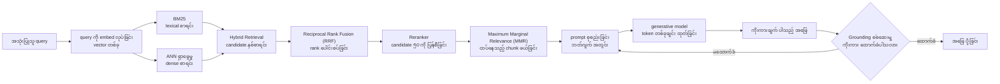
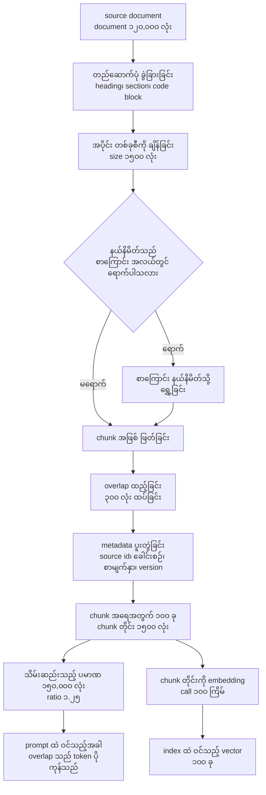
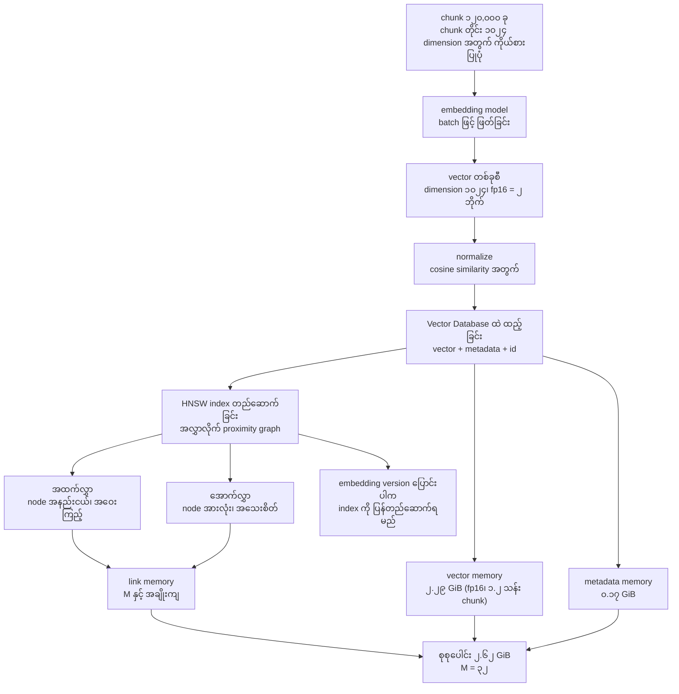
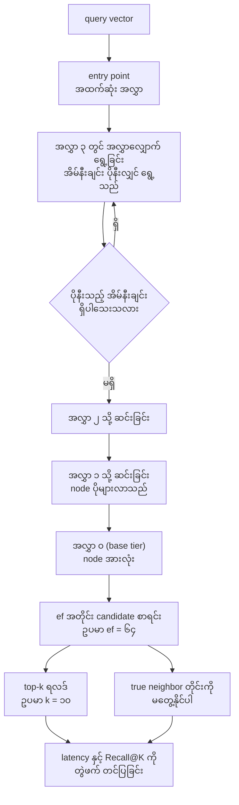
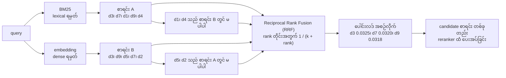
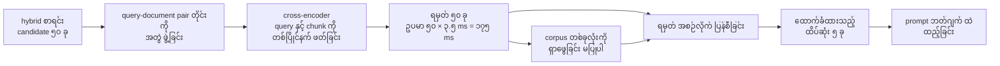
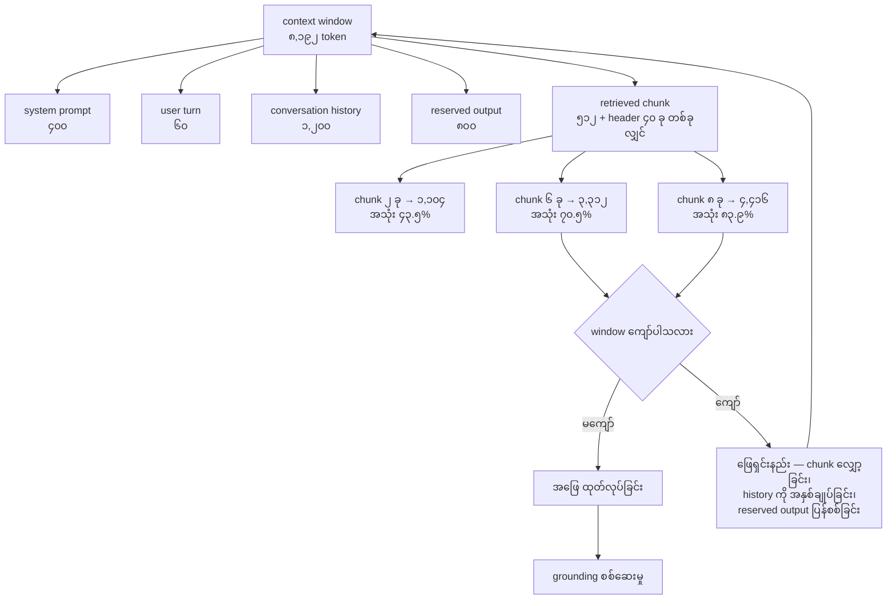

# Area 04 — ပုံရှင်းလင်းချက်များ (Visual Explanations)

Term တစ်ခုကို စာဖြင့်သာ ဖတ်ပါက "ဘယ်ကနေ ဘယ်ကို သွားသည်" ဟူသည့် လမ်းကြောင်း မမြင်ရပါ။
ဤဖိုင်သည် retrieval နှင့် generation လုပ်ငန်းစဉ် တစ်ခုလုံး၏ လမ်းကြောင်းများကို ပုံဖြင့် ပြသည် —
တောင်းဆိုမှု ဝင်လာသည့် အချိန်မှ ကိုးကားချက် ပါသည့် အဖြေ ထွက်သည့် အချိန်အထိ၊ ထို လုပ်ငန်းစဉ်အတွင်း
ကိန်းဂဏန်း ဖြစ်လာသည့် နေရာ တိုင်း (chunk အရေအတွက်၊ vector memory၊ recall၊ token ဘတ်ဂျက်) အထိ
ဖော်ပြသည်။

**ပုံများ ကြည့်နည်း** — ဤဖိုင်ကို GitHub တွင် ဖတ်ပါက Mermaid ပုံများ အလိုအလျောက် render ဖြစ်သည်။
ဒေသအတွင်း တွင်ဖတ်လိုပါက VS Code ၏ Mermaid extension သို့မဟုတ် mermaid.live တွင်
ဖိုင်ထဲရှိ mermaid code block ကို ကူးထည့်ပါ။

## ၁။ RAG တောင်းဆိုမှု တစ်ခုလုံး၏ လမ်းကြောင်း (End-to-end)

**ဘာကို ကြည့်ရမည်** —
- `E` တွင် စာရင်း နှစ်စာရင်း စုစည်းသည်၊ သို့သော် `F` တွင် **rank** ကို ပေါင်းသည် — raw score များကို
  မပေါင်းပါ။ ထို့ကြောင့် cosine similarity နှင့် BM25 score တို့ တူညီသည့် စကေး ရှိရန် မလိုပါ။
- `G` သည် ကော်ပရပ်စ် တစ်ခုလုံးကို ရှာဖွေခြင်း မပြုပါ — `F` က ပေးအပ်ပြီးသား candidate set ကိုသာ ပြန်စီသည်။
- `H` မှ `I` သို့ ရောက်သည့်အခါ retrieved token သည် context window ထဲ တိုက်ရိုက် ပါဝင်လာသည် —
  ဤနေရာတွင် ကုန်ကျစရိတ်နှင့် ပြတ်တောက်နိုင်ခြေ စတင်သည် (ပုံ ၇ ကို ကြည့်ပါ)။
- `L` သည် စက်ဝိုင်းပြန်သည့် မြှား ဖြစ်သည် — ကိုးကားချက် မထောက်ခံသည့် အဆိုကို ပယ်ချပြီး
  အထောက်အထား ပြန်ရွေးသည့် လုပ်ငန်းစဉ် ဖြစ်သည်။

**သက်ဆိုင်သည့် term** — Semantic Search, Dense Retrieval, BM25, Hybrid Retrieval, Reciprocal Rank Fusion (RRF), Reranker, Maximum Marginal Relevance (MMR), RAG (Retrieval-Augmented Generation), Grounding

## ၂။ Chunking — နယ်နိမိတ်၊ overlap နှင့် metadata

**ဘာကို ကြည့်ရမည်** —
- `G` ရှိ overlap သည် **အစနှင့် အဆုံး** ကို ဖြတ်သည့် အချက်အလက် မပျောက်စေရန် ဖြစ်သည်၊ သို့သော်
  သိမ်းဆည်းမှုနှင့် embedding ကုန်ကျစရိတ်ကို တိုက်ရိုက် တိုးစေသည် (chunk ၁၀၀ တွင် လုံး ၃၀,၀၀၀ ခန့်
  ထပ်ဖြစ်သည်)။
- `H` သည် အရေးပါသည် — metadata မပါပါက ထိုးထွင်းချက် (citation) ကို မဖော်ထုတ်နိုင်သဖြင့်
  `Grounding` စစ်ဆေးမှု မလုပ်နိုင်ပါ။
- overlap ရာခိုင်နှုန်းကို တိုးပါက chunk အရေအတွက်နှင့် သိမ်းဆည်းသည့် ပမာဏ နှစ်ခုလုံး တိုးသည် —
  ဤ အချိုးသည် linear အလျော့အကျ မဟုတ်ပါ။

**သက်ဆိုင်သည့် term** — Chunking, Vector Database, RAG (Retrieval-Augmented Generation), Grounding

## ၃။ Embedding နှင့် vector index တည်ဆောက်ခြင်း

**ဘာကို ကြည့်ရမည်** —
- memory အကြီးဆုံး အစိတ်အပိုင်းသည် vector ကိုယ်တိုင် (၈၇ % ခန့်) ဖြစ်သည်၊ link နှင့် metadata က
  ကျန် အစိတ်အပိုင်း ဖြစ်သည်။
- `M` (node တစ်ခုလျှင် link အရေအတွက်) ကို ၁၆ မှ ၆၄ သို့ တိုးပါက link memory သည် လေးဆ
  ဖြစ်သည်၊ သို့သော် vector memory က မပြောင်းလဲပါ။
- `M` သည် index တည်ဆောက်ချိန် parameter ဖြစ်သည်၊ `ef` သည် query ချိန် parameter ဖြစ်သည် —
  နှစ်ခုကို ခွဲခြား သိရမည် (ပုံ ၄ ကို ကြည့်ပါ)။
- `M` တိုးလျှင် link memory သာ မဟုတ်၊ index တည်ဆောက်ချိန်နှင့် query အရည်အသွေး နှစ်ခုလုံး
  ပြောင်းလဲသည်။

**သက်ဆိုင်သည့် term** — Chunking, Dense Retrieval, Vector Database, HNSW, Approximate Nearest Neighbor (ANN)

## ၄။ ANN ရှာဖွေမှု — အလွှာလိုက် graph ကို လမ်းလျှောက်ခြင်း (HNSW ပုံစံ)

**ဘာကို ကြည့်ရမည်** —
- အထက်လွှာတွင် node နည်းသဖြင့် လမ်း ရှာခြင်း လျင်မြန်သည်၊ သို့သော် ကြမ်းတမ်းသည်။
  အောက်လွှာတွင် node များသဖြင့် အသေးစိတ် ရှာသည်။
- `P6` ရှိ `ef` သည် ရှာဖွေမှု အကျယ်ကို ဆုံးဖြတ်သည် — `ef` တိုးလျှင် recall တိုးသည်၊
  latency လည်း တိုးသည်။
- `P9` သည် ANN ၏ အနှစ်သာရ ဖြစ်သည် — approximation ဖြစ်သဖြင့် recall သည် ၁.၀ မဖြစ်နိုင်ပါ။
  ထို့ကြောင့် `Recall@K` ကို latency နှင့် တွဲဖက် တင်ပြရသည်။
- အလွှာ အရေအတွက်သည် graph တည်ဆောက်ပုံ အပေါ် မူတည်သည်၊ query တိုင်းတွင် တူညီသည့်
  အလွှာ အရေအတွက် ဖြတ်စရာ မလိုပါ — မရှိသည့် အလွှာကို ကျော်သည်။

**သက်ဆိုင်သည့် term** — Approximate Nearest Neighbor (ANN), HNSW, Vector Database, Dense Retrieval, Recall@K

## ၅။ Hybrid Search — score မဟုတ်ဘဲ rank ကို ပေါင်းစပ်ခြင်း

**ဘာကို ကြည့်ရမည်** —
- `E` သည် rank ကိုသာ သုံးသည် — BM25 ၏ ရမှတ်နှင့် cosine similarity သည် စကေး မတူညီသည့်
  အတွက် ဤနည်းလမ်းက စကေး ကိုက်ညီမှု လိုအပ်ချက်ကို ဖယ်ရှားပေးသည်။
- `H` နှင့် `I` သည် hybrid ၏ အကျိုးအမြတ် ဖြစ်သည် — lexical စာရင်းတွင်သာ ပါသည့် item နှင့်
  dense စာရင်းတွင်သာ ပါသည့် item နှစ်မျိုးလုံး ပေါင်းစပ်ထားသည့် စာရင်းထဲ ရောက်လာသည်။
- စာရင်း နှစ်ခုလုံးတွင် ပါသည့် item (`d3`၊ `d7`၊ `d9`) သည် ပေါင်းလဒ် နှစ်ကြိမ် ရသဖြင့်
  ရှေ့သို့ တက်သည် — fusion သည် **အများကြီး သဘောတူညီမှု** ကို ဆုချသည်။
- `RRF` သည် input list အားလုံးတွင် မပါဝင်သည့် item တစ်ခုကို ပြန်လည် ရယူနိုင်ခြင်း မရှိပါ။

**သက်ဆိုင်သည့် term** — BM25, Dense Retrieval, Hybrid Retrieval, Reciprocal Rank Fusion (RRF), Semantic Search

## ၆။ Reranking — candidate ၅၀ မှ ၅ ခုသို့

**ဘာကို ကြည့်ရမည်** —
- `C` တွင် query နှင့် candidate ကို **တစ်ပြိုင်နက်** ဖတ်သည့်အတွက် ပထမအဆင့် retrieval ထက်
  ပိုကုန်ကျသည်၊ ထို့ကြောင့် candidate အရေအတွက်ကို ကန့်သတ်ရသည်။
- `H` သည် reranker ၏ အကန့်အသတ် ဖြစ်သည် — retrieval က မတွေ့သည့် အထောက်အထားကို
  reranker က ဖန်တီးပေးနိုင်ခြင်း မရှိပါ။
- reranking depth ကို တိုးပါက precision တိုးသည်၊ latency လည်း တိုးသည် (ပုံ ၇ နှင့်
  [`04_exercises.md`](04_exercises.md) ရှိ ဆုံးဖြတ်ချက် ၂ ကို ကြည့်ပါ)။
- `F` မှ `G` သို့ ကူးသည့် အရေအတွက်သည် context window ထဲ ဝင်မည့် အထောက်အထား ပမာဏကို
  တိုက်ရိုက် သတ်မှတ်သည်။

**သက်ဆိုင်သည့် term** — Reranker, Hybrid Retrieval, Maximum Marginal Relevance (MMR), RAG (Retrieval-Augmented Generation)

## ၇။ Retrieved token များ — context ဘတ်ဂျက် အတွက် ပြိုင်ဆိုင်မှု

**ဘာကို ကြည့်ရမည်** —
- `retrieved chunk` သည် ကျန် အပိုင်း လေးခုနှင့် **တူညီသည့် ဘတ်ဂျက်** ကို မျှဝေ သုံးသည် —
  chunk ထည့်လိုက်သည့် အရေအတွက် တိုင်းသည် history သို့မဟုတ် output အတွက် နေရာကို ယူသည်။
- `reserved output` ကို မနုတ်ပါက window အတွင်း ဝင်သည်ဟု ထင်ရသော်လည်း အဖြေသည်
  အလယ်တွင် ပြတ်တောက်သည်။
- chunk တိုင်းတွင် ခေါင်းစီး (header) token လည်း ပါသည် — ပုံတွင် ၅၁၂ + ၄၀ ဖြစ်သည်။
  ထို့ကြောင့် "chunk token" ကို တွက်သည့်အခါ header ကို မေ့ခြင်း မပြုရ။
- `Z` မှ `W` သို့ ပြန်လှည့်သည့် မြှား သည် retrieval ဘတ်ဂျက် ချိန်ညှိခြင်း ဖြစ်သည် —
  ဤ အဆင့်သည် `Maximum Marginal Relevance (MMR)` ၏ တန်ဖိုးကို ဖော်ပြသည်။

**သက်ဆိုင်သည့် term** — RAG (Retrieval-Augmented Generation), Chunking, Maximum Marginal Relevance (MMR), Grounding

## ပုံတိုင်းနှင့် term ချိတ်ဆက်မှု

| ပုံ | ပြသည့် အကြောင်းအရာ | သက်ဆိုင်သည့် term |
|---|---|---|
| ၁ | RAG တောင်းဆိုမှု တစ်ခုလုံး၏ လမ်းကြောင်း | Semantic Search, Dense Retrieval, BM25, Hybrid Retrieval, Reciprocal Rank Fusion (RRF), Reranker, Maximum Marginal Relevance (MMR), RAG (Retrieval-Augmented Generation), Grounding |
| ၂ | Chunking၊ overlap နှင့် metadata | Chunking, Vector Database, RAG (Retrieval-Augmented Generation), Grounding |
| ၃ | embedding နှင့် index တည်ဆောက်ခြင်း | Chunking, Dense Retrieval, Vector Database, HNSW, Approximate Nearest Neighbor (ANN) |
| ၄ | HNSW အလွှာလိုက် ရှာဖွေမှု | Approximate Nearest Neighbor (ANN), HNSW, Vector Database, Dense Retrieval, Recall@K |
| ၅ | hybrid search နှင့် rank fusion | BM25, Dense Retrieval, Hybrid Retrieval, Reciprocal Rank Fusion (RRF), Semantic Search |
| ၆ | reranking နှင့် context ရွေးချယ်မှု | Reranker, Hybrid Retrieval, Maximum Marginal Relevance (MMR), RAG (Retrieval-Augmented Generation) |
| ၇ | retrieved token နှင့် context ဘတ်ဂျက် | RAG (Retrieval-Augmented Generation), Chunking, Maximum Marginal Relevance (MMR), Grounding |

## နောက်တစ်ဆင့်

- ကိန်းဂဏန်း အဖြစ် မြင်လိုပါက — [`04_exercises.md`](04_exercises.md) (chunk အရေအတွက်၊ vector memory၊ recall@k၊ prompt token ကုန်ကျစရိတ်)
- အစဉ်နှင့် မှီခိုမှု — [`01_learning_sequence.md`](01_learning_sequence.md)
- Term တိုင်း၏ အပြည့်အစုံ အဓိပ္ပာယ် — [`../../terms/04_retrieval_and_generation.md`](../../terms/04_retrieval_and_generation.md)
