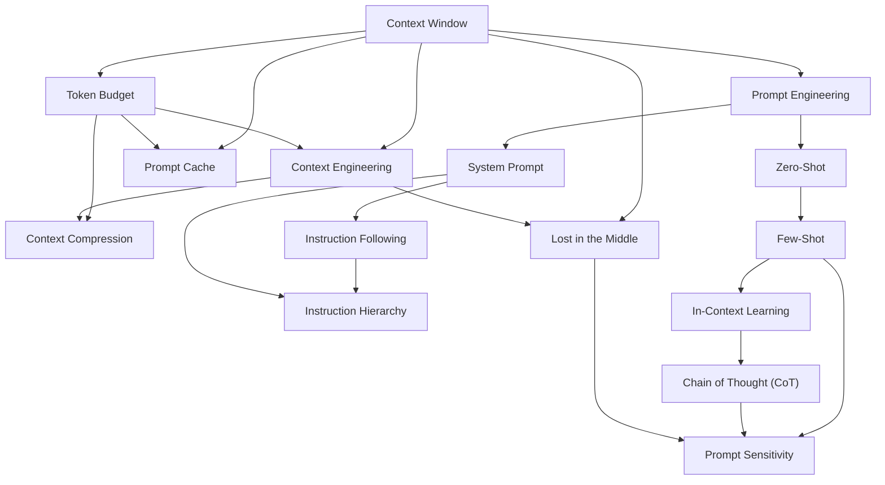

# Area 05 — Prompting & context: လေ့လာသည့် အစဉ် (Learning Sequence)

ဤနယ်ပယ်၏ term ၁၅ ခုသည် ရောနှောနေသည့် ခေါင်းစဉ်များ မဟုတ်ပါ။ ၎င်းတို့သည် **အဆင့် ၅ ဆင့်** —
မော်ဒယ် တကယ် မြင်သည့် အရာ (capacity) → ညွှန်ကြားချက် ပေးခြင်း (authority) → ဥပမာနှင့် output ပုံစံ
(demonstration) → context ကို စီမံခြင်း (management) → ကာကွယ်ခြင်းနှင့် အကဲဖြတ်ခြင်း (robustness) —
အဖြစ် တည်ဆောက်ထားသည်။ ဤဖိုင်သည် term များကို မည်သည့် အစဉ်အတိုင်း ဖတ်ရမည်၊ မည်သည့် term က
မည်သည့် term အပေါ် အခြေခံသည်ကို သတ်မှတ်ပေးသည်။

**ဖတ်သည့် အစဉ်ကို လိုက်ခြင်း၏ အကျိုးသက်ရောက်မှု** — နောက် term တိုင်းသည် အရင် term များကို
အသုံးပြု၍ ရှင်းလင်းသည်။ ဥပမာ `Token Budget` သည် `Context Window` ကို မသိဘဲ ပြည့်စုံစွာ
နားလည်နိုင်မည် မဟုတ်သလို၊ `Context Compression` သည် `Context Engineering` နှင့် `Token Budget` ကို
မသိဘဲ "ဘာကို ချုံ့ရမည်၊ ဘာကို စာလုံးတိုင်း ထိန်းရမည်" ဟူသည့် အချက်ကို ဆုံးဖြတ်နိုင်မည် မဟုတ်ပါ။

## အဆင့် ၅ ဆင့်၏ ခြုံငုံမှု

| အဆင့် | အမည် | Term | ဤအဆင့် ပြီးပါက ဖြေနိုင်ရမည့် မေးခွန်း |
|---|---|---|---|
| ၁ | မော်ဒယ် တကယ် မြင်သည့် အရာ | Context Window, Token Budget | inference တစ်ခုအတွက် ရရှိသည့် တိကျသည့် နေရာ မည်မျှ ဖြစ်သည်၊ ထို နေရာကို မည်သို့ ခွဲဝေမည် |
| ၂ | ညွှန်ကြားချက် ပေးခြင်း | Prompt Engineering, System Prompt, Instruction Following, Instruction Hierarchy | လုပ်ဆောင်ရမည့် အလုပ်ကို မည်သည့် စကားလုံးဖြင့်၊ မည်သည့် အခွင့်အာဏာ အဆင့်ဖြင့် ပေးမည် |
| ၃ | ဥပမာနှင့် ခိုင်မာသည့် output | Zero-Shot, Few-Shot, In-Context Learning, Chain of Thought (CoT) | demonstration မပါဘဲ၊ ပါဘဲ၊ rationale ပါဘဲ လုပ်သည့်အခါ ရလဒ် မည်သို့ ကွာခြားသည် |
| ၄ | context ကို စီမံခြင်း | Context Engineering, Context Compression, Prompt Cache | window အတွင်းသို့ မည်သည့် အထောက်အထား ဝင်မည်၊ ချုံ့သည့်အခါ ဘာဆုံးရှုံးသည်၊ ဘာကို ပြန်လည် အသုံးပြုနိုင်သည် |
| ၅ | ကာကွယ်ခြင်းနှင့် အကဲဖြတ်ခြင်း | Lost in the Middle, Prompt Sensitivity | အထောက်အထား တည်နေရာနှင့် prompt မူကွဲအပေါ် စနစ်သည် ဘယ်လောက် ခိုင်မာသည် |

## အဆင့်များအကြား မှီခိုမှု (Prerequisite Graph)

## အဆင့် ၁ — မော်ဒယ် တကယ် မြင်သည့် အရာ (၂ term)

**အစဉ်** — `Context Window` → `Token Budget`

**ဘာကြောင့် ဤနေရာတွင် ရှိသည်** — ဤအဆင့်သည် ကျန် အဆင့် ၄ ဆင့်လုံး၏ ကန့်သတ်ချက်ကို သတ်မှတ်သည်။
`Context Window` သည် model နှင့် API contract တစ်ခုအောက်တွင် inference တစ်ခုအတွက် ရရှိသည့်
အများဆုံး token စွမ်းရည် ဖြစ်သည်။ ထို စွမ်းရည်တွင် system ညွှန်ကြားချက်များ၊ message များ၊
ရယူထားသည့် အကြောင်းအရာ၊ tool ဖလှယ်မှုများနှင့် ထုတ်လုပ်သည့် output တို့ ပါဝင်နိုင်ပြီး
provider အလိုက် တွက်ချက်မှုနှင့် output ကန့်သတ်ချက်များ ကွာခြားသည်။ `Token Budget` သည် ထို
စွမ်းရည်အတွင်း ညွှန်ကြားချက်၊ အထောက်အထား၊ မှတ်တမ်း၊ tool ရလဒ်၊ reasoning နှင့် output
တို့အကြား token ကို ကြိုတင် ခွဲဝေ သတ်မှတ်သည့် အစီအစဉ် ဆွဲသည့် ကန့်သတ်ချက် ဖြစ်သည်။

**မှတ်သားရန်** — Window သည် **ကန့်သတ်ချက်** ဖြစ်သည်၊ Budget သည် **အစီအစဉ်** ဖြစ်သည်။ ထို
နှစ်ခုကို မခွဲခြားပါက output အတွက် နေရာ မကျန်သည့် အခြေအနေကို မမြင်နိုင်ပါ။

**စစ်ဆေးသည့် မေးခွန်း** — Window ကြီးခြင်းသည် ထည့်သွင်းထားသည့် အသေးစိတ် တိုင်းကို
မော်ဒယ် ယုံကြည်စိတ်ချစွာ အသုံးပြုမည်ဟု အာမခံသလား။

## အဆင့် ၂ — ညွှန်ကြားချက် ပေးခြင်း (၄ term)

**အစဉ်** — `Prompt Engineering` → `System Prompt` → `Instruction Following` → `Instruction Hierarchy`

**ဘာကြောင့် ဤနေရာတွင် ရှိသည်** — `Prompt Engineering` သည် မော်ဒယ်နှင့် ထိတွေ့သည့်
ညွှန်ကြားချက်များ၊ ဥပမာများ၊ ကန့်သတ်ချက်များနှင့် output လိုအပ်ချက်များကို စီစဉ် တည်ဆောက်ခြင်း
ဖြစ်သည်။ `System Prompt` သည် ထို လုပ်ငန်းအတွက် provider မှ သတ်မှတ်ထားသည့် လမ်းကြောင်း —
application မှ ပေးအပ်သည့် ညွှန်ကြားချက် message သို့မဟုတ် configuration — ဖြစ်သည်။
`Instruction Following` သည် ထို ညွှန်ကြားချက်များကို အပြုအမူ အဖြစ် ပြောင်းနိုင်သည့် မော်ဒယ်
စွမ်းရည် ဖြစ်ပြီး၊ `Instruction Hierarchy` သည် အခွင့်အာဏာ မတူညီသည့် ရင်းမြစ်များမှ
ညွှန်ကြားချက်များ ပဋိပက္ခဖြစ်သည့်အခါ ဖြေရှင်းသည့် စည်းမျဉ်း ဖြစ်သည်။

**မှတ်သားရန်** — ဘာသာစကား ထုတ်လုပ်ခြင်းသည် ချောမွေ့နိုင်သည်၊ သို့သော် အသုံးပြုသူ
တောင်းဆိုသည့် လုပ်ဆောင်ချက်၊ format၊ နယ်နိမိတ် သို့မဟုတ် ဦးစားပေး အစဉ်ကို မလိုက်နာဘဲ
ဖြစ်နိုင်သည်။ ထို့ကြောင့် instruction adherence ကို ဖြေဆိုချက် အရည်အသွေးနှင့် သီးခြားစီ
အကဲဖြတ်ရမည်။

**စစ်ဆေးသည့် မေးခွန်း** — `Instruction Hierarchy` သည် လုံခြုံရေး နယ်နိမိတ် တစ်ခု ဖြစ်သလား။
`System Prompt` သည် လျှို့ဝှက် နေမည်ဟု အာမခံနိုင်သလား။

## အဆင့် ၃ — ဥပမာနှင့် ခိုင်မာသည့် output (၄ term)

**အစဉ်** — `Zero-Shot` → `Few-Shot` → `In-Context Learning` → `Chain of Thought (CoT)`

**ဘာကြောင့် ဤနေရာတွင် ရှိသည်** — ဤအဆင့်သည် ညွှန်ကြားချက်သာ ရှိသည့် အခြေအနေမှ
ဥပမာနှင့် rationale ပါလာသည့် အခြေအနေသို့ တက်သည်။ `Zero-Shot` သည် လက်ရှိ input တွင်
task-specific demonstration များ မထည့်ဘဲ လုပ်ဆောင်ခြင်း ဖြစ်သည်။ `Few-Shot` သည် ပစ်မှတ် input
မတိုင်မီ ဥပမာ အနည်းငယ် ထည့်သွင်းခြင်း ဖြစ်သည်။ `In-Context Learning` သည် ထို ဖြစ်စဉ်၏
ယန္တရား — parameter update မပြုဘဲ လက်ရှိ input မှ မော်ဒယ်၏ အပြုအမူ လိုက်လျောညီထွေ
ပြောင်းလဲခြင်း — ဖြစ်သည်။ `Chain of Thought (CoT)` သည် ဖြေဆိုချက် မထုတ်လုပ်မီ task တစ်ခုကို
အစိတ်အပိုင်းများ ခွဲခြမ်းသည့် ကြားခံ ကျိုးကြောင်းဆင်ခြင်မှု ဖြစ်သည်။

**မှတ်သားရန်** — ဥပမာ အရေအတွက် တစ်သမတ်တည်း ထက် ဥပမာ၏ အရည်အသွေးနှင့် လွှမ်းခြုံမှုက
ပို၍ အရေးပါသည်။ ချောမွေ့သည့် rationale တစ်ခုသည် ဖြေဆိုချက် မှန်ကန်ကြောင်း သက်သေ မဟုတ်ပါ။

**စစ်ဆေးသည့် မေးခွန်း** — `Zero-Shot` သည် မော်ဒယ်တွင် သက်ဆိုင်သည့် pretraining မရှိခဲ့သည်ဟု
ဆိုလိုသလား။ ဆန့်ကျင်နေသည့် demonstration များ ထည့်ပါက ယုံကြည်စိတ်ချရမှု မည်သို့ ဖြစ်သည်။

## အဆင့် ၄ — context ကို စီမံခြင်း (၃ term)

**အစဉ်** — `Context Engineering` → `Context Compression` → `Prompt Cache`

**ဘာကြောင့် ဤနေရာတွင် ရှိသည်** — အဆင့် ၃ အထိ ညွှန်ကြားချက်နှင့် ဥပမာကို စီစဉ်ပြီးပါက
ကျန် ပြဿနာမှာ **ဘာကို ထည့်မည်၊ ဘာကို ဖြုတ်မည်** ဖြစ်သည်။ `Context Engineering` သည်
ညွှန်ကြားချက်များ၊ ရွေးချယ်ထားသည့် file များ၊ ရယူထားသည့် အထောက်အထားများ၊ tool ရလဒ်များ၊
ဥပမာများ၊ state နှင့် output ကန့်သတ်ချက်များ အပါအဝင် အဆင့်တိုင်းတွင် မော်ဒယ်အား ပေးအပ်သည့်
အချက်အလက် ပတ်ဝန်းကျင် အပြည့်အစုံကို စီစဉ် ဖွဲ့စည်းခြင်း ဖြစ်သည်။ `Context Compression` သည်
ထို ပတ်ဝန်းကျင်၏ token ပမာဏကို လျှော့ချခြင်း ဖြစ်သည်။ `Prompt Cache` သည် တူညီသည့်
သို့မဟုတ် အရည်အချင်း ပြည့်မီသည့် prompt prefix တစ်ခုအတွက် တွက်ချက်မှုကို ပြန်လည်
အသုံးပြုခြင်း ဖြစ်သည်။

**မှတ်သားရန်** — ချုံ့ခြင်းသည် မူရင်း အပြည့်အစုံကို ထိန်းသိမ်းထားခြင်း မရှိပါက lossy ဖြစ်သည်။
ပိုတိုသည့် summary တစ်ခုသည် အလိုအလျောက် ညီမျှသည့် context မဟုတ်ပါ။

**စစ်ဆေးသည့် မေးခွန်း** — `Context Engineering` နှင့် `Prompt Engineering` သည် မည်သို့ ကွာခြားသနည်း။
`Prompt Cache` နှင့် prefix caching၊ semantic caching တို့သည် မည်သို့ ဆက်စပ်သနည်း။

## အဆင့် ၅ — ကာကွယ်ခြင်းနှင့် အကဲဖြတ်ခြင်း (၂ term)

**အစဉ်** — `Lost in the Middle` → `Prompt Sensitivity`

**ဘာကြောင့် ဤနေရာတွင် ရှိသည်** — ဤအဆင့်သည် ရှေ့ အဆင့် ၄ ဆင့်က ဆောက်လုပ်ထားသည့်
စနစ်ကို **ခိုင်မာမှု** အနေဖြင့် ပြန်စစ်သည့် အဆင့် ဖြစ်သည်။ `Lost in the Middle` သည်
အထောက်အထား၏ တည်နေရာအလိုက် မော်ဒယ် စွမ်းဆောင်ရည် ပြောင်းလဲသည့် long-context ကျရှုံးမှု
ပုံစံ ဖြစ်သည်။ `Prompt Sensitivity` သည် ရည်ရွယ်သည့် task ကို မပြောင်းလဲဘဲ prompt ၏ စကားလုံး၊
အစဉ်၊ format သို့မဟုတ် ဥပမာများကို ပြောင်းလဲခြင်းကြောင့် ဖြစ်ပေါ်သည့် ကွဲပြားမှု ဖြစ်သည်။
ဤ term နှစ်ခုသည် ရှေ့ အဆင့် အားလုံး၏ ရလဒ်ကို "မည်သည့် အခြေအနေတွင် ကျရှုံးနိုင်သည်" ဟု
မေးသည့်အတွက် အဆုံးတွင် ရှိသည်။

**မှတ်သားရန်** — ဤ term နှစ်ခုလုံးသည် **လေ့လာ တွေ့ရှိထားသည့် အပြုအမူ ပုံစံ** ဖြစ်သည်၊
မော်ဒယ်၊ task သို့မဟုတ် တည်နေရာ တိုင်းကို တူညီစွာ သက်ရောက်သည့် ပုံသေ နိယာမ မဟုတ်ပါ။
ထို့ကြောင့် ဤအဆင့်တွင် တိုင်းတာမှု (eval) သည် မဖြစ်မနေ လိုအပ်သည်။

**စစ်ဆေးသည့် မေးခွန်း** — အထောက်အထားကို context window အတွင်း ထည့်နိုင်ခြင်းသည်
မော်ဒယ်က ထို အထောက်အထားကို အသုံးပြုမည်ဟု အာမခံသလား။
sensitivity သည် prompt ချို့ယွင်းမှု တိုင်း ဖြစ်သလား။

## Term ၁၅ ခု၏ အစဉ် ဇယား

| # | Term | အဆင့် | ကြိုတင် သိရမည့် term | ဖွင့်ပေးသည့် အချက် |
|---|---|---|---|---|
| 1 | Context Window | ၁ | — | inference တစ်ခုအတွက် token နေရာ အတိုင်းအတာ |
| 2 | Token Budget | ၁ | Context Window | ညွှန်ကြားချက်၊ အထောက်အထား၊ မှတ်တမ်း၊ output အကြား ခွဲဝေမှု |
| 3 | Prompt Engineering | ၂ | Context Window | ညွှန်ကြားချက်၊ ဥပမာ၊ ကန့်သတ်ချက်၊ output လိုအပ်ချက် စီစဉ်ခြင်း |
| 4 | System Prompt | ၂ | Prompt Engineering | provider ၏ instruction hierarchy အတွင်း အခြေခံ ညွှန်ကြားချက် |
| 5 | Instruction Following | ၂ | System Prompt | ညွှန်ကြားချက်မှ လိုက်နာသည့် အပြုအမူသို့ ချိတ်ဆက်မှု |
| 6 | Instruction Hierarchy | ၂ | System Prompt, Instruction Following | အခွင့်အာဏာ မတူညီသည့် ညွှန်ကြားချက်များ၏ ပဋိပက္ခ ဖြေရှင်းမှု |
| 7 | Zero-Shot | ၃ | Prompt Engineering | demonstration မပါဘဲ task လုပ်ဆောင်မှု |
| 8 | Few-Shot | ၃ | Zero-Shot | ဥပမာ အနည်းငယ်ဖြင့် task၊ format၊ နယ်နိမိတ် ကောက်ချက်ချမှု |
| 9 | In-Context Learning | ၃ | Few-Shot | parameter update မပါဘဲ လိုက်လျောညီထွေ ပြောင်းလဲမှု |
| 10 | Chain of Thought (CoT) | ၃ | In-Context Learning | အဆင့်လိုက် ခွဲခြမ်းသည့် ကြားခံ ကျိုးကြောင်းဆင်ခြင်မှု |
| 11 | Context Engineering | ၄ | Context Window, Token Budget | အချက်အလက် ပတ်ဝန်းကျင် အပြည့်အစုံကို ဖွဲ့စည်းမှု |
| 12 | Context Compression | ၄ | Context Engineering, Token Budget | budget အတွင်း ထည့်သွင်းနိုင်သည့် token လျှော့ချမှု |
| 13 | Prompt Cache | ၄ | Context Window, Token Budget | တူညီသည့် prefix ကို ပြန်လည် အသုံးပြုမှု |
| 14 | Lost in the Middle | ၅ | Context Window, Context Engineering | တည်နေရာအလိုက် စွမ်းဆောင်ရည် ကျဆင်းသည့် ပုံစံ |
| 15 | Prompt Sensitivity | ၅ | Few-Shot, Chain of Thought (CoT), Lost in the Middle | မူကွဲအလိုက် ရလဒ် ကွဲပြားမှုနှင့် ယုံကြည်စိတ်ချရမှု တိုင်းတာချက် |

## လက်တွေ့ လုပ်သည့် အစဉ် (၅ ကြိမ် ထိုင်ရန်)

`labs/` folder ကို သီးခြား ရေးသားနေသည် (ဖိုင် ၃ ခု ရှိပြီး ဖြစ်သည်)။ Lab များ၏ token
အားလုံးသည် `tokens = ceil(characters / 4)` ဟူသည့် estimator မှ ရရှိသည့် ခန့်မှန်းတန်ဖိုး ဖြစ်သည်။

| ကြိမ် | ဖတ်ရမည့် အဆင့် | လက်တွေ့ လုပ်ရမည့် အရာ |
|---|---|---|
| ၁ | အဆင့် ၁ | `python3 guides/05_prompting_and_context/labs/lab_token_budget.py --window 16384` |
| ၂ | အဆင့် ၂ နှင့် [`02_visual_explanations.md`](02_visual_explanations.md) ပုံ ၁–၃ | `python3 guides/05_prompting_and_context/labs/lab_shape_prompt.py --task classify --examples 2` |
| ၃ | အဆင့် ၃ | `python3 guides/05_prompting_and_context/labs/lab_shape_prompt.py --sweep` နှင့် ဤဖိုင်ရှိ prerequisite graph ကို စာရွက်ပေါ် ပြန်ဆွဲခြင်း |
| ၄ | အဆင့် ၄ | `python3 guides/05_prompting_and_context/labs/lab_token_budget.py --sweep` နှင့် `lab_prefix_cache.py --calls 12000` |
| ၅ | အဆင့် ၅ နှင့် [`04_exercises.md`](04_exercises.md) | `python3 guides/05_prompting_and_context/labs/lab_shape_prompt.py --examples 0 --cot on --seed 1` နှင့် တွက်ချက်ရသည့် လေ့ကျင့်ခန်း ၆ ခု |

## နောက်တစ်ဆင့်

- ပုံရှင်းလင်းချက်များ — [`02_visual_explanations.md`](02_visual_explanations.md) (window budget၊ prompt တည်ဆောက်ပုံ၊ structured output၊ injection)
- လေ့ကျင့်ခန်းများ — [`04_exercises.md`](04_exercises.md)
- Term တိုင်း၏ အပြည့်အစုံ အဓိပ္ပာယ် — [`../../terms/05_prompting_and_context.md`](../../terms/05_prompting_and_context.md)
