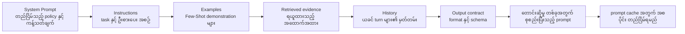
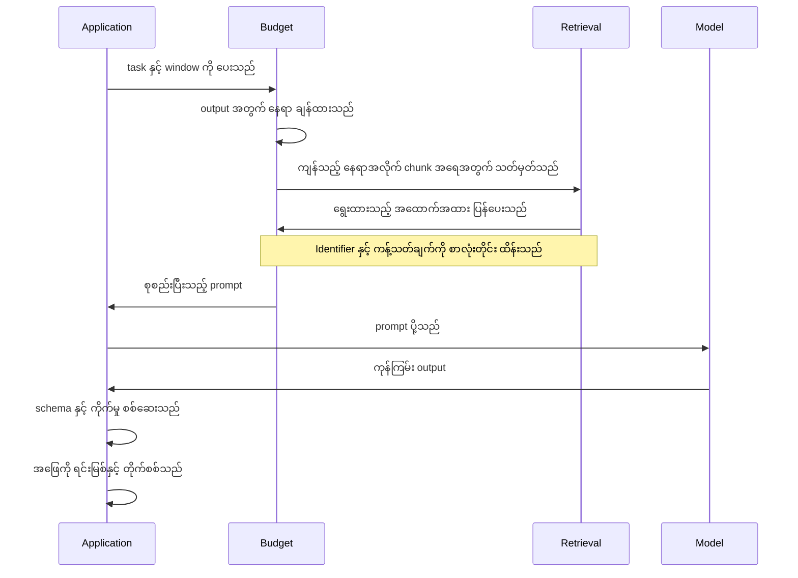
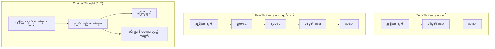
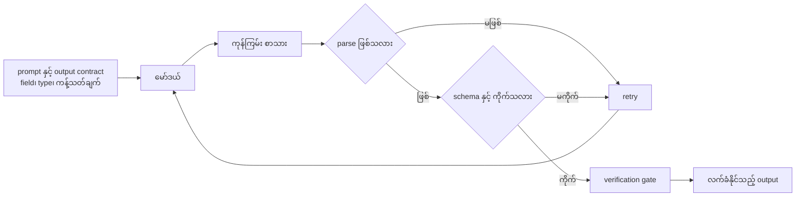
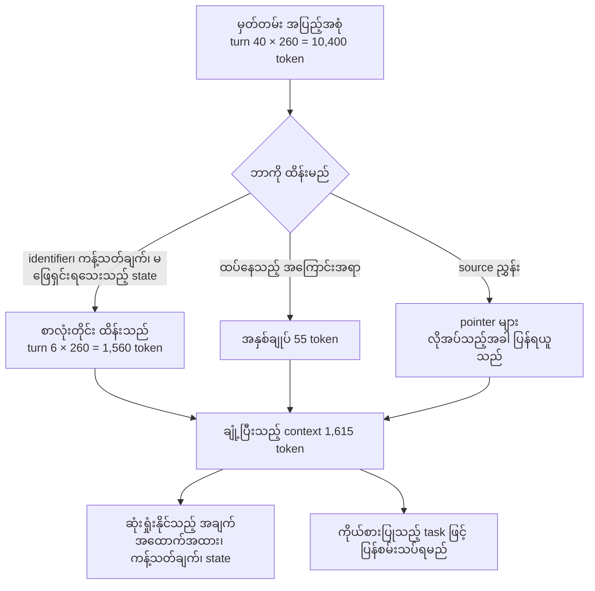
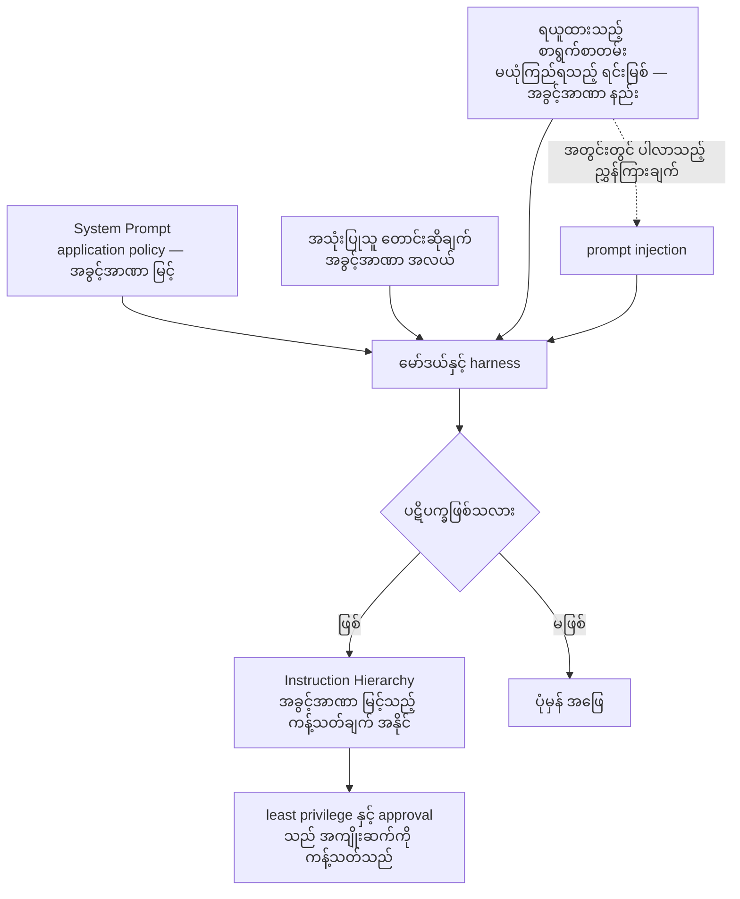
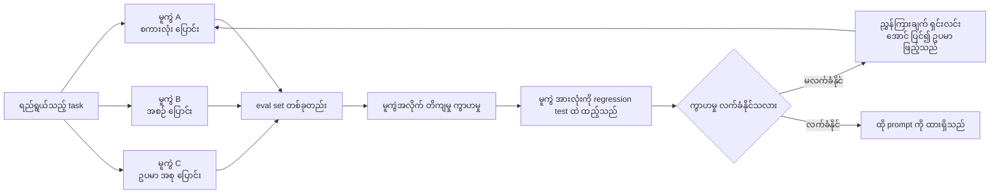

# Area 05 — ပုံရှင်းလင်းချက်များ (Visual Explanations)

Term တစ်ခုကို စာဖြင့်သာ ဖတ်ပါက "ဘယ်ကနေ ဘယ်ကို သွားသည်" ဟူသည့် လမ်းကြောင်း မမြင်ရပါ။
ဤဖိုင်သည် ထို လမ်းကြောင်းများကို ပုံဖြင့် ပြသည် — context window သည် budget တစ်ခု အဖြစ်
မည်သို့ ခွဲဝေခံရသည်၊ prompt တစ်ခု မည်သို့ စုစည်းသည်၊ structured output သည် schema
စစ်ဆေးမှုကို မည်သို့ ဖြတ်သည်၊ retrieved စာသားထဲမှ ညွှန်ကြားချက် မည်သို့ ဝင်လာသည် အထိ။

**ပုံများ ကြည့်နည်း** — ဤဖိုင်ကို GitHub တွင် ဖတ်ပါက Mermaid ပုံများ အလိုအလျောက် render ဖြစ်သည်။
ဒေသအတွင်း တွင်ဖတ်လိုပါက VS Code ၏ Mermaid extension သို့မဟုတ် mermaid.live တွင်
```mermaid``` block ကို ကူးထည့်ပါ။

## ၁။ Context Window ကို budget အဖြစ် မြင်ခြင်း

```mermaid
flowchart TD
    W["Context Window = 16,384 token<br/>ဤပမာဏသည် ကန့်သတ်ချက် ဖြစ်သည်"]
    W --> S["System Prompt 700 · 4.3%"]
    W --> T["Tool schema 900 · 5.5%"]
    W --> R["Retrieved evidence 2,200 · 13.4%"]
    W --> H["Conversation history 5,200 · 31.7%"]
    W --> U["User turn 320 · 2.0%"]
    W --> O["Reserved output 2,048 · 12.5%"]
    W --> F["Headroom 5,016 · 30.6%"]
    H --> X["အကြီးဆုံး အပိုင်း — စုစုပေါင်း၏ ၃၁.၇%"]
    F --> Y["ဤနေရာသည် အထောက်အထား အသစ်<br/>သို့မဟုတ် turn အသစ်အတွက် ကျန်သည်"]
```

**ဘာကို ကြည့်ရမည်**
- Window သည် **အသုံးပြုနိုင်သည့် ပမာဏ** မဟုတ်၊ **ကန့်သတ်ချက်** ဖြစ်သည်။ ထို့ကြောင့် output အတွက် နေရာ ကို မဖြစ်မနေ ချန်ရမည်။
- အပိုင်း တစ်ခုစီ၏ ရာခိုင်နှုန်းသည် ပေါင်းလျှင် 100% ဖြစ်သည်။ ထို့ကြောင့် တစ်ခု တိုးလာပါက အခြား တစ်ခု လျော့ရမည်။
- ဤ ဥပမာတွင် အကြီးဆုံး အသုံးစရိတ်သည် ညွှန်ကြားချက် မဟုတ်ဘဲ conversation history ဖြစ်သည်။
- Headroom 5,016 token သည် chunk တစ်ခုလျှင် 550 token ဖြစ်ပါက chunk ၉ ခုစာ နေရာ ဖြစ်သည်။

**သက်ဆိုင်သည့် term** — Context Window, Token Budget, Context Engineering

## ၂။ Prompt တစ်ခု မည်သည့် အပိုင်းများဖြင့် စုစည်းသည်



**ဘာကို ကြည့်ရမည်**
- အစဉ်သည် **အခွင့်အာဏာ အစဉ်** နှင့် **တည်ငြိမ်မှု အစဉ်** နှစ်ခုလုံးကို လိုက်နာသည်။
- တည်ငြိမ်သည့် အပိုင်း (system၊ examples) ကို ရှေ့တွင်ထား၍ တောင်းဆိုမှုနှင့် သီးသန့်ဖြစ်သည့် အကြောင်းအရာကို နောက်တွင် ထားသည်။
- ထို အစဉ်သည် `Prompt Cache` ၏ စာချုပ်နှင့် တိုက်ရိုက် ဆက်စပ်သည် — prefix မတည်ငြိမ်ပါက cache hit မရနိုင်ပါ။
- Output contract သည် နောက်ဆုံးတွင် ရှိသည်၊ အကြောင်းမှာ ဖြေဆိုချက်၏ ပုံစံကို သတ်မှတ်သည့် အပိုင်း ဖြစ်သောကြောင့် ဖြစ်သည်။

**သက်ဆိုင်သည့် term** — System Prompt, Prompt Engineering, Few-Shot, Context Engineering, Prompt Cache

## ၃။ Request တစ်ခု၏ လည်ပတ်မှု — prompt စုစည်းခြင်းမှ စစ်ဆေးခြင်းအထိ



**ဘာကို ကြည့်ရမည်**
- Prompt စုစည်းခြင်းသည် မော်ဒယ်ကို မခေါ်မီ အဆင့်တွင် **အပြည့်အဝ** ပြီးသည်။ မော်ဒယ်သည် ထည့်ပေးထားသည့် အရာကိုသာ မြင်သည်။
- Budget အဆင့်သည် retrieval အဆင့်ကို ကန့်သတ်သည် — ထို့ကြောင့် budget မှားပါက ရွေးချယ်မှု မှား၍ ဆုံးရှုံးမှု ဖြစ်သည်။
- စစ်ဆေးခြင်း အဆင့် (schema နှင့် grounding) သည် output ထွက်ပြီးနောက် ကျန်သေးသည့် တစ်ခုတည်းသော ကာကွယ်မှု ဖြစ်သည်။
- ဤ လည်ပတ်မှုတွင် မော်ဒယ်သည် state ကို မမှတ်ထားပါ — မှတ်တမ်းတိုင်းကို application က ပြန်လည် ပေးပို့သည်။

**သက်ဆိုင်သည့် term** — Context Window, Token Budget, Context Engineering, Context Compression

## ၄။ Zero-Shot၊ Few-Shot နှင့် Chain of Thought နှိုင်းယှဉ်ချက်



**ဘာကို ကြည့်ရမည်**
- လမ်းကြောင်း သုံးခုလုံးတွင် မော်ဒယ်၏ weight သည် မပြောင်းလဲပါ — ပြောင်းလဲသည်မှာ context သာ ဖြစ်သည်။ ဤအချက်သည် `In-Context Learning` ၏ အဓိပ္ပာယ် ဖြစ်သည်။
- `Zero-Shot` လမ်းကြောင်းသည် အတိုဆုံး ဖြစ်သည်၊ သို့သော် format နှင့် နယ်နိမိတ်ကို ဖော်ပြရန် ညွှန်ကြားချက်ကိုသာ မှီရသည်။
- `Few-Shot` လမ်းကြောင်းတွင် ဥပမာ တိုးသည့်အခါ token အရေအတွက်လည်း တိုးသည်၊ ထို့ကြောင့် ဥပမာ အရေအတွက်နှင့် budget သည် တိုက်ရိုက် ဆက်စပ်သည်။
- `Chain of Thought (CoT)` တွင် ထွက်လာသည့် အဆင့်များသည် **ဖြေဆိုချက် မှန်ကန်ကြောင်း သက်သေ မဟုတ်ပါ** — ထို့ကြောင့် သီးခြားစီ စစ်ဆေးရမည့် အချက် လမ်းကြောင်း ခွဲထားသည်။

**သက်ဆိုင်သည့် term** — Zero-Shot, Few-Shot, In-Context Learning, Chain of Thought (CoT)

## ၅။ Structured Output နှင့် Schema စစ်ဆေးခြင်း



**ဘာကို ကြည့်ရမည်**
- ချောမွေ့သည့် စာသားသည် ကိုက်သည့် စာသား မဟုတ်ပါ။ ထို့ကြောင့် parse နှင့် schema အဆင့် နှစ်ခုကို ခွဲထားသည်။
- စစ်ဆေးမှု မအောင်ပါက retry loop ပြန်ဝင်သည်။ ဤ loop ၏ အရေအတွက်သည် ကုန်ကျစရိတ်နှင့် latency ကို တိုးစေသည်။
- Schema ဖြင့် ကန့်သတ်ထားသည့် output သည် free text ထက် ယုံကြည်စိတ်ချရမှု မြင့်သည်၊ သို့သော် **အကြောင်းအရာ မှန်ကန်မှု** ကို အာမခံခြင်း မပြုပါ။
- Verification gate သည် schema ကို ကျော်ပြီးမှ ဝင်သည်၊ အကြောင်းမှာ schema သည် ပုံစံကိုသာ စစ်၍ အကြောင်းအရာကို မစစ်သောကြောင့် ဖြစ်သည်။

**သက်ဆိုင်သည့် term** — Prompt Engineering, Instruction Following, Chain of Thought (CoT), Prompt Sensitivity

## ၆။ Context Compaction နှင့် အနှစ်ချုပ်ခြင်း



**ဘာကို ကြည့်ရမည်**
- ချုံ့ခြင်းသည် **lossy** ဖြစ်သည်။ ပိုတိုသည့် summary သည် အလိုအလျောက် ညီမျှသည့် context မဟုတ်ပါ။
- ထို့ကြောင့် လမ်းကြောင်း သုံးခုကို ခွဲထားသည် — စာလုံးတိုင်း ထိန်းခြင်း၊ အနှစ်ချုပ်ခြင်း၊ pointer ဖြင့် ပြန်ရယူနိုင်စေခြင်း။
- ဤ ဥပမာတွင် 10,400 token မှ 1,615 token သို့ ကျဆင်းသည်၊ ဆိုလိုသည်မှာ 84.5% လျော့သည်။
- ချုံ့ပြီးနောက် ကျန်သည့် နေရာသည် ကြီးမားလာသော်လည်း တူညီသည့် task အပေါ် တိကျမှု ကျဆင်းမှု ရှိမရှိ မဖြစ်မနေ စမ်းသပ်ရမည်။

**သက်ဆိုင်သည့် term** — Context Compression, Token Budget, Context Engineering, Lost in the Middle

## ၇။ Prompt Injection သည် Retrieved စာသားမှတစ်ဆင့် ဝင်လာခြင်း



**ဘာကို ကြည့်ရမည်**
- ဤပုံတွင် ညွှန်ကြားချက် သုံးမျိုးသည် **အခွင့်အာဏာ မတူညီဘဲ** တစ်နေရာတည်းသို့ ရောက်လာသည်။ ထို ရောနှောမှုသည် agent စနစ်၏ အဓိက အာရုံစိုက်ရမည့် အချက် ဖြစ်သည်။
- Data အဖြစ် ရောက်လာသည့် စာသားသည် ပုံစံအားဖြင့် ညွှန်ကြားချက်နှင့် တူနိုင်သည် — ထို့ကြောင့် အမှတ်အသား (label) ပြုရမည်။
- `Instruction Hierarchy` သည် အပြုအမူကို တိုးတက်စေနိုင်သည်၊ သို့သော် **လုံခြုံရေး နယ်နိမိတ် တစ်ခု မဟုတ်ပါ**။ least privilege နှင့် approval controls က အကျိုးဆက်များကို ကန့်သတ်ဆဲ ဖြစ်သည်။
- တိုက်ရိုက် ပဋိပက္ခ (အသုံးပြုသူမှ လာသည်) နှင့် သွယ်ဝိုက် ပဋိပက္ခ (retrieved စာသားမှ လာသည်) နှစ်မျိုးလုံးကို စမ်းသပ်ရမည်။

**သက်ဆိုင်သည့် term** — Instruction Hierarchy, System Prompt, Context Engineering, Instruction Following

## ၈။ Prompt Sensitivity ကို အကဲဖြတ်သည့် loop



**ဘာကို ကြည့်ရမည်**
- မူကွဲ သုံးခုလုံးသည် **အဓိပ္ပာယ် တူညီသည့်** prompt များ ဖြစ်သည်။ သို့သော် ရလဒ် ကွာဟနိုင်သည်။
- ကွာဟမှုကို တိုင်းတာသည့် အရာသည် အမှု အလိုက် ကွဲပြားမှု (variance) ဖြစ်သည်၊ ပျမ်းမျှ တိကျမှု တစ်ခုတည်း မဟုတ်ပါ။
- eval set တစ်ခုပေါ်တွင် prompt တစ်ခုကို အကောင်းဆုံး ဖြစ်အောင် ပြုပြင်ခြင်းသည် မူကွဲများ၏ ကွာဟမှုကို ဖုံးကွယ်နိုင်သည်။
- ထို့ကြောင့် မူကွဲများကို regression test များတွင် ထိန်းသိမ်းရမည်၊ အောင်မြင်သည့် မူကွဲ တစ်ခုတည်းကို မထားရ။
- sensitivity သည် prompt ချို့ယွင်းမှု တိုင်း မဟုတ်ပါ — မရှင်းလင်းမှု၊ မော်ဒယ်၏ ခိုင်မာမှု အားနည်းမှု၊ မတည်ငြိမ်သည့် decoding သို့မဟုတ် မလုံလောက်သည့် scoring စည်းမျဉ်းတို့ကို ဖော်ထုတ်နိုင်သည်။

**သက်ဆိုင်သည့် term** — Prompt Sensitivity, Prompt Engineering, Few-Shot, Lost in the Middle

## ပုံတိုင်းနှင့် term ချိတ်ဆက်မှု

| ပုံ | ပြသည့် အကြောင်းအရာ | သက်ဆိုင်သည့် term |
|---|---|---|
| ၁ | Context window ကို budget အဖြစ် မြင်ခြင်း | Context Window, Token Budget, Context Engineering |
| ၂ | Prompt တစ်ခု၏ အပိုင်းများ နှင့် အစဉ် | System Prompt, Prompt Engineering, Few-Shot, Prompt Cache |
| ၃ | Request တစ်ခု၏ လည်ပတ်မှု | Context Window, Token Budget, Context Engineering, Context Compression |
| ၄ | Zero-Shot၊ Few-Shot နှင့် Chain of Thought | Zero-Shot, Few-Shot, In-Context Learning, Chain of Thought (CoT) |
| ၅ | Structured output နှင့် schema စစ်ဆေးခြင်း | Prompt Engineering, Instruction Following, Prompt Sensitivity |
| ၆ | Context compaction နှင့် အနှစ်ချုပ်ခြင်း | Context Compression, Token Budget, Context Engineering |
| ၇ | Retrieved စာသားမှ ဝင်လာသည့် prompt injection | Instruction Hierarchy, System Prompt, Instruction Following |
| ၈ | Prompt sensitivity ကို အကဲဖြတ်သည့် loop | Prompt Sensitivity, Prompt Engineering, Few-Shot |

## နောက်တစ်ဆင့်

- အစဉ်လိုက် ဖတ်ရန် — [`01_learning_sequence.md`](01_learning_sequence.md)
- ကိန်းဂဏန်း အဖြစ် မြင်လိုပါက — [`04_exercises.md`](04_exercises.md) ရှိ တွက်ချက်ရသည့် လေ့ကျင့်ခန်း ၆ ခု
- Term တိုင်း၏ အပြည့်အစုံ အဓိပ္ပာယ် — [`../../terms/05_prompting_and_context.md`](../../terms/05_prompting_and_context.md)
