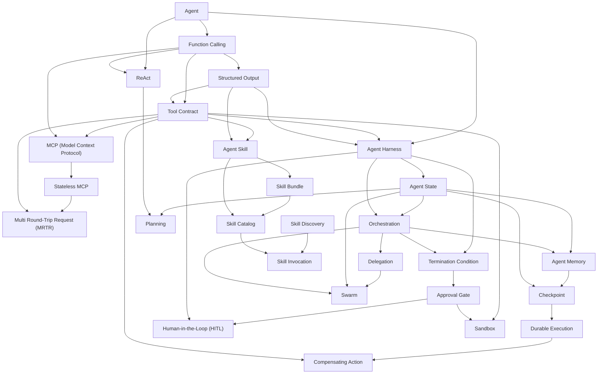

# Area 06 — Agents & tools: လေ့လာသည့် အစဉ် (Learning Sequence)

ဤနယ်ပယ်၏ term ၂၇ ခုသည် ရောနှောနေသည့် စာရင်း မဟုတ်ပါ။ ၎င်းတို့သည် **အဆင့် ခြောက်ဆင့် တည်ဆောက်မှု တစ်ခု** ဖြစ်သည် —
မော်ဒယ် call တစ်ခုတည်း (a single model call) မှ စ၍ **loop** တစ်ခု၊ **tool contract** တစ်ခု၊ **harness** နှင့် **state**၊
**memory** နှင့် handoff၊ ပျက်ကျမှုနှင့် human approval၊ နောက်ဆုံးတွင် **skill** အစုအဝေးနှင့် multi-agent routing အထိ
တည်ဆောက်သည်။ ဤဖိုင်သည် term များကို မည်သည့် အစဉ်အတိုင်း ဖတ်ရမည်၊ မည်သည့် term က မည်သည့် term အပေါ်
အခြေခံသည်ကို သတ်မှတ်ပေးသည်။

**ဖတ်သည့် အစဉ်ကို လိုက်ခြင်း၏ အကျိုးသက်ရောက်မှု** — နောက် term တိုင်းသည် အရင် term များကို အသုံးပြု၍
ရှင်းလင်းသည်။ ဥပမာ `Tool Contract` သည် `Function Calling` နှင့် `Structured Output` ကို မသိဘဲ နားလည်နိုင်မည်
မဟုတ်သလို၊ `Compensating Action` သည် `Durable Execution` ကို မသိဘဲ အဓိပ္ပာယ် မထွက်ပါ။ အစဉ်လွဲဖတ်ပါက
term တိုင်း မှတ်ရုံသာ ဖြစ်ပြီး စနစ် တစ်ခုအဖြစ် မမြင်ရပါ။

## အဆင့် ၆ ဆင့်၏ ခြုံငုံမှု

| အဆင့် | အမည် | Term | ဤအဆင့် ပြီးပါက ဖြေနိုင်ရမည့် မေးခွန်း |
|---|---|---|---|
| ၁ | မော်ဒယ် call တစ်ခုနှင့် loop တစ်ခု | Agent, Function Calling, Structured Output, ReAct | loop တစ်ခုသည် call တစ်ခုနှင့် မည်သည့် နေရာတွင် တိုးလာသည်၊ ဘာကြောင့် ထို တိုးမှု လိုအပ်သည် |
| ၂ | Tool contract နှင့် ၎င်း၏ schema | Tool Contract, MCP (Model Context Protocol), Stateless MCP, Multi Round-Trip Request (MRTR) | မော်ဒယ် ထုတ်လွှတ်သည့် တောင်းဆိုမှုကို စနစ်က မည်သည့် နေရာတွင် စစ်ဆေး၍ မည်သည့် အခါ ငြင်းပယ်သည် |
| ၃ | Harness နှင့် state | Agent Harness, Agent State, Orchestration, Planning | မော်ဒယ် တူညီသည့် စနစ် နှစ်ခု မည်သို့ ကွာခြားသည်၊ မည်သည့် အချက်က ဆက်လုပ်ရန် ဆုံးဖြတ်သည် |
| ၄ | Memory, context နှင့် handoff | Agent Memory, Checkpoint, Delegation | context window ကျော်လွန်သည့် တာဝန်ကို မည်သို့ ဆက်လုပ်သည်၊ တာဝန် တစ်ပိုင်းကို မည်သို့ လွှဲအပ်သည် |
| ၅ | ပျက်ကျမှု, retry နှင့် human approval | Termination Condition, Durable Execution, Compensating Action, Approval Gate, Human-in-the-Loop (HITL), Sandbox | loop သည် မည်သည့် အခါ ရပ်ရမည်၊ ဘေးထွက်ဆိုးကျိုး ဖြစ်ပြီးနောက် ချို့ယွင်းပါက မည်သို့ ပြန်ချိန်သည် |
| ၆ | Skill နှင့် multi-agent routing | Agent Skill, Skill Bundle, Skill Catalog, Skill Discovery, Skill Invocation, Swarm | ပြန်လည်အသုံးပြုနိုင်သည့် လုပ်ငန်းစဉ် အသိပညာကို မည်သို့ package လုပ်၍ မည်သည့် အခါ load လုပ်သည် |

## အဆင့်များအကြား မှီခိုမှု (Prerequisite Graph)

**ဂရပ်ဖ် ဖတ်နည်း** — မြှား၏ ဦးတည်ရာသည် မှီခိုမှု ဖြစ်သည်။ `Agent` သည် ဤနယ်ပယ်၏ အမြစ် ဖြစ်သည်၊ သို့သော်
စနစ် တစ်ခုလုံး၏ အလယ်ဗဟိုတွင် `Agent Harness`၊ `Agent State` နှင့် `Tool Contract` သုံးခု ရှိသည် — ၎င်းတို့ကို
ဖြတ်၍ မည်သည့် term မျှ မဖြတ်ဘဲ ကျော်တက်၍ မရပါ။ ညာဘက်ခြမ်း (skill အစုအဝေး) သည် ဘယ်ဘက်ခြမ်း (loop၊
contract၊ state) ပေါ်တွင် တည်ဆောက်သည်၊ ထို့ကြောင့် skill များကို အစတွင် မဖတ်ရ။

## အဆင့် ၁ — မော်ဒယ် call တစ်ခုနှင့် loop တစ်ခု (၄ term)

**အစဉ်** — `Agent` → `Function Calling` → `Structured Output` → `ReAct`

**ဘာကြောင့် ဤနေရာတွင် ရှိသည်** — `Agent` သည် ဤနယ်ပယ်၏ အခြေခံ ဖြစ်သည်၊ သို့သော် မော်ဒယ်ကိုယ်တိုင်
လုပ်ဆောင်ချက် မလုပ်နိုင်ပါ။ `Function Calling` သည် မော်ဒယ်အား tool တစ်ခုကို အမည်တပ်၍ တောင်းဆိုစေသည့်
နယ်နိမိတ် ဖြစ်သည်။ ၎င်း တောင်းဆိုမှုကို စက်ဖတ်နိုင်သည့် ပုံစံဖြင့် ထုတ်ရန် `Structured Output` လိုအပ်သည်။
`ReAct` သည် ဤ အစိတ်အပိုင်းများကို ကျိုးကြောင်းဆင်ခြင်မှု၊ လုပ်ဆောင်ချက် နှင့် observation အဖြစ် အလှည့်ကျ
ရောနှောသည့် loop တစ်ခု အဖြစ် စုစည်းသည်။ ဤအဆင့် မပြီးဘဲ `Tool Contract` ကို ဖတ်ပါက စာချုပ် တစ်ခုသည်
ဘာကို ကာကွယ်သည်ကို မသိနိုင်ပါ။

**မှတ်သားရန်** — call တစ်ခု၏ ကုန်ကျစရိတ်သည် ခန့်မှန်းနိုင်သည်၊ loop တစ်ခု၏ ကုန်ကျစရိတ်သည်
step အရေအတွက်နှင့်အတူ **စုစည်း** ကြီးထွားသည်၊ အကြောင်းမှာ step တိုင်းသည် ယခင် context အားလုံးကို
ပြန်လည် ပို့ရသောကြောင့် ဖြစ်သည်။ ဤ အချက်သည် `04_exercises.md` ၏ ဥပမာ ၁ ဖြစ်သည်။

**စစ်ဆေးသည့် မေးခွန်း** — `Function Calling` ရှိရုံဖြင့် agent တစ်ခု ဖြစ်လာသလား။ `Structured Output` က
schema နှင့် ကိုက်ညီအောင် ထုတ်ပေးသည့် ရလဒ်တွင် တန်ဖိုး မှားနိုင်ခြင်း ရှိသလား။

## အဆင့် ၂ — Tool contract နှင့် ၎င်း၏ schema (၄ term)

**အစဉ်** — `Tool Contract` → `MCP (Model Context Protocol)` → `Stateless MCP` → `Multi Round-Trip Request (MRTR)`

**ဘာကြောင့် ဤနေရာတွင် ရှိသည်** — မော်ဒယ်သည် tool တစ်ခုကို **တောင်းဆိုရုံသာ** တောင်းဆိုသည်။ `Tool Contract`
သည် ထို နယ်နိမိတ်၏ ပြည့်စုံသည့် သဘောတူညီချက် — typed input၊ output၊ validation၊ permission၊
ဘေးထွက်ဆိုးကျိုး၊ error၊ timeout၊ idempotency နှင့် ခေါ်သူထံ ပြန်လည်ပေးအပ်သည့် အထောက်အထား — ကို
သတ်မှတ်သည်။ `MCP (Model Context Protocol)` သည် ထို စာချုပ်များကို host နှင့် server ကြား သယ်ဆောင်သည့်
စံ protocol ဖြစ်သည်။ `Stateless MCP` သည် request တိုင်း မိမိ၏ version နှင့် capabilities ကို သယ်ဆောင်သဖြင့်
session state မလိုသည့် ပုံစံကို ပေးသည်။ `Multi Round-Trip Request (MRTR)` သည် ထို stateless ပုံစံအောက်တွင်
server တစ်ခုက လူ သို့မဟုတ် မော်ဒယ်ထံမှ input ကို အသွားအပြန် တောင်းနိုင်သည့် နည်းလမ်း ဖြစ်သည်။

**မှတ်သားရန်** — JSON Schema တစ်ခုသည် contract ၏ **အပိုင်း တစ်ခုသာ** ဖြစ်သည်။ schema သည် field များ
ရှိသည်ကို ပြောသည်၊ contract သည် tool သည် မည်သည့် အခါ လုံခြုံသည်ကို ပြောသည်။

**စစ်ဆေးသည့် မေးခွန်း** — ငြင်းပယ်ခံရသည့် tool call တစ်ခု၏ ကုန်ကျစရိတ်သည် ဘယ်နှစ်ဆ ဖြစ်သည်၊
ငြင်းပယ်ခြင်းသည် execution မတိုင်မီ ဖြစ်သလား၊ အပြီး ဖြစ်သလား။

## အဆင့် ၃ — Harness နှင့် state (၄ term)

**အစဉ်** — `Agent Harness` → `Agent State` → `Orchestration` → `Planning`

**ဘာကြောင့် ဤနေရာတွင် ရှိသည်** — `Agent Harness` သည် မော်ဒယ်ပတ်လည်ရှိ runtime ဖြစ်သည် — context စုစည်းခြင်း၊
tool ဖော်ထုတ်ခြင်း၊ state စီမံခြင်း၊ ကန့်သတ်ချက် ချမှတ်ခြင်း၊ trace မှတ်ခြင်း နှင့် ဆက်လုပ်မည်၊ ပြန်ကြိုးစားမည်၊
မေးမြန်းမည် သို့မဟုတ် ရပ်မည်ကို ဆုံးဖြတ်ခြင်း တို့ ဖြစ်သည်။ `Agent State` သည် harness သယ်ဆောင်သည့်
တိကျပြတ်သားသည့် data ဖြစ်သည်။ `Orchestration` သည် model နှင့် tool အဆင့်များအကြား အစဉ်လိုက် စီစဉ်ခြင်း၊
အခန်းကိုင်းခွဲခြင်း၊ လွှဲအပ်ခြင်း၊ ပြန်ကြိုးစားခြင်းနှင့် အဆုံးသတ်ခြင်းတို့ကို ပြုလုပ်သည့် control logic ဖြစ်သည်။
`Planning` သည် လက်ရှိ state မှ ပန်းတိုင်ဆီသို့ ရွေ့ရန် လုပ်ဆောင်ချက်များ၏ အစဉ်နှင့် မှီခိုမှုကို တည်ဆောက်သည်။

**မှတ်သားရန်** — `Agent State` သည် conversation history နှင့် တူညီသည် မဟုတ်ပါ။ Transcript သည်
အထောက်အထား ဖြစ်သည်၊ state သည် နောက်တွင် မည်သည့်အရာ ဖြစ်လာမည်ကို ဆုံးဖြတ်ရန် အသုံးပြုသည့်
ကျစ်လျစ်သည့် လုပ်ငန်းလည်ပတ်မှု မှတ်တမ်း ဖြစ်သည်။

**စစ်ဆေးသည့် မေးခွန်း** — မော်ဒယ် တူညီသည့် စနစ် နှစ်ခုသည် ဘာကြောင့် စွမ်းဆောင်ရည် အလွန်ကွာသနည်း။
state ကို transcript နှင့် ရောနှောပါက မည်သည့် ပြဿနာ ဖြစ်လာသည်။

## အဆင့် ၄ — Memory, context နှင့် handoff (၃ term)

**အစဉ်** — `Agent Memory` → `Checkpoint` → `Delegation`

**ဘာကြောင့် ဤနေရာတွင် ရှိသည်** — `Agent Memory` သည် မော်ဒယ်၏ အပြင်ဘက်တွင် သိမ်းဆည်းထားပြီး
နောက်ပိုင်း agent အဆင့်များတွင် အသုံးပြုရန် ရွေးချယ်ထားသည့် အချက်အလက်များ ဖြစ်သည်။ memory သည်
context window တစ်ခုထက် ကျော်လွန်၍ ဆက်လက်တည်ရှိမှု ပေးသည်။ `Checkpoint` သည် သိရှိထားပြီးသည့်
နယ်နိမိတ်တစ်ခုမှ ပြန်လည်စတင်ရန် အသုံးပြုသည့် တည်မြဲသည့် snapshot ဖြစ်သည်။ `Delegation` သည်
ကန့်သတ်ထားသည့် subtask တစ်ခုကို လိုအပ်သည့် context၊ အခွင့်အာဏာ၊ output contract နှင့်
ပြန်လည်ပေးအပ်ရမည့် အခြေအနေများနှင့်တကွ လွှဲအပ်ခြင်း ဖြစ်သည်။

**မှတ်သားရန်** — `Agent Memory` သည် `Agent State` နှင့် တူညီသည် မဟုတ်ပါ။ State သည် လက်ရှိ run ကို
ခြေရာခံသည်။ Memory သည် ဖြစ်နိုင်သည့် အနာဂတ် run များအတွက် ရွေးချယ်ထားသည့် အချက်အလက်များကို ထိန်းသိမ်းသည်။

**စစ်ဆေးသည့် မေးခွန်း** — tool ရလဒ် ကြီးလာသည့်အခါ context သည် turn မည်မျှတွင် ပြည့်သည်၊
မည်သည့် turn တွင် window ကို ကျော်လွန်သည်။

## အဆင့် ၅ — ပျက်ကျမှု, retry နှင့် human approval (၆ term)

**အစဉ်** — `Termination Condition` → `Durable Execution` → `Compensating Action` → `Approval Gate` → `Human-in-the-Loop (HITL)` → `Sandbox`

**ဘာကြောင့် ဤနေရာတွင် ရှိသည်** — `Termination Condition` သည် loop မစတင်မီ အောင်မြင်မှု အထောက်အထား၊
အများဆုံး အဆင့်နှင့် ကုန်ကျစရိတ်၊ ပြန်လည်ကြိုးစား၍ မရနိုင်သည့် အမှားများနှင့် escalation အခြေအနေများကို
သတ်မှတ်သည်။ `Durable Execution` သည် process ပျက်ကျခြင်းနှင့် ရှည်ကြာသည့် စောင့်ဆိုင်းမှုများကို ကျော်လွန်၍
state နှင့် ပြီးစီးပြီးသား အဆင့်များ တည်ရှိနေစေသည်။ `Compensating Action` သည် atomic အနေဖြင့်
ပြန်လည်ဖျက်သိမ်းနိုင်ခြင်း မရှိသည့်အခါ ပြီးမြောက်သွားသည့် ဘေးထွက်ဆိုးကျိုးကို အဓိပ္ပာယ်အားဖြင့် ဆန့်ကျင်ဖျက်ပစ်သည်။
`Approval Gate` သည် အကျိုးဆက် ကြီးမားသည့် လုပ်ဆောင်ချက်ကို ခွင့်ပြုချက် မပေးမချင်း ပိတ်ဆို့ထားသည်။
`Human-in-the-Loop (HITL)` သည် သတ်မှတ်ထားသည့် အချက်များတွင် လူက ဆုံးဖြတ်ချက် သို့မဟုတ်
escalation ပေးသည့် workflow တည်ဆောက်ပုံ ဖြစ်သည်။ `Sandbox` သည် file၊ process၊ network၊ credential နှင့်
host အရင်းအမြစ်များသို့ ဝင်ရောက်နိုင်မှုကို ကန့်သတ်ထားသည့် သီးခြားခွဲထုတ်ထားသည့် ပတ်ဝန်းကျင် ဖြစ်သည်။

**မှတ်သားရန်** — approval gate သည် **လုပ်ဆောင်ချက် တစ်ခု ခွင့်ပြုထားခြင်း ရှိမရှိ** ကို မေးသည်။
verification gate သည် **ထို လုပ်ဆောင်ချက် မှန်ကန်ကြောင်း အထောက်အထား** ပြသနိုင်ရှိမရှိကို မေးသည်။
ဤ နှစ်ခုကို ရောနှောပါက လုံခြုံရေး နယ်နိမိတ် ပျက်သည်။

**စစ်ဆေးသည့် မေးခွန်း** — termination condition မရှိပါက loop တစ်ခု မည်သည့် လေးလမ်းဖြင့် ပျက်စီးနိုင်သည်။
retry အရေအတွက် တိုးခြင်းသည် escalation ကို ဘယ်လောက် လျှော့ပေးသည်၊ ကုန်ကျစရိတ်နှင့် ဘယ်လို
ချိန်ညှိရသည်။

## အဆင့် ၆ — Skill နှင့် multi-agent routing (၆ term)

**အစဉ်** — `Agent Skill` → `Skill Bundle` → `Skill Catalog` → `Skill Discovery` → `Skill Invocation` → `Swarm`

**ဘာကြောင့် ဤနေရာတွင် ရှိသည်** — `Agent Skill` သည် entry point သည် `SKILL.md` ဖြစ်သည့်၊
ရှာဖွေတွေ့ရှိနိုင်သည့် လုပ်ငန်းစဉ် ညွှန်ကြားချက် directory တစ်ခု ဖြစ်သည်။ `Skill Bundle` သည် ၎င်း directory
တစ်ခုလုံး — reference၊ script၊ asset၊ fixture အားလုံး အပါအဝင် — ဖြစ်သည်။ `Skill Catalog` သည်
အရည်အချင်းပြည့်မီသည့် skill များ၏ မော်ဒယ် မြင်နိုင်သည့် ကျစ်လျစ်သည့် စာရင်း ဖြစ်သည်။ `Skill Discovery` သည်
ထို စာရင်းကို ထုတ်ဝေသည့် runtime pipeline ဖြစ်သည်။ `Skill Invocation` သည် skill တစ်ခုကို ရွေးချယ်၍
၎င်း၏ ညွှန်ကြားချက်များကို လုပ်ငန်း context ထဲ ဝင်ရောက်စေသည့် လုပ်ငန်းစဉ် ဖြစ်သည်။ `Swarm` သည်
ဗဟို ထိန်းချုပ်မှု တစ်ခုတည်း မရှိသည့်၊ ချိတ်ဆက်မှု လျော့ရဲရဲ multi-agent ပုံစံ ဖြစ်သည်။

**မှတ်သားရန်** — skill တစ်ခု activate လုပ်ခြင်းသည် **context ကို ပေးအပ်သည်**။ ၎င်းသည် tool တစ်ခု
ဖော်ထုတ်ခြင်း၊ permission ပေးခြင်း၊ sandbox တစ်ခု ဖန်တီးခြင်း သို့မဟုတ် ရလဒ် မှန်ကန်ကြောင်း သက်သေပြခြင်း
မပြုပါ။ ထို လေးခုကို သီးခြားစီ စီစဉ်ရမည်။

**စစ်ဆေးသည့်မေးခွန်း** — catalog entry တစ်ခု ရှိခြင်းသည် skill ကို အသုံးပြုပြီးသား ဖြစ်သလား။
`Swarm` တွင် topology၊ state ပိုင်ဆိုင်မှုနှင့် အဆုံးသတ်ခြင်း စည်းမျဉ်းများကို မသတ်မှတ်ပါက ဘာဖြစ်သည်။

## Term ၂၇ ခု၏ အစဉ် ဇယား

| # | Term | အဆင့် | ကြိုတင် သိရမည့် term | ဖွင့်ပေးသည့် အချက် |
|---|---|---|---|---|
| 1 | Agent | ၁ | — | မော်ဒယ်နှင့် စနစ် ခွဲခြားမှု |
| 2 | Function Calling | ၁ | Agent | structured tool တောင်းဆိုမှု |
| 3 | Structured Output | ၁ | Function Calling | schema နှင့် ကိုက်ညီသည့် ရလဒ်၊ field အဆင့် validation |
| 4 | ReAct | ၁ | Agent, Function Calling | ကျိုးကြောင်းဆင်ခြင်မှုနှင့် လုပ်ဆောင်ချက် ရောနှောသည့် loop |
| 5 | Tool Contract | ၂ | Function Calling, Structured Output | validation၊ permission၊ error နှင့် evidence ၏ အခြေခံ |
| 6 | MCP (Model Context Protocol) | ၂ | Tool Contract, Function Calling | host နှင့် server ကြား စံချိန် |
| 7 | Stateless MCP | ၂ | MCP (Model Context Protocol) | session state မလိုသည့် တောင်းဆိုမှု ပုံစံ |
| 8 | Multi Round-Trip Request (MRTR) | ၂ | Stateless MCP, Tool Contract | stateless ပုံစံအောက် input တောင်းခြင်း |
| 9 | Agent Harness | ၃ | Agent, Tool Contract, Structured Output | context၊ tool၊ state၊ limit နှင့် trace စီမံမှု |
| 10 | Agent State | ၃ | Agent Harness | ရှည်လျားသည့် တာဝန် ပြန်လည်စတင်နိုင်မှု |
| 11 | Orchestration | ၃ | Agent Harness, Agent State | ဆက်လုပ်၊ ရပ်၊ ပြန်ကြိုးစားခြင်း၏ control logic |
| 12 | Planning | ၃ | Agent State, ReAct | ယူဆချက်နှင့် မှီခိုမှုကို ကြိုတင်မြင်ခြင်း |
| 13 | Agent Memory | ၄ | Agent State, Orchestration | context window ကျော်လွန်သည့် ဆက်လက်တည်ရှိမှု |
| 14 | Checkpoint | ၄ | Agent State, Agent Memory | သိရှိသည့် နယ်နိမိတ်မှ ပြန်စခြင်း |
| 15 | Delegation | ၄ | Orchestration, Agent State | အထူးပြုလုပ်ခြင်းနှင့် အပြိုင်လုပ်ဆောင်ခြင်း |
| 16 | Termination Condition | ၅ | Agent Harness, Orchestration | loop ရပ်ရမည့် အခြေအနေ |
| 17 | Durable Execution | ၅ | Checkpoint, Agent State | ပျက်ကျမှုကို ကျော်လွန်သည့် လုပ်ငန်းစဉ် |
| 18 | Compensating Action | ၅ | Durable Execution, Tool Contract | ပြန်မဖျက်နိုင်သည့် ဘေးထွက်ဆိုးကျိုး ပြန်ချိန်ခြင်း |
| 19 | Approval Gate | ၅ | Termination Condition, Tool Contract | အကျိုးဆက် ကြီးမားသည့် လုပ်ဆောင်ချက် ပိတ်ဆို့ခြင်း |
| 20 | Human-in-the-Loop (HITL) | ၅ | Approval Gate, Agent Harness | သတ်မှတ်သည့် အချက်တွင် လူ၏ ဆုံးဖြတ်ချက် |
| 21 | Sandbox | ၅ | Tool Contract, Approval Gate | ထိခိုက်နိုင်သည့် အတိုင်းအတာ ကန့်သတ်ခြင်း |
| 22 | Agent Skill | ၆ | Tool Contract, Structured Output | ပြန်လည်အသုံးပြုနိုင်သည့် လုပ်ငန်းစဉ် အသိပညာ |
| 23 | Skill Bundle | ၆ | Agent Skill | တစ်ယူနစ်တည်း တပ်ဆင်နိုင်မှု |
| 24 | Skill Catalog | ၆ | Agent Skill, Skill Bundle | မော်ဒယ် မြင်နိုင်သည့် ကျစ်လျစ်သည့် စာရင်း |
| 25 | Skill Discovery | ၆ | Skill Bundle, Skill Catalog | ပျောက်ဆုံး၊ ပုံပျက်၊ ဖုံးလွှမ်းခံရသည့် package ရောဂါရှာဖွေမှု |
| 26 | Skill Invocation | ၆ | Skill Catalog, Skill Discovery | ညွှန်ကြားချက်များကို context ထဲ ဝင်ရောက်စေခြင်း |
| 27 | Swarm | ၆ | Delegation, Agent State, Orchestration | ဗဟို မရှိသည့် multi-agent တည်ဆောက်ပုံ |

## လက်တွေ့ လုပ်သည့် အစဉ် (၆ ကြိမ် ထိုင်ရန်)

| ကြိမ် | ဖတ်ရမည့် အဆင့် | လက်တွေ့ လုပ်ရမည့် အရာ |
|---|---|---|
| ၁ | အဆင့် ၁ | `python3 guides/06_agents_and_tools/labs/lab_agent_loop.py` |
| ၂ | အဆင့် ၂ | `python3 guides/06_agents_and_tools/labs/lab_tool_schema.py` |
| ၃ | အဆင့် ၃ | `python3 .../lab_agent_loop.py --max-steps 16 --tool-calls 6 --context 8192` |
| ၄ | အဆင့် ၄ | `python3 .../lab_agent_loop.py --cost-budget 0.06` |
| ၅ | အဆင့် ၅ | `python3 .../lab_concurrency.py` |
| ၆ | အဆင့် ၆ | `python3 .../lab_tool_schema.py --tools 8 --fields 6 --turns 12` |

**ဖတ်နည်း** — အဆင့် တိုင်း၏ ကိန်းဂဏန်းကို [`04_exercises.md`](04_exercises.md) ရှိ တူညီသည့်
`python3` heredoc block ဖြင့် လည်း ပြန်လည် ထုတ်ယူနိုင်သည်။

## နောက်တစ်ဆင့်

- ပုံရှင်းလင်းချက်များ — [`02_visual_explanations.md`](02_visual_explanations.md) (agent loop၊ contract၊ state၊ harness၊ retry၊ approval)
- လေ့ကျင့်ခန်းများ — [`04_exercises.md`](04_exercises.md) (ဥပမာ ၄၊ တွက်ချက်မှု ၆၊ ပြဿနာ ၃၊ ဆုံးဖြတ်ချက် ၂)
- Term တိုင်း၏ အပြည့်အစုံ အဓိပ္ပာယ် — [`../../terms/06_agents_and_tools.md`](../../terms/06_agents_and_tools.md)
