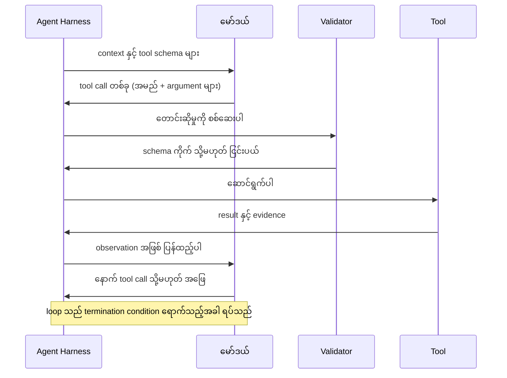
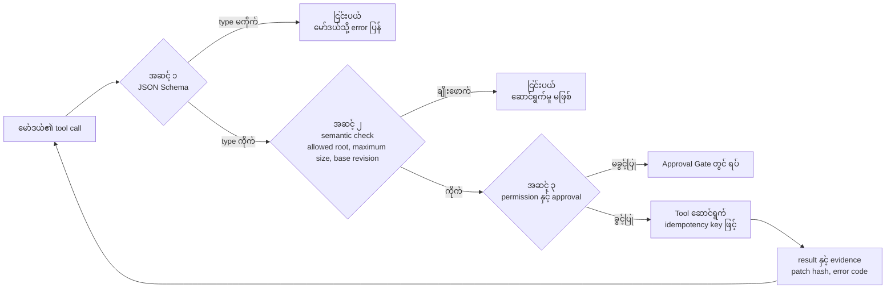
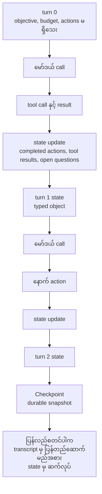
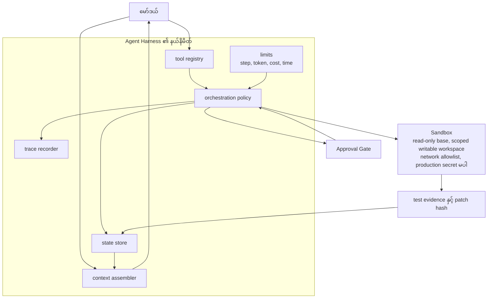
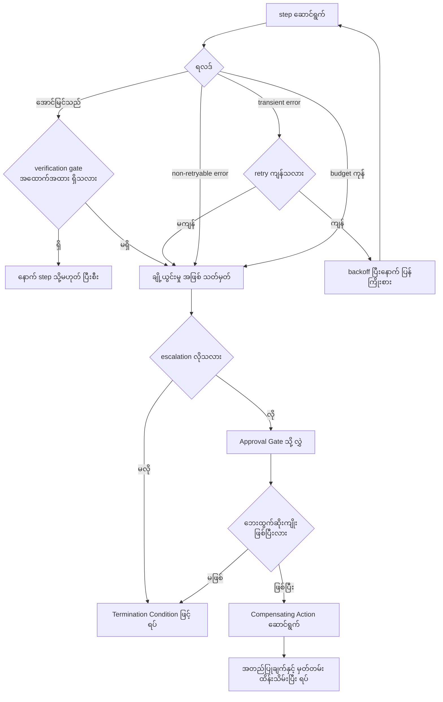
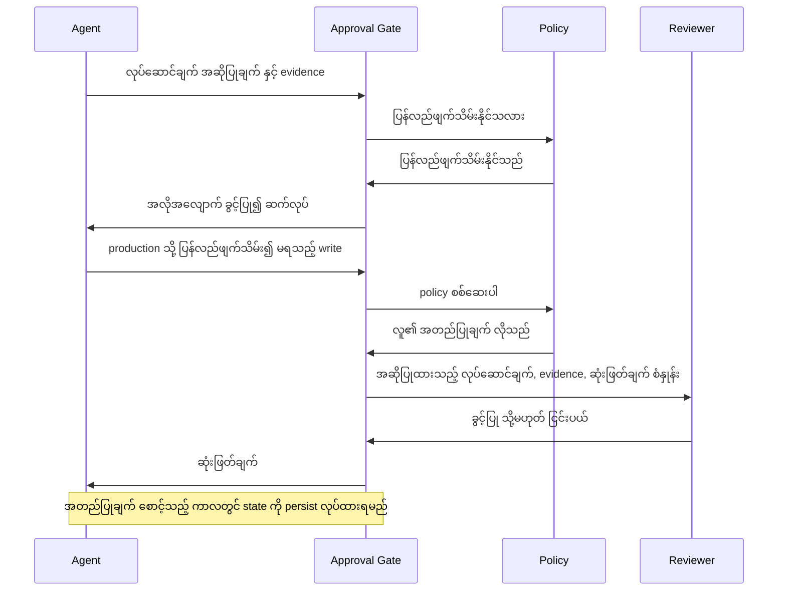
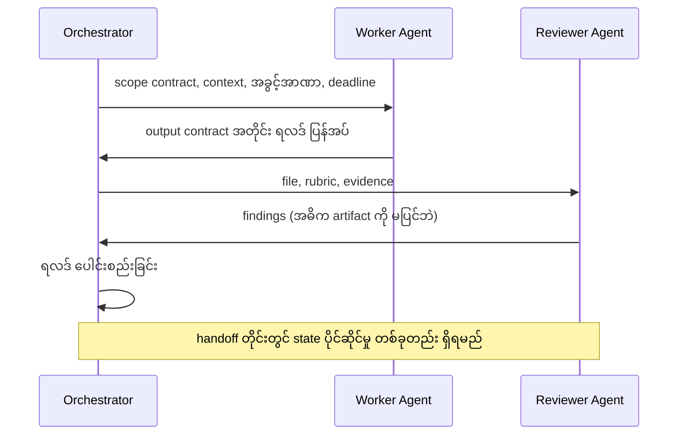
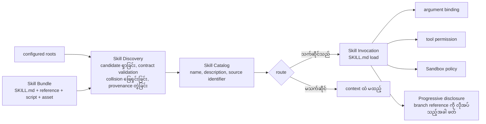

# Area 06 — ပုံရှင်းလင်းချက်များ (Visual Explanations)

Term တစ်ခုကို စာဖြင့်သာ ဖတ်ပါက "ဘယ်ကနေ ဘယ်ကို သွားသည်" ဟူသည့် လမ်းကြောင်း မမြင်ရပါ။ ဤဖိုင်သည်
agent စနစ် တစ်ခုအတွင်း အချက်အလက် စီးဆင်းသည့် လမ်းကြောင်းများကို ပုံဖြင့် ပြသည် — မော်ဒယ်မှ tool call
သို့ သွားသည့် loop၊ tool contract ၏ validation path၊ turn များအကြား state၊ harness နှင့် sandbox ၏
နယ်နိမိတ်၊ ချို့ယွင်းမှုနှင့် retry ဆုံးဖြတ်ချက်၊ အတည်ပြုချက် ဂိတ်၊ multi-agent routing နှင့်
skill များ ရှာဖွေ၍ အသုံးချသည့် လမ်းကြောင်း အထိ ဖြစ်သည်။

**ပုံများ ကြည့်နည်း** — ဤဖိုင်ကို GitHub တွင် ဖတ်ပါက Mermaid ပုံများ အလိုအလျောက် render ဖြစ်သည်။
ဒေသအတွင်း၌ ဖတ်လိုပါက VS Code ၏ Mermaid extension သို့မဟုတ် mermaid.live တွင်
Mermaid block ကို ကူးထည့်ပါ။

## ၁။ Agent loop — မော်ဒယ်, tool call, result, မော်ဒယ်

**ဘာကို ကြည့်ရမည်**
- မော်ဒယ်သည် tool ကို **တောင်းဆိုရုံသာ** တောင်းဆိုသည်။ ဆောင်ရွက်ခြင်း (execute) ကို `H` က ဆုံးဖြတ်သည်။
- `H → V → H` ဟူသည့် နေရာသည် tool contract ၏ ပထမ အဆင့် ဖြစ်သည်။ ငြင်းပယ်ခြင်းသည် ဤနေရာတွင်
  ဖြစ်ပါက tool သည် လုံးဝ မဆောင်ရွက်ရသေးသဖြင့် ထိခိုက်နိုင်သည့် အတိုင်းအတာ သုည ဖြစ်သည်။
- ပြန်လှည့်သည့် မြှား `H → M` သည် **loop** ဖြစ်သည်။ ဤ မြှား တစ်ခုတည်းက loop ကို call တစ်ခုထက်
  ကုန်ကျစေသည်၊ အကြောင်းမှာ observation တိုင်းသည် နောက် call ၏ input ထဲ ဝင်သောကြောင့် ဖြစ်သည်။

**သက်ဆိုင်သည့် term** — Agent, Agent Harness, Function Calling, Tool Contract, Termination Condition, ReAct

## ၂။ Tool contract နှင့် ၎င်း၏ validation path

**ဘာကို ကြည့်ရမည်**
- အဆင့် သုံးဆင့်သည် **တူညီသည့် အလုပ်ကို မလုပ်ပါ**။ schema သည် field အမျိုးအစားကို စစ်သည်၊
  semantic အဆင့်သည် တန်ဖိုး၏ အဓိပ္ပာယ်ကို စစ်သည်၊ permission အဆင့်သည် လုပ်ပိုင်ခွင့်ကို စစ်သည်။
- ငြင်းပယ်ခြင်း သည် တတ်နိုင်သမျှ **ဘယ်ဘက်တွင်** ဖြစ်ရမည်။ ဤ ပုံတွင် `R1` နှင့် `R2` သည်
  side effect သုညဖြင့် ရပ်ပြီး၊ `R3` သည် လူကို စောင့်စေသည်။ ဆောင်ရွက်ပြီးမှ ငြင်းပယ်ခြင်းကို
  `Compensating Action` ဖြင့်သာ ပြန်ချိန်နိုင်သည်။
- `EV` မှ `A` သို့ ပြန်လည်ဆက်သွယ်မှုသည် function calling ၏ အဓိကအချက် ဖြစ်သည် — ရလဒ်သည်
  နောက် မော်ဒယ် အဆင့်၏ input ဖြစ်သွားသည်။

**သက်ဆိုင်သည့် term** — Tool Contract, Function Calling, Structured Output, Approval Gate, Compensating Action, MCP (Model Context Protocol)

## ၃။ Turn များအကြား Agent State

**ဘာကို ကြည့်ရမည်**
- `S0 → U1 → S1 → U2 → S2` သည် **state** ၏ သက်တမ်း ဖြစ်သည်။ turn တိုင်းတွင် state ကို update လုပ်ရမည်၊
  ထို့ကြောင့် လုပ်ဆောင်ချက် တစ်ခုစီပြီးနောက် state ကို မှတ်တမ်းတင်ရမည်။
- `CHK` သို့ သွားသည့် မြှား သည် state ကို **တည်မြဲအောင်** သိမ်းသည့် နေရာ ဖြစ်သည်။ ထို နေရာ မရှိပါက
  process ပျက်ကျသည့်အခါ state လည်း ပျောက်ပြီး တာဝန် တစ်ခုလုံးကို အစမှ ပြန်လုပ်ရမည်။
- `RES` သည် `Agent Memory` နှင့် `Agent State` ၏ ကွာခြားချက်ကို ပြသည် — state သည် **ဤ run** ကို
  ဆက်လုပ်ရန် ဖြစ်သည်၊ memory သည် **နောက် run** များအတွက် ရွေးချယ်ထားသည့် အချက်အလက် ဖြစ်သည်။

**သက်ဆိုင်သည့် term** — Agent State, Checkpoint, Agent Memory, Durable Execution, Orchestration

## ၄။ Harness နယ်နိမိတ်နှင့် Sandbox

**ဘာကို ကြည့်ရမည်**
- `HB` အကွက်သည် `Agent Harness` ၏ နယ်နိမိတ် ဖြစ်သည် — context၊ tool၊ state၊ limit၊ trace နှင့်
  policy အားလုံးသည် ဤအတွင်း ရှိသည်။ မော်ဒယ်သည် အပြင်ဘက်တွင် ရှိပြီး `HB` နှင့်သာ ဆက်သွယ်သည်။
- `LIM` သည် `Termination Condition` ၏ အကောင်အထည်ဖော်မှု ဖြစ်သည်။ limit မရှိပါက `POL` သည်
  loop ကို ရပ်ရန် အခြေခံ မရှိပါ။
- `SANDBOX` သည် `POL` မှ ဖြတ်၍သာ ဝင်ရသည်။ ထို့ကြောင့် ထုတ်လုပ်ထားသည့် code မှားယွင်းပါက
  ၎င်း၏ သက်ရောက်နိုင်သည့် အတိုင်းအတာသည် sandbox အတွင်းတွင်သာ ရပ်သည်။
- sandbox သည် **ထိခိုက်နိုင်သည့် အတိုင်းအတာကို** လျှော့ပေးသည်၊ sandbox အတွင်းရှိ code မှန်ကန်သည်
  သို့မဟုတ် အန္တရာယ်ကင်းသည်ကို သက်သေပြခြင်း မပြုပါ။

**သက်ဆိုင်သည့် term** — Agent Harness, Sandbox, Termination Condition, Orchestration, Approval Gate, Agent State

## ၅။ ချို့ယွင်းမှုနှင့် retry ဆုံးဖြတ်ချက်

**ဘာကို ကြည့်ရမည်**
- `R` တွင် လမ်းကြောင်း လေးခု ခွဲသည် — အောင်မြင်သည်၊ transient error၊ non-retryable error နှင့်
  budget ကုန်ခြင်း။ နောက် နှစ်ခုကို retry **မလုပ်ရ**။ ဤ ခွဲခြားမှုသည်
  `Termination Condition` ရေးသည့်အခါ သတ်မှတ်ထားရမည့် အချက် ဖြစ်သည်။
- `VG` သည် **အောင်မြင်သည်** ဆိုသည့် အခြေအနေကို အထောက်အထားဖြင့် စစ်သည်။ ဤ နေရာ မရှိပါက loop သည်
  ပြီးစီးပြီဟု ဆိုသော်လည်း ပန်းတိုင် မပြည့်မီနိုင်သည်။
- `COMP → CA` လမ်းကြောင်းသည် retry နှင့် မတူပါ။ retry သည် တူညီသည့် အလုပ်ကို ပြန်လုပ်သည်၊
  `Compensating Action` သည် ပြီးသွားသည့် ဘေးထွက်ဆိုးကျိုးကို ဆန့်ကျင်သည့် **အလုပ် အသစ်** ကို လုပ်သည်။

**သက်ဆိုင်သည့် term** — Termination Condition, Durable Execution, Compensating Action, Approval Gate, Tool Contract

## ၆။ Human-in-the-Loop အတည်ပြုချက် ဂိတ်

**ဘာကို ကြည့်ရမည်**
- ဂိတ်သည် လုပ်ဆောင်ချက် **တိုင်း** ကို ပိတ်ဆို့သည် မဟုတ်ပါ။ ပြန်လည်ဖျက်သိမ်းနိုင်သည့် အလုပ်များကို
  အလိုအလျောက် ခွင့်ပြုသည် — ထို့ကြောင့် automation မဆုံးရှုံးပါ။
- `R` သို့ ပို့သည့် အချက်သုံးခုကို ကြည့်ပါ — အဆိုပြုထားသည့် လုပ်ဆောင်ချက်၊ evidence နှင့်
  ဆုံးဖြတ်ချက် စံနှုန်း။ စံနှုန်း မရှိပါက `Human-in-the-Loop (HITL)` သည် စနစ်ကို အလိုအလျောက်
  လုံခြုံစေခြင်း မပြုပါ။
- `Note` သည် `Durable Execution` နှင့် ဆက်စပ်သည်။ စောင့်ဆိုင်းချိန် နာရီများစွာ ဖြစ်နိုင်သဖြင့်
  စောင့်နေသည့် state သည် process ထက် ပိုရှည်ရသည်။

**သက်ဆိုင်သည့် term** — Approval Gate, Human-in-the-Loop (HITL), Durable Execution, Agent State, Sandbox

## ၇။ Multi-agent handoff နှင့် routing

**ဘာကို ကြည့်ရမည်**
- `O → W` မှာ ပို့သည့် အချက် လေးခုသည် `Delegation` ၏ အဓိပ္ပာယ် ဖြစ်သည် — လိုအပ်သည့် context၊
  အခွင့်အာဏာ၊ output contract နှင့် ပြန်လည်ပေးအပ်ရမည့် အခြေအနေ ဖြစ်သည်။ ထို လေးခု မပါဘဲ
  မရှင်းလင်းသည့် မက်ဆေ့ချ် ပေးပို့ခြင်းသည် ယုံကြည်စိတ်ချရသည့် delegation မဟုတ်ပါ။
- `W → O` နှင့် `RV → O` နှစ်ခုလုံးသည် `O` သို့ ပြန်သည်။ ထို့ကြောင့် ရလဒ် ပေါင်းစည်းနိုင်စွမ်း
  မဆုံးရှုံးပါ။ ဤ ပုံစံကို `Swarm` နှင့် မရောပါ — swarm တွင် ဗဟို ထိန်းချုပ်မှု မရှိပါ။
- `Note` သည် `Swarm` အပါအဝင် multi-agent ပုံစံ တိုင်းအတွက် လိုအပ်ချက် ဖြစ်သည် — topology၊
  state ပိုင်ဆိုင်မှုနှင့် အဆုံးသတ်ခြင်း စည်းမျဉ်းများ ဖြစ်သည်။

**သက်ဆိုင်သည့် term** — Delegation, Swarm, Orchestration, Agent State, Agent Harness

## ၈။ Skill ရှာဖွေခြင်း, catalog နှင့် အသုံးချခြင်း

**ဘာကို ကြည့်ရမည်**
- `DISC` မှ `CAT` သို့ သွားသည့် မြှား သည် **ကျစ်လျစ်ခြင်း** ကို ပြသည်။ catalog ထဲ ဝင်သည်မှာ
  routing metadata သာဖြစ်ပြီး skill body အားလုံး မဟုတ်ပါ။ ထို့ကြောင့် package များစွာ တပ်ဆင်ထားသော်လည်း
  context မပြည့်ပါ။
- `INV` မှ ထွက်သည့် မြှား သုံးခု (`ARG`, `PERM`, `SBX`) သည် skill တစ်ခု အသုံးချခြင်းနှင့်
  ခွင့်ပြုချက် ပေးခြင်း မတူညီကြောင်း ပြသည်။ activation သည် instructions ကို context ထဲ ထည့်သည်၊
  permission နှင့် sandbox သည် သီးခြား ဆုံးဖြတ်ချက်များ ဖြစ်သည်။
- `BUNDLE → DISC` မြှား သည် `Skill Bundle` ၏ အခန်းကဏ္ဍကို ပြသည် — discovery သည် entry file
  တစ်ခုတည်းကို မဟုတ်ဘဲ **directory တစ်ခုလုံး** ကို စစ်ဆေးသည်။

**သက်ဆိုင်သည့် term** — Agent Skill, Skill Bundle, Skill Catalog, Skill Discovery, Skill Invocation, MCP (Model Context Protocol)

## ပုံတိုင်းနှင့် term ချိတ်ဆက်မှု

| ပုံ | ပြသည့် အကြောင်းအရာ | သက်ဆိုင်သည့် term |
|---|---|---|
| ၁ | Agent loop နှင့် return path | Agent, Agent Harness, Function Calling, Tool Contract, Termination Condition, ReAct |
| ၂ | Tool contract နှင့် validation အဆင့် သုံးဆင့် | Tool Contract, Function Calling, Structured Output, Approval Gate, Compensating Action, MCP (Model Context Protocol) |
| ၃ | Turn များအကြား state နှင့် checkpoint | Agent State, Checkpoint, Agent Memory, Durable Execution, Orchestration |
| ၄ | Harness နယ်နိမိတ်နှင့် sandbox | Agent Harness, Sandbox, Termination Condition, Orchestration, Approval Gate, Agent State |
| ၅ | ချို့ယွင်းမှုနှင့် retry လမ်းကြောင်း | Termination Condition, Durable Execution, Compensating Action, Approval Gate, Tool Contract |
| ၆ | Approval gate နှင့် လူ၏ ဆုံးဖြတ်ချက် | Approval Gate, Human-in-the-Loop (HITL), Durable Execution, Agent State, Sandbox |
| ၇ | Delegation နှင့် multi-agent handoff | Delegation, Swarm, Orchestration, Agent State, Agent Harness |
| ၈ | Skill discovery, catalog နှင့် invocation | Agent Skill, Skill Bundle, Skill Catalog, Skill Discovery, Skill Invocation, MCP (Model Context Protocol) |

## နောက်တစ်ဆင့်

- ကိန်းဂဏန်း အဖြစ် မြင်လိုပါက — [`04_exercises.md`](04_exercises.md) ရှိ heredoc block များ
- အစဉ် တည်ဆောက်မှု — [`01_learning_sequence.md`](01_learning_sequence.md) (အဆင့် ၆ ဆင့်၊ prerequisite graph)
- Term တိုင်း၏ အပြည့်အစုံ အဓိပ္ပာယ် — [`../../terms/06_agents_and_tools.md`](../../terms/06_agents_and_tools.md)
