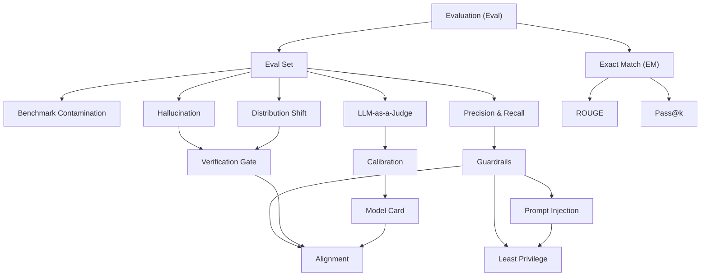

# Area 07 — Evaluation & Safety: လေ့လာသည့် အစဉ် (Learning Sequence)

ဤနယ်ပယ်၏ term ၁၇ ခုသည် ရောနှောနေသည့် ခေါင်းစဉ်များ မဟုတ်သည်။ ၎င်းတို့သည် **အဆင့် ၅ ဆင့်** —
တိုင်းတာမှုကို သတ်မှတ်ခြင်း (what to measure, on which data) → output ကို score ခြင်း (how to score
outputs) → ယုံထိုက်မှုနှင့် နှိုင်းယှဉ်မှု (comparing models fairly) → ဘေးကင်းရေးနှင့် အလွဲသုံးမှု
(safety and misuse) → ထုတ်လုပ်မှုတွင် စောင့်ကြည့်ခြင်း (monitoring after release) — အဖြစ်
တည်ဆောက်ထားသည်။ ဤဖိုင်သည် term များကို မည်သည့် အစဉ်အတိုင်း ဖတ်ရမည်၊ မည်သည့် term က
မည်သည့် term အပေါ် အခြေခံသည်ကို သတ်မှတ်ပေးသည်။

**ဖတ်သည့် အစဉ်ကို လိုက်ခြင်း၏ အကျိုးသက်ရောက်မှု** — `Pass@k` ကို `Exact Match (EM)` မသိဘဲ
ဖတ်ပါက "မှန်ကန်သည်ဟု မည်သို့ ရေတွက်သည်" ဟူသည့် အခြေခံ ပျောက်နေမည်။ `Calibration` ကို
`LLM-as-a-Judge` မသိဘဲ ဖတ်ပါက score ကို မည်သည့် အရာက ထုတ်ပေးသည်ကို ရှင်းနိုင်မည် မဟုတ်။
`Alignment` သည် ဤနယ်ပယ်၏ အဆုံးတွင် ရှိသည်မှာ အကြောင်းရင်း ရှိသည် — ၎င်းသည် evaluation၊
oversight နှင့် စနစ် ထိန်းချုပ်မှုများ အားလုံးကို ပေါင်းစည်းသည့် ပန်းတိုင် ဖြစ်သည်။

## အဆင့် ၅ ဆင့်၏ ခြုံငုံမှု

| အဆင့် | အမည် | Term | ဤအဆင့် ပြီးပါက ဖြေနိုင်ရမည့် မေးခွန်း |
|---|---|---|---|
| ၁ | တိုင်းတာမှုကို သတ်မှတ်ခြင်း | Evaluation (Eval), Eval Set, Benchmark Contamination, Distribution Shift (၄) | ဘာကို တိုင်းတာမည်၊ မည်သည့် data အပေါ် တိုင်းတာမည်၊ ရလဒ်သည် ယုံထိုက်ပါသလား |
| ၂ | output ကို score ခြင်း | Exact Match (EM), ROUGE, Precision & Recall, Pass@k, LLM-as-a-Judge (၅) | ထုတ်လာသည့် အဖြေတစ်ခုကို မည်သည့် စည်းမျဉ်းဖြင့် မှန်/မှား ရေတွက်မည် |
| ၃ | ယုံထိုက်မှုနှင့် နှိုင်းယှဉ်မှု | Calibration, Model Card (၂) | model တစ်ခု၏ score နှင့် confidence ကို မည်မျှ ယုံနိုင်မည်၊ နှိုင်းယှဉ်မှု တရားမျှတပါသလား |
| ၄ | ဘေးကင်းရေးနှင့် အလွဲသုံးမှု | Guardrails, Prompt Injection, Least Privilege, Hallucination (၄) | တိုက်ခိုက်မှုနှင့် ကျရှုံးမှု ပုံစံများကို မည်သည့် ထိန်းချုပ်မှုက လျှော့ချမည် |
| ၅ | ထုတ်လုပ်မှုတွင် စောင့်ကြည့်ခြင်း | Verification Gate, Alignment (၂) | release မတိုင်မီ မည်သည့် အထောက်အထား လိုအပ်မည်၊ release ပြီးနောက် ဘာကို စောင့်ကြည့်မည် |

## အဆင့်များအကြား မှီခိုမှု (Prerequisite Graph)

**ဖတ်နည်း** — မြှား၏ ဦးတည်ချက်သည် "မှီခိုမှု" ဖြစ်သည်။ `Eval Set` မရှိဘဲ `Benchmark Contamination`
ကို တိုင်းတာနိုင်မည် မဟုတ်သလို၊ `Guardrails` မရှိဘဲ `Prompt Injection` ကို လျှော့ချနိုင်မည် မဟုတ်သည်။
`Alignment` သို့ ရောက်သည့် လမ်းကြောင်း သုံးခု (`Guardrails`၊ `Verification Gate`၊ `Model Card`) ရှိသည် —
၎င်းသည် alignment အတွက် စနစ် ထိန်းချုပ်မှု၊ အထောက်အထား စစ်ဆေးမှုနှင့် အစီရင်ခံမှု သုံးခုလုံး
လိုအပ်သည့် အချက်ကို ပြသည်။

## အဆင့် ၁ — တိုင်းတာမှုကို သတ်မှတ်ခြင်း (၄ term)

**အစဉ်** — `Evaluation (Eval)` → `Eval Set` → `Benchmark Contamination` → `Distribution Shift`

**ဘာကြောင့် ဤနေရာတွင် ရှိသည်** — `Evaluation (Eval)` သည် လုပ်ငန်းစဉ် (process) ကို သတ်မှတ်သည် —
အောင်မြင်မှု စံနှုန်း ရှင်းလင်းမှု၊ data၊ scorer နှင့် ပြန်လည်စစ်ဆေးမှု။ ထို လုပ်ငန်းစဉ်က
အသုံးပြုသည့် အရာဝတ္ထု (artifact) သည် `Eval Set` ဖြစ်သည်။ ထို set ၏ ရလဒ်ကို မယုံထိုက်စေသည့်
အကြောင်းရင်း နှစ်ခုကို နောက်တွင် ဖတ်သည် — `Benchmark Contamination` (data ယိုစိမ့်မှု) နှင့်
`Distribution Shift` (deploy ပြီးနောက် distribution ကွာခြားမှု)။ ဤအဆင့် မပြီးဘဲ score တစ်ခုကို
မထုတ်ရ — မည်သည့် data အပေါ် တိုင်းတာသည်ကို မသိဘဲ score ကို အဓိပ္ပာယ် ကောက်နိုင်မည် မဟုတ်။

**မှတ်သားရန်** — `Eval Set` တွင် အမျိုးအစား သုံးမျိုး ရှိသည်။ Development eval သည်
ထပ်ခါတလဲလဲ ပြုပြင်တိုးတက်စေရန် လမ်းညွှန်သည်၊ final held-out test သည် ရွေးချယ်မှုများ
သတ်မှတ်ပြီးနောက် စွမ်းဆောင်ရည်ကို ခန့်မှန်းသည်၊ standardized benchmark သည်
မျှဝေထားသည့် protocol အောက်တွင် နှိုင်းယှဉ်မှုကို ပံ့ပိုးသည်။ မည်သည့် held-out set ကိုမဆို
ထပ်ခါတလဲလဲ ချိန်ညှိခြင်းသည် test အချက်အလက် ယိုစိမ့်စေပြီး ရလဒ်ကို ဖောင်းပွစေသည်။

**စစ်ဆေးသည့် မေးခွန်း** — ထပ်ခါတလဲလဲ အသုံးပြုနိုင်သည့် `Eval Set` တစ်ခုသည် မရေရာသည့်
အရည်အသွေး အဆိုကို မည်သို့ အထောက်အထား အဖြစ် ပြောင်းလဲပေးသည်၊ development eval နှင့်
final held-out test ကို မည်သို့ ခွဲခြားသည်။

## အဆင့် ၂ — output ကို score ခြင်း (၅ term)

**အစဉ်** — `Exact Match (EM)` → `ROUGE` → `Precision & Recall` → `Pass@k` → `LLM-as-a-Judge`

**ဘာကြောင့် ဤနေရာတွင် ရှိသည်** — ဤအဆင့်သည် scorer မိသားစုကို ခွဲပြသည်။ `Exact Match (EM)`
သည် အခြေခံ အကျဆုံး — normalized ပုံစံ အတိအကျ တူညီမှသာ မှန်သည်ဟု ရေတွက်သည်၊ partial credit
မဖော်ပြ။ `ROUGE` သည် ထို အတိအကျ ကိုက်ညီမှုကို လျှော့ချ၍ n-gram ထပ်တူမှု သို့မဟုတ်
longest common subsequence ဖြင့် တိုင်းသည်။ `Precision & Recall` သည် "အမှတ်အသားပြုထားသည့်
အရာများထဲမှ မည်မျှ မှန်သည်" နှင့် "သက်ဆိုင်သည့် အရာများထဲမှ မည်မျှ ရှာတွေ့သည်" ဟူသည့်
ဆန့်ကျင်ဘက် ဦးတည်ချက် နှစ်ခုကို ထည့်သည်။ `Pass@k` သည် တစ်ကြိမ်တည်း အဖြေကို မတိုင်းတော့ဘဲ
k အကြိမ် နမူနာယူထားသည့် လျာထားချက်များထဲမှ အနည်းဆုံး တစ်ခု အောင်မြင်မှုကို တိုင်းသည်။
`LLM-as-a-Judge` သည် exact test အဖြစ် ဖော်ပြရန် ခက်ခဲသည့် ဂုဏ်သတ္တိများ (ရှင်းလင်းမှု၊
ညွှန်ကြားချက် လိုက်နာမှု) အတွက် rubric ဖြင့် score ပေးသည်။

**မှတ်သားရန်** — scorer တစ်ခုစီသည် ကုန်ကျစရိတ် တစ်ခုစီ ရှိသည်။ `Exact Match (EM)` သည်
deterministic ဖြစ်၍ audit လုပ်ရန် လွယ်သည်၊ `ROUGE` သည် အနှစ်ချုပ်များအတွက် မကြာခဏ
အသုံးပြုသည်၊ `LLM-as-a-Judge` သည် scale ချပေးသည်၊ သို့သော် ground truth မဟုတ်ဘဲ
အစဉ်လိုက်မှု၊ စကားလုံး များပြားမှု၊ စတိုင်၊ prompt အရေးအသား သို့မဟုတ် မျှဝေသည့်
model ကျရှုံးမှုများကြောင့် bias ဖြစ်နိုင်သည်။

**စစ်ဆေးသည့် မေးခွန်း** — canonical အဖြေ တစ်ခုတည်း ရှိသည့် အလုပ်တွင် `Exact Match (EM)`
နည်းခြင်းသည် အမှန်တကယ် ကျရှုံးမှု ဖြစ်သလား။ `Precision & Recall` ၏ threshold ကို
ပြောင်းသည့်အခါ metric နှစ်ခု မည်သို့ လဲလှယ်သည်။

## အဆင့် ၃ — ယုံထိုက်မှုနှင့် နှိုင်းယှဉ်မှု (၂ term)

**အစဉ်** — `Calibration` → `Model Card`

**ဘာကြောင့် ဤနေရာတွင် ရှိသည်** — အဆင့် ၂ ပြီးပါက score တစ်ခု ရပြီ။ သို့သော် score ကောင်းခြင်းသည်
ထို score အပေါ် မှီခိုနိုင်ခြင်းကို မဆိုလိုပါ။ `Calibration` သည် ဖော်ပြသည့် confidence နှင့်
ထို confidence အဆင့်ရှိ ခန့်မှန်းချက်များ အမှန်ဖြစ်သည့် လက်တွေ့ အကြိမ်အရေအတွက် အကြား
ကိုက်ညီမှုကို တိုင်းသည်။ `Model Card` သည် ထို အထောက်အထား အားလုံးကို အစီရင်ခံပုံ — ရည်ရွယ်ထားသည့်
အသုံးပြုမှုများ၊ evaluation အခြေအနေများ၊ ကန့်သတ်ချက်များ — ဖြစ်သည်။ ဤအဆင့်သည်
"နှိုင်းယှဉ်မှု တရားမျှတခြင်း" ကို ဖြေသည် — မတူညီသည့် အခြေအနေအောက် ရရှိသည့် ကိန်းဂဏန်း
နှစ်ခုကို တိုက်ရိုက် နှိုင်းယှဉ်ခြင်း မပြုရ။

**မှတ်သားရန်** — `Model Card` သည် အထောက်အထားနှင့် ကန့်သတ်ချက်များကို ဆက်သွယ်ဖော်ပြသည်၊
လက်မှတ်အတည်ပြုချက်၊ အာမခံချက်၊ စနစ် threat model သို့မဟုတ် deployment အလိုက် evaluation ၏
အစားထိုး မဟုတ်သည်။ ထို့ကြောင့် `Model Card` ပါ ကိန်းဂဏန်းများသည် မိမိ အသုံးပြုသူများနှင့်
deployment အခြေအနေများအတွက် သက်ဆိုင်ခြင်း ရှိ မရှိ ဆုံးဖြတ်ရမည်။

**စစ်ဆေးသည့် မေးခွန်း** — ပျမ်းမျှအားဖြင့် တိကျသည့် စနစ်တစ်ခုသည် မည်သို့ ယုံကြည်မှု လွန်ကဲနိုင်သည်၊
`Model Card` သည် eval ရလဒ်များကို နှိုင်းယှဉ်နိုင်စေရန် မည်သည့် အချက်များကို ဖော်ပြရမည်။

## အဆင့် ၄ — ဘေးကင်းရေးနှင့် အလွဲသုံးမှု (၄ term)

**အစဉ်** — `Guardrails` → `Prompt Injection` → `Least Privilege` → `Hallucination`

**ဘာကြောင့် ဤနေရာတွင် ရှိသည်** — `Guardrails` သည် ဤအဆင့်၏ အထီးအမ (ဘောင်ခွင့်) ဖြစ်သည် —
input၊ tool အသုံးပြုမှု၊ output၊ permission နှင့် escalation တို့ကို ကန့်သတ်သည့် စနစ်
ထိန်းချုပ်မှုများ အားလုံး။ `Prompt Injection` သည် ထို ထိန်းချုပ်မှုများ ကာကွယ်ရမည့် အဓိက
တိုက်ခိုက်မှု ပုံစံ ဖြစ်သည်။ `Least Privilege` သည် ထို တိုက်ခိုက်မှု အောင်မြင်သည့်အခါ
ထိခိုက်မှုကို ကျဉ်းမြောင်းစေသည့် နည်းလမ်း ဖြစ်သည်။ `Hallucination` သည် တိုက်ခိုက်မှု မဟုတ်ဘဲ
output အရည်အသွေး ကျရှုံးမှု ဖြစ်သည်၊ သို့သော် ထို ကျရှုံးမှုကို production တွင် ဖမ်းဆုပ်ရန်
အထောက်အထား စစ်ဆေးမှု (အဆင့် ၅) လိုအပ်သည်။

**မှတ်သားရန်** — `Guardrails` သည် အန္တရာယ်ကို လျှော့ချသည်၊ AI စနစ်တစ်ခု ဘေးကင်းသည်ဟု
သက်သေပြခြင်း မဟုတ်သည်။ မည်သည့် filter တစ်ခုတည်းမှ ကျရှုံးမှု ပုံစံ အားလုံးကို
မဖုံးလွှမ်းနိုင်သည့်အတွက် ထိန်းချုပ်မှုများကို အန္တရာယ်အလိုက် အလွှာလိုက် စီစဉ်ရမည်။

**စစ်ဆေးသည့် မေးခွန်း** — `Prompt Injection` တွင် အခြေအနေ နှစ်မျိုး (အသုံးပြုသူထံမှ တိုက်ရိုက်၊
retrieved page များမှ သွယ်ဝိုက်) က ကာကွယ်မှု ဖွဲ့စည်းပုံကို မည်သို့ ကွာခြားစေသည်၊
`Least Privilege` သည် `Prompt Injection` အောင်မြင်သည့်အခါ ဘာကို ကန့်သတ်သည်။

## အဆင့် ၅ — ထုတ်လုပ်မှုတွင် စောင့်ကြည့်ခြင်း (၂ term)

**အစဉ်** — `Verification Gate` → `Alignment`

**ဘာကြောင့် ဤနေရာတွင် ရှိသည်** — `Verification Gate` သည် သတ်မှတ်ထားသည့် အထောက်အထား
မှန်ကန်မှု သို့မဟုတ် အရည်အသွေး စံနှုန်းတစ်ခုကို ဖြည့်ဆည်းသည်အထိ တိုးတက်မှုကို တားဆီးသည့်
နေရာ ဖြစ်သည် — ၎င်းသည် model ၏ "ပြီးပါပြီ" ဟူသည့် အဆိုကို အထောက်အထား အခြေခံသည့်
ဆုံးဖြတ်ချက် အဖြစ် ပြောင်းလဲပေးသည်။ `Alignment` သည် အဆုံး ပန်းတိုင် ဖြစ်သည် —
မျှော်လင့်ထားသည့် အခြေအနေများတွင်ဖြစ်စေ၊ ရန်လိုသည့် (adversarial) အခြေအနေများတွင်ဖြစ်စေ
ရည်ရွယ်သည့် ပန်းတိုင်၊ ကန့်သတ်ချက်နှင့် လူသား၏ ဦးစားပေးချက်များနှင့် ကိုက်ညီသည့် အပြုအမူ။
ထို ပန်းတိုင်သို့ ရောက်ရန် evaluation၊ oversight နှင့် စနစ် ထိန်းချုပ်မှုများ အားလုံး လိုအပ်သည်။

**မှတ်သားရန်** — စနစ်တစ်ခုသည် သတ်မှတ်ထားသည့် metric ကို အကောင်းဆုံးဖြစ်အောင်
လုပ်ဆောင်နေစဉ် အသုံးပြုသူ၏ အမှန်တကယ် ရည်ရွယ်ချက်ကို ချိုးဖောက်နိုင်သည်။ ထို့ကြောင့်
metric တစ်ခုတည်းဖြင့် အကဲမဖြတ်ရ။

**စစ်ဆေးသည့် မေးခွန်း** — `Verification Gate` နှင့် approval gate ကွာခြားချက်ကား အဘယ်နည်း၊
release ပြီးနောက် ကျရှုံးမှု အသစ်များကို version စီမံထားသည့် `Eval Set` ထဲသို့ မည်သို့
ထည့်သွင်းမည်။

## Term ၁၇ ခု၏ အစဉ် ဇယား

| # | Term | အဆင့် | ကြိုတင် သိရမည့် term | ဖွင့်ပေးသည့် အချက် |
|---|---|---|---|---|
| 1 | Evaluation (Eval) | ၁ | — | တိုင်းတာသည့် လုပ်ငန်းစဉ်၏ အခြေခံ |
| 2 | Eval Set | ၁ | Evaluation (Eval) | ထပ်ခါတလဲလဲ အသုံးပြုနိုင်သည့် အထောက်အထား |
| 3 | Benchmark Contamination | ၁ | Eval Set | score ကို မယုံထိုက်စေသည့် data ယိုစိမ့်မှု |
| 4 | Distribution Shift | ၁ | Eval Set | deploy ပြီးနောက် ကျရှုံးနိုင်သည့် အခြေအနေ |
| 5 | Exact Match (EM) | ၂ | Evaluation (Eval) | canonical အဖြေအတွက် deterministic scoring |
| 6 | ROUGE | ၂ | Exact Match (EM) | စာသား ထပ်တူမှု metric မိသားစု |
| 7 | Precision & Recall | ၂ | Eval Set | ဆန့်ကျင်ဘက် ဦးတည်ချက် နှစ်ခုနှင့် F1 |
| 8 | Pass@k | ၂ | Exact Match (EM) | attempt budget ၏ တန်ဖိုး |
| 9 | LLM-as-a-Judge | ၂ | Eval Set | exact test အဖြစ် မဖော်ပြနိုင်သည့် ဂုဏ်သတ္တိ |
| 10 | Calibration | ၃ | LLM-as-a-Judge | confidence ၏ ယုံထိုက်မှု |
| 11 | Model Card | ၃ | Calibration | အထောက်အထားနှင့် ကန့်သတ်ချက် အစီရင်ခံမှု |
| 12 | Guardrails | ၄ | Precision & Recall | ထိန်းချုပ်မှု အားလုံး၏ အလွှာစနစ် |
| 13 | Prompt Injection | ၄ | Guardrails | အဓိက တိုက်ခိုက်မှု ပုံစံ |
| 14 | Least Privilege | ၄ | Prompt Injection | ကျရှုံးမှုတစ်ခု၏ ထိခိုက်မှုကို ကျဉ်းစေခြင်း |
| 15 | Hallucination | ၄ | Eval Set | output အရည်အသွေး ကျရှုံးမှု |
| 16 | Verification Gate | ၅ | Hallucination, Distribution Shift | အထောက်အထား အခြေခံသည့် ဆုံးဖြတ်ချက် |
| 17 | Alignment | ၅ | Guardrails, Verification Gate, Model Card | ပန်းတိုင်နှင့် ကိုက်ညီသည့် အပြုအမူ |

## လက်တွေ့ လုပ်သည့် အစဉ် (၅ ကြိမ် ထိုင်ရန်)

| ကြိမ် | ဖတ်ရမည့် အဆင့် | လက်တွေ့ လုပ်ရမည့် လက်တွေ့စမ်းသပ်မှု |
|---|---|---|
| ၁ | အဆင့် ၁ + ၂ | `python3 labs/lab_eval_size.py --n 400 --acc-a 0.877 --acc-b 0.902` |
| ၂ | အဆင့် ၂ + ၃ | `python3 labs/lab_eval_size.py --sweep` |
| ၃ | အဆင့် ၄ | `python3 labs/lab_guardrail_cost.py --rps 40 --latency-ms 20` |
| ၄ | အဆင့် ၄ + ၅ | `python3 labs/lab_guardrail_cost.py --sweep` |
| ၅ | အဆင့် ၅ | `python3 labs/lab_drift_monitor.py --window 800 --baseline 0.912 --observed 0.871 --threshold 2` |

**သတိထားရန်** — flag များသည် lab ဖိုင်၏ `--help` အတိုင်း ဖြစ်သည်။ `lab_eval_size.py` သည်
eval အရွယ်အစားနှင့် model နှစ်ခုကို ခွဲခြားနိုင်မှုကို ဆက်စပ်ပြသဖြင့် အဆင့် ၁ နှင့် ၃ နှစ်ခုလုံးအတွက်
အသုံးပြုသည်။ `lab_guardrail_cost.py` သည် guardrail တစ်ခု ထည့်ခြင်း၏ latency၊ throughput နှင့်
ကုန်ကျစရိတ်ကို တိုင်းသည်။ `lab_drift_monitor.py` သည် window အလိုက် drift statistic နှင့်
သတိပေးချက်တစ်ခု၏ ကုန်ကျစရိတ်ကို တိုင်းသည်။

## နောက်တစ်ဆင့်

- ပုံရှင်းလင်းချက်များ — [`02_visual_explanations.md`](02_visual_explanations.md) (contamination၊ harness loop၊ guardrails၊ drift)
- လေ့ကျင့်ခန်းများ — [`04_exercises.md`](04_exercises.md)
- Term တိုင်း၏ အပြည့်အစုံ အဓိပ္ပာယ် — [`../../terms/07_evaluation_and_safety.md`](../../terms/07_evaluation_and_safety.md)
