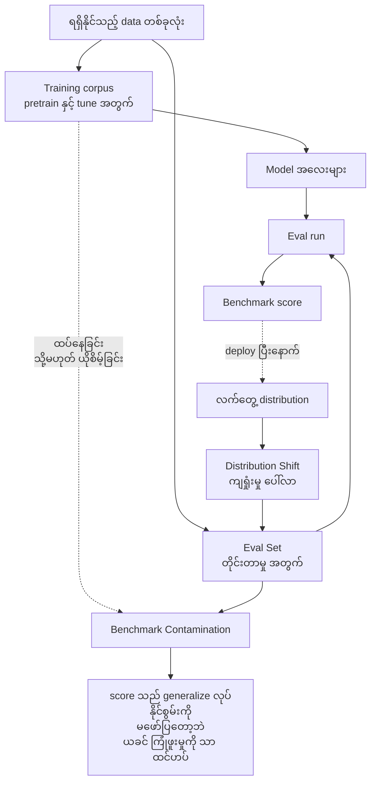
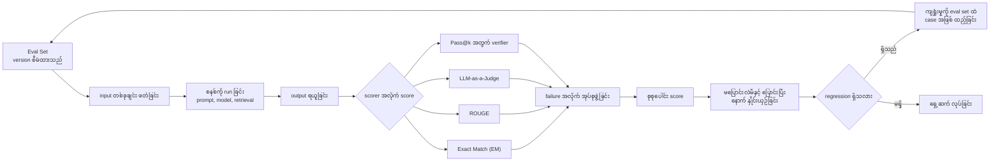
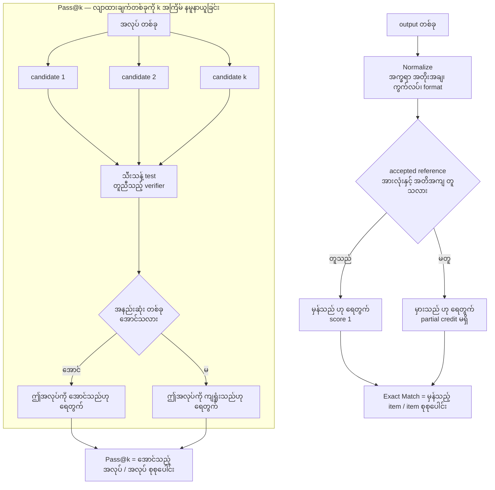
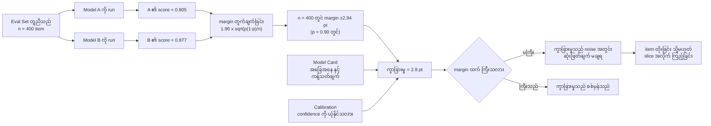
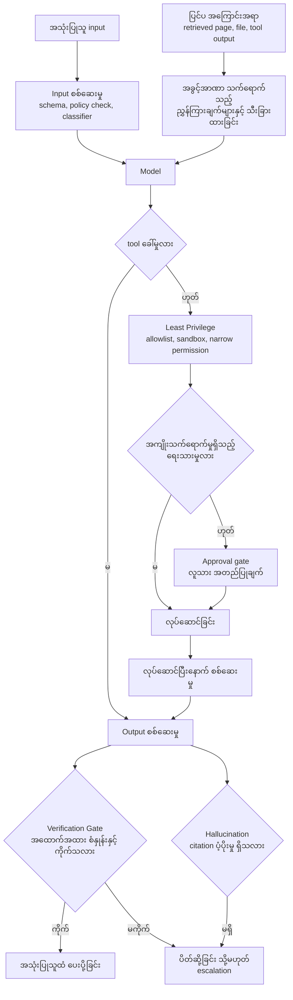
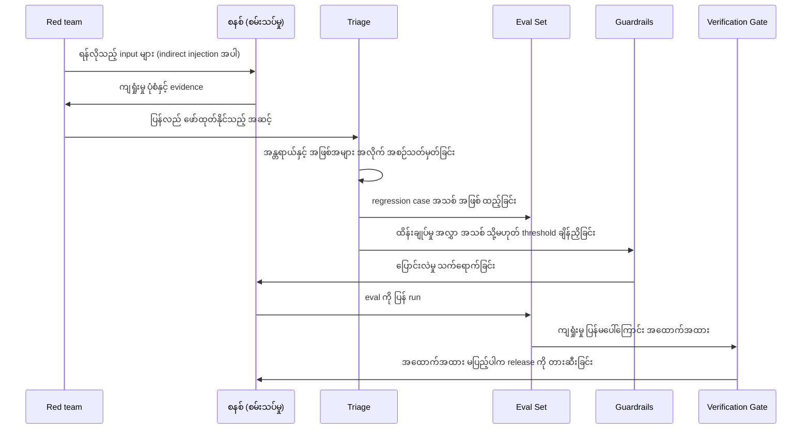
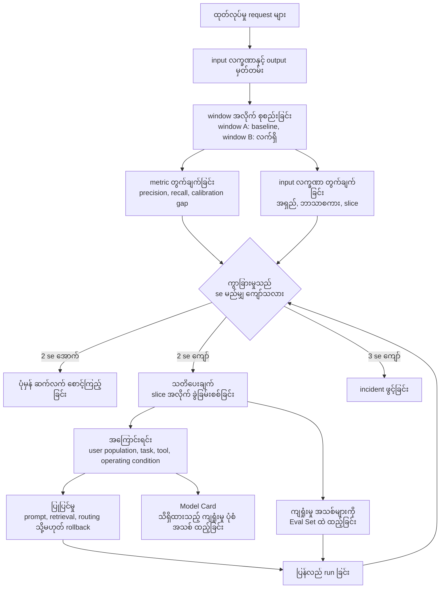

# Area 07 — ပုံရှင်းလင်းချက်များ (Visual Explanations)

Term တစ်ခုကို စာဖြင့်သာ ဖတ်ပါက "ဘယ်ကနေ ဘယ်ကို သွားသည်" ဟူသည့် လမ်းကြောင်း မမြင်ရပါ။
ဤဖိုင်သည် ထို လမ်းကြောင်းများကို ပုံဖြင့် ပြသည် — eval set နှင့် training data ကွာခြားမှု၊
eval harness loop၊ scorer ၏ အလုပ်လုပ်ပုံ၊ model နှစ်ခု နှိုင်းယှဉ်သည့်အခါ confidence၊
guardrail pipeline နှင့် ထုတ်လုပ်မှု စောင့်ကြည့်မှု အထိ။

**ပုံများ ကြည့်နည်း** — ဤဖိုင်ကို GitHub တွင် ဖတ်ပါက Mermaid ပုံများ အလိုအလျောက် render ဖြစ်သည်။
ဒေသအတွင်း တွင်ဖတ်လိုပါက VS Code ၏ Mermaid extension သို့မဟုတ် mermaid.live တွင်
mermaid code block ကို ကူးထည့်ပါ။

## ၁။ Eval set နှင့် training data — ခွဲထားရသည့် အကြောင်းရင်း

**ဘာကို ကြည့်ရမည်** —

- Eval Set သည် training corpus နှင့် **သီးခြား** ဖြစ်ရမည်။ မြှား နှစ်ခုစလုံး data တူညီသည့်
  အရင်းအမြစ်မှ လာသည်ကို ကြည့်ပါ — ခွဲထားမှု (split) သည် ရည်ရွယ်ချက်ဖြင့် လုပ်ရသည့် အလုပ် ဖြစ်သည်။
- အစက်မြှား (`T → X`) သည် မတော်တဆ ဖြစ်ပေါ်သည့် လမ်းကြောင်း ဖြစ်သည်။ Contamination သည်
  အတိအကျ ကူးချခြင်းထက် ကျယ်ပြန့်သည် — စကားပြန်ရေးချက်များ၊ အဖြေသော့များ၊ benchmark
  metadata နှင့် ထပ်တလဲလဲ prompt tuning လုပ်ခြင်းတို့သည်လည်း evaluation အချက်အလက်ကို
  ယိုစိမ့်စေနိုင်သည်။
- အောက်ပိုင်း၏ ပြန်လှည့်မြှား (`DS → E`) သည် အရေးပါသည် — deploy ပြီးနောက် ကျရှုံးမှု အသစ်များကို
  version စီမံထားသည့် eval set ထဲသို့ ထည့်သွင်းခြင်းသည် ဤ လုပ်ငန်းစဉ်ကို ရပ်တန့်မနေစေသည့်
  နည်းလမ်း ဖြစ်သည်။

**သက်ဆိုင်သည့် term** — Eval Set, Evaluation (Eval), Benchmark Contamination, Distribution Shift

## ၂။ Eval harness loop — တိုင်းတာမှုကို ထပ်ခါတလဲလဲ လုပ်နိုင်သည့် စက်

**ဘာကို ကြည့်ရမည်** —

- ဤ loop သည် **input အစုတစ်ခုတည်း** ကို run တိုင်း တူညီစွာ အသုံးပြုသည်။ ထို့ကြောင့် prompt၊
  model၊ tool သို့မဟုတ် retrieval ပြောင်းပြီးနောက် ကွာခြားမှုသည် ပြောင်းလဲမှုမှ လာသည်ဟု
  ကောက်ချက်ချနိုင်သည်။
- `E` အဆင့်တွင် scorer သည် တစ်ခုတည်း မဟုတ်သည်ကို ကြည့်ပါ။ မည်သည့် အလုပ်အတွက် မည်သည့်
  scorer ဖြစ်သည်ကို ကြိုတင် သတ်မှတ်ရမည်။
- `J` (failure အလိုက် အုပ်စုဖွဲ့ခြင်း) သည် စုစုပေါင်း score ထက် အချက်အလက် ပိုပေးသည် —
  မည်သည့် အမျိုးအစား ကျရှုံးသည်ကို ပြသည်။
- `M → N → A` ဟူသည့် ပြန်လှည့်မှား သည် eval set ကို **ရှင်သန်စေသည့်** အစိတ်အပိုင်း ဖြစ်သည်။
  ဤ line မရှိပါက eval set သည် အချိန်နှင့်အတူ ခေတ်မမီတော့ပါ။

**သက်ဆိုင်သည့် term** — Evaluation (Eval), Eval Set, Exact Match (EM), ROUGE, LLM-as-a-Judge, Pass@k

## ၃။ သတ်မှတ်ထားသည့် metric အတွက် scoring — Exact Match နှင့် Pass@k

**ဘာကို ကြည့်ရမည်** —

- `Normalize` သည် Exact Match ၏ အခြေခံ အချက် ဖြစ်သည်။ Normalization ကို **မတိုင်မီ**
  သတ်မှတ်ရမည်၊ ရလဒ် မြင်ပြီးမှ မသတ်မှတ်ရ။
- Exact Match သည် partial credit မဖော်ပြသည့် အချက်ကို ကြည့်ပါ — ထို့ကြောင့် output များစွာ
  မှန်ကန်နိုင်သည့်အခါ အလုပ်နှင့်ဆိုင်သည့် စစ်ဆေးမှုများနှင့် တွဲဖက်အသုံးပြုရမည်။
- Pass@k တွင် အောင်မြင်မှုကို **အလုပ် အဆင့်** တွင် ရေတွက်သည်၊ candidate အဆင့်တွင် မရေတွက်ပါ။
  `k` တိုးသည့်အခါ score တက်ခြင်းသည် ပိုကောင်းသည့် ပထမဆုံး အဖြေကို မဆိုလိုဘဲ
  ပိုကြီးမားသည့် attempt budget ကို ထင်ဟပ်သည်။
- `V` တွင် test သည် candidate တိုင်းအတွက် **သီးသန့်** ဖြစ်ရမည်။ Test တူညီစွာ run လုပ်ခြင်းနှင့်
  သီးသန့် environment သည် pass@k ၏ ယုံထိုက်မှုကို ဆုံးဖြတ်သည်။

**သက်ဆိုင်သည့် term** — Exact Match (EM), Pass@k, ROUGE, Eval Set, Verification Gate

## ၄။ Model နှစ်ခု နှိုင်းယှဉ်ခြင်း — confidence မပါသော ကွာခြားမှုသည် ဆုံးဖြတ်ချက် မဟုတ်

**ဘာကို ကြည့်ရမည်** —

- ဤပုံတွင် item ၄၀၀ နှင့် ကွာခြားမှု ၂.၈ pt ဖြစ်သည်၊ margin သည် ၂.၉၄ pt ဖြစ်သည်။ ထို့ကြောင့်
  `Q` သည် "မကြီး" ဘက်သို့ ထွက်သည် — ကြိုက်နှစ်သက်သည့် model ကို ရွေးချယ်ခြင်းသည်
  ကိန်းဂဏန်း အရ ခိုင်လုံမှု မရှိပါ။
- `margin` သည် item အရေအတွက်နှင့် တစ်ပြန်တစ်လှည့် အချိုးကျသည် — item လေးဆ တိုးပါက
  margin ထက်ဝက် ဖြစ်သည်။ ထို့ကြောင့် "ဘယ်လောက် ကွာခြားမှုကို ဖမ်းလိုသည်" က
  "item မည်မျှ လိုသည်" ကို ဆုံးဖြတ်သည်။
- `MC` နှင့် `CAL` မှ ဝင်လာသည့် မြှား နှစ်ခုသည် အရေးပါသည် — ကွာခြားမှု စစ်မှန်သော်လည်း
  eval အခြေအနေ မတူပါက နှိုင်းယှဉ်မှု တရားမဟုတ်ပါ၊ confidence ကို မယုံနိုင်ပါက score ကြီးသည့်
  model သည် လက်တွေ့တွင် ပိုမကောင်းနိုင်ပါ။

**သက်ဆိုင်သည့် term** — Eval Set, Calibration, Model Card, Evaluation (Eval), Precision & Recall

## ၅။ Guardrail pipeline — အလွှာလိုက် ထိန်းချုပ်မှု

**ဘာကို ကြည့်ရမည်** —

- Filter တစ်ခုတည်း မရှိသည်ကို ကြည့်ပါ — input စစ်ဆေးမှု၊ သီးခြားထားခြင်း၊ permission
  ကန့်သတ်မှု၊ approval၊ လုပ်ဆောင်ပြီးနောက် စစ်ဆေးမှု နှင့် output စစ်ဆေးမှု ရှိသည်။
  ဤ အလွှာများသည် မတူညီသည့် ကျရှုံးမှု ပုံစံများကို ဖုံးလွှမ်းသည်။
- `EXT → SEG` သည် `Prompt Injection` ၏ အဓိက ကာကွယ်မှု ဖြစ်သည် — ပြင်ပ အကြောင်းအရာကို
  ယုံကြည်စိတ်ချရခြင်း မရှိသည့် အရာအဖြစ် သတ်မှတ်ပြီး အခွင့်အာဏာ သက်ရောက်သည့်
  ညွှန်ကြားချက်များနှင့် သီးခြားထားခြင်း ဖြစ်သည်။
- `LP` နှင့် `AGG` သည် ကျရှုံးမှုတစ်ခု ဖြစ်ပါက ထိခိုက်မှုကို ကျဉ်းစေသည်။ Model များသည်
  အမှားလုပ်မိနိုင်သည် သို့မဟုတ် အန္တရာယ်ရှိသည့် ညွှန်ကြားချက်များကို လိုက်နာမိနိုင်သည်။
- Guardrails သည် အန္တရာယ်ကို လျှော့ချသည်ကို မှတ်ပါ — AI စနစ်တစ်ခု ဘေးကင်းသည်ဟု
  သက်သေပြခြင်း မဟုတ်ပါ။

**သက်ဆိုင်သည့် term** — Guardrails, Prompt Injection, Least Privilege, Hallucination, Verification Gate

## ၆။ Red team နှင့် incident — ကျရှုံးမှုတစ်ခုမှ eval set အထိ

**ဘာကို ကြည့်ရမည်** —

- Red team လုပ်ငန်းစဉ်သည် **စမ်းသပ်မှု** ဖြစ်သည်၊ သက်သေပြချက် မဟုတ်ပါ။ ရလဒ်သည်
  eval set ထဲသို့ ပြန်ဝင်သည့်အခါတွင်သာ တန်ဖိုး ရှိသည်။
- `TRI → GR` နှင့် `TRI → EV` သည် မတူညီသည့် လုပ်ဆောင်ချက် နှစ်ခု ဖြစ်သည် — တစ်ခုက
  ထိန်းချုပ်မှုကို ပြောင်းသည်၊ တစ်ခုက တိုင်းတာမှုကို တိုးသည်။ နှစ်ခုလုံး လိုအပ်သည်။
- `GT` သည် အဆုံးတွင် ရှိသည်မှာ အကြောင်းရင်း ရှိသည် — ပြုပြင်မှုတိုင်းသည်
  "ကျရှုံးမှု ပြန်မပေါ်ကြောင်း" အထောက်အထား မပြမချင်း release ကို မဖြတ်သန်းရ။
- Threshold ချိန်ညှိခြင်းသည် တစ်ဘက်တွင် ပိတ်ဆို့မှု တိုးစေသည်၊ အခြားတစ်ဘက်တွင်
  လွတ်သွားမှု တိုးစေသည် — ဤ လဲလှယ်မှုကို `Precision & Recall` ဖြင့် တိုင်းသည်။

**သက်ဆိုင်သည့် term** — Prompt Injection, Guardrails, Evaluation (Eval), Eval Set, Verification Gate, Precision & Recall

## ၇။ ထုတ်လုပ်မှုတွင် drift စောင့်ကြည့်ခြင်း

**ဘာကို ကြည့်ရမည်** —

- Drift သည် model drift အမြဲတမ်း မဟုတ်သည်ကို ကြည့်ပါ — model သည် မပြောင်းလဲဘဲ ၎င်း၏
  ပတ်ဝန်းကျင် သို့မဟုတ် အသုံးပြုသူအုပ်စု ပြောင်းလဲနိုင်သည်။ ထို့ကြောင့် `M2`
  (input လက္ခဏာ) သည် `M1` (metric) နှင့် တွဲဖက် လိုအပ်သည်။
- `CMP` တွင် ကွာခြားမှုကို standard error ဖြင့် စံကိုက်ပြထားသည်ကို ကြည့်ပါ —
  window ငယ်သည့်အခါ se ကြီးသဖြင့် ကွာခြားမှု အနည်းငယ်သည် noise ဖြစ်နိုင်သည်။
- `ROOT` သည် slice အလိုက် ခွဲခြမ်းစစ်ခြင်းကို ဆိုလိုသည် — စုစုပေါင်း metric
  မပြောင်းလဲသော်လည်း slice တစ်ခုတည်းတွင် ပြိုလဲနိုင်သည်။
- `ADD` သည် drift ၏ အဆုံးသတ်မှတ် ဖြစ်သည် — စောင့်ကြည့်မှုတွင် တွေ့သည့် ကျရှုံးမှုတိုင်းသည်
  version စီမံထားသည့် eval set ထဲသို့ ရောက်ရမည်၊ မရောက်ပါက ထို ကျရှုံးမှုသည် ပြန်ပေါ်လာမည်။

**သက်ဆိုင်သည့် term** — Distribution Shift, Eval Set, Calibration, Precision & Recall, Model Card, Verification Gate

## ပုံတိုင်းနှင့် term ချိတ်ဆက်မှု

| ပုံ | ပြသည့် အကြောင်းအရာ | သက်ဆိုင်သည့် term |
|---|---|---|
| ၁ | Eval set နှင့် training data၊ contamination နှင့် shift | Eval Set, Evaluation (Eval), Benchmark Contamination, Distribution Shift |
| ၂ | Eval harness loop | Evaluation (Eval), Eval Set, Exact Match (EM), ROUGE, LLM-as-a-Judge, Pass@k |
| ၃ | Exact Match နှင့် Pass@k scoring | Exact Match (EM), Pass@k, ROUGE, Eval Set, Verification Gate |
| ၄ | Model နှစ်ခု နှိုင်းယှဉ်ခြင်းနှင့် confidence | Eval Set, Calibration, Model Card, Precision & Recall |
| ၅ | Guardrail pipeline | Guardrails, Prompt Injection, Least Privilege, Hallucination, Verification Gate |
| ၆ | Red team နှင့် incident စီးဆင်းမှု | Prompt Injection, Guardrails, Evaluation (Eval), Eval Set, Verification Gate |
| ၇ | ထုတ်လုပ်မှု drift စောင့်ကြည့်မှု | Distribution Shift, Eval Set, Calibration, Precision & Recall, Model Card |

Term ၁၇ ခုအနက် ပုံများတွင် တိုက်ရိုက် မပါဝင်သည့် term တစ်ခုသာ ရှိသည် — `Alignment`။ ၎င်းသည်
ပုံ တစ်ပုံတည်း၏ အကြောင်းအရာ မဟုတ်ဘဲ ဤပုံ ခုနစ်ပုံ ပေါင်းစည်းသည့် ပန်းတိုင် ဖြစ်သည် —
မျှော်လင့်ထားသည့် အခြေအနေများတွင်ဖြစ်စေ၊ ရန်လိုသည့် အခြေအနေများတွင်ဖြစ်စေ
ရည်ရွယ်သည့် ပန်းတိုင်၊ ကန့်သတ်ချက်နှင့် လူသား၏ ဦးစားပေးချက်များနှင့် ကိုက်ညီသည့် အပြုအမူ
ဖြစ်သည်။

## နောက်တစ်ဆင့်

- term များကို အစဉ်လိုက် ဖတ်လိုပါက — [`01_learning_sequence.md`](01_learning_sequence.md)
- ကိန်းဂဏန်း အဖြစ် မြင်လိုပါက — [`04_exercises.md`](04_exercises.md)
- Term တိုင်း၏ အပြည့်အစုံ အဓိပ္ပာယ် — [`../../terms/07_evaluation_and_safety.md`](../../terms/07_evaluation_and_safety.md)
