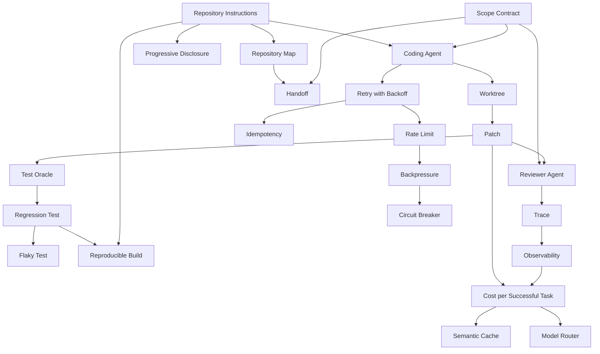

# Area 08 — AI-native development: လေ့လာသည့် အစဉ် (Learning Sequence)

ဤနယ်ပယ်၏ term ၂၃ ခုသည် ရောနှောနေသည့် ခေါင်းစဉ်များ မဟုတ်ပါ။ ၎င်းတို့သည် **အလုပ်တစ်ခုကို
လုပ်ဆောင်သည့် လုပ်ငန်းစဉ် တစ်ခု** — spec ရေးခြင်း → context နှင့် နယ်နိမိတ် ပေးခြင်း → ကုဒ်
ထုတ်လုပ်ခြင်း → test ဖြင့် အတည်ပြုခြင်း → တိုင်းတာခြင်း → ယုံကြည်စိတ်ချရမှုနှင့် အဖွဲ့
လုပ်ငန်းစဉ်သို့ ပေါင်းစည်းခြင်း — အဖြစ် တည်ဆောက်ထားသည်။ ဤဖိုင်သည် term များကို မည်သည့်
အစဉ်အတိုင်း ဖတ်ရမည်၊ မည်သည့် term က မည်သည့် term အပေါ် အခြေခံသည်ကို သတ်မှတ်ပေးသည်။

**ဖတ်သည့် အစဉ်ကို လိုက်ခြင်း၏ အကျိုးသက်ရောက်မှု** — နောက် term တိုင်းသည် အရင် term များကို
အသုံးပြု၍ ရှင်းလင်းသည်။ ဥပမာ `Reviewer Agent` သည် `Patch` နှင့် `Scope Contract` ကို
မသိဘဲ အကျိုးမရှိသလို၊ `Cost per Successful Task` သည် `Observability` မရှိဘဲ တွက်ချက်၍
မရနိုင်ပါ။

## အဆင့် ၆ ဆင့်၏ ခြုံငုံမှု

| အဆင့် | အမည် | Term | ဤအဆင့် ပြီးပါက ဖြေနိုင်ရမည့် မေးခွန်း |
|---|---|---|---|
| ၁ | spec ရေးခြင်း နှင့် လုပ်ငန်း နယ်ပယ် သတ်မှတ်ခြင်း | Scope Contract, Repository Instructions, Coding Agent, Progressive Disclosure | agent တစ်ခု လုပ်ဆောင်နိုင်သည့် လုပ်ငန်း ဖော်ပြချက် တစ်ခုတွင် မည်သည့် အချက် ပါရမည် |
| ၂ | context နှင့် နယ်နိမိတ် ပေးခြင်း | Repository Map, Worktree, Handoff | agent အား မည်သည့် အထောက်အထား အစဉ်ဖြင့် ပေးမည်၊ မည်သည့် နေရာတွင် ရပ်တန့်စေမည် |
| ၃ | ကုဒ် ထုတ်လုပ်ခြင်း နှင့် ပြန်လည် စစ်ဆေးခြင်း | Patch, Reviewer Agent | ဖိုင် ၄၀ ကို ထိသည့် ပြောင်းလဲမှုကို review လုပ်နိုင်သည့် ပုံစံသို့ မည်သို့ ပြန်ချုံ့မည် |
| ၄ | test ဖြင့် အတည်ပြုခြင်း | Test Oracle, Regression Test, Flaky Test, Reproducible Build | test အောင်ခြင်းသည် ဘာကို အာမခံသည်၊ ဘာကို အာမမခံနိုင်သနည်း |
| ၅ | တိုင်းတာခြင်း နှင့် ကုန်ကျစရိတ် | Trace, Observability, Cost per Successful Task, Semantic Cache, Model Router | လုပ်ငန်းစဉ် တစ်ခုလုံး၏ တကယ့် ကုန်ကျစရိတ်ကို မည်သည့် ကိန်းဂဏန်းဖြင့် ဆုံးဖြတ်မည် |
| ၆ | ယုံကြည်စိတ်ချရမှု နှင့် အဖွဲ့ လုပ်ငန်းစဉ် | Retry with Backoff, Idempotency, Rate Limit, Backpressure, Circuit Breaker | ခေတ္တ ပျက်ကွက်မှုသည် အလုပ်တစ်ခုလုံး သို့မဟုတ် ဘေးထွက် အကျိုးသက်ရောက်မှုကို မည်သို့ မထိခိုက်စေရမည် |

## အဆင့်များအကြား မှီခိုမှု (Prerequisite Graph)

## အဆင့် ၁ — spec ရေးခြင်း နှင့် လုပ်ငန်း နယ်ပယ် သတ်မှတ်ခြင်း (၄ term)

**အစဉ်** — `Scope Contract` → `Repository Instructions` → `Coding Agent` → `Progressive Disclosure`

**ဘာကြောင့် ဤနေရာတွင် ရှိသည်** — `Scope Contract` သည် ဤ လုပ်ငန်းစဉ် တစ်ခုလုံး၏
အခြေခံ ဖြစ်သည် — ပန်းတိုင်၊ ခွင့်ပြုထားသည့် နှင့် တားမြစ်ထားသည့် မျက်နှာပြင်၊ မျှော်လင့်သည့်
artifact၊ verification လိုအပ်ချက် နှင့် ရပ်တန့်မည့် အခြေအနေ ကို သတ်မှတ်သည်။
`Repository Instructions` သည် ထို သဘောတူညီချက် ကို repository တစ်ခုအတွင်း မည်သည့်
command နှင့် စည်းမျဉ်းဖြင့် လုပ်ဆောင်ရမည် ကို ဖြည့်စွက်သည်။ ထို နှစ်ခု ပေါ်တွင်မှ
`Coding Agent` ၏ တန်ဖိုး ရှိ၊ မရှိ ဆုံးဖြတ်နိုင်သည်။ `Progressive Disclosure` သည် ထို agent
အား တစ်ကြိမ်တည်း context အပြည့် မပေးဘဲ အဆင့်လိုက် ပေးသည့် နည်းလမ်း ဖြစ်သဖြင့်
အဆင့် ၂ တွင် ဖတ်မည့် `Repository Map` ကို ရှေ့ပြေး ပြင်ဆင်ပေးသည်။

**မှတ်သားရန်** — လုပ်ငန်း ဖော်ပြချက်သည် "မည်သည့် အရာ လိုချင်သည်" ကို ဆိုသည်၊ scope contract
သည် "မည်သည့် နေရာ ထိရမည်၊ မထိရ၊ မည်သည့် အထောက်အထား ပြရမည်" ကို ထပ်ဆင့် သတ်မှတ်သည်။
စာကြောင်း နှစ်မျိုးကို တူညီဟု မယူဆရ။

**Checkpoint မေးခွန်း** — ငွေရှင်းသည့် module တွင် bug ပြင်ရန် scope contract မပါဘဲ coding agent
အား လုပ်ငန်း ပေးပါက မည်သည့် အမှား နှစ်မျိုး ဖြစ်နိုင်သည်။

## အဆင့် ၂ — context နှင့် နယ်နိမိတ် ပေးခြင်း (၃ term)

**အစဉ်** — `Repository Map` → `Worktree` → `Handoff`

**ဘာကြောင့် ဤနေရာတွင် ရှိသည်** — `Repository Map` သည် agent အား ကြီးမားသည့် ဖိုင်များ
မဖွင့်မီ မှန်ကန်သည့် အထောက်အထား ကို ရှာတွေ့စေသည်။ `Worktree` သည် ထို agent ကို
အခြား လူ သို့မဟုတ် agent များနှင့် တစ်ပြိုင်နက် အလုပ်လုပ်စေသည် — checkout တစ်ခုကို
လဲလှယ်ရခြင်း မရှိဘဲ သီးခြား working directory နှင့် index ရရှိသည်။ `Handoff` သည်
session တစ်ခု ပြီးဆုံးသည့်အခါ ပန်းတိုင်၊ လက်ရှိ အခြေအနေ၊ အထောက်အထား၊ ဆုံးဖြတ်ချက်၊
ကန့်သတ်ချက် နှင့် ကျန်ရှိသည့် အလုပ် ကို ဆက်ခံသူထံ ထိန်းသိမ်းစွာ လွှဲပြောင်းသည်။
ဤအဆင့် မပြီးဘဲ အဆင့် ၃ ကို ဖတ်ပါက "agent သည် အဘယ်ကြောင့် မှားသည့် subsystem ကို
ထိသနည်း" ဟူသည့် မေးခွန်းကို ဖြေနိုင်မည် မဟုတ်ပါ။

**မှတ်သားရန်** — worktree သည် checked-out ဖိုင်များကို သီးခြားခွဲခြားပေးသည်၊ စက်ပေါ်ရှိ
process၊ port၊ cache၊ database သို့မဟုတ် secret တိုင်းကို သီးခြားခွဲခြားပေးခြင်း မဟုတ်ပါ။

**Checkpoint မေးခွန်း** — အကြမ်းဖျင်း ဖိုင် tree နှင့် repository map သည် မည်သည့် အချက်တွင်
ကွာခြားသည်၊ handoff တွင် မည်သည့် အချက် အနည်းဆုံး ပါရမည်။

## အဆင့် ၃ — ကုဒ် ထုတ်လုပ်ခြင်း နှင့် ပြန်လည် စစ်ဆေးခြင်း (၂ term)

**အစဉ်** — `Patch` → `Reviewer Agent`

**ဘာကြောင့် ဤနေရာတွင် ရှိသည်** — agent ၏ အထွက်ကို working directory တစ်ခုလုံး အဖြစ်
လက်ခံပါက review လုပ်၍ မရပါ။ `Patch` သည် သိထားသည့် base revision တစ်ခုနှင့် နှိုင်းယှဉ်၍
ထည့်သည့် နှင့် ဖြတ်သည့် စာကြောင်းများ အဖြစ် ဖော်ပြသဖြင့် ကျဉ်းမြောင်းသည့် artifact တစ်ခုကို
စစ်ဆေးခြင်း၊ test လုပ်ခြင်း၊ အသုံးချခြင်း သို့မဟုတ် ပယ်ချခြင်း ပြုလုပ်နိုင်စေသည်။
`Reviewer Agent` သည် ထို patch ကို တိကျသည့် စံချိန်စံညွှန်းများအပေါ် စစ်ဆေးပြီး စာကြောင်း
တိကျသည့် တွေ့ရှိချက်များ သို့မဟုတ် အဆုံးအဖြတ် ပြန်ပေးရန် တာဝန်ပေးထားသည်။ အခန်းကဏ္ဍ
ခွဲခြားမှုသည် ချန်လှပ်ထားမှုများကို ဖမ်းမိနိုင်သော်လည်း reviewer သည် သီးခြားလွတ်လပ်သည့်
အထောက်အထား နှင့် တိကျသည့် rubric ရရှိမှသာ အကျိုးရှိသည်။

**Checkpoint မေးခွန်း** — reviewer agent အား ထုတ်လုပ်သည့် agent နှင့် အတူတူ context ပေးပါက
အဘယ်ကြောင့် တူညီသည့် အမှားကို ပြန်ဖြစ်နိုင်သနည်း။ reviewer သို့ မည်သည့်
အထောက်အထား ပေးရမည်။

## အဆင့် ၄ — test ဖြင့် အတည်ပြုခြင်း (၄ term)

**အစဉ်** — `Test Oracle` → `Regression Test` → `Flaky Test` → `Reproducible Build`

**ဘာကြောင့် ဤနေရာတွင် ရှိသည်** — test input များ ထုတ်လုပ်နိုင်ခြင်းဖြင့် မလုံလောက်ပါ။
`Test Oracle` သည် ရလဒ် တစ်ခုချင်းစီကို အမျိုးအစားခွဲရန် လွတ်လပ်သည့် အခြေခံ — လုပ်ဆောင်နိုင်သည့်
invariant၊ ရည်ညွှန်း implementation၊ schema သို့မဟုတ် လူ၏ ဆုံးဖြတ်ချက် — ဖြစ်သည်။
`Regression Test` သည် အလုပ်လုပ်ကြောင်း သိထားသည့် အပြုအမူကို ကာကွယ်သည့် ထပ်ခါတလဲလဲ
လုပ်နိုင်သည့် စစ်ဆေးမှု ဖြစ်သည်။ `Flaky Test` သည် ထို verification gate များကို အားနည်းစေသည် —
အောင်နိုင်ခြင်းနှင့် ကျရှုံးခြင်း နှစ်မျိုးလုံး ဖြစ်နိုင်သဖြင့် တကယ့် ပျက်ကွက်မှုများကို လျစ်လျူရှုရန်
လေ့ကျင့်ပေးသည်။ `Reproducible Build` သည် ဤအဆင့်ကို build အဆင့်သို့ တိုးချဲ့သည် —
ကြေညာထားသည့် source၊ ပတ်ဝန်းကျင် နှင့် လမ်းညွှန်ချက်များဖြင့် bit တစ်လုံးမျှ မကွာသည့်
artifact ကို သီးခြားစီ ပြန်လည် ထုတ်လုပ်နိုင်ခြင်း ဖြစ်သည်။

**မှတ်သားရန်** — ရံဖန်ရံခါ ပေါ်သည့် product bug ကို အမြဲတမ်း ဖော်ထုတ်ပြသည့် test သည်
အဖိုးတန်သည့် အထောက်အထား ဖြစ်ပြီး flaky test ဖြစ်ရန် မလိုအပ်ပါ။

**Checkpoint မေးခွန်း** — ကုဒ်ကို ရေးသည့် မော်ဒယ်ကို ၎င်း၏ output မှန်ကန်သည်၊ မမှန်ကန်
မေးခြင်းသည် အဘယ်ကြောင့် လွတ်လပ်သည့် test oracle မဖြစ်သနည်း။ flaky test တစ်ခုသည်
merge တစ်ခုကို မည်သို့ လွဲမှားစွာ ဖြတ်သန်းစေနိုင်သည်။

## အဆင့် ၅ — တိုင်းတာခြင်း နှင့် ကုန်ကျစရိတ် (၅ term)

**အစဉ်** — `Trace` → `Observability` → `Cost per Successful Task` → `Semantic Cache` → `Model Router`

**ဘာကြောင့် ဤနေရာတွင် ရှိသည်** — `Trace` သည် မော်ဒယ် ခေါ်ဆိုမှုများ၊ retrieval၊ tool များ၊
အခြေအနေ ပြောင်းလဲမှုများ၊ retry များ၊ ခွင့်ပြုချက်များ နှင့် evaluation များ တစ်လျှောက်
ဆက်စပ်နေသည့် မှတ်တမ်း ဖြစ်သည်။ `Observability` သည် ထို မှတ်တမ်း အပါအဝင် မှတ်တမ်းတင်ထားသည့်
input၊ output၊ အချိန်တိုင်းတာမှု၊ ကုန်ကျစရိတ် နှင့် error များမှ စနစ်၏ အပြုအမူကို
နားလည်နိုင်သည့် စွမ်းရည် ဖြစ်သည်။ ထို အထောက်အထား ရှိမှသာ `Cost per Successful Task` ကို
စုစုပေါင်း စနစ် ကုန်ကျစရိတ်ကို အောင်မြင်သည့် လုပ်ငန်း အရေအတွက်ဖြင့် စား၍ တွက်နိုင်သည် —
retry၊ ကျရှုံးသည့် run နှင့် evaluation အပိုကုန်ကျစရိတ် အားလုံး ပါဝင်သည်။
`Semantic Cache` နှင့် `Model Router` သည် ထို ကုန်ကျစရိတ်ကို လျှော့သည့် ဆုံးဖြတ်ချက် နှစ်ခု
ဖြစ်သဖြင့် အဆုံးတွင် ရှိသည်။

**Checkpoint မေးခွန်း** — cost per token နှင့် cost per successful task သည် မည်သည့် အရာကို
ကွာခြားစွာ တိုင်းတာသည်။ semantic cache တစ်ခုသည် မည်သည့် အခြေအနေတွင် ကုန်ကျစရိတ်
လျှော့ခြင်းထက် အန္တရာယ် ပိုကြီးစေသည်။

## အဆင့် ၆ — ယုံကြည်စိတ်ချရမှု နှင့် အဖွဲ့ လုပ်ငန်းစဉ် (၅ term)

**အစဉ်** — `Retry with Backoff` → `Idempotency` → `Rate Limit` → `Backpressure` → `Circuit Breaker`

**ဘာကြောင့် ဤနေရာတွင် ရှိသည်** — ဖြန့်ကျက်ထားသည့် စနစ်တွင် ခေတ္တ ပျက်ကွက်မှုသည် သာမန်
ဖြစ်သည်။ `Retry with Backoff` သည် ထို လုပ်ဆောင်ချက်ကို တစ်ဆင့်ချင်း ပိုရှည်သည့် ကြားချိန်များဖြင့်
ထပ်လုပ်သည် — များသောအားဖြင့် ကျပန်း jitter နှင့် တင်းကျပ်သည့် retry အရေအတွက် ကန့်သတ်ချက်
ပါဝင်သည်။ သို့သော် retry သည် ဘေးထွက် အကျိုးသက်ရောက်မှုကို ထပ်နှစ်ဆ ဖြစ်စေနိုင်သဖြင့်
`Idempotency` လိုအပ်သည် — တူညီသည့် identity ဖြင့် ထပ်လုပ်သည့်အခါ ပထမ အောင်မြင်စွာ
လုပ်ဆောင်ပြီးသည့် အကျိုးသက်ရောက်မှုထက် ပို၍ မဖြစ်ပေါ်စေသည့် ဂုဏ်သတ္တိ ဖြစ်သည်။
`Rate Limit` သည် ခွင့်ပြုထားသည့် request၊ token သို့မဟုတ် တစ်ပြိုင်နက် လုပ်ဆောင်သည့် အလုပ်
ပမာဏကို ဖြတ်တောက်သည်။ `Backpressure` သည် အောက်ပိုင်း capacity ကန့်သတ်ချက်ကို အပေါ်ပိုင်းသို့
ဖြန့်ဝေသည် — ပျက်ကွက်မှု မဖြစ်မီ ကာကွယ်သည်။ `Circuit Breaker` သည် ထို့ထက် နောက်ကျသည် —
ပျက်ကွက်မှုများ သတ်မှတ်ထားသည့် အဆင့်ကို ကျော်လွန်ပြီးမှ ခေါ်ဆိုမှုများကို ခေတ္တရပ်ဆိုင်းပြီး
cooldown ကာလ ပြီးနောက် ကျန်းမာရေး စမ်းသပ်မှုကို ခွင့်ပြုသည်။

**Checkpoint မေးခွန်း** — idempotency မရှိဘဲ retry လုပ်ပါက မည်သည့် အန္တရာယ် ဖြစ်နိုင်သည်၊
မည်သို့ ကာကွယ်ရမည်။ backpressure နှင့် circuit breaker သည် မည်သည့် အချက်တွင် ကွာခြားသည်။

## Term ၂၃ ခု၏ အစဉ် ဇယား

| # | Term | အဆင့် | ကြိုတင် သိရမည့် term | ဖွင့်ပေးသည့် အချက် |
|---|---|---|---|---|
| 1 | Scope Contract | ၁ | — | လုပ်ငန်း၏ နယ်နိမိတ်၊ artifact နှင့် ရပ်တန့်မည့် အခြေအနေ |
| 2 | Repository Instructions | ၁ | — | repository အလိုက် command၊ စည်းမျဉ်း နှင့် နယ်နိမိတ် |
| 3 | Coding Agent | ၁ | Scope Contract, Repository Instructions | patch ထုတ်လုပ်သည့် အလုပ်သမား |
| 4 | Progressive Disclosure | ၁ | Repository Instructions | context ကို အဆင့်လိုက် ဖော်ထုတ်ခြင်း |
| 5 | Repository Map | ၂ | Repository Instructions | မှန်ကန်သည့် အထောက်အထား ရှာတွေ့ခြင်း |
| 6 | Worktree | ၂ | Coding Agent | တစ်ပြိုင်နက် အလုပ်လုပ်နိုင်သည့် သီးခြား checkout |
| 7 | Handoff | ၂ | Scope Contract, Repository Map | session များအကြား ဆက်လက်လုပ်ဆောင်မှု |
| 8 | Patch | ၃ | Worktree | review လုပ်နိုင်သည့် ကျဉ်းမြောင်းသည့် artifact |
| 9 | Reviewer Agent | ၃ | Patch, Scope Contract | လွတ်လပ်သည့် အထောက်အထားဖြင့် စစ်ဆေးမှု |
| 10 | Test Oracle | ၄ | Patch | ရလဒ် တစ်ခုချင်းစီကို အမျိုးအစားခွဲသည့် အခြေခံ |
| 11 | Regression Test | ၄ | Test Oracle | အလုပ်လုပ်ကြောင်း သိထားသည့် အပြုအမူ ကာကွယ်မှု |
| 12 | Flaky Test | ၄ | Regression Test | verification gate ၏ ယုံကြည်ရမှု |
| 13 | Reproducible Build | ၄ | Repository Instructions, Regression Test | artifact ကို မူလ စက်ကို ကျော်လွန်၍ စစ်ဆေးမှု |
| 14 | Trace | ၅ | Reviewer Agent | လုပ်ငန်းစဉ် တစ်ဆင့်ချင်းစီ၏ ဆက်စပ် မှတ်တမ်း |
| 15 | Observability | ၅ | Trace | စနစ် အပြုအမူကို နားလည်သည့် စွမ်းရည် |
| 16 | Cost per Successful Task | ၅ | Observability, Patch | workflow ၏ တကယ့် ကုန်ကျစရိတ် |
| 17 | Semantic Cache | ၅ | Cost per Successful Task | ထပ်ခါတလဲလဲ ရည်ရွယ်ချက်၏ latency နှင့် ကုန်ကျစရိတ် လျှော့ခြင်း |
| 18 | Model Router | ၅ | Cost per Successful Task | လုပ်ငန်းအလိုက် မော်ဒယ် ရွေးချယ်မှု |
| 19 | Retry with Backoff | ၆ | Coding Agent | ခေတ္တ ပျက်ကွက်မှုကို ခံနိုင်သည့် လုပ်ငန်းစဉ် |
| 20 | Idempotency | ၆ | Retry with Backoff | retry ၏ ဘေးထွက် အကျိုးသက်ရောက်မှု ကာကွယ်မှု |
| 21 | Rate Limit | ၆ | Retry with Backoff | ခွင့်ပြုထားသည့် အသုံးပြုမှု၏ အပေါ်ဆုံး ကန့်သတ်ချက် |
| 22 | Backpressure | ၆ | Rate Limit | capacity ကန့်သတ်ချက်ကို စနစ်တစ်လျှောက် ဖြန့်ဝေမှု |
| 23 | Circuit Breaker | ၆ | Backpressure | ပျက်ကွက်ပြီးနောက် ခေါ်ဆိုမှု ရပ်ဆိုင်းမှု နှင့် ပြန်လည် စမ်းသပ်မှု |

## လက်တွေ့ လုပ်သည့် အစဉ် (၅ ကြိမ် ထိုင်ရန်)

| ကြိမ် | ဖတ်ရမည့် အဆင့် | လက်တွေ့ လုပ်ရမည့် lab |
|---|---|---|
| ၁ | အဆင့် ၁ + ၂ | `python3 guides/08_ai_native_development/labs/lab_context_strategy.py --scope-files 60 --window 32000` |
| ၂ | အဆင့် ၃ | `python3 .../labs/lab_review_budget.py --generated-lines 1200 --defect-rate 0.08` |
| ၃ | အဆင့် ၄ | `python3 .../labs/lab_review_budget.py --generated-lines 3000 --defect-rate 0.12` |
| ၄ | အဆင့် ၅ | `python3 .../labs/lab_change_cost.py --tasks 100 --attempts 4 --success-rate 0.62` |
| ၅ | အဆင့် ၆ + လေ့ကျင့်ခန်း | `python3 .../labs/lab_change_cost.py --success-rate 0.45 --attempts 5` နှင့် [`04_exercises.md`](04_exercises.md) |

## နောက်တစ်ဆင့်

- ပုံရှင်းလင်းချက်များ — [`02_visual_explanations.md`](02_visual_explanations.md) (spec မှ patch အထိ လမ်းကြောင်း၊ review လှည့်ပတ်မှု၊ handoff)
- အောက်ခံစနစ်နှင့် ချိတ်ဆက်မှု — [`03_theory_to_infrastructure.md`](03_theory_to_infrastructure.md)
- လေ့ကျင့်ခန်းများ — [`04_exercises.md`](04_exercises.md)
- လက်တွေ့စမ်းသပ်မှုများ — [`labs/`](labs/)
- Term တိုင်း၏ အပြည့်အစုံ အဓိပ္ပာယ် — [`../../terms/08_ai_native_development.md`](../../terms/08_ai_native_development.md)
