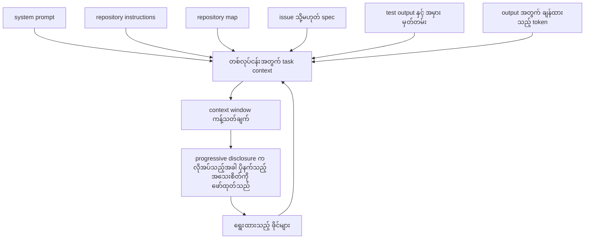
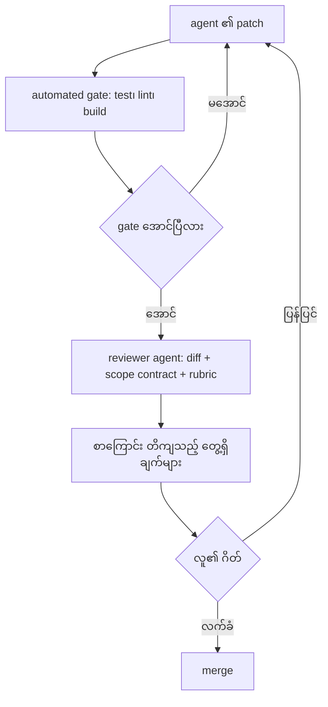
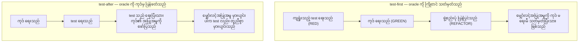
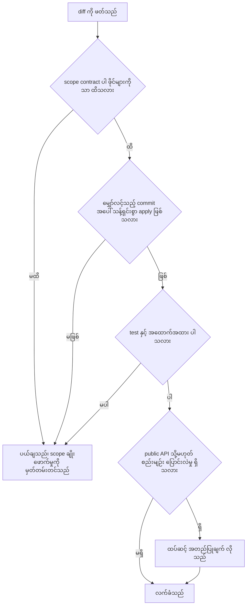
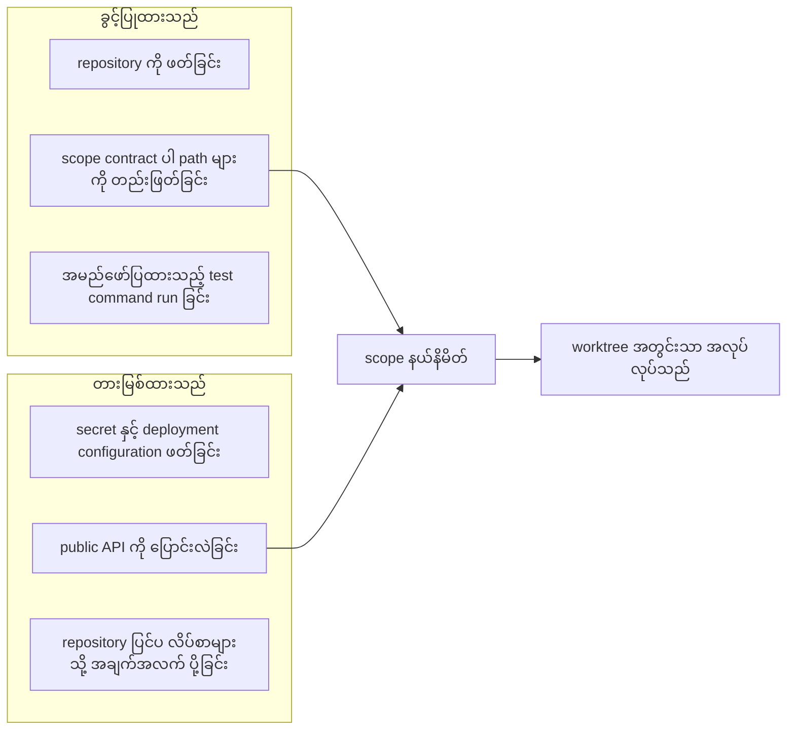
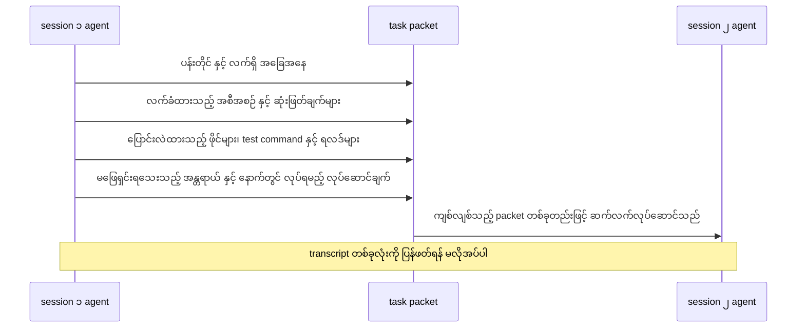
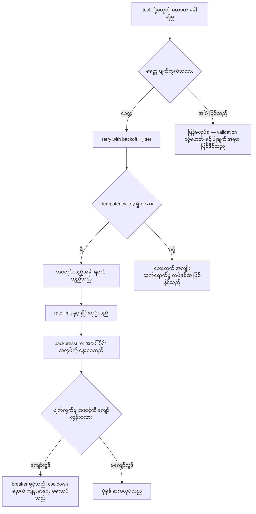

# Area 08 — ပုံရှင်းလင်းချက်များ (Visual Explanations)

Term တစ်ခုကို စာဖြင့်သာ ဖတ်ပါက "ဘယ်ကနေ ဘယ်ကို သွားသည်" ဟူသည့် လမ်းကြောင်း မမြင်ရပါ။
ဤဖိုင်သည် ထို လမ်းကြောင်းများကို ပုံဖြင့် ပြသည် — spec မှ patch အထိ လုပ်ငန်းစဉ်၊ agent ရရှိသည့်
context အစုအဝေး၊ လူ၏ ဂိတ်ပါသည့် review လှည့်ပတ်မှု၊ test-first နှင့် test-after လမ်းကြောင်း
နှစ်မျိုး၊ diff review checklist၊ tool ခွင့်ပြုချက် နှင့် scope နယ်နိမိတ်၊ session များအကြား handoff
နှင့် workflow ယုံကြည်စိတ်ချရမှု အထိ။

**ပုံများ ကြည့်နည်း** — ဤဖိုင်ကို GitHub တွင် ဖတ်ပါက Mermaid ပုံများ အလိုအလျောက် render ဖြစ်သည်။
ဒေသအတွင်း ဖတ်လိုပါက VS Code ၏ Mermaid extension သို့မဟုတ် mermaid.live တွင်
```mermaid``` block ကို ကူးထည့်ပါ။

## ၁။ spec မှ plan သို့၊ plan မှ patch သို့၊ patch မှ review သို့

```mermaid
flowchart LR
    A["ပန်းတိုင် နှင့် scope contract"] --> B["agent သည် plan ရေးသည်"]
    B --> C["လူ သို့မဟုတ် reviewer က plan ကို အတည်ပြုသည်"]
    C --> D["agent သည် patch ထုတ်လုပ်သည်"]
    D --> E["test နှင့် verification gate များ run သည်"]
    E --> F{"gate အောင်ပြီလား"}
    F -->|"မအောင်"| D
    F -->|"အောင်"| G["diff review အဆင့်"]
    G --> H{"လက်ခံပြီလား"}
    H -->|"လက်မခံ"| D
    H -->|"လက်ခံ"| I["merge နှင့် handoff မှတ်တမ်း"]
```

**ဘာကို ကြည့်ရမည်** — လုပ်ငန်းစဉ်တွင် **ဂိတ် သုံးခု** ရှိသည်။ ပထမ ဂိတ်သည် `C` — plan ကို
ကုဒ် မရေးမီ အတည်ပြုခြင်း ဖြစ်ပြီး ကျယ်သည့် အမှားကို အစောဆုံး ဖမ်းသည်။ ဒုတိယ ဂိတ်သည်
`E` — automation က ဆုံးဖြတ်သည်။ တတိယ ဂိတ်သည် `G` — လူ သို့မဟုတ် reviewer agent က
diff ကို စစ်သည်။ မြှား နှစ်ခု (`F → D`, `H → D`) က လုပ်ငန်းစဉ်သည် တစ်လမ်းသွား မဟုတ်ဘဲ
ပြန်လှည့်နိုင်သည် ကို ပြသည်။ ဂိတ် တစ်ခု ချိုးဖောက်ခံရပါက (ဥပမာ gate ကျရှုံးသည့် patch
merge ဖြစ်ပါက) နောက်ဆုံး အဆင့်တွင် ကုန်ကျစရိတ် အကြီးဆုံး ဖြစ်သည် — ဤဖိုင်၏ လေ့ကျင့်ခန်း
များသည် ထို ကုန်ကျစရိတ်ကို ကိန်းဂဏန်း ဖြစ်စေသည်။

**သက်ဆိုင်သည့် term** — Scope Contract, Coding Agent, Patch, Regression Test, Reviewer Agent, Handoff

## ၂။ agent ရရှိသည့် context အစုအဝေး



**ဘာကို ကြည့်ရမည်** — `B` သို့ ဝင်သည့် မြှား တိုင်းသည် token ကုန်သည်။ ထို token များထဲတွင်
agent တကယ် အသုံးပြုနိုင်သည့် အချက်အလက်နှင့် ဆူညံမှု ရောနှောနေသည်။ `RO` သည်
**ဖြတ်၍ မရသည့်** အစိတ်အပိုင်း ဖြစ်သည် — output အတွက် နေရာ မချန်ပါက အဖြေသည်
အလယ်တွင် ပြတ်တောက်သည်။ `PD` မြှား က progressive disclosure သည် ဖိုင်များကို အစမှ
အပြည့် မဖွင့်ဘဲ repository map နှင့် လိုအပ်သည့် module ကို ရှာတွေ့ပြီးမှ load လုပ်သည့်
လမ်းကြောင်းကို ပြသည်။

**သက်ဆိုင်သည့် term** — Repository Instructions, Repository Map, Progressive Disclosure, Context Engineering, Coding Agent

## ၃။ လူ၏ ဂိတ် ပါသည့် review လှည့်ပတ်မှု



**ဘာကို ကြည့်ရမည်** — automation သည် `B → C` ကို ဖြေသည်၊ `D` သည် "စံချိန်စံညွှန်းအလိုက်
မှန်သလား" ကို ဖြေသည်၊ `F` သည် "ဤ လုပ်ငန်းကို လက်ခံနိုင်သလား" ကို ဖြေသည်။ ဤ မေးခွန်း
သုံးခုသည် မတူညီပါ — test အောင်ခြင်းသည် လက်ခံသင့်ခြင်းကို မဆိုလိုပါ။ ကျရှုံးသည့် လည်ပတ်မှု
တိုင်းသည် `A` သို့ ပြန်လာသည်ကို ကြည့်ပါ — ထို့ကြောင့် ကျဉ်းသည့် patch သည် လည်ပတ်မှု
တစ်ခုလျှင် ကုန်ကျစရိတ် နည်းသည်။

**သက်ဆိုင်သည့် term** — Verification Gate, Reviewer Agent, Regression Test, Scope Contract, Patch

## ၄။ test-first နှင့် test-after — လမ်းကြောင်း နှစ်မျိုး



**ဘာကို ကြည့်ရမည်** — `TF` တွင် မျှော်လင့်အပြုအမူကို ကုဒ် မတည်ရှိမီ သတ်မှတ်သဖြင့်
oracle သည် ကုဒ်နှင့် **မှီခိုမှု မရှိ**။ `TA` တွင် test ကို ကုဒ် ဖတ်ပြီးမှ ရေးသဖြင့် oracle သည်
ကုဒ်၏ အပြုအမူကို ပြန်လည် ဖော်ပြရုံသာ ဖြစ်နိုင်သည် — ကုဒ် မှားယွင်းပါက test လည်း ထို
အမှားကို အလိုအလျောက် လက်ခံသည်။ ဤအချက်သည် "test အောင်သည်" ဟူသည့် အထောက်အထား၏
တန်ဖိုးကို ကွာခြားစေသည်။

**သက်ဆိုင်သည့် term** — Test Oracle, Regression Test, Flaky Test, Verification Gate

## ၅။ diff review checklist — ဖြတ်သန်းရမည့် ဂိတ်များ



**ဘာကို ကြည့်ရမည်** — ဤ checklist သည် "ကုဒ် ကောင်းသလား" ကို မမေးဘဲ **"အထောက်အထား ရှိသလား"**
ကို မေးသည်။ အဆင့် တိုင်းသည် ပြင်း၍ စျေးသက်သာသည့် စစ်ဆေးမှု ဖြစ်သည် — ဖိုင်စာရင်း
စစ်ခြင်းသည် မိနစ်ပိုင်း ကုန်သည်၊ dependency အမှား သည် အလုပ်ရက် ကုန်သည်။ ထို့ကြောင့်
`Q1` နှင့် `Q2` ကို ရှေးဦး စစ်ရမည်။

**သက်ဆိုင်သည့် term** — Patch, Scope Contract, Test Oracle, Reviewer Agent, Worktree

## ၆။ agent ၏ tool ခွင့်ပြုချက် နှင့် scope နယ်နိမိတ်



**ဘာကို ကြည့်ရမည်** — ခွင့်ပြုချက် သည် "agent ကောင်းသည်ဟု ယုံသည်" ဆိုသည့် အချက် မဟုတ်ဘဲ
**မူဝါဒ စည်းမျဉ်း** ဖြစ်သည်။ `ALLOW` နှင့် `DENY` နှစ်ခုစလုံးသည် တိကျပြီး စက်ဖြင့် စစ်ဆေးနိုင်ရမည် —
"တတ်နိုင်သမျှ ဂရုစိုက်ပါ" ဟူသည့် ညွှန်ကြားချက်သည် စစ်ဆေးနိုင်သည့် စည်းမျဉ်း မဖြစ်ပါ။
`W` သည် tool များ တကယ် run သည့် နေရာ ဖြစ်သည်။

**သက်ဆိုင်သည့် term** — Scope Contract, Repository Instructions, Worktree, Coding Agent

## ၇။ session များအကြား handoff



**ဘာကို ကြည့်ရမည်** — `S1` မှ `P` သို့ မြှား လေးခုသည် handoff တွင် ပါရမည့် အချက် လေးမျိုး
တိုက်ရိုက် ဖြစ်သည်။ summary တစ်ခုတည်း ပေးပါက "ဘာဖြစ်ခဲ့သည်" ကို သိသော်လည်း
"မည်သည့် အခြေအနေက အခွင့်အာဏာ ရှိသည်၊ နောက်တွင် မည်သည့် အရာ လုပ်ရမည်" ကို မသိနိုင်ပါ။
`P → S2` မှာ packet တစ်ခုတည်း လွှဲပြောင်းခြင်း ဖြစ်သည် — session အသစ် တစ်ခုသည်
အလုပ်တစ်ခုလုံးကို အစမှ ပြန်တည်ဆောက်ခြင်း သို့မဟုတ် ပြီးစီးပြီးသား လုပ်ဆောင်မှုများ
ထပ်လုပ်ခြင်းကို ဤနေရာတွင် ကာကွယ်သည်။

**သက်ဆိုင်သည့် term** — Handoff, Agent State, Checkpoint, Scope Contract, Progressive Disclosure

## ၈။ retry၊ rate limit၊ backpressure နှင့် circuit breaker



**ဘာကို ကြည့်ရမည်** — ဤပုံသည် ထိန်းချုပ်မှု လေးမျိုးကို အစဉ်လိုက် ခွဲပြသည်။ retry သည်
**ခေတ္တ** ပျက်ကွက်မှုအတွက်သာ ဖြစ်သည် (`F → RB`)၊ အမြဲ ဖြစ်သည့် အမှားအတွက် မဟုတ်ပါ
(`F → STOP`)။ idempotency သည် retry ၏ ဘေးထွက် အကျိုးသက်ရောက်မှုကို ကာကွယ်သည်။
backpressure သည် ပျက်ကွက်မှု မဖြစ်မီ ကာကွယ်သည်၊ circuit breaker သည် ပျက်ကွက်မှုများ
ပေါ်ထွက်ပြီးမှ ရပ်တန့်သည် — ဤ အစဉ်ကွာခြားမှုကို `BP → CB` တွင် မြင်နိုင်သည်။

**သက်ဆိုင်သည့် term** — Retry with Backoff, Idempotency, Rate Limit, Backpressure, Circuit Breaker

## ပုံတိုင်းနှင့် term ချိတ်ဆက်မှု

| ပုံ | ပြသည့် အကြောင်းအရာ | သက်ဆိုင်သည့် term |
|---|---|---|
| ၁ | spec မှ plan၊ patch၊ review အထိ လုပ်ငန်းစဉ် | Scope Contract, Coding Agent, Patch, Reviewer Agent, Handoff |
| ၂ | agent ရရှိသည့် context အစုအဝေး | Repository Instructions, Repository Map, Progressive Disclosure, Coding Agent |
| ၃ | လူ၏ ဂိတ် ပါသည့် review လှည့်ပတ်မှု | Verification Gate, Reviewer Agent, Regression Test, Patch |
| ၄ | test-first နှင့် test-after | Test Oracle, Regression Test, Flaky Test |
| ၅ | diff review checklist | Patch, Scope Contract, Test Oracle, Worktree |
| ၆ | tool ခွင့်ပြုချက် နှင့် scope နယ်နိမိတ် | Scope Contract, Repository Instructions, Worktree, Coding Agent |
| ၇ | session များအကြား handoff | Handoff, Scope Contract, Progressive Disclosure |
| ၈ | retry၊ rate limit၊ backpressure၊ circuit breaker | Retry with Backoff, Idempotency, Rate Limit, Backpressure, Circuit Breaker |

## နောက်တစ်ဆင့်

- အစဉ် နှင့် ကြိုတင် သိရမည့် term — [`01_learning_sequence.md`](01_learning_sequence.md)
- ကိန်းဂဏန်း အနေဖြင့် မြင်လိုပါက — [`labs/`](labs/)
- လေ့ကျင့်ခန်းများ — [`04_exercises.md`](04_exercises.md)
- Term တိုင်း၏ အပြည့်အစုံ အဓိပ္ပာယ် — [`../../terms/08_ai_native_development.md`](../../terms/08_ai_native_development.md)
