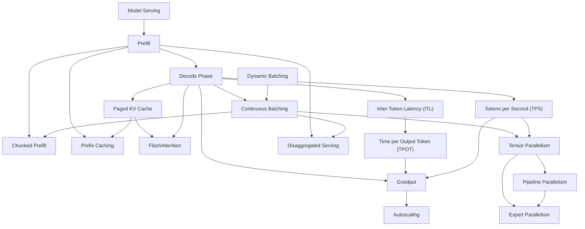

# Area 09 — Infrastructure & serving: လေ့လာသည့် အစဉ် (Learning Sequence)

ဤနယ်ပယ်၏ term ၁၈ ခုသည် ခေါင်းစဉ် ရောနှောနေသည့် စာရင်း မဟုတ်ပါ။ ၎င်းတို့သည် **အဆင့် ငါးဆင့်** —
serving ဆိုသည်မှာ ဘာလဲ နှင့် request တစ်ခု၏ ကုန်ကျစရိတ် → accelerator ပေါ်တွင် အလုပ် စီစဉ်ခြင်း →
memory layout နှင့် ပြန်လည် အသုံးပြုခြင်း → မော်ဒယ်ကို device များအကြား ဖြန့်ကျက်ခြင်း →
deployment ကောင်း/ဆိုး တိုင်းတာခြင်းနှင့် scale လုပ်ခြင်း — အဖြစ် တည်ဆောက်ထားသည်။
ဤဖိုင်သည် term များကို မည်သည့် အစဉ်အတိုင်း ဖတ်ရမည်၊ မည်သည့် term က မည်သည့် term အပေါ် အခြေခံသည်ကို
သတ်မှတ်ပေးသည်။

**ဖတ်သည့် အစဉ်ကို လိုက်ခြင်း၏ အကျိုးသက်ရောက်မှု** — နောက် term တိုင်းသည် ရှေ့ term များကို အသုံးပြု၍
ရှင်းလင်းသည်။ ဥပမာ `Continuous Batching` သည် `Decode Phase` မပါဘဲ အကျိုးအမြတ် မပေါ်နိုင်သလို၊
`Goodput` သည် `Inter-Token Latency (ITL)` နှင့် `Tokens per Second (TPS)` ကို မတိုင်းတာဘဲ
ခိုင်မာစွာ သတ်မှတ်နိုင်မည် မဟုတ်ပါ။ ထို့ကြောင့် အဆင့် အစဉ်သည် ရှေ့သို့ ပြန်လှည့်ခြင်း မဟုတ်ဘဲ
တည်ဆောက်မှု အစဉ် ဖြစ်သည်။

## အဆင့် ၅ ဆင့်၏ ခြုံငုံမှု

| အဆင့် | အမည် | Term | ဤအဆင့် ပြီးပါက ဖြေနိုင်ရမည့် မေးခွန်း |
|---|---|---|---|
| ၁ | serving ဆိုသည်မှာ ဘာလဲ၊ request တစ်ခု၏ ကုန်ကျစရိတ် | Model Serving, Prefill, Decode Phase, Tokens per Second (TPS) | request တစ်ခုသည် မည်သည့် အဆင့်များမှ ဖြတ်သွားသည်၊ မည်သည့် အဆင့်က အချိန်ကို အဓိက စားသည် |
| ၂ | accelerator ပေါ်တွင် အလုပ် စီစဉ်ခြင်း | Continuous Batching, Dynamic Batching, Chunked Prefill | request များကို တစ်ချိန်တည်း ရောနှော၍ accelerator ကို အလွတ် မထားဘဲ မည်သို့ လည်ပတ်စေမည် |
| ၃ | memory layout နှင့် ပြန်လည် အသုံးပြုခြင်း | Paged KV Cache, Prefix Caching, FlashAttention | attention state ကို မည်သို့ သိမ်း၍ မည်သည့် အလုပ်ကို ထပ်မလုပ်ဘဲ ကျော်မည် |
| ၄ | မော်ဒယ်ကို device များအကြား ဖြန့်ကျက်ခြင်း | Tensor Parallelism, Pipeline Parallelism, Expert Parallelism, Disaggregated Serving | device တစ်ခု၏ memory ထက် ကြီးသည့် မော်ဒယ်ကို မည်သို့ ဖွင့်တင်မည်၊ အဆင့်များကို မည်သို့ ခွဲမည် |
| ၅ | deployment ကောင်း/ဆိုး တိုင်းတာခြင်းနှင့် scale လုပ်ခြင်း | Goodput, Inter-Token Latency (ITL), Time per Output Token (TPOT), Autoscaling | မည်သည့် ကိန်းဂဏန်းဖြင့် rollout ကို ခွင့်ပြုမည်၊ မည်သည့် signal ဖြင့် replica အရေအတွက် ပြောင်းမည် |

## အဆင့်များအကြား မှီခိုမှု (Prerequisite Graph)

## အဆင့် ၁ — serving ဆိုသည်မှာ ဘာလဲ၊ request တစ်ခု၏ ကုန်ကျစရိတ် (၄ term)

**အစဉ်** — `Model Serving` → `Prefill` → `Decode Phase` → `Tokens per Second (TPS)`

**ဘာကြောင့် ဤနေရာတွင် ရှိသည်** — `Model Serving` သည် ဤနယ်ပယ် တစ်ခုလုံး၏ နယ်နိမိတ် ကို သတ်မှတ်သည် —
version သတ်မှတ်ထားသည့် artifact ကို ဖွင့်တင်ခြင်း၊ request လက်ခံခြင်း၊ schedule လုပ်ခြင်း၊ လုပ်ငန်း
သဘောတူညီချက် အောက်တွင် ရလဒ် ပြန်ပေးခြင်း ဖြစ်သည်။ ထို နယ်နိမိတ် အတွင်း ဝင်လာသည့် request
တစ်ခုကို `Prefill` (input token အားလုံးကို စီမံခြင်း) နှင့် `Decode Phase` (token အသစ် တစ်လှမ်းချင်း
ထုတ်ခြင်း) ဟု အပိုင်းနှစ်ပိုင်း ခွဲသည်။ ဤ နှစ်ပိုင်းသည် compute နှင့် memory အပေါ် ဖိအား သက်ရောက်ပုံ
မတူညီသဖြင့် နောက် အဆင့် အားလုံး၏ အခြေခံ ဖြစ်သည်။ `Tokens per Second (TPS)` သည် ထို လုပ်ငန်းစဉ်၏
အထွက်ကို တိုင်းတာသည့် အတိုင်းအတာ ဖြစ်သဖြင့် အဆင့် ၁ ၏ အဆုံးတွင် ရှိသည်။

**စစ်ဆေးသည့် မေးခွန်း** — TTFT (ပထမ token အထိ စောင့်ချိန်) သည် `Prefill` နှင့် queue ကြာချိန် အပေါ်
မည်သို့ မှီခိုသည်။ output token ၄၀၀ ရှိသည့် request တစ်ခုတွင် စုစုပေါင်း အချိန်၏ မည်သည့် အပိုင်းသည်
`Decode Phase` တွင် ကုန်သည်။

**ဤအဆင့် ဖွင့်ပေးသည့် အချက်** — request တစ်ခု၏ latency ကို အစိတ်အပိုင်း အလိုက် ခွဲ၍ တိုင်းတာနိုင်ခြင်း။
ထို ခွဲခြားမှု မရှိဘဲ `Autoscaling` သို့မဟုတ် batching ဆုံးဖြတ်ချက် တစ်ခုမျှ ခိုင်မာစွာ ချနိုင်မည် မဟုတ်ပါ။

## အဆင့် ၂ — accelerator ပေါ်တွင် အလုပ် စီစဉ်ခြင်း (၃ term)

**အစဉ်** — `Dynamic Batching` → `Continuous Batching` → `Chunked Prefill`

**ဘာကြောင့် ဤနေရာတွင် ရှိသည်** — `Dynamic Batching` သည် queue တွင် စောင့်နေသည့် request များမှ
batch များကို ဖွဲ့သည့် မူဝါဒ ဖြစ်သည် — လည်ပတ်မှု မစမီ အဆင့် ဖြစ်သည်။ `Continuous Batching` သည်
ထို့ထက် တစ်ဆင့် တိုးပြီး generation လည်ပတ်နေစဉ်အတွင်း iteration နယ်နိမိတ်များတွင် ပြီးဆုံးသည့်
request ကို ဖယ်၍ အသစ် ထည့်သည်။ `Chunked Prefill` သည် ထို scheduler ကို အသုံးပြု၍ ရှည်လျားသည့်
prompt တစ်ခု၏ prefill အလုပ်ကို အပိုင်းအစ ငယ်များ အဖြစ် ခွဲ၍ decode အလုပ်နှင့် အလှည့်ကျ ရောနှောစေသည်။
အစဉ်သည် အရေးပါသည် — `Chunked Prefill` ကို `Continuous Batching` မသိဘဲ ဖတ်ပါက
"မည်သည့် အလုပ်နှင့် မည်သည့် အလုပ်ကို ရောနှောသည်က" ကို ဆုံးဖြတ်နိုင်မည် မဟုတ်ပါ။

**မှတ်သားရန်** — scheduling ၏ ပန်းတိုင် နှစ်ခုသည် ဆန့်ကျင်ဘက် ဖြစ်သည် — aggregate throughput
တိုးခြင်း နှင့် request တစ်ခုချင်း၏ latency မဆိုးခြင်း။ batch ကြီးလာသည့်အခါ ပထမပန်းတိုင် တိုးပြီး
ဒုတိယပန်းတိုင် ကျဆင်းသည်။ ထို့ကြောင့် ဤအဆင့်သည် အဆင့် ၅ ၏ metric များအပေါ် တိုက်ရိုက် မှီခိုသည်။

**စစ်ဆေးသည့် မေးခွန်း** — `Dynamic Batching` နှင့် `Continuous Batching` ကွာခြားသည့် အချက်ကား အဘယ်နည်း။
ရှည်လျားသည့် prompt တစ်ခုသည် တက်ကြွနေသည့် decode များကို မည်သို့ နှောင့်နှေးစေနိုင်သည်၊
`Chunked Prefill` သည် ထို ပြဿနာကို မည်သို့ ဖြေရှင်းသည်။

**ဤအဆင့် ဖွင့်ပေးသည့် အချက်** — accelerator ကို အလွတ် မထားဘဲ လည်ပတ်စေသည့် မူဝါဒ များ၊
ထို မူဝါဒများ ပြောင်းလဲသည့်အခါ ဖြစ်ပေါ်သည့် latency အကျိုးဆက်။

## အဆင့် ၃ — memory layout နှင့် ပြန်လည် အသုံးပြုခြင်း (၃ term)

**အစဉ်** — `Paged KV Cache` → `Prefix Caching` → `FlashAttention`

**ဘာကြောင့် ဤနေရာတွင် ရှိသည်** — အဆင့် ၂ သည် အလုပ် စီစဉ်မှုကို ပြောင်းသည်၊ သို့သော် စီစဉ်ခံရသည့်
အလုပ်သည် memory ကို ယူသည်။ `Paged KV Cache` သည် sequence တစ်ခုချင်းအတွက် ဆက်တိုက် allocation
တစ်ခုတည်း လိုအပ်ခြင်းကို ဖျောက်ပြီး attention state ကို ပုံသေ အရွယ်အစား block များတွင် သိမ်းသည်။
block ဖြစ်သွားပါက **အစိတ်အပိုင်း မျှဝေ** နိုင်သည် — ထို နေရာတွင် `Prefix Caching` ပေါ်လာသည်၊
တူညီပြီး သတ်မှတ်ချက် ပြည့်မီသည့် token prefix တစ်ခုအတွက် block များကို request များအကြား ပြန်သုံးသည်။
`FlashAttention` သည် ထို attention တွက်ချက်မှုကို tile ခွဲ၍ accelerator memory အလွှာများအကြား
လွှဲပြောင်းမှုကို လျှော့ချသည် — ဆိုလိုသည်မှာ memory layout ကို ထိရောက်စွာ အသုံးချသည့် နောက်ဆုံး အလွှာ ဖြစ်သည်။

**စစ်ဆေးသည့် မေးခွန်း** — `Paged KV Cache` သည် မော်ဒယ်၏ context limit ကို တိုးချဲ့သလား။
`Prefix Caching` သည် semantic caching နှင့် မည်သို့ ကွာခြားသည်၊ hit တစ်ခု အကျိုးရှိရန် မည်သည့်
အချက် ကိုက်ညီရမည်နည်း။

**ဤအဆင့် ဖွင့်ပေးသည့် အချက်** — တူညီသည့် VRAM အတွင်း concurrency မည်မျှ ထည့်နိုင်သည်၊
မည်သည့် အလုပ် ထပ်တလဲလဲ ဖြစ်နေသည်ကို ရှာဖွေခြင်း၊ attention ၏ memory လှုပ်ရှားမှု ကန့်သတ်ချက်။

## အဆင့် ၄ — မော်ဒယ်ကို device များအကြား ဖြန့်ကျက်ခြင်း (၄ term)

**အစဉ်** — `Tensor Parallelism` → `Pipeline Parallelism` → `Expert Parallelism` → `Disaggregated Serving`

**ဘာကြောင့် ဤနေရာတွင် ရှိသည်** — မော်ဒယ် ကြီးလာသည့်အခါ device တစ်ခုတည်း၏ memory ထဲ
မဝင်တော့ပါ။ `Tensor Parallelism` သည် layer တစ်ခုအတွင်းရှိ tensor operation များကို device များအကြား
ခွဲပြီး collective communication ဖြင့် ပြန်ပေါင်းသည် — ဆိုလိုသည်မှာ layer တစ်ခုတည်းကို device
များစွာဖြင့် တွက်ခြင်း ဖြစ်သည်။ `Pipeline Parallelism` သည် ဆက်တိုက် လိုက်နာရသည့် layer အုပ်စုများကို
device များအကြား ပိုင်းခြား၍ microbatch များကို pipeline တစ်ခုကဲ့သို့ ရွှေ့သည် — ဆိုလိုသည်မှာ
အတိမ်အနက် အလိုက် ခွဲခြင်း ဖြစ်သည်။ `Expert Parallelism` သည် MoE subnetwork များကို device
များအကြား ဖြန့်ဝေ၍ token တိုင်းကို ၎င်း၏ ရွေးချယ်ထားသည့် expert ရှိသည့် device သို့ route လုပ်သည်။
`Disaggregated Serving` သည် ဤ တစ်ဆင့် နက်သည့် ဆွေးနွေးချက်မှ ထွက်ပြီး prefill အလုပ်နှင့် decode
အလုပ်ကို သီးခြား worker pool နှစ်ခုတွင် လည်ပတ်စေသည် — ဆိုလိုသည်မှာ **အဆင့်များ** ကို ခွဲခြင်း ဖြစ်သည်။
ထို့ကြောင့် ၎င်းသည် ခွဲခြင်း နည်းလမ်းနှစ်မျိုး (အလွှာ အတွင်း ခွဲခြင်း နှင့် အဆင့် အလိုက် ခွဲခြင်း) ကို
ဆွေးနွေးပြီးမှ အဆုံးတွင် ရှိသည်။

**မှတ်သားရန်** — မှီခိုမှု နှစ်မျိုးကို မရောပါနှင့်။ အလွှာ အတွင်း ခွဲခြင်း တွင် communication အကြိမ်အရေအတွက်
များပြီး interconnect လျင်မြန်မှုကို ကန့်သတ်ချက် အဖြစ် ရှုသည်၊ အဆင့် အလိုက် ခွဲခြင်း တွင်
idle bubble နှင့် stage imbalance ကို ကန့်သတ်ချက် အဖြစ် ရှုသည်။

**စစ်ဆေးသည့် မေးခွန်း** — device ၈ ခုရှိသည့် node တစ်ခုတွင် `Tensor Parallelism` နှင့်
`Pipeline Parallelism` အနက် မည်သည့်အရာက communication အကြိမ်အရေအတွက် ပိုများသည်၊ အကြောင်းရင်း ကား အဘယ်နည်း။
`Disaggregated Serving` သည် tensor parallelism ၏ အထူးအခြေအနေ တစ်ခု ဖြစ်သလား။

**ဤအဆင့် ဖွင့်ပေးသည့် အချက်** — မော်ဒယ် အရွယ်အစားနှင့် device အရေအတွက် ကို ချိန်ညှိသည့်
သင်္ချာ၊ communication နှင့် idle time ကို တိုင်းတာခြင်း။

## အဆင့် ၅ — deployment ကောင်း/ဆိုး တိုင်းတာခြင်းနှင့် scale လုပ်ခြင်း (၄ term)

**အစဉ်** — `Inter-Token Latency (ITL)` → `Time per Output Token (TPOT)` → `Goodput` → `Autoscaling`

**ဘာကြောင့် ဤနေရာတွင် ရှိသည်** — ရှေ့အဆင့် လေးဆင့်လုံးသည် စနစ်ကို ပြောင်းလဲသည်၊ သို့သော်
"ပြောင်းလဲမှုသည် ကောင်းသလား" ကို ဖြေရန် အတိုင်းအတာ လိုသည်။ `Inter-Token Latency (ITL)` သည်
ဆက်တိုက် output token နှစ်ခုအကြား ကြားကာလ တစ်ခုကို တိုင်းသည် — ၎င်းသည် decode ရပ်တန့်မှုများ ကို
ဖော်ထုတ်သည်။ `Time per Output Token (TPOT)` သည် ထို ကြားကာလများ၏ request တစ်ခုချင်း ပျှမ်းမျှ ဖြစ်သည်။
`Goodput` သည် ထို အတိုင်းအတာများအပေါ် အခြေခံသည့် ပန်းတိုင် နှစ်ခုလုံး ပြည့်မီသည့် ပြီးစီးသွားသည့်
request များ၏ နှုန်း ဖြစ်သည် — ဆိုလိုသည်မှာ ဝန်ဆောင်မှု သဘောတူညီချက် ပြည့်မီသည့် အလုပ်ကိုသာ
ရေတွက်သည်။ `Autoscaling` သည် ထို တိုင်းတာမှုနှင့် ချိတ်ဆက်ထားသည့် demand signal မှ replica များ၏
အရေအတွက်ကို ပြောင်းသည်။ ထို့ကြောင့် တိုင်းတာချက် မခိုင်မာဘဲ scale လုပ်ခြင်းသည် အလုပ်မဖြစ်ပါ။

**စစ်ဆေးသည့် မေးခွန်း** — aggregate throughput တိုးနေသော်လည်း `Goodput` ကျဆင်းသည့် အခြေအနေကို
မည်သို့ ရှင်းပြမည်။ `Autoscaling` သည် မည်သည့် အချက်များကို မဖြစ်မနေ ထည့်သွင်း စဉ်းစားရမည်နည်း။

**ဤအဆင့် ဖွင့်ပေးသည့် အချက်** — rollout ကို ခွင့်ပြုသည့် gate များ၊ scale-up နှင့် scale-down
ဆုံးဖြတ်ချက်၊ ကုန်ကျစရိတ်နှင့် ဝန်ဆောင်မှု အရည်အသွေး လဲလှယ်မှု။

## Term ၁၈ ခု၏ အစဉ် ဇယား

| # | Term | အဆင့် | ကြိုတင် သိရမည့် term | ဖွင့်ပေးသည့် အချက် |
|---|---|---|---|---|
| 1 | Model Serving | ၁ | — | serving စနစ် တစ်ခုလုံး၏ နယ်နိမိတ် |
| 2 | Prefill | ၁ | Model Serving | TTFT နှင့် prompt အရှည်၏ ကုန်ကျစရိတ် |
| 3 | Decode Phase | ၁ | Prefill | token တစ်ခုချင်း ကြာချိန် |
| 4 | Tokens per Second (TPS) | ၁ | Decode Phase | throughput တိုင်းတာခြင်း |
| 5 | Dynamic Batching | ၂ | Tokens per Second (TPS) | queue မှ batch ဖွဲ့ခြင်း |
| 6 | Continuous Batching | ၂ | Dynamic Batching, Decode Phase | accelerator အလွတ် လျှော့ချခြင်း |
| 7 | Chunked Prefill | ၂ | Continuous Batching, Prefill | ရှည်သည့် prompt ၏ နှောက်ယှက်မှု ဖြေရှင်းခြင်း |
| 8 | Paged KV Cache | ၃ | Decode Phase | memory အသုံးဝင်မှုနှင့် block မျှဝေမှု |
| 9 | Prefix Caching | ၃ | Paged KV Cache, Prefill | ထပ်တလဲလဲ prefix တွက်ချက်မှု ကျော်ခြင်း |
| 10 | FlashAttention | ၃ | Paged KV Cache, Decode Phase | attention ရှိ memory လှုပ်ရှားမှု လျှော့ချခြင်း |
| 11 | Tensor Parallelism | ၄ | Continuous Batching, Tokens per Second (TPS) | layer တစ်ခုကို device များစွာဖြင့် တွက်ခြင်း |
| 12 | Pipeline Parallelism | ၄ | Tensor Parallelism | device memory ကျော်လွန်သည့် မော်ဒယ် |
| 13 | Expert Parallelism | ၄ | Pipeline Parallelism, Tensor Parallelism | MoE ကို route လုပ်၍ ဖြန့်ခြင်း |
| 14 | Disaggregated Serving | ၄ | Prefill, Decode Phase, Continuous Batching | အဆင့် အလိုက် pool ခွဲခြင်း |
| 15 | Inter-Token Latency (ITL) | ၅ | Decode Phase | decode ရပ်တန့်မှု ဖော်ထုတ်ခြင်း |
| 16 | Time per Output Token (TPOT) | ၅ | Inter-Token Latency (ITL) | request တစ်ခုချင်း ပျှမ်းမျှ |
| 17 | Goodput | ၅ | Time per Output Token (TPOT), Tokens per Second (TPS) | သဘောတူညီချက် ပြည့်မီသည့် အလုပ် ရေတွက်ခြင်း |
| 18 | Autoscaling | ၅ | Goodput | demand signal မှ replica ချိန်ညှိခြင်း |

## လက်တွေ့ လုပ်သည့် အစဉ် (၅ ကြိမ် ထိုင်ရန်)

| ကြိမ် | ဖတ်ရမည့် အဆင့် | လက်တွေ့ လုပ်ရမည့် အရာ |
|---|---|---|
| ၁ | အဆင့် ၁ | `python3 labs/lab_serving_memory.py --params-b 8 --context 8192 --batch 32` — weights၊ KV cache နှင့် လိုအပ်သည့် VRAM |
| ၂ | အဆင့် ၂ | `python3 labs/lab_roofline.py --sweep` — batch နှင့် tokens/s၊ cost per million tokens |
| ၃ | အဆင့် ၃ | `python3 labs/lab_serving_memory.py --context 32768 --dtype int8 --batch 8` — KV ကြီးထွားမှုနှင့် dtype ၏ သက်ရောက်မှု |
| ၄ | အဆင့် ၄ | `python3 labs/lab_roofline.py --params-b 70 --dtype int4 --batch 64` — device တစ်ခုလျှင် weights နှင့် bandwidth |
| ၅ | အဆင့် ၅ + [`04_exercises.md`](04_exercises.md) | `python3 labs/lab_autoscale.py --rps 40 --output-tokens 300 --replicas 3` နှင့် တွက်ချက်ရသည့် လေ့ကျင့်ခန်း ၆ ခု |

Lab များ၏ အမည်နှင့် flag အတိအကျကို [`labs/README.md`](labs/README.md) တွင် အတည်ပြုရမည်။
Lab အားလုံးကို တစ်ကြိမ်တည်း စစ်ဆေးလိုပါက `python3 labs/run_labs.py` ကို run ရမည်။

## နောက်တစ်ဆင့်

- ပုံရှင်းလင်းချက်များ — [`02_visual_explanations.md`](02_visual_explanations.md) (serving လမ်းကြောင်း၊ batching timeline၊ paged KV cache block၊ parallelism layout၊ autoscaling signal)
- အောက်ခံစနစ်နှင့် ချိတ်ဆက်မှု — [`03_theory_to_infrastructure.md`](03_theory_to_infrastructure.md)
- လေ့ကျင့်ခန်းများ — [`04_exercises.md`](04_exercises.md)
- Term တိုင်း၏ အပြည့်အစုံ အဓိပ္ပာယ် — [`../../terms/09_infrastructure_and_serving.md`](../../terms/09_infrastructure_and_serving.md)
