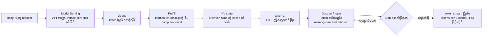
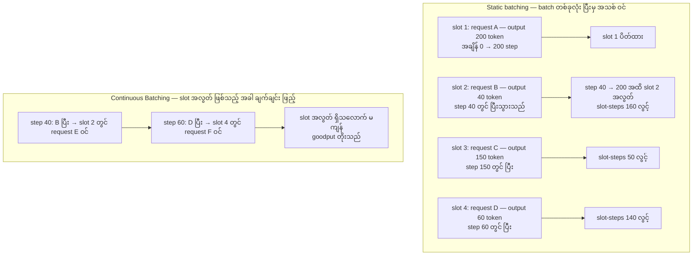
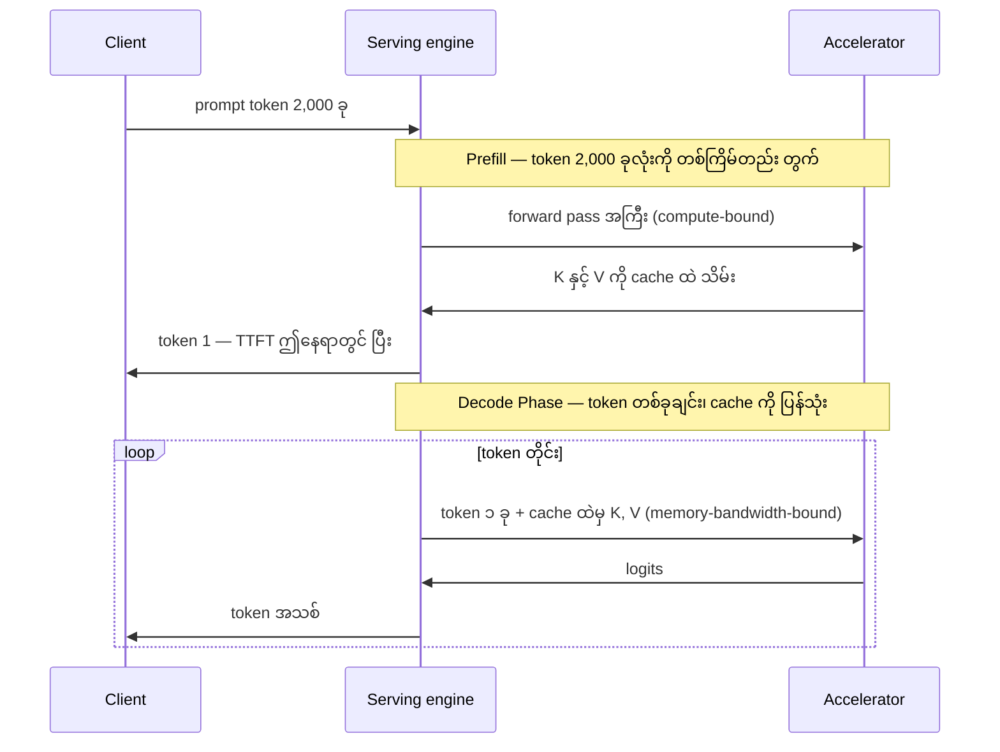
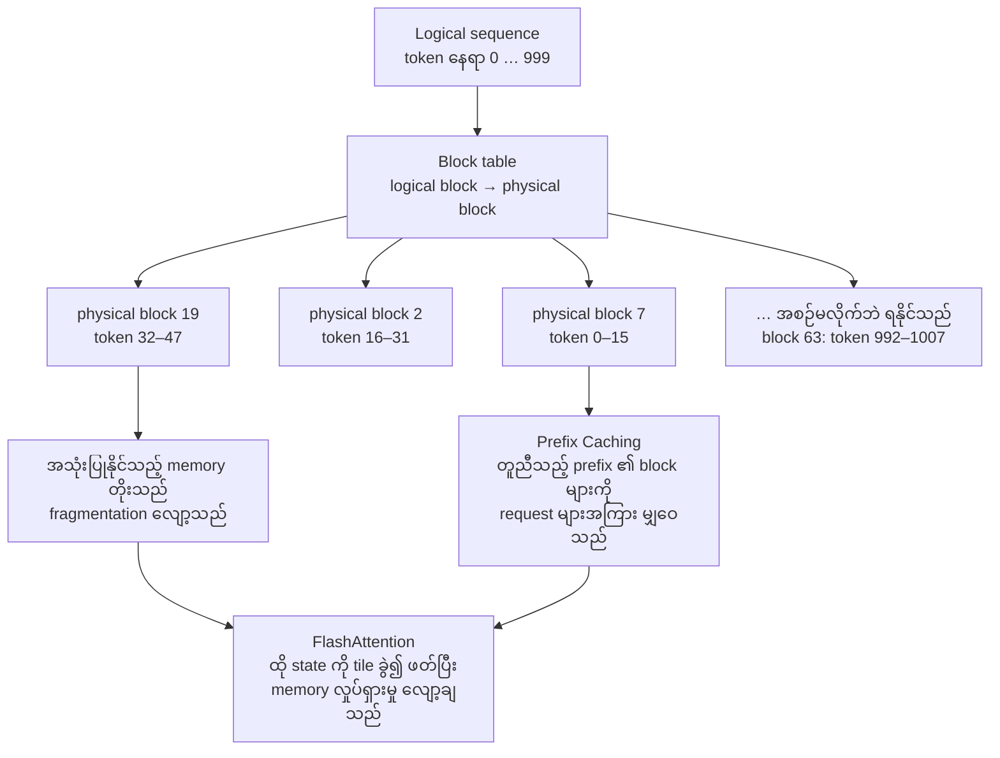
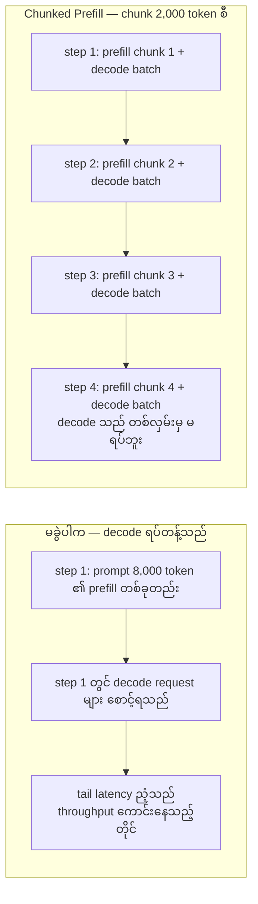
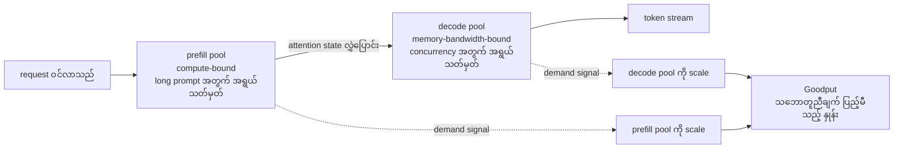
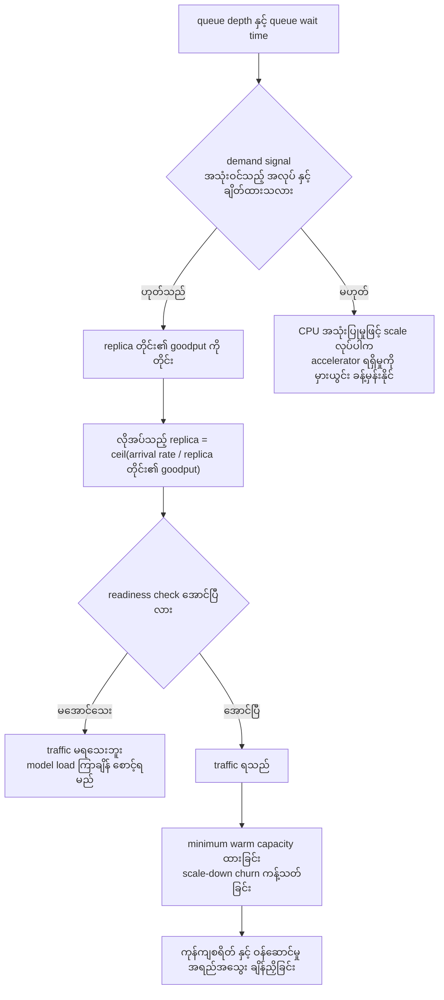
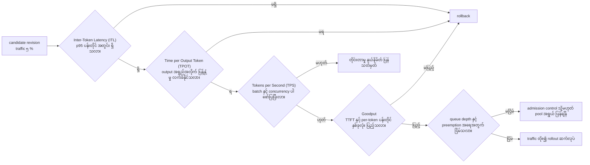

# Area 09 — ပုံရှင်းလင်းချက်များ (Visual Explanations)

Term တစ်ခုကို စာဖြင့်သာ ဖတ်ပါက "အလုပ် မည်သည့် အစဉ်ဖြင့် ရွေ့သည်၊ device မည်သည့်နေရာတွင် ဘာလုပ်သည်"
ဟူသည့် ပုံ မပေါ်ပါ။ ဤဖိုင်သည် serving စနစ် တစ်ခုကို ပုံ ကိုးခုဖြင့် ပြသည် — request ဝင်လာသည့် အချိန်မှ
token stream ဖြစ်လာသည်အထိ၊ batching မူဝါဒ နှစ်ခု၏ timeline ကွာခြားမှု၊ prefill နှင့် decode ၏
KV cache အပေါ် မှီခိုမှု၊ paged KV cache block layout၊ chunked prefill ၏ ရောနှောမှု၊
tensor နှင့် pipeline parallelism ၏ layout၊ disaggregated pool များ၊ queue signal ဖြင့် autoscaling
နှင့် rollout ကို ခွင့်ပြုသည့် metric gate များ ဖြစ်သည်။

**ပုံများ ကြည့်နည်း** — ဤဖိုင်ကို GitHub တွင် ဖတ်ပါက Mermaid ပုံများ အလိုအလျောက် render ဖြစ်သည်။
ဒေသအတွင်း တွင်ဖတ်လိုပါက VS Code ၏ Mermaid extension သို့မဟုတ် mermaid.live တွင်
`mermaid` block ကို ကူးထည့်ပါ။

## ၁။ Request တစ်ခုမှ token stream သို့ serving လမ်းကြောင်း

**ဘာကို ကြည့်ရမည်** — `Model Serving` သည် ဤလမ်းကြောင်း တစ်ခုလုံးကို ပိုင်ဆိုင်သည့် အလွှာ ဖြစ်သည် —
version pin၊ request limit စစ်ခြင်း၊ cancellation နှင့် response boundary အားလုံး ဤနေရာတွင် ရှိသည်။
`C` နှင့် `D` သည် TTFT ကို ဖွဲ့စည်းပြီး၊ `G → H → G` ဟူသည့် ပြန်လှည့်သည့် မြှား သည် decode အဆင့်
ဖြစ်သည်။ `D` သည် compute-bound ဖြစ်သည်၊ `G` သည် memory-bandwidth-bound ဖြစ်သည် — ဤ ကွာခြားမှုကို
နားလည်ပါက `Continuous Batching` သည် ဘာကြောင့် အကျိုးရှိသည်ကို ရှင်းနိုင်သည်။
**သက်ဆိုင်သည့် term** — Model Serving, Prefill, Decode Phase, Continuous Batching, Tokens per Second (TPS)

## ၂။ Static batching နှင့် Continuous Batching — timeline ချိန်းဆိုချက်

**ဘာကို ကြည့်ရမည်** — request လေးခု၏ output အရှည်များသည် 200၊ 40၊ 150 နှင့် 60 ဖြစ်သည်။
static batching တွင် batch တစ်ခုလုံးသည် အရှည်ဆုံး 200 step အထိ လည်ပတ်သဖြင့် slot ၄ ခုအတွက်
slot-step 800 အနက် အသုံးဝင်သည့် အလုပ်သည် 450 သာ ဖြစ်သည်၊ လွင့်သည့် အချိုးသည် 43.8 % ဖြစ်သည်။
`Continuous Batching` သည် iteration နယ်နိမိတ်တွင် ပြီးဆုံးသည့် request ကို ဖယ်၍ အသစ် ထည့်သဖြင့်
တူညီသည့် အလုပ်ပမာဏကို ပို၍ တိုတောင်းသည့် အချိန်အတွင်း ပြီးစေသည်။
**သက်ဆိုင်သည့် term** — Continuous Batching, Dynamic Batching, Decode Phase, Goodput, Tokens per Second (TPS)

## ၃။ Prefill နှင့် Decode Phase — KV cache က ဘာကို ပြောင်းသည်

**ဘာကို ကြည့်ရမည်** — `Prefill` သည် prompt တစ်ခုလုံးကို တစ်ကြိမ်တည်း တွက်သဖြင့် compute ကို ပြည့်စေသည်၊
`Decode Phase` သည် token တစ်ခုလျှင် တစ်လှမ်းသာ တွက်သော်လည်း cache ထဲမှ K၊ V အားလုံးကို ဖတ်ရသဖြင့်
memory bandwidth ကို ပြည့်စေသည်။ ဤ ပုံတွင် prompt token 2,000၊ output token 400၊
prefill 3,000 token/s၊ decode step 22 ms ဟု ယူပါက စုစုပေါင်း အချိန်၏ 92.6 % သည် decode အဆင့်တွင်
ကုန်သည် — ဆိုလိုသည်မှာ TTFT ကို ကောင်းစေရုံဖြင့် ခံစားမှု မကောင်းနိုင်ပါ။
**သက်ဆိုင်သည့် term** — Prefill, Decode Phase, Model Serving, Tokens per Second (TPS)

## ၄။ Paged KV Cache — logical နေရာမှ physical block သို့

**ဘာကို ကြည့်ရမည်** — sequence အရှည် မတူညီမှုသည် fragmentation ကို ဖြစ်ပေါ်စေသည်။ block ဖြစ်သွားပါက
logical နေရာသည် physical block နှင့် သီးခြား ဖြစ်သဖြင့် ဆက်တိုက် နေရာ မလိုတော့ဘဲ block များကို
မျှဝေနိုင်သည်။ token တစ်ခုလျှင် 128 KiB ရှိသည့် geometry တွင် block 16 token ဖြစ်ပါက block တစ်ခုလျှင်
2 MiB ဖြစ်သည်၊ sequence 1,000 token အတွက် block 63 (token 1,008) လိုသဖြင့် အတွင်း လွင့်မှုသည်
0.8 % သာ ဖြစ်သည်။ prefix 1,500 token ကို မျှဝေပါက block 94 ကို ပြန်သုံးနိုင်သည်။
**သက်ဆိုင်သည့် term** — Paged KV Cache, Prefix Caching, FlashAttention, Decode Phase

## ၅။ Chunked Prefill — ရှည်သည့် prompt ကို အပိုင်းခွဲ၍ ရောနှောခြင်း

**ဘာကို ကြည့်ရမည်** — `Chunked Prefill` သည် prompt တွက်ချက်မှုကို စီစဉ်သည့် ပုံစံကို ပြောင်းသည်။
prompt 8,000 token ကို chunk 2,000 ဖြင့် လေးဆင့် ခွဲပါက step တိုင်းတွင် decode အလုပ်နှင့် အလှည့်ကျ
ရောနှောနိုင်သဖြင့် တက်ကြွနေသည့် generation များ ရပ်တန့်ခြင်း မရှိတော့ပါ။ ဤနေရာတွင် model ၏ context
window သည် ပြောင်းလဲခြင်း မရှိပါ — ပြောင်းလဲသည်မှာ schedule လုပ်သည့် ပုံစံ ဖြစ်သည်။
**သက်ဆိုင်သည့် term** — Chunked Prefill, Prefill, Decode Phase, Dynamic Batching, Inter-Token Latency (ITL)

## ၆။ Tensor Parallelism နှင့် Pipeline Parallelism — layout နှစ်မျိုး

```mermaid
flowchart TD
    subgraph TP["Tensor Parallelism — layer တစ်ခုအတွင်း ခွဲခြင်း (width)"]
        T1["layer 1<br/>device 1: ကော်လံ အပိုင်း"] --> T3["collective communication<br/>အပိုင်း ရလဒ် ပြန်ပေါင်း"]
        T2["layer 1<br/>device 2: ကော်လံ အပိုင်း"] --> T3
        T3 --> T4["layer 2 — အားလုံး device နှစ်ခုလုံးတွင်"]
    end
    subgraph PP["Pipeline Parallelism — layer အုပ်စုများကို ခွဲခြင်း (depth)"]
        P1["device 1: layer 1–20"] --> P2["device 2: layer 21–40"]
        P2 --> P3["device 3: layer 41–60"]
        P3 --> P4["device 4: layer 61–80"]
        P5["microbatch schedule<br/>idle bubble ကို ထည့်သွင်း စဉ်းစားရမည်"] --> P4
    end
    subgraph EP["Expert Parallelism — expert များကို ခွဲခြင်း"]
        E1["router<br/>token တိုင်း expert ရွေး"] --> E2["device 1: expert 1, 2"]
        E1 --> E3["device 2: expert 3, 4"]
        E2 --> E4["activation ကို route လုပ်၍ ရလဒ် ပြန်ပေါင်း"]
        E3 --> E4
    end
```

**ဘာကို ကြည့်ရမည်** — 70B မော်ဒယ် fp16 သည် 140 GB ရှိသဖြင့် 80 GB card တစ်ခုတွင် မဝင်ပါ။
`Tensor Parallelism` ဖြင့် device ၈ ခု ခွဲပါက တစ်ခုလျှင် 17.5 GB ဖြစ်သည်၊ သို့သော် layer တိုင်းတွင်
collective communication လိုသည် — token တစ်ခုလျှင် 2.62 MB ခန့် ရွှေ့ရသည်၊ 600 GB/s link တွင်
4.4 µs ဖြစ်သည်။ `Pipeline Parallelism` သည်လည်း တစ်ခုလျှင် 17.5 GB ဖြစ်သည်၊ သို့သော်
stage အညီအမျှ မဖြစ်ခြင်းနှင့် idle bubble ကို ပေးဆပ်ရသည် — stage ၈ ခု၊ microbatch ၈ ခုတွင်
idle အချိုးသည် 46.7 % ဖြစ်သည်။ `Expert Parallelism` တွင် ခွဲသည့် အရာသည် expert ဖြစ်ပြီး
token တိုင်းကို route လုပ်သဖြင့် load-balance သည် ပြဿနာ အသစ် ဖြစ်လာသည်။
**သက်ဆိုင်သည့် term** — Tensor Parallelism, Pipeline Parallelism, Expert Parallelism, Model Serving

## ၇။ Disaggregated Serving — pool နှစ်ခု၊ bottleneck နှစ်မျိုး

**ဘာကို ကြည့်ရမည်** — `Prefill` နှင့် `Decode Phase` သည် hardware အပေါ် ဖိအား သက်ရောက်ပုံ မတူညီကြပါ။
တစ်ခုတည်းသော queue တွင် ရောထားပါက ရှည်သည့် prompt သည် decode ကို တွန်းထုတ်သည်။
သီးခြား pool များ ဖြစ်ပါက တစ်ခုချင်းကို ၎င်း၏ bottleneck အလိုက် အရွယ်သတ်မှတ်ပြီး
signal အလိုက် scale လုပ်နိုင်သည်။ ပေးဆပ်ရသည့် အရာမှာ attention state လွှဲပြောင်းမှု ကုန်ကျစရိတ်
နှင့် အဆင့်များအကြား failure recovery ဖြစ်သည်။
**သက်ဆိုင်သည့် term** — Disaggregated Serving, Prefill, Decode Phase, Model Serving, Goodput

## ၈။ Autoscaling — queue signal မှ replica အရေအတွက်သို့

**ဘာကို ကြည့်ရမည်** — `Autoscaling` သည် စွမ်းရည်ကို ထပ်တိုး သို့မဟုတ် လျှော့ချသည်။ overload ဖြစ်နေသည့်
dependency ကို ပိုမြန်စေသည် မဟုတ်သလို hardware ကို အချိန်မီ ရရှိမည်ဟုလည်း အာမခံသည် မဟုတ်ပါ။
ထို့ကြောင့် signal သည် "အသုံးဝင်သည့် အလုပ်" နှင့် ချိတ်ထားရမည် — CPU အသုံးပြုမှုကို ကြည့်ပါက
decode အဆင့် (memory-bound) တွင် မှားယွင်းစွာ ဆုံးဖြတ်နိုင်သည်။ replica အသစ်သည် readiness check
မအောင်မချင်း traffic မရရမည်၊ အကြောင်းမှာ မော်ဒယ် ဖွင့်တင်ရန် ကြာချိန်သည် queue ကို ပို၍ ရှည်စေနိုင်သည်။
**သက်ဆိုင်သည့် term** — Autoscaling, Goodput, Model Serving, Tokens per Second (TPS)

## ၉။ Rollout ကို ခွင့်ပြုသည့် metric gate များ

**ဘာကို ကြည့်ရမည်** — rollout ကို ခွင့်ပြုသည့် gate သည် aggregate throughput တစ်ခုတည်း မဖြစ်ရပါ။
`Goodput` သည် သဘောတူညီချက် ပြည့်မီသည့် အလုပ်ကိုသာ ရေတွက်သဖြင့် gate တွင် အဓိက အခန်းကဏ္ဍမှ ပါဝင်သည်။
`Inter-Token Latency (ITL)` နှင့် `Time per Output Token (TPOT)` သည် decode ရပ်တန့်မှုကို ဖော်ထုတ်ပြီး၊
`Tokens per Second (TPS)` သည် မည်သည့် နယ်နိမိတ်အောက်တွင် တိုင်းခဲ့သည်ကို ဖော်ပြရမည်။
ထို့ကြောင့် metric တစ်ခုချင်းသည် ဆုံးဖြတ်ချက် တစ်ခုစီကို ပိုင်ဆိုင်သည်။
**သက်ဆိုင်သည့် term** — Goodput, Inter-Token Latency (ITL), Time per Output Token (TPOT), Tokens per Second (TPS), Autoscaling

## ပုံတိုင်းနှင့် term ချိတ်ဆက်မှု

| ပုံ | ပြသည့် အကြောင်းအရာ | သက်ဆိုင်သည့် term |
|---|---|---|
| ၁ | Request တစ်ခုမှ token stream သို့ serving လမ်းကြောင်း | Model Serving, Prefill, Decode Phase, Tokens per Second (TPS) |
| ၂ | Static batching နှင့် Continuous Batching timeline | Continuous Batching, Dynamic Batching, Decode Phase, Goodput |
| ၃ | Prefill နှင့် Decode Phase — KV cache က ဘာပြောင်းသည် | Prefill, Decode Phase, Model Serving, Tokens per Second (TPS) |
| ၄ | Paged KV Cache block layout နှင့် မျှဝေမှု | Paged KV Cache, Prefix Caching, FlashAttention |
| ၅ | Chunked Prefill ၏ ရောနှောမှု | Chunked Prefill, Prefill, Decode Phase, Dynamic Batching |
| ၆ | Tensor၊ Pipeline နှင့် Expert Parallelism layout | Tensor Parallelism, Pipeline Parallelism, Expert Parallelism |
| ၇ | Disaggregated Serving pool နှစ်ခု | Disaggregated Serving, Prefill, Decode Phase, Goodput |
| ၈ | Autoscaling — queue signal မှ replica သို့ | Autoscaling, Goodput, Model Serving |
| ၉ | Rollout ကို ခွင့်ပြုသည့် metric gate | Goodput, Inter-Token Latency (ITL), Time per Output Token (TPOT), Tokens per Second (TPS) |

## နောက်တစ်ဆင့်

- ကိန်းဂဏန်း အဖြစ် မြင်လိုပါက — [`labs/`](labs/) ရှိ `lab_serving_memory.py`၊ `lab_roofline.py` နှင့် `lab_autoscale.py`
- deployment အပေါ် သက်ရောက်မှု — [`03_theory_to_infrastructure.md`](03_theory_to_infrastructure.md)
- လေ့ကျင့်ခန်းများ — [`04_exercises.md`](04_exercises.md)
- Term တိုင်း၏ အပြည့်အစုံ အဓိပ္ပာယ် — [`../../terms/09_infrastructure_and_serving.md`](../../terms/09_infrastructure_and_serving.md)
