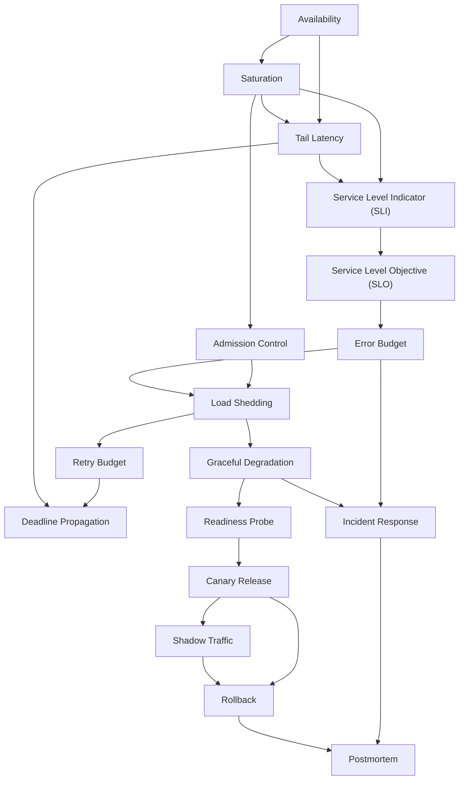

# Area 10 — Reliability & operations: လေ့လာသည့် အစဉ် (Learning Sequence)

ဤနယ်ပယ်၏ term ၁၇ ခုသည် ရောနှောနေသည့် ခေါင်းစဉ်များ မဟုတ်ပါ။ ၎င်းတို့သည် **ငါးဆင့် အစဉ်တစ်ခု** —
(၁) မည်သည့် အရာ မှားနိုင်သည်၊ မည်သို့ တိုင်းတာမည် → (၂) ပန်းတိုင်နှင့် ခွင့်ပြု budget →
(၃) ဝန်ပို ကာကွယ်ခြင်း → (၄) လျှော့ချခြင်း၊ ပြောင်းလဲမှု လွှတ်ခြင်းနှင့် ပြန်လည် ရယူခြင်း →
(၅) incident လည်ပတ်ခြင်းနှင့် သင်ယူခြင်း — အဖြစ် တည်ဆောက်ထားသည်။

**ဖတ်သည့် အစဉ်ကို လိုက်ခြင်း၏ အကျိုးသက်ရောက်မှု** — နောက် term တိုင်းသည် အရင် term များကို အသုံးပြု၍ ရှင်းလင်းသည်။
ဥပမာ `Load Shedding` သည် `Saturation` (မည်သည့် အရင်းအမြစ် ကုန်နေသည်) ကို မသိဘဲ နားလည်နိုင်မည် မဟုတ်သလို၊
`Error Budget` သည် `Service Level Objective (SLO)` မရှိဘဲ တွက်ချက်နိုင်မည် မဟုတ်ပါ။ `Postmortem` သည်
`Incident Response` ၏ အထောက်အထား (trace၊ audit log၊ timeline) ကို အသုံးပြုသဖြင့် အဆုံးတွင် ရှိသည်။

## အဆင့် ၅ ဆင့်၏ ခြုံငုံမှု

| အဆင့် | အမည် | Term | ဤအဆင့် ပြီးပါက ဖြေနိုင်ရမည့် မေးခွန်း |
|---|---|---|---|
| ၁ | မှားယွင်းနိုင်သည့် အရာနှင့် တိုင်းတာမှု | Availability, Saturation, Tail Latency, Service Level Indicator (SLI) | ဝန်ဆောင်မှု တစ်ခု ကောင်း/ဆိုးကို မည်သည့် ကိန်းဂဏန်းဖြင့် ဆုံးဖြတ်မည်၊ မည်သည့် အရင်းအမြစ် ကုန်နေသည်ကို မည်သို့ သိမည် |
| ၂ | ပန်းတိုင်နှင့် ခွင့်ပြု budget | Service Level Objective (SLO), Error Budget | မည်သည့် အဆင့် ကို ကတိပြုမည်၊ မည်မျှ မအောင်မြင်မှုကို ခွင့်ပြုမည် |
| ၃ | ဝန်ပို ကာကွယ်ခြင်း | Admission Control, Load Shedding, Retry Budget, Deadline Propagation | demand သည် စွမ်းရည်ကို ကျော်လွန်သည့်အခါ မည်သည့် အလုပ်ကို လက်ခံမည်၊ မည်သည့် အလုပ်ကို ငြင်းပယ်မည် |
| ၄ | လျှော့ချခြင်း၊ ပြောင်းလဲမှု လွှတ်ခြင်းနှင့် ပြန်လည် ရယူခြင်း | Graceful Degradation, Readiness Probe, Canary Release, Shadow Traffic, Rollback | ချို့ယွင်းနေသည့် အခြေအနေတွင် အဓိက ဝန်ဆောင်မှုကို မည်သို့ ထိန်းမည်၊ version အသစ်ကို မည်သို့ အန္တရာယ် နည်းစွာ လွှတ်မည် |
| ၅ | incident လည်ပတ်ခြင်းနှင့် သင်ယူခြင်း | Incident Response, Postmortem | incident ဖြစ်နေစဉ် မည်သူ ဘာလုပ်မည်၊ ပြီးနောက် မည်သို့ ပြန်ဖြစ်မှု လျှော့မည် |

## အဆင့်များအကြား မှီခိုမှု (Prerequisite Graph)

## အဆင့် ၁ — မှားယွင်းနိုင်သည့် အရာနှင့် တိုင်းတာမှု (၄ term)

**အစဉ်** — `Availability` → `Saturation` → `Tail Latency` → `Service Level Indicator (SLI)`

**ဘာကြောင့် ဤနေရာတွင် ရှိသည်** — ဤအဆင့်သည် မေးခွန်း နှစ်ခုကို ဦးစွာ ဖြေသည်။ ပထမ — ဝန်ဆောင်မှု တစ်ခု
"ကောင်းသည်" ဆိုသည်မှာ ဘာကို ဆိုလိုသည် ဟူသည့် မေးခွန်းကို `Availability` က ဖြေသည်၊ သို့သော် process
လည်ပတ်နေသော်လည်း အသုံးပြုသူ မပြီးမြောက်နိုင်သည့် အခြေအနေ ရှိသဖြင့် user-visible ဖြစ်ရပ်နှင့် ချိတ်ရသည်။
ဒုတိယ — မည်သည့် အရင်းအမြစ် ကုန်နေသည်ကို `Saturation` က ပြသည်၊ ထို ကုန်ခန်းမှုသည် `Tail Latency` အဖြစ်
အနှေးဆုံး request များတွင် ပေါ်လာသည်။ ထို အတိုင်းအတာ နှစ်ခုကို စုစည်း၍ တိုင်းတာနိုင်သည့် ကိန်းဂဏန်း
တစ်ခု ဖြစ်စေသည့် အရာသည် `Service Level Indicator (SLI)` ဖြစ်သည်။ SLI မရှိဘဲ နောက် အဆင့် ၄ ဆင့်လုံးသည်
ဆွေးနွေးနိုင်သည့် အဆင့်သို့ မရောက်ပါ။

**မှတ်သားရန်** — ပျှမ်းမျှ (average) latency သည် **ကျန်းမာနေသည့်ဟု ပေါ်နိုင်သည်**၊ သို့သော် queueing
နှင့် retry တို့ကြောင့် အသုံးပြုသူ အုပ်စုတစ်ခု ပို၍ ကြာကြာ စောင့်နိုင်သည်။ ထို့ကြောင့် availability ကို
percentile အမြင့် (tail) နှင့် တွဲဖတ်ရမည်။

**စစ်ဆေးသည့် မေးခွန်း** — process uptime သည် 100% ဖြစ်သော်လည်း availability သည် 99% သာ ဖြစ်နိုင်သည့်
အခြေအနေ တစ်ခုကို ဖော်ပြပါ။ SLI တစ်ခုကို တွက်ရာတွင် numerator၊ denominator နှင့် ဖယ်ထားသည့် အခြေအနေများ
မသတ်မှတ်ပါက မည်သည့် ပြဿနာ ဖြစ်သနည်း။

## အဆင့် ၂ — ပန်းတိုင်နှင့် ခွင့်ပြု budget (၂ term)

**အစဉ်** — `Service Level Objective (SLO)` → `Error Budget`

**ဘာကြောင့် ဤနေရာတွင် ရှိသည်** — အဆင့် ၁ တွင် တိုင်းတာမှု ရရှိပြီးပါက "မည်မျှ ကောင်းရမည်" ဟူသည့်
ပန်းတိုင်ကို `Service Level Objective (SLO)` က သတ်မှတ်သည်။ ထို ပန်းတိုင် သည် ဖြစ်နိုင်ခြေ ကိန်းဂဏန်း
တစ်ခု ဖြစ်သဖြင့် "မအောင်မြင်မှု မည်မျှ ခွင့်ပြု" ဟူသည့် ပမာဏကို တိုက်ရိုက် ဆင်းသက်စေနိုင်သည် — ထို ပမာဏသည်
`Error Budget` ဖြစ်သည်။ ဤ အဆင့် နှစ်ခုသည် ဤနယ်ပယ်၏ ဆုံးဖြတ်ချက် နယ်နိမိတ် ဖြစ်သဖြင့်
နောက် အဆင့် ၃၊ ၄၊ ၅ ၏ policy များ အားလုံး ဤ အဆင့်ကို ပြန်ညွှန်းသည်။

**မှတ်သားရန်** — SLO သည် **အတွင်းပိုင်း** ပန်းတိုင် ဖြစ်သည်။ စာချုပ်အခြေခံ သဘောတူညီချက်
(service-level agreement) တွင် လျော်ကြေးများ ပါဝင်နိုင်ပြီး မတူညီသည့် အဓိပ္ပာယ်ဖွင့်ဆိုချက်များကို သုံးနိုင်သည်။
Error Budget သည် incident များ ဖြစ်ပေါ်စေရန် ခွဲတမ်း (quota) မဟုတ်ပါ — ၎င်းသည် policy တစ်ခု ဖြစ်သည်။

**စစ်ဆေးသည့် မေးခွန်း** — SLO 99.9% နှင့် 30-day window အတွက် ခွင့်ပြုသည့် မအောင်မြင်မှုသည်
မည်မျှ မိနစ် ဖြစ်သနည်း။ လက်ရှိ စွမ်းဆောင်ရည်ကို ကြည့်၍ ပန်းတိုင် သတ်မှတ်ခြင်းသည် ဘာကြောင့် မှား သနည်း။

## အဆင့် ၃ — ဝန်ပို ကာကွယ်ခြင်း (၄ term)

**အစဉ်** — `Admission Control` → `Load Shedding` → `Retry Budget` → `Deadline Propagation`

**ဘာကြောင့် ဤနေရာတွင် ရှိသည်** — `Saturation` ဖြစ်သည့်အခါ request တိုင်းကို ဆက်လက် လက်ခံနေခြင်းသည်
queue ကြီးထွားမှုနှင့် timeout cascade ကို ဖြစ်စေသည်။ ထို့ကြောင့် လက်ခံမှု မပြုမီ gate တစ်ခု (Admission Control)
ဖြင့် ဝင်ခွင့်ကို ဆုံးဖြတ်သည်။ လက်ခံပြီးသား အလုပ်အပါအဝင် ရွေးချယ်ထားသည့် အလုပ်ကို ငြင်းပယ်ခြင်း၊
ချပစ်ခြင်း သို့မဟုတ် ပလပ်ဖျက်ခြင်းသည် `Load Shedding` ဖြစ်သည်။ ဝန်ပို ဖြစ်နေစဉ်တွင် ချို့ယွင်းသည့်
dependency တစ်ခုကို retry များဖြင့် ထပ်မံ တိုက်ခိုက်ခြင်းသည် အန္တရာယ်အရှိဆုံး အပြုအမူ ဖြစ်သဖြင့်
retry traffic အပေါ် ကန့်သတ်ချက် (`Retry Budget`) ရမည်။ ထို retry များ နှင့် အခြား ခေါ်ဆိုမှု အားလုံးသည်
အသုံးပြုသူ၏ deadline အတွင်းတွင်သာ အသုံးဝင်သဖြင့် ကျန်ရှိသည့် အချိန် budget ကို downstream သို့
ပေးပို့ရသည် (`Deadline Propagation`)။ ဤအဆင့်၏ term လေးခုသည် **တစ်ခုတည်း စနစ်** အဖြစ် အလုပ်လုပ်သည်။

**မှတ်သားရန်** — Admission Control သည် လက်ခံမှု **မပြုမီ** အလုပ်လုပ်သည်။ Load Shedding သည်
ingress၊ queue များ၊ dependency များ သို့မဟုတ် အခြား overload နယ်နိမိတ်များတွင် အလုပ်ကို ငြင်းပယ် သို့မဟုတ်
ဖယ်ရှားနိုင်သည်။ Retry Budget သည် **အပိုကြိုးစားမှုများ** ကို ကန့်သတ်ပြီး၊ Error Budget သည် SLO က
ခွင့်ပြုသည့် အသုံးပြုသူ မြင်တွေ့နိုင်သည့် မယုံကြည်ရမှုကို တိုင်းတာသည် — နှစ်ခု ရောမထားရ။

**စစ်ဆေးသည့် မေးခွန်း** — queue သည် အလွန်ရှည်နေသည့်အခါ ငြင်းပယ်ခြင်းသည် ဘာကြောင့် "အသုံးပြုသူကို
ကူညီခြင်း" ဖြစ်သနည်း။ ချို့ယွင်းသည့် dependency တစ်ခုကို retry လုပ်သည့်အခါ မည်သည့် နှစ်ခု ကန့်သတ်ချက်
(deadline နှင့် retry budget) ကို တစ်ချိန်တည်း စစ်ရမည်နည်း။

## အဆင့် ၄ — လျှော့ချခြင်း၊ ပြောင်းလဲမှု လွှတ်ခြင်းနှင့် ပြန်လည် ရယူခြင်း (၅ term)

**အစဉ်** — `Graceful Degradation` → `Readiness Probe` → `Canary Release` → `Shadow Traffic` → `Rollback`

**ဘာကြောင့် ဤနေရာတွင် ရှိသည်** — ဝန်ပို ကာကွယ်ခြင်း မလုံလောက်သည့်အခါ စနစ်သည် အရည်အသွေး၊ feature၊
freshness သို့မဟုတ် workload ကို လျှော့ချ၍ ကန့်သတ်ထားသည့် အဓိက ဝန်ဆောင်မှုကို ထိန်းသိမ်းရသည်
(`Graceful Degradation`)။ လျှော့ချ mode သည် instance အလိုက် အလုပ်လုပ်သဖြင့် traffic ကို instance တစ်ခုထံ
ပို့သင့်/မသင့် ကို `Readiness Probe` က ဆုံးဖြတ်သည်။ ထို့နောက် ပြောင်းလဲမှု (model၊ prompt၊ agent၊ configuration)
ကို ထုတ်လွှတ်သည့်အခါ ဖော်ထုတ်မှုကို ကန့်သတ်ရန် `Canary Release` ကို သုံးသည်၊ အသုံးပြုသူ အပေါ်
သက်ရောက်မှု မရှိစေရန် ကိုယ်စားလှယ် တစ်ခုကို အစစ်အမှန် traffic မိတ္တူနှင့် စမ်းသပ်ရန် `Shadow Traffic`
ကို သုံးသည်။ မည်သည့် နည်းလမ်းဖြင့်မျှ မကာကွယ်နိုင်သည့် ချို့ယွင်းမှု ဖြစ်ပါက ယခင် သိရှိပြီးသား
deployment သို့ ပြန်လည် ရယူရသည် (`Rollback`) — ထို့ကြောင့် recovery ကို rollout မလုပ်မီ ရေးဆွဲရမည်။

**မှတ်သားရန်** — `Canary Release` သည် traffic ၏ ထိန်းချုပ်ထားသည့် အချိုးအစား တစ်ခုအတွက် **တကယ့်
အသုံးပြုသူများ** ကို version အသစ်မှ ဝန်ဆောင်ပေးသည်။ `Shadow Traffic` သည် ကိုယ်စားလှယ်၏ တုံ့ပြန်မှုကို
အဓိက လမ်းကြောင်းပြင်ပတွင် ထားရှိသည်၊ သို့သော် မိတ္တူ request သည် လည်ပတ်နေသေးသဖြင့် ၎င်း၏
အကျိုးဆက်များကို သီးခြားခွဲထားရမည်။ code rollback သည် database migration၊ cache သို့မဟုတ်
ပြင်ပ အကျိုးဆက်များကို အလိုအလျောက် ပြန်လှန်ပေးသည် မဟုတ်ပါ။

**စစ်ဆေးသည့်မေးခွန်း** — degradation mode သည် မည်သည့် နေရာတွင် လည်ပတ်မှု ရှုထောင့်မှ
မြင်တွေ့နိုင်ရမည်နည်း။ rollback လုပ်ပြီးနောက် ဝန်ဆောင်မှု ကျန်းမာမှုကို မည်သို့ စစ်ဆေးမည်နည်း။

## အဆင့် ၅ — incident လည်ပတ်ခြင်းနှင့် သင်ယူခြင်း (၂ term)

**အစဉ်** — `Incident Response` → `Postmortem`

**ဘာကြောင့် ဤနေရာတွင် ရှိသည်** — အဆင့် ၄ အထိ အလုံးစုံ ရေးဆွဲထားသော်လည်း ဖြစ်ရပ် တစ်ခု ဖြစ်လာသည့်အခါ
လူနှင့် လုပ်ငန်းစဉ် လိုအပ်သည် — ဖော်ထုတ်ခြင်း၊ ခွဲခြမ်းစိတ်ဖြာခြင်း၊ ထိန်းချုပ်ခြင်း၊ ပြန်လည်
ကောင်းမွန်စေခြင်း၊ ဆက်သွယ် အသိပေးခြင်းနှင့် သင်ယူခြင်း ဖြစ်သည် (`Incident Response`)။ ရှင်းလင်းသည့်
တာဝန်ခွဲဝေမှုနှင့် အထောက်အထားသည် ကြံဖန် ဖြေရှင်းမှုထက် ပို၍ အရေးပါသည်။ ဝန်ဆောင်မှု ပြန်လည်
ရရှိပြီးသည့်နောက်တွင်မူ ဖြစ်ရပ်၏ အထောက်အထား အားလုံးကို ရေရှည် တည်တံ့သည့် မှတ်တမ်းအဖြစ်
စုစည်းရသည် (`Postmortem`) — ထို အထောက်အထားသည် နောက် incident တစ်ခု၏ တုံ့ပြန်ချိန်ကို တိုစေသည်။
ထို့ကြောင့် `Postmortem` သည် ဤ အစဉ်၏ အဆုံးတွင် ရှိပြီး၊ ပြန်လည်၍ အဆင့် ၁ နှင့် ၂ (တိုင်းတာမှု နှင့်
ပန်းတိုင်) ကို ပြန်ပြင်ဆင်သည့် အချက်အလက်ကို ပေးသည်။

**စစ်ဆေးသည့် မေးခွန်း** — Postmortem တစ်ခုသည် "လုပ်ဆောင်ချက် စာရင်း" အဖြစ် မပြီးဆုံးရန် မည်သည့်
စစ်ဆေးမှု လိုအပ်သနည်း။ severity သတ်မှတ်ခြင်းသည် မည်သည့် ဆုံးဖြတ်ချက်များကို ပြောင်းလဲစေသနည်း။

## Term ၁၇ ခု၏ အစဉ် ဇယား

| # | Term | အဆင့် | ကြိုတင် သိရမည့် term | ဖွင့်ပေးသည့် အချက် |
|---|---|---|---|---|
| 1 | Availability | ၁ | — | ဝန်ဆောင်မှု ကတိကို user-visible ဖြစ်ရပ်နှင့် ချိတ်ဆက်ခြင်း |
| 2 | Saturation | ၁ | Availability | ကန့်သတ်သည့် အရင်းအမြစ်နှင့် queue ကို ဖော်ထုတ်ခြင်း |
| 3 | Tail Latency | ၁ | Availability, Saturation | အနှေးဆုံး အသုံးပြုသူ အုပ်စုကို တိုင်းတာခြင်း |
| 4 | Service Level Indicator (SLI) | ၁ | Saturation, Tail Latency | တိုင်းတာမှု တစ်ခုတည်းအဖြစ် စုစည်းခြင်း |
| 5 | Service Level Objective (SLO) | ၂ | Service Level Indicator (SLI) | ပန်းတိုင်နှင့် window သတ်မှတ်ခြင်း |
| 6 | Error Budget | ၂ | Service Level Objective (SLO) | ခွင့်ပြုသည့် မအောင်မြင်မှု ပမာဏ နှင့် burn rate |
| 7 | Admission Control | ၃ | Saturation | လက်ခံမှု မပြုမီ gate နှင့် ငြင်းပယ်သည့် အခြေအနေ |
| 8 | Load Shedding | ၃ | Admission Control, Error Budget | overload နယ်နိမိတ်တွင် အလုပ် ဖယ်ရှားခြင်း |
| 9 | Retry Budget | ၃ | Load Shedding | retry traffic ကို ကန့်သတ်ခြင်း |
| 10 | Deadline Propagation | ၃ | Retry Budget, Tail Latency | ကျန်ရှိသည့် အချိန် budget ကို ပေးပို့ခြင်း |
| 11 | Graceful Degradation | ၄ | Load Shedding | လျှော့ချ mode နှင့် အဓိက ဝန်ဆောင်မှု ထိန်းသိမ်းခြင်း |
| 12 | Readiness Probe | ၄ | Graceful Degradation | traffic ရရှိခွင့် ဆုံးဖြတ်ခြင်း |
| 13 | Canary Release | ၄ | Readiness Probe | ဖော်ထုတ်မှုကို ကန့်သတ်ထားသည့် rollout |
| 14 | Shadow Traffic | ၄ | Canary Release | အသုံးပြုသူ မထိခိုက်စေဘဲ စမ်းသပ်ခြင်း |
| 15 | Rollback | ၄ | Canary Release, Shadow Traffic | ယခင် version သို့ ပြန်လည် ရယူခြင်း |
| 16 | Incident Response | ၅ | Error Budget, Graceful Degradation | severity၊ command တာဝန် နှင့် တုံ့ပြန်မှု |
| 17 | Postmortem | ၅ | Incident Response, Rollback | အထောက်အထားမှ စမ်းသပ်နိုင်သည့် တိုးတက်မှု |

## လက်တွေ့ လုပ်သည့် အစဉ် (၅ ကြိမ် ထိုင်ရန်)

| ကြိမ် | ဖတ်ရမည့် အဆင့် | လက်တွေ့ လုပ်ရမည့် အရာ |
|---|---|---|
| ၁ | အဆင့် ၁ + ၂ | ဤဖိုင်ရှိ prerequisite graph ကို စာရွက်ပေါ် ပြန်ဆွဲပြီး SLO 99.9% ၏ error budget ကို မိမိဘာသာ တွက်ခြင်း |
| ၂ | အဆင့် ၃ | `python3 guides/10_reliability_and_operations/labs/lab_queue_headroom.py --arrivals-per-s 12 --service-ms 50 --workers 1` |
| ၃ | အဆင့် ၃ | `python3 guides/10_reliability_and_operations/labs/lab_retry_storm.py --retries 3 --failure-rate 0.5 --jitter 1.0 --retry-budget 0.10` |
| ၄ | အဆင့် ၄ | `python3 guides/10_reliability_and_operations/labs/lab_error_budget.py --slo-percent 99.9 --requests-per-day 1000000 --window-days 30 --failure-rate 0.0005` |
| ၅ | အဆင့် ၅ + စစ်ဆေးခြင်း | [`04_exercises.md`](04_exercises.md) ရှိ တွက်ချက်ရသည့် လေ့ကျင့်ခန်း ၆ ခု |

Lab တိုင်းသည် offline နှင့် deterministic ဖြစ်သဖြင့် run တိုင်း၏ output ကို မိမိ တွက်ချက်မှုနှင့်
တိုက်စစ်နိုင်သည်။ Flag အားလုံး၏ အပြည့်အစုံ စာရင်းကို [`labs/README.md`](labs/README.md) တွင် ကြည့်ပါ။

## နောက်တစ်ဆင့်

- ပုံရှင်းလင်းချက်များ — [`02_visual_explanations.md`](02_visual_explanations.md) (request လမ်းကြောင်း၊ queue၊ circuit breaker၊ incident timeline)
- ကိန်းဂဏန်းဖြင့် မြင်လိုပါက — [`04_exercises.md`](04_exercises.md) ၏ လေ့ကျင့်ခန်း ဆယ့်တစ်ခု
- Term တိုင်း၏ အပြည့်အစုံ အဓိပ္ပာယ် — [`../../terms/10_reliability_and_operations.md`](../../terms/10_reliability_and_operations.md)
