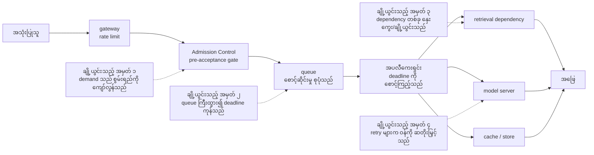
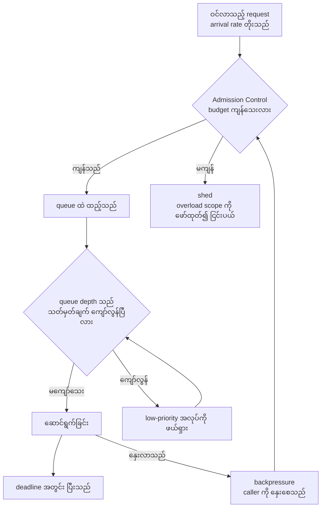
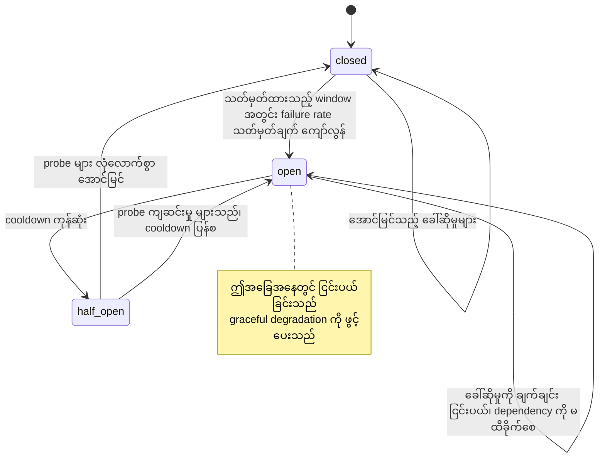
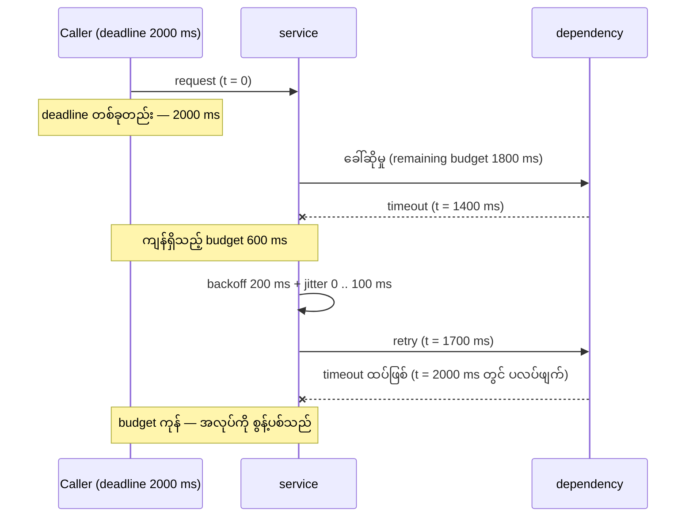
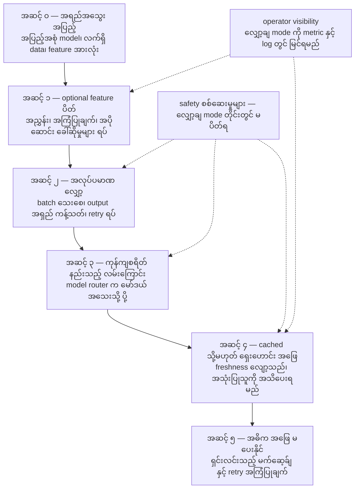
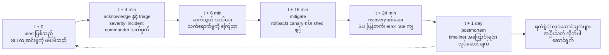
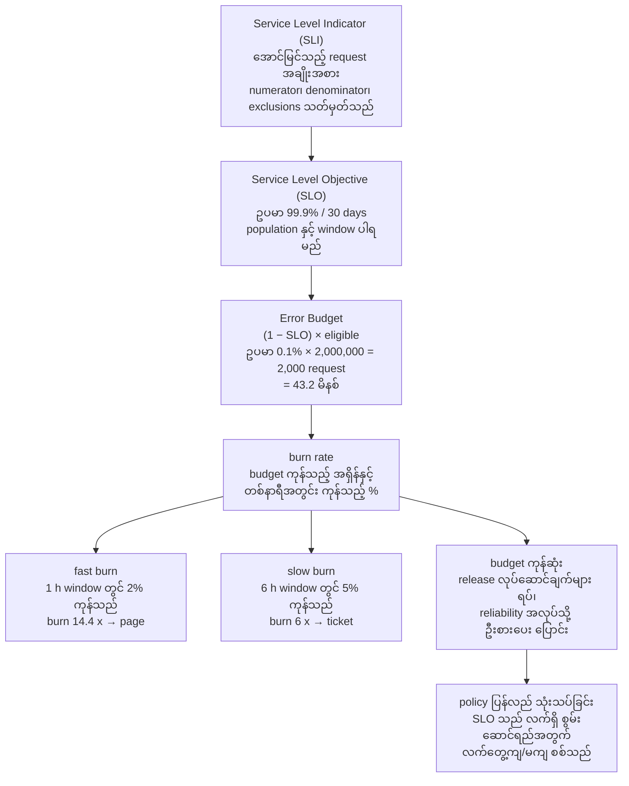

# Area 10 — ပုံရှင်းလင်းချက်များ (Visual Explanations)

Reliability term များကို စာဖြင့်သာ ဖတ်ပါက "မည်သည့် နေရာတွင် စတင် ပျက်သည်၊ မည်သည့် အစိတ်အပိုင်းက
မည်သည့် အစိတ်အပိုင်းကို ကာကွယ်သည်" ဟူသည့် ဆက်စပ်မှု မမြင်ရပါ။ ဤဖိုင်သည် ထို ဆက်စပ်မှုကို ပုံ ၇ ခုဖြင့်
ပြသည် — request လမ်းကြောင်း၏ ချို့ယွင်းသည့် အမှတ်များ၊ queue ပေါ်ရှိ backpressure နှင့် load shedding၊
circuit breaker အခြေအနေစက်၊ timeout နှင့် jitter ပါသည့် retry၊ degradation လှေကား၊ incident timeline နှင့်
SLO error budget အထိ ဖြစ်သည်။

**ပုံများ ကြည့်နည်း** — ဤဖိုင်ကို GitHub တွင် ဖတ်ပါက Mermaid ပုံများ အလိုအလျောက် render ဖြစ်သည်။
ဒေသအတွင်း ဖတ်လိုပါက VS Code ၏ Mermaid extension သို့မဟုတ် mermaid.live တွင် ```mermaid``` block ကို
ကူးထည့်ပါ။

## ၁။ Request လမ်းကြောင်းနှင့် ၎င်း၏ ချို့ယွင်းသည့် အမှတ်များ



**ဘာကို ကြည့်ရမည်** — ချို့ယွင်းမှု တိုင်းသည် **လမ်းကြောင်းတစ်လျှောက် တစ်နေရာတွင်** ရှိသည်၊
"စနစ် ပျက်သည်" ဟူသည့် အခြေအနေ တစ်ခု မဟုတ်ပါ။ `F1` သည် ingress တွင် စတင်ပြီး `F2` သည်
queue တွင်၊ `F3` သည် dependency တွင်၊ `F4` သည် ပထမ သုံးခု၏ အကျိုးဆက်အဖြစ် ပေါ်လာသည်။
တုံ့ပြန်မှု တိုင်းကို **အစောဆုံး အချက်အလက် ရရှိသည့် နယ်နိမိတ်** တွင် လုပ်ရမည် — `F3` ကို
`ANS` အဆင့်တွင်မှ ကိုင်တွယ်ပါက capacity ကုန်ပြီးသား ဖြစ်နေလိမ့်မည်။
**သက်ဆိုင်သည့် term** — Admission Control, Load Shedding, Deadline Propagation, Saturation, Tail Latency

## ၂။ Queue ပေါ်ရှိ backpressure နှင့် load shedding



**ဘာကို ကြည့်ရမည်** — backpressure သည် **အလုပ်ကို ငြင်းပယ်ခြင်း မဟုတ်ဘဲ လက်ခံနှုန်းကို
နှေးစေခြင်း** ဖြစ်သည် — downstream က "နောက်မပို့ပါနှင့်" ဟု signal ပြန်ပေးသည့် လမ်း ဖြစ်သည်။
load shedding သည် ထို လုပ်ငန်းစဉ်၏ နောက်ဆုံး အဆင့် ဖြစ်သည် — ငြင်းပယ်ခြင်း၊ ချပစ်ခြင်း သို့မဟုတ်
ပလပ်ဖျက်ခြင်း ဖြစ်သည်။ ပထမ ဆုံးသော အဆင့် (`GATE`) သည် လက်ခံမှု **မပြုမီ** အလုပ်လုပ်သဖြင့်
queue ကြီးထွားမှုကို ဖြစ်မလာမီ ရပ်တန့်စေသည်။ ငြင်းပယ်သည့်အခါ အခြေအနေသည် ယာယီ ဖြစ်ပြီး
caller ၏ retry budget က ခွင့်ပြုသည့်အခါမှသာ retryable အဖြစ် သတ်မှတ်ရမည်။
**သက်ဆိုင်သည့် term** — Admission Control, Load Shedding, Retry Budget, Saturation, Graceful Degradation

## ၃။ Circuit breaker အခြေအနေစက် (closed၊ open၊ half-open)



**ဘာကို ကြည့်ရမည်** — circuit breaker သည် **ချို့ယွင်းနေသည့် dependency ကို ခေါ်ဆိုမှုများဖြင့်
ထပ်မံ တိုက်ခိုက်ခြင်း** ကို ရပ်တန့်သည့် နည်းလမ်း ဖြစ်သည်။ `closed` သည် ပုံမှန် လည်ပတ်မှု၊ `open`
သည် ခေါ်ဆိုမှုကို ချက်ချင်း ငြင်းပယ်၍ dependency ကို အသက်ရှူခွင့် ပေးသည့် အခြေအနေ၊ `half_open` သည်
probe အနည်းငယ်ဖြင့် ပြန်လည် ကောင်းမွန်မှုကို စမ်းသပ်သည့် အခြေအနေ ဖြစ်သည်။ half-open တွင်
probe အရေအတွက် ကန့်သတ်ချက် **မရှိပါက** breaker သည် ဝန်ကို ပြန်လည် တိုးပေးသဖြင့် အန္တရာယ်ရှိသည်။
**သက်ဆိုင်သည့် term** — Graceful Degradation, Readiness Probe, Retry Budget, Availability, Tail Latency

## ၄။ Timeout နှင့် jitter ပါသည့် retry



**ဘာကို ကြည့်ရမည်** — retry တစ်ကြိမ် လုပ်ရန် **အချိန် သုံးခု** လိုသည် — backoff၊ jitter နှင့်
ခေါ်ဆိုမှု ကိုယ်တိုင်၏ ကြာချိန်။ သုံးခုလုံးသည် မူလ deadline ၏ ကျန်ရှိသည့် budget ထဲတွင် ပါရမည်။
jitter မထည့်ပါက client များအားလုံး တစ်ချိန်တည်း ပြန်လည် ကြိုးစားသဖြင့် dependency အပေါ်
လှိုင်း (thundering herd) ဖြစ်စေသည်။ `Deadline Propagation` မရှိပါက dependency တိုင်းသည်
မိမိ၏ timeout ကို သီးခြား ရေတွက်သဖြင့် အသုံးပြုသူ deadline ကို ကျော်လွန်သည့် အလုပ်များ
capacity ကို စားသုံးနေစေသည်။
**သက်ဆိုင်သည့် term** — Deadline Propagation, Retry Budget, Tail Latency, Service Level Objective (SLO)

## ၅။ Degradation လှေကား — အရည်အသွေး အပြည့်မှ cached အဖြေအထိ



**ဘာကို ကြည့်ရမည်** — လှေကား အဆင့် တိုင်းသည် **ကြိုတင် သတ်မှတ်ထားရမည့် ဆုံးဖြတ်ချက်** ဖြစ်သည် —
အကျပ်အတည်း ဖြစ်နေစဉ်တွင် ဆုံးဖြတ်နိုင်မည် မဟုတ်ပါ။ အောက်သို့ ဆင်းသည့် အဆင့် တိုင်းတွင်
အသုံးပြုသူ ရလဒ်သည် သိသိသာသာ ပြောင်းလဲသဖြင့် မြင်တွေ့နိုင်မှု (visibility) နှင့် အသိပေးခြင်း
လိုအပ်သည်။ လျှော့ချ mode သည် "ဘာမျှ မဖြစ်သကဲ့သို့" ပိုဆိုးသည့် အဖြေကို တိတ်ဆိတ်စွာ
ပြန်ပေးခြင်း မဟုတ်ပါ။ ဝန်ဆောင်မှု အပြည့်အဝကို **တမင်တကာ** ပြန်လည် ရယူရမည်။
**သက်ဆိုင်သည့် term** — Graceful Degradation, Load Shedding, Readiness Probe, Availability, Incident Response

## ၆။ Incident timeline — alert မှ postmortem အထိ



**ဘာကို ကြည့်ရမည်** — timeline ကို **အပိုင်း လေးပိုင်း** ခွဲကြည့်ရမည် — ဖော်ထုတ်ချိန် (t + 0 မှ t + 4)၊
ထိန်းချုပ်ချိန် (t + 4 မှ t + 16)၊ ပြန်လည် ကောင်းမွန်ချိန် (t + 16 မှ t + 24) နှင့် သင်ယူချိန် (t + 24 မှ
postmortem)။ error budget ကို စားသုံးသည့် ပမာဏသည် **အပိုင်းတိုင်း၏ ကြာချိန်** အပေါ် တိုက်ရိုက်
မူတည်သည်၊ ထို့ကြောင့် detect ချိန် တိုစေခြင်းသည် recovery လျင်မြန်စေခြင်းနှင့် တူညီသည့် တန်ဖိုး
ရှိသည်။ postmortem သည် timeline ကို trace နှင့် log များမှ တည်ဆောက်ပြီး **လုပ်ဆောင်ချက် တစ်ခုချင်းက
သက်ဆိုင်ရာ control ကို ပြောင်းလဲခဲ့သလား** ပြန်လည် သုံးသပ်ရမည်။
**သက်ဆိုင်သည့် term** — Incident Response, Postmortem, Error Budget, Service Level Indicator (SLI), Rollback

## ၇။ SLO နှင့် ၎င်း၏ error budget



**ဘာကို ကြည့်ရမည်** — error budget သည် SLO မှ **ဆင်းသက်** လာသည့် ပမာဏ ဖြစ်သည်၊ သီးခြား
သတ်မှတ်သည့် ကိန်းဂဏန်း မဟုတ်ပါ။ burn rate သည် ထို budget ကို မည်သည့် အရှိန်ဖြင့်
စားသုံးနေသည်ကို ပြသဖြင့် **တူညီသည့် ပမာဏ** ကို အချိန်နှစ်မျိုးဖြင့် တိုင်းတာနိုင်သည် — အမြန်
ဖြစ်ပွားသည့် incident နှင့် နှေးကွေးစွာ တိုးလာသည့် ယုတ်လျော့မှု နှစ်မျိုးလုံးကို မြင်နိုင်ရမည်။
window တို (1 h) ပါက ဖော်ထုတ်မှု မြန်သည်၊ သို့သော် ဆူညံသံ (noise) များသည်၊ window ရှည် (6 h)
ပါက တည်ငြိမ်သည်၊ သို့သော် အန္တရာယ်ကို နောက်ကျမှ သိသည် — ထို့ကြောင့် window နှစ်ခုကို
တွဲသုံးရသည်။
**သက်ဆိုင်သည့် term** — Service Level Indicator (SLI), Service Level Objective (SLO), Error Budget, Availability, Incident Response

## ပုံတိုင်းနှင့် term ချိတ်ဆက်မှု

| ပုံ | ပြသည့် အကြောင်းအရာ | သက်ဆိုင်သည့် term |
|---|---|---|
| ၁ | Request လမ်းကြောင်းနှင့် ချို့ယွင်းသည့် အမှတ် ၄ ခု | Admission Control, Load Shedding, Deadline Propagation, Saturation, Tail Latency |
| ၂ | Queue ပေါ်ရှိ backpressure နှင့် load shedding | Admission Control, Load Shedding, Retry Budget, Saturation, Graceful Degradation |
| ၃ | Circuit breaker — closed၊ open၊ half-open | Graceful Degradation, Readiness Probe, Retry Budget, Availability, Tail Latency |
| ၄ | Timeout နှင့် jitter ပါသည့် retry | Deadline Propagation, Retry Budget, Tail Latency, Service Level Objective (SLO) |
| ၅ | Degradation လှေကား — အရည်အသွေး အပြည့်မှ cached အဖြေအထိ | Graceful Degradation, Load Shedding, Readiness Probe, Availability, Incident Response |
| ၆ | Incident timeline — alert မှ postmortem အထိ | Incident Response, Postmortem, Error Budget, Service Level Indicator (SLI), Rollback |
| ၇ | SLO နှင့် error budget၊ burn rate policy | Service Level Indicator (SLI), Service Level Objective (SLO), Error Budget, Availability, Incident Response |

## နောက်တစ်ဆင့်

- ကိန်းဂဏန်း အဖြစ် မြင်လိုပါက — [`04_exercises.md`](04_exercises.md) (error budget၊ queueing latency၊ timeout budget၊ alert နှုန်း)
- အဆင့်လိုက် ဖတ်ရန် — [`01_learning_sequence.md`](01_learning_sequence.md)
- Term တိုင်း၏ အပြည့်အစုံ အဓိပ္ပာယ် — [`../../terms/10_reliability_and_operations.md`](../../terms/10_reliability_and_operations.md)
