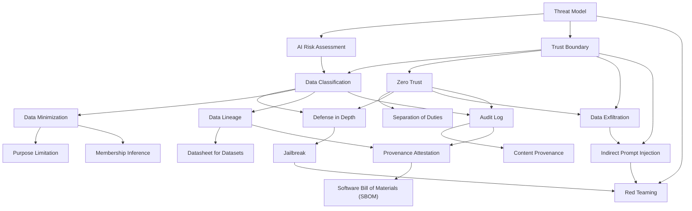

# Area 11 — Security & Governance: လေ့လာသည့် အစဉ် (Learning Sequence)

ဤနယ်ပယ်၏ term ၂၀ ခုသည် ရောနှောနေသည့် ခေါင်းစဉ်များ မဟုတ်ပါ။ ၎င်းတို့သည် **အဆင့် ၅ ဆင့်** —
ဘာကို ကာကွယ်သည်၊ မည်သူကို ဆန့်ကျင်သည် → မည်သူက ဘာလုပ်နိုင်သည် → data ကိုယ်တိုင် ကာကွယ်ခြင်း
→ ဖြစ်ပွားခဲ့သည့် အရာ သက်သေပြခြင်း → စမ်းသပ်ခြင်းနှင့် အုပ်ချုပ်မှု — အဖြစ် တည်ဆောက်ထားသည်။
ဤဖိုင်သည် term များကို မည်သည့် အစဉ်အတိုင်း ဖတ်ရမည်၊ မည်သည့် term က မည်သည့် term အပေါ် အခြေခံသည်
ကို သတ်မှတ်ပေးသည်။

**ဖတ်သည့် အစဉ်ကို လိုက်ခြင်း၏ အကျိုးသက်ရောက်မှု** — နောက် term တိုင်းသည် အရင် term များကို
အသုံးပြု၍ ရှင်းလင်းသည်။ ဥပမာ `Audit Log` သည် `Data Classification` နှင့် `Zero Trust` ကို မသိဘဲ
မည်သည့် ဖြစ်ရပ် မှတ်တမ်းတင်ရမည်ကို ဆုံးဖြတ်နိုင်မည် မဟုတ်သလို၊ `Red Teaming` သည် `Threat Model`
နှင့် `Jailbreak` ကို မသိဘဲ တိုက်ခိုက်မှု များကို မည်သည့် နေရာမှ ထုတ်ယူမည်ကို ဆုံးဖြတ်နိုင်မည် မဟုတ်ပါ။

## အဆင့် ၅ ဆင့်၏ ခြုံငုံမှု

| အဆင့် | အမည် | Term | ဤအဆင့် ပြီးပါက ဖြေနိုင်ရမည့် မေးခွန်း |
|---|---|---|---|
| ၁ | ကာကွယ်ရမည့် အရာနှင့် ရန်သူ | Threat Model, AI Risk Assessment, Trust Boundary, Data Classification | မည်သည့်အရာကို ကာကွယ်သည်၊ မည်သူကို ဆန့်ကျင်သည်၊ မည်သည့် နေရာတွင် data နှင့် အာဏာ ဖြတ်ကူးသည် |
| ၂ | မည်သူက ဘာလုပ်နိုင်သည် | Zero Trust, Separation of Duties, Defense in Depth, Data Exfiltration | access တောင်းခံမှု တိုင်းကို မည်သို့ အကဲဖြတ်သည်၊ control များကို မည်သို့ အလွှာလိုက် စီစဉ်သည် |
| ၃ | data ကိုယ်တိုင် ကာကွယ်ခြင်း | Data Minimization, Purpose Limitation, Data Lineage, Datasheet for Datasets | မည်မျှ data လိုသည်၊ မည်သည့် ရည်ရွယ်ချက်အတွက် လိုသည်၊ မည်သည့် artifact အထိ ဆင်းသက်သည် |
| ၄ | ဖြစ်ပွားခဲ့သည့် အရာ သက်သေပြခြင်း | Audit Log, Content Provenance, Provenance Attestation, Software Bill of Materials (SBOM) | မည်သူ ဘာလုပ်ခဲ့သည်၊ artifact သည် မည်သို့ ဖြစ်ပေါ်လာသည်၊ supply chain ကို မည်သို့ စစ်သည် |
| ၅ | စမ်းသပ်ခြင်းနှင့် အုပ်ချုပ်မှု | Indirect Prompt Injection, Jailbreak, Membership Inference, Red Teaming | control များသည် တိုက်ခိုက်မှုအောက်တွင် မည်သို့ ပြုမူသည်၊ policy နှင့် အပြုအမူ ကွာဟမှုကို မည်သို့ တိုင်းသည် |

## အဆင့်များအကြား မှီခိုမှု (Prerequisite Graph)

## အဆင့် ၁ — ကာကွယ်ရမည့် အရာနှင့် ရန်သူ (၄ term)

**အစဉ်** — `Threat Model` → `AI Risk Assessment` → `Trust Boundary` → `Data Classification`

**ဘာကြောင့် ဤနေရာတွင် ရှိသည်** — control တစ်ခုကို "ကောင်းသည်၊ မကောင်းသည်" ဟု မဆုံးဖြတ်နိုင်ပါ။
မည်သည့်အရာကို ကာကွယ်သည်၊ မည်သူကို ဆန့်ကျင်သည်၊ မည်သည့် ယူဆချက်များအောက်တွင် ဆိုသည်ကို
အရင် ဖော်ပြရမည်။ `Threat Model` သည် ထို အခြေခံကို ပေးသည်။ `AI Risk Assessment` သည် ထို
အန္တရာယ် များကို deploy လုပ်သည့် context၊ ထိခိုက်ခံရသည့် လူအုပ်စုများနှင့် residual risk အထိ
ချိန်ဆသည်။ `Trust Boundary` သည် data၊ ညွှန်ကြားချက်နှင့် အာဏာ ဖြတ်ကူးသည့် နေရာကို ဆွဲပေးသည် —
control တိုင်း သည် ထို နေရာများတွင် ရှိရမည်။ `Data Classification` သည် မည်သည့် data ကို
မည်သည့် အဆင့်တန်းအဖြစ် သတ်မှတ်သည် ကို ဆုံးဖြတ်သည်၊ ထို့ကြောင့် နောက် အဆင့် ၃ နှင့် ၄ ၏
အခြေခံ ဖြစ်သည်။

**စစ်ဆေးသည့် မေးခွန်း** — threat model သည် မည်သည့် asset၊ မည်သည့် ရန်သူနှင့် မည်သည့်
ယူဆချက်ကို ဖော်ပြသနည်း။ data classification သည် မည်သည့် စည်းမျဉ်းများကို data class အလိုက်
ပြောင်းလဲစေသနည်း။

## အဆင့် ၂ — မည်သူက ဘာလုပ်နိုင်သည် (၄ term)

**အစဉ်** — `Zero Trust` → `Separation of Duties` → `Defense in Depth` → `Data Exfiltration`

**ဘာကြောင့် ဤနေရာတွင် ရှိသည်** — boundary များ ဆွဲပြီးနောက် မည်သူက မည်သည့် လုပ်ဆောင်ချက်ကို
လုပ်နိုင်သည် ကို ဆုံးဖြတ်ရမည်။ `Zero Trust` သည် network တည်နေရာမှ သွယ်ဝိုက် ယုံကြည်မှု မပေးဘဲ
access တောင်းခံမှု တိုင်းကို identity၊ resource၊ policy နှင့် context အလိုက် အကဲဖြတ်သည်။
`Separation of Duties` သည် ပဋိပက္ခ ဖြစ်သည့် အာဏာ များကို မတူညီသည့် role များအကြား ခွဲသည် —
principal တစ်ခုတည်းသည် လုပ်ဆောင်ချက် တစ်ခုကို အဆိုပြုခြင်း၊ အတည်ပြုခြင်းနှင့် ဆောင်ရွက်ခြင်း
အားလုံး မလုပ်နိုင်ရမည်။ `Defense in Depth` သည် control တစ်ခု ပျက်ကွက်လျှင် ရလဒ်ကို ၎င်းတစ်ခုတည်းက
မဆုံးဖြတ်နိုင်စေရန် preventive၊ detective နှင့် corrective control များကို အလွှာအမျိုးမျိုးတွင် စီသည်။
`Data Exfiltration` သည် ထို control များ ပျက်ကွက်သည့် အခါ ဖြစ်ပေါ်သည့် ရလဒ် ဖြစ်သည် — ကာကွယ်ထားသည့်
data ကို ခွင့်ပြုချက် မရှိသည့် လူ၊ tool သို့မဟုတ် သိုလှောင်ရာ နေရာသို့ လွှဲပြောင်းခြင်း ဖြစ်သည်။
ထို့ကြောင့် ဤ term သည် အဆင့်၏ အဆုံးတွင် ရှိသည်။

**မှတ်သားရန်** — `Zero Trust` သည် "မည်သည့်အရာကိုမျှ မယုံကြည်ခြင်း" မဟုတ်ပါ၊ access ဆုံးဖြတ်ချက်
တိုင်းကို ရှင်းလင်းစွာ ဖော်ပြခြင်း ဖြစ်သည်။ `Separation of Duties` သည် တူညီသည့် credential ကို
မျှဝေ အသုံးပြုခြင်း မဟုတ်ဘဲ ပဋိပက္ခ ဖြစ်သည့် အာဏာအပေါ် အခြေခံသည်။

**စစ်ဆေးသည့် မေးခွန်း** — zero trust သည် network နယ်နိမိတ်ကို အစားထိုးသည်ဟု ဆိုနိုင်သလား။
authorized retrieval သည် data exfiltration မဟုတ်သည့် အကြောင်းရင်းနှင့် နောက်ပိုင်းတွင်
exfiltration ဖြစ်လာနိုင်သည့် အခြေအနေကို ရှင်းလင်းပါ။

## အဆင့် ၃ — data ကိုယ်တိုင် ကာကွယ်ခြင်း (၄ term)

**အစဉ်** — `Data Minimization` → `Purpose Limitation` → `Data Lineage` → `Datasheet for Datasets`

**ဘာကြောင့် ဤနေရာတွင် ရှိသည်** — access နှင့် control များ ရှိသည့်တိုင်း မလိုအပ်သည့် data
ကို စုဆောင်းစုပုံထားပါက ဖော်ထုတ်ခံရမှု၏ သက်ရောက်မှု ကြီးလာသည်။ `Data Minimization` သည်
သတ်မှတ်ထားသည့် ရည်ရွယ်ချက် တစ်ခုအတွက် လိုအပ်သည့် ပမာဏအတိုင်းသာ စုဆောင်းခြင်း၊ ဖော်ထုတ်ခြင်းနှင့်
ထိန်းသိမ်းခြင်းကို ကန့်သတ်သည် — မည်မျှ လိုသည် ကို ဖြေသည်။ `Purpose Limitation` သည် မည်သည့်
ရည်ရွယ်ချက်အတွက် လိုသည် ကို ဖြေသည်။ `Data Lineage` သည် source တစ်ခုကို ပြင်ဆင်ခြင်း၊ ရုပ်သိမ်းခြင်း
သို့မဟုတ် အန္တရာယ်ရှိသည်ဟု တွေ့ရှိခြင်း ဖြစ်သည့်အခါ မည်သည့် dataset၊ embedding၊ evaluation နှင့်
model artifact များ သက်ရောက်နိုင်သည်ကို ဖော်ထုတ်ပေးသည်။ `Datasheet for Datasets` သည်
ထို artifact ၏ ရည်ရွယ်ချက်၊ စုဆောင်းသည့် လုပ်ငန်းစဉ်၊ အသုံးပြုမှုနှင့် သိရှိထားသည့် ကန့်သတ်ချက်များကို
ဖွဲ့စည်းထားသည့် အတိုင်း မှတ်တမ်းတင်သည် — ထို့ကြောင့် အဆုံးတွင် ရှိသည်။

**မှတ်သားရန်** — minimization သည် data လုံးဝ မသိမ်းဆည်းခြင်း မဟုတ်ပါ။ lineage သည် မည်သည့် artifact
များ သက်ရောက်သည် ကို ရှာပေးသည်၊ datasheet သည် ထို artifact ကို မည်သူ ဖန်တီးခဲ့သည် နှင့်
မည်သည့် ယူဆချက် ချို့ယွင်းသည် ကို ဖော်ပြသည်။

**စစ်ဆေးသည့် မေးခွန်း** — data minimization နှင့် purpose limitation သည် မည်သည့် မေးခွန်းကို
အသီးသီး ဖြေသနည်း။ source တစ်ခုကို ရုပ်သိမ်းသည့်အခါ မည်သည့် term က မည်သည့် term ကို
အသုံးပြု၍ သက်ရောက်မှုကို ရှာသည်။

## အဆင့် ၄ — ဖြစ်ပွားခဲ့သည့် အရာ သက်သေပြခြင်း (၄ term)

**အစဉ်** — `Audit Log` → `Content Provenance` → `Provenance Attestation` → `Software Bill of Materials (SBOM)`

**ဘာကြောင့် ဤနေရာတွင် ရှိသည်** — control များ ရှိသည့်တိုင်း "တကယ် ဘာဖြစ်ခဲ့သည်" ကို ပြန်လည်
စစ်ဆေးနိုင်ရမည်။ `Audit Log` သည် မည်သူ သို့မဟုတ် မည်သည့် အရာက ဆောင်ရွက်ခဲ့သည်၊ မည်သည့်အရာ
ပြောင်းလဲခဲ့သည်၊ မည်သည့်အချိန်တွင် ဖြစ်ပွားခဲ့သည်ကို ကြာရှည်ခံ၍ access control ဖြင့် ကာကွယ်ထားသည့်
မှတ်တမ်း အဖြစ် ထိန်းသိမ်းသည်။ `Content Provenance` သည် media သို့မဟုတ် digital content တစ်ခု၏
မူလရင်းမြစ်နှင့် တည်းဖြတ်မှု သမိုင်းကြောင်းအပေါ် စစ်ဆေး အတည်ပြုနိုင်သည့် အချက်အလက် ဖြစ်သည်။
`Provenance Attestation` သည် artifact တစ်ခုကို ၎င်းကို မည်သို့၊ မည်သည့်နေရာတွင်၊ မည်သည့်အချိန်တွင်၊
မည်သည့် input များမှ ထုတ်လုပ်ခဲ့သည်ဆိုသည့် ကြေညာချက်များနှင့် ချိတ်ဆက်ပေးသည့်၊ စစ်မှန်ကြောင်း
အတည်ပြုထားသည့် machine-readable metadata ဖြစ်သည်။ `Software Bill of Materials (SBOM)` သည်
software component များနှင့် ၎င်းတို့၏ ဆက်စပ်မှုများကို ဖွဲ့စည်းထားသည့် စာရင်း ဖြစ်သည် —
`Provenance Attestation` ဖြင့် ထို စာရင်းကို ယုံကြည်နိုင်သည့် build အတွင်းမှ ထုတ်လုပ်မှသာ
vulnerability တစ်ခု ပေါ်ပေါက်သည့်အခါ သက်ရောက်သည့် dependency များကို ရှာနိုင်သည်။

**မှတ်သားရန်** — trace သည် execution path တစ်ခုကို ရောဂါရှာဖွေရန် ကူညီသည်၊ audit log သည်
execution များစွာနှင့် အချိန်ကြာလာသည့်အခါ တာဝန်ခံမှုအတွက် လိုအပ်သည့် ဖြစ်ရပ်များကို ထိန်းသိမ်းသည်။
လက်မှတ် (signature) သည် attester ကို ဖော်ထုတ်ပြီး integrity ကို ကာကွယ်သည်၊ သို့သော်
attestation အတွင်းရှိ ကြေညာချက် တိုင်း မှန်ကန်သည် ဆိုသည်ကို သက်သေမပြနိုင်ပါ။

**စစ်ဆေးသည့် မေးခွန်း** — audit log သည် မည်သည့် အချက်များကို မှတ်တမ်းတင်ရမည်နည်း၊ တစ်ချိန်တည်းတွင်
မည်သည့်အရာကို redact လုပ်ရမည်နည်း။ provenance နှင့် provenance attestation သည် မည်သည့်
မေးခွန်းကို အသီးသီး ဖြေသနည်း။

## အဆင့် ၅ — စမ်းသပ်ခြင်းနှင့် အုပ်ချုပ်မှု (၄ term)

**အစဉ်** — `Indirect Prompt Injection` → `Jailbreak` → `Membership Inference` → `Red Teaming`

**ဘာကြောင့် ဤနေရာတွင် ရှိသည်** — control များ သတ်မှတ်ပြီးနောက် ၎င်းတို့သည် တိုက်ခိုက်မှုအောက်တွင်
တကယ် ခုခံနိုင်သည် မခုခံနိုင်သည် ကို တိုင်းရမည်။ `Indirect Prompt Injection` သည် သုံးစွဲသူ၏
ညွှန်ကြားချက်မှတစ်ဆင့် တိုက်ရိုက် မဟုတ်ဘဲ စနစ်က ရယူသည် သို့မဟုတ် လေ့လာသည် ဖြစ်သည့် အကြောင်းအရာ
မှတစ်ဆင့် ပို့ဆောင်သည့် တိုက်ခိုက်မှု ဖြစ်သည် — trust boundary တစ်ခု ဖြတ်ကူးသည့် လမ်းကြောင်း ဖြစ်သည်။
`Jailbreak` သည် မော်ဒယ်၏ training သို့မဟုတ် application control များ ကာကွယ်ရန် ရည်ရွယ်ထားသည့်
အပြုအမူကို ထုတ်လုပ်စေရန် ရည်ရွယ်သည့် ရန်လိုသည့် input ဖြစ်သည်။ `Membership Inference` သည်
record တစ်ခု သည် training data ထဲတွင် ပါဝင်ခဲ့သည် မပါဝင်ခဲ့သည် ကို output များမှ ခန့်မှန်းသည့်
တိုက်ခိုက်မှု ဖြစ်သည် — `Data Minimization` သည် ထို ဖော်ထုတ်ခံရမှုကို တိုက်ရိုက် လျှော့ပေးသည်။
`Red Teaming` သည် ထို တိုက်ခိုက်မှု အားလုံးကို ဖွဲ့စည်းထားသည့် လုပ်ငန်းစဉ် အဖြစ် စမ်းသပ်ပြီး
အတည်ပြုပြီးသည့် ပျက်ကွက်မှုများကို regression eval များ အဖြစ် ပြောင်းလဲသည် — ထို့ကြောင့်
အဆုံးတွင် ရှိသည်။

**မှတ်သားရန်** — indirect သည် ပို့ဆောင်သည့် လမ်းကြောင်းကို ဖော်ပြသည်၊ ပိုအားနည်းသည့် တိုက်ခိုက်မှုကို
မဆိုလိုပါ။ jailbreak prompt စာရင်းတစ်ခုသည် ပြည့်စုံသည့် red-team အစီအစဉ် မဟုတ်ပါ။

**စစ်ဆေးသည့် မေးခွန်း** — jailbreak နှင့် prompt injection သည် မည်သည့် ရည်မှန်းချက် အသီးသီး ရှိသနည်း။
membership inference ၏ ရလဒ်ကို မည်သည့် တိုင်းတာချက်ဖြင့် အကဲဖြတ်မည်၊ မည်သည့် term က
ထို တိုင်းတာချက်ကို လျှော့ပေးသည်။

## Term ၂၀ ခု၏ အစဉ် ဇယား

| # | Term | အဆင့် | ကြိုတင် သိရမည့် term | ဖွင့်ပေးသည့် အချက် |
|---|---|---|---|---|
| 1 | Threat Model | ၁ | — | asset၊ ရန်သူနှင့် တိုက်ခိုက်သည့် လမ်းကြောင်း ကို ဖော်ပြသည် |
| 2 | AI Risk Assessment | ၁ | Threat Model | likelihood၊ impact၊ residual risk နှင့် review trigger |
| 3 | Trust Boundary | ၁ | Threat Model | data၊ ညွှန်ကြားချက်နှင့် အာဏာ ဖြတ်ကူးသည့် နေရာ |
| 4 | Data Classification | ၁ | Trust Boundary | class အလိုက် access၊ retention နှင့် sharing စည်းမျဉ်း |
| 5 | Zero Trust | ၂ | Trust Boundary | access တောင်းခံမှု တိုင်းကို context အလိုက် အကဲဖြတ်ခြင်း |
| 6 | Separation of Duties | ၂ | Zero Trust | ပဋိပက္ခ ဖြစ်သည့် အာဏာကို role များအကြား ခွဲခြင်း |
| 7 | Defense in Depth | ၂ | Zero Trust, Data Classification | preventive၊ detective နှင့် corrective control အလွှာများ |
| 8 | Data Exfiltration | ၂ | Trust Boundary, Zero Trust | outbound transfer ကို စစ်ဆေးခြင်းနှင့် alert |
| 9 | Data Minimization | ၃ | Data Classification | လိုအပ်သည့် field နှင့် retention ကန့်သတ်ချက် |
| 10 | Purpose Limitation | ၃ | Data Minimization | အသုံးပြုမှု အသစ်ကို ကိုက်ညီမှု စစ်ဆေးခြင်း |
| 11 | Data Lineage | ၃ | Data Classification | သက်ရောက်သည့် dataset၊ embedding နှင့် model artifact ရှာခြင်း |
| 12 | Datasheet for Datasets | ၃ | Data Lineage | dataset ၏ စုဆောင်းမှုနှင့် ကန့်သတ်ချက် အထောက်အထား |
| 13 | Audit Log | ၄ | Data Classification, Zero Trust | authorization၊ approval နှင့် ပြင်ပသို့ ရေးသွင်းမှု မှတ်တမ်း |
| 14 | Content Provenance | ၄ | Audit Log | media ၏ မူလရင်းမြစ်နှင့် တည်းဖြတ်မှု သမိုင်းကြောင်း |
| 15 | Provenance Attestation | ၄ | Data Lineage, Audit Log | supply-chain ကြေညာချက် ကို စစ်ဆေးခြင်း |
| 16 | Software Bill of Materials (SBOM) | ၄ | Provenance Attestation | သက်ရောက်သည့် dependency နှင့် license တာဝန် အကဲဖြတ်ခြင်း |
| 17 | Indirect Prompt Injection | ၅ | Trust Boundary, Data Exfiltration | retrieved content အတွင်း ဝှက်ထားသည့် ညွှန်ကြားချက်ကို တွေ့ရှိခြင်း |
| 18 | Jailbreak | ၅ | Defense in Depth | policy နှင့် အပြုအမူ ကွာဟမှု ကို ဖော်ထုတ်ခြင်း |
| 19 | Membership Inference | ၅ | Data Minimization | training data ပါဝင်မှု ဖော်ထုတ်ခံရမှု ကို အကဲဖြတ်ခြင်း |
| 20 | Red Teaming | ၅ | Threat Model, Jailbreak, Indirect Prompt Injection | အတည်ပြုပြီးသည့် ပျက်ကွက်မှုများမှ regression eval များ |

## လက်တွေ့ လုပ်သည့် အစဉ် (၅ ကြိမ် ထိုင်ရန်)

| ကြိမ် | ဖတ်ရမည့် အဆင့် | လက်တွေ့ လုပ်ရမည့် အရာ |
|---|---|---|
| ၁ | အဆင့် ၁ + ၂ | prerequisite graph ကို စာရွက်ပေါ် ပြန်ဆွဲခြင်း၊ မိမိ စနစ်၏ boundary များကို ရေးဆွဲခြင်း |
| ၂ | အဆင့် ၁ + ၂ | [`02_visual_explanations.md`](02_visual_explanations.md) ပုံ ၁–၃ ကို ဖတ်၍ control တိုင်းကို boundary တိုင်းနှင့် တွဲခြင်း |
| ၃ | အဆင့် ၃ | data class တစ်ခုစီအတွက် field၊ လက်ခံသူနှင့် retention ကာလ ကို စာရင်းချခြင်း |
| ၄ | အဆင့် ၄ + ၅ | [`02_visual_explanations.md`](02_visual_explanations.md) ပုံ ၄–၇ ကို ဖတ်၍ သက်သေ လမ်းကြောင်းနှင့် exfiltration လမ်းကြောင်း ကို ချိတ်ခြင်း |
| ၅ | စစ်ဆေးခြင်း | [`04_exercises.md`](04_exercises.md) ရှိ တွက်ချက်ရသည့် လေ့ကျင့်ခန်း ၆ ခုနှင့် ဆုံးဖြတ်ချက် ၂ ခု |

## နောက်တစ်ဆင့်

- ပုံရှင်းလင်းချက်များ — [`02_visual_explanations.md`](02_visual_explanations.md) (trust boundary၊ least privilege၊ redaction၊ audit trail၊ policy ဆုံးဖြတ်ချက်)
- လက်တွေ့စမ်းသပ်မှုများ — [`labs/`](labs/) (`--self-test` အောင်မြင်သော lab ၃ ခု)
- အောက်ခံစနစ်နှင့် ချိတ်ဆက်မှု — [`03_theory_to_infrastructure.md`](03_theory_to_infrastructure.md)
- လေ့ကျင့်ခန်းများ — [`04_exercises.md`](04_exercises.md)
- Term တိုင်း၏ အပြည့်အစုံ အဓိပ္ပာယ် — [`../../terms/11_security_and_governance.md`](../../terms/11_security_and_governance.md)
