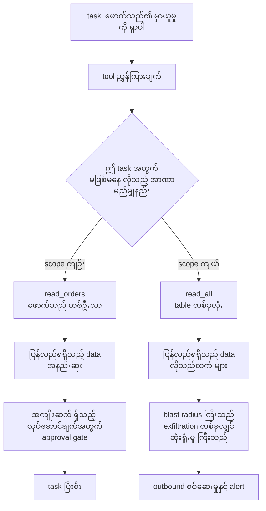
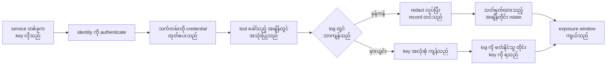
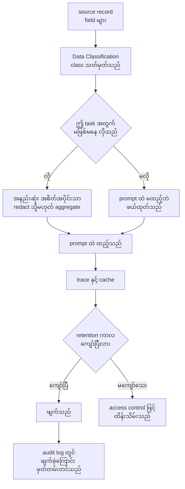
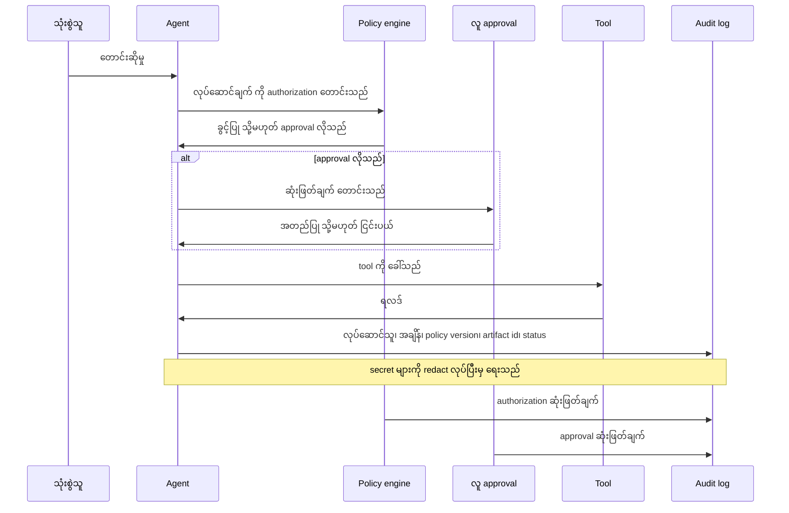
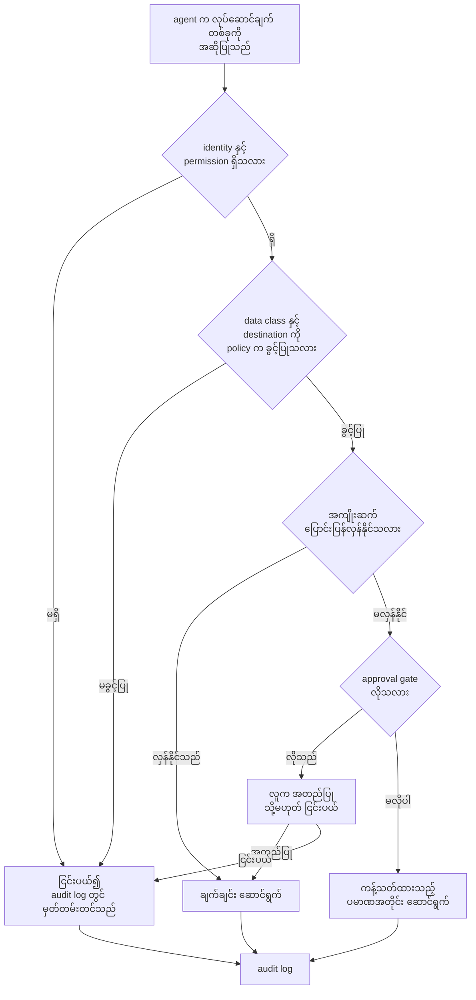
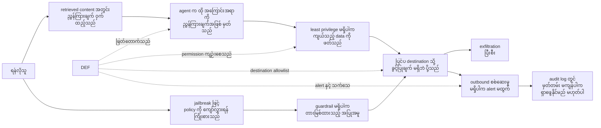

# Area 11 — ပုံရှင်းလင်းချက်များ (Visual Explanations)

Term တစ်ခုကို စာဖြင့်သာ ဖတ်ပါက "ဘယ်ကနေ ဘယ်ကို သွားသည်" ဟူသည့် လမ်းကြောင်း မမြင်ရပါ။
လုံခြုံရေး တွင် ထို လမ်းကြောင်းသည် အဓိက ဖြစ်သည် — data သည် မည်သည့် boundary ကို ဖြတ်သည်၊
အာဏာ သည် မည်သည့် tool သို့ ရောက်သည်၊ သက်သေ သည် မည်သည့် မှတ်တမ်းတွင် ကျန်သည်။ ဤဖိုင်သည်
ထို လမ်းကြောင်း ၇ ခုကို ပုံဖြင့် ပြသည်။

**ပုံများ ကြည့်နည်း** — ဤဖိုင်ကို GitHub တွင် ဖတ်ပါက Mermaid ပုံများ အလိုအလျောက် render ဖြစ်သည်။
ဒေသအတွင်း တွင်ဖတ်လိုပါက VS Code ၏ Mermaid extension သို့မဟုတ် mermaid.live တွင်
```mermaid``` block ကို ကူးထည့်ပါ။

## ၁။ LLM application တစ်ခု၏ trust boundary

```mermaid
flowchart LR
    subgraph U["ယုံကြည်မှု မထားနိုင်သည့် zone ပထမ"]
        USER["သုံးစွဲသူ"]
        EXT["ပြင်ပ အကြောင်းအရာ<br/>webpage၊ document၊ email"]
    end
    subgraph B1["trust boundary 1<br/>input validation နှင့် instruction hierarchy"]
        GATE["Input gate<br/>label နှင့် validate"]
    end
    subgraph M["model zone"]
        CTX["model context<br/>system + retrieved + history"]
        MODEL["မော်ဒယ်"]
    end
    subgraph B2["trust boundary 2<br/>authorization"]
        TOOLGATE["Tool gate<br/>permission နှင့် schema"]
    end
    subgraph T["privileged zone"]
        TOOL["tool များ"]
        STORE["data store များ"]
        OUT["ပြင်ပ service များ"]
    end
    USER --> GATE
    EXT --> GATE
    GATE --> CTX
    CTX --> MODEL
    MODEL --> TOOLGATE
    TOOLGATE --> TOOL
    TOOLGATE --> STORE
    TOOLGATE --> OUT
    STORE --> CTX
```

**ဘာကို ကြည့်ရမည်** — မြှား တိုင်းသည် boundary တစ်ခုကို ဖြတ်သည့် နေရာ ဖြစ်သည်။ ထို နေရာတိုင်းတွင်
စနစ်က လုပ်ဆောင်သူကို စစ်မှန်ကြောင်း အတည်ပြုရမည်၊ data ကို validate လုပ်ရမည်၊ permission ကို
ကန့်သတ်ရမည်၊ မည်သည့် ကြေညာချက်က လုပ်ဆောင်မှုကို သက်ရောက်နိုင်သည်ကို ဆုံးဖြတ်ရမည်။
`EXT` မှ `GATE` သို့ မြှား သည် အရေးအကြီးဆုံး ဖြစ်သည် — ယုံကြည်မှု မထားနိုင်သည့် document စာသားသည်
အာဏာ ရှိသည့် context ထဲသို့ ဝင်လာသည့် နေရာ ဖြစ်သည်။ network boundary သည် ထို boundary အမျိုးအစား
အနက် တစ်မျိုးသာ ဖြစ်သည်။
**သက်ဆိုင်သည့် term** — Trust Boundary, Threat Model, Indirect Prompt Injection, Data Exfiltration

## ၂။ agent tool များ၏ least privilege



**ဘာကို ကြည့်ရမည်** — အာဏာ သည် **task အပေါ်** အခြေခံရမည်၊ လုပ်ဆောင်သူ အပေါ် မဟုတ်ပါ။ `S1` နှင့် `S2`
သည် တူညီသည့် task ကို ဖြေနိုင်သည်၊ သို့သော် ပြန်လည်ရရှိသည့် data ပမာဏ ကွာခြားသည်။ ထို ကွာခြားမှုသည်
`BLAST` တွင် ဆုံးရှုံးမှု အတိုင်းအတာ အဖြစ် ပြောင်းသည် — ဤအချက်ကို [`04_exercises.md`](04_exercises.md) ၏
လေ့ကျင့်ခန်း ၆ တွင် ကိန်းဂဏန်းဖြင့် တွက်ထားသည်။
**သက်ဆိုင်သည့် term** — Zero Trust, Defense in Depth, Data Exfiltration, Trust Boundary

## ၃။ key နှင့် secret ကိုင်တွယ်သည့် လမ်းကြောင်း



**ဘာကို ကြည့်ရမည်** — key တစ်ခု၏ အန္တရာယ်သည် "ဘယ်လောက် ကြာကြာ အသုံးပြုခဲ့သည်" နှင့်
"မည်သည့် အချိန်တွင် ရပ်စဲသည်" ပေါ် မူတည်သည်။ `REDACT` မှ `ROT` သို့ လမ်းကြောင်းတွင် exposure window
သည် rotation interval ဖြင့် ကန့်သတ်ခံရသည်၊ `LEAK` မှ လမ်းကြောင်းတွင် ထို ကန့်သတ်ချက် မရှိဘဲ
key ကို အသုံးပြုနိုင်သူ တိုင်း၏ လက်ထဲတွင် ကျန်သည်။ မည်သည့် credential တန်ဖိုးကိုမျှ ဤဖိုင်တွင်
ရေးမထားပါ — လမ်းကြောင်း နှင့် ကာလ ကိုသာ ပြသည်။
**သက်ဆိုင်သည့် term** — Zero Trust, Audit Log, Provenance Attestation, Data Exfiltration

## ၄။ prompt အတွင်း sensitive data နှင့် redaction လမ်းကြောင်း



**ဘာကို ကြည့်ရမည်** — `NEED` အဆင့်သည် data minimization ၏ အဓိက ဖြစ်သည် — မလိုသည့် field သည်
prompt ထဲသို့ လုံးဝ မဝင်သင့်ပါ။ ဝင်ရမည့် field သည် အစောဆုံး boundary တွင် `RED` ဖြင့်
လျော့ခံရသည်။ `CACHE` သည် အန္တရာယ် ဖြစ်သည့် နေရာ ဖြစ်သည် — prompt ထဲ ထည့်လိုက်သည့် field တိုင်း
trace နှင့် cache တွင် ထပ်ကျန်သည်၊ ထို့ကြောင့် retention ကာလ ကို သတ်မှတ်ပြီး ဖျက်ခြင်းကို
မှတ်တမ်းတင်ရမည်။
**သက်ဆိုင်သည့် term** — Data Minimization, Purpose Limitation, Data Classification, Audit Log

## ၅။ request မှ audit record အထိ — သက်သေ လမ်းကြောင်း



**ဘာကို ကြည့်ရမည်** — audit record သည် tool ၏ ရလဒ် မဟုတ်ဘဲ **ဆုံးဖြတ်ချက် လမ်းကြောင်း** ကို
ထိန်းသိမ်းသည်။ ထို့ကြောင့် `P` နှင့် `H` နှစ်ခုလုံးသည် ၎င်းတို့၏ ဆုံးဖြတ်ချက်ကို log သို့
ပို့ရမည် — ထို မှတ်တမ်းသည် separation of duties ကို လက်တွေ့ စစ်ဆေးနိုင်သည့် အထောက်အထား ဖြစ်သည်။
ပြင်ပသို့ ရေးသွင်းသည့် လုပ်ဆောင်ချက် တိုင်းတွင်လည်း ထို မှတ်တမ်း မဖြစ်မနေ လိုသည်။
**သက်ဆိုင်သည့် term** — Audit Log, Separation of Duties, Zero Trust, Provenance Attestation

## ၆။ policy ဆုံးဖြတ်ချက် လမ်းကြောင်းနှင့် human approval gate



**ဘာကို ကြည့်ရမည်** — ဤ လမ်းကြောင်းတွင် အဆင့် တိုင်းသည် policy ၏ အစိတ်အပိုင်း ဖြစ်သည် —
identity၊ permission၊ data class၊ destination၊ ပြောင်းပြန်လှန်နိုင်မှုနှင့် ပမာဏ ဖြစ်သည်။ မည်သည့် လမ်းကြောင်းမှ
မဆို အောင်မြင်သည်ဖြစ်စေ ငြင်းပယ်ခံရသည်ဖြစ်စေ `LOG` သို့ ရောက်သည်။ `GATE` တွင် လူက
ဆုံးဖြတ်သည့် အခါ ထို ဆုံးဖြတ်ချက်ကို သီးသန့် identity ဖြင့် log တင်ရမည်၊ ထို့ကြောင့်
separation of duties ကို လက်တွေ့ အတည်ပြုနိုင်သည်။ policy တစ်ခုသည် အကျိုးရှိသည့် workflow ကို
ပိတ်ဆို့သည့် အခြေအနေကို [`04_exercises.md`](04_exercises.md) ၏ ပြဿနာ ၃ တွင် ဖော်ပြထားသည်။
**သက်ဆိုင်သည့် term** — Zero Trust, Separation of Duties, Defense in Depth, Audit Log

## ၇။ vulnerability နှင့် exfiltration လမ်းကြောင်းများ



**ဘာကို ကြည့်ရမည်** — တိုက်ခိုက်မှု လမ်းကြောင်း နှစ်ခု (`A` နှင့် `B`) သည် တစ်နေရာတည်းတွင်
ဆုံသည် — `A4` ဖြစ်သည်။ ထို့ကြောင့် control ကို ထို အမှတ် တစ်ခုတည်းတွင် မထားရဘဲ အလွှာလိုက်
(`DEF`) ထားရသည်။ အထောက်အထား မကျန်ပါက (`C2`) ဖြစ်ပွားခဲ့သည့် အရာကို ပြန်လည် စုံစမ်းနိုင်မည်
မဟုတ်ပါ — ထို့ကြောင့် detection နှင့် audit log သည် တိုက်ခိုက်မှုကို တားဆီးသည့် control များထက်
အနည်းဆုံး တူညီစွာ အရေးပါသည်။
**သက်ဆိုင်သည့် term** — Indirect Prompt Injection, Jailbreak, Data Exfiltration, Defense in Depth, Audit Log

## ပုံတိုင်းနှင့် term ချိတ်ဆက်မှု

| ပုံ | ပြသည့် အကြောင်းအရာ | သက်ဆိုင်သည့် term |
|---|---|---|
| ၁ | LLM application ၏ trust boundary | Trust Boundary, Threat Model, Indirect Prompt Injection, Data Exfiltration |
| ၂ | agent tool များ၏ least privilege | Zero Trust, Defense in Depth, Data Exfiltration, Trust Boundary |
| ၃ | key နှင့် secret ကိုင်တွယ်သည့် လမ်းကြောင်း | Zero Trust, Audit Log, Provenance Attestation, Data Exfiltration |
| ၄ | prompt အတွင်း sensitive data နှင့် redaction | Data Minimization, Purpose Limitation, Data Classification, Audit Log |
| ၅ | request မှ audit record အထိ သက်သေ လမ်းကြောင်း | Audit Log, Separation of Duties, Zero Trust, Provenance Attestation |
| ၆ | policy ဆုံးဖြတ်ချက်နှင့် human approval gate | Zero Trust, Separation of Duties, Defense in Depth, Audit Log |
| ၇ | vulnerability နှင့် exfiltration လမ်းကြောင်းများ | Indirect Prompt Injection, Jailbreak, Data Exfiltration, Defense in Depth, Audit Log |

## နောက်တစ်ဆင့်

- ကိန်းဂဏန်း အဖြစ် မြင်လိုပါက — [`labs/`](labs/) ရှိ lab ၃ ခု (`lab_blast_radius.py`၊ `lab_redaction_path.py`၊ `lab_audit_volume.py`)
- deployment အပေါ် သက်ရောက်မှု — [`03_theory_to_infrastructure.md`](03_theory_to_infrastructure.md)
- လေ့ကျင့်ခန်းများ — [`04_exercises.md`](04_exercises.md)
- လေ့လာသည့် အစဉ် — [`01_learning_sequence.md`](01_learning_sequence.md)
